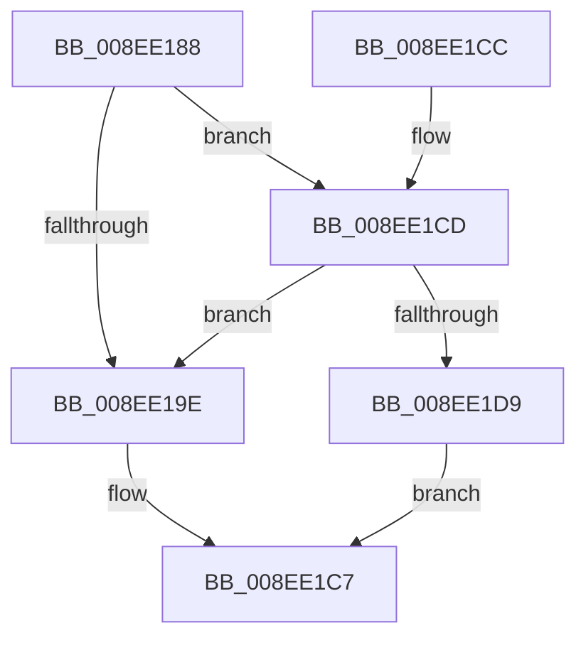

# PnpCtxRegQueryValueIndirect

- RVA: `0x008EE188`–`0x008EE207` (길이 `127` bytes)
- VA: `0x00000001408EE188`
- 실행 섹션: `PAGE`
- PDB 이름 있음: `예`; PDB Function 태그: `아니요`
- unwind 정보 RVA: `0x00086EB4`
- 디코드: `30`개 명령, `127/127` bytes 표시
- 미해석 바이트: `0` (있으면 어셈블리에 `.byte`로 보존)

> 이 문서는 커널 이미지의 기계어와 PDB 기호를 분석해 생성했습니다. 4번과 5번은 함수 원형과 자료형을 바이너리 사용 방식에서 추정한 C 해석이며 원본 소스 복구 결과는 아닙니다.

## 1. Dependencies

- 직접 호출 지점: **2**; 고유 호출 대상: **2**
- 직접 호출자로 확인된 함수: **1**
- RIP 상대 이미지 참조: **1**

### Outgoing calls
- `0x008EE1C2` → [PnpRegQueryValueIndirect](PnpRegQueryValueIndirect_function_008EE210.md) (function, `0x008EE210`)
- `0x008EE200` → [guard_dispatch_icall](../../text/6B/guard_dispatch_icall_function_006BAAD0.md) (function, `0x006BAAD0`)

### Direct callers
- [sub_00B2F7FC](../B2/Unknown_function_00B2F7FC.md) at `0x00B2F8A0`

### Static image references
- `0x008EE1CD` → RVA `0x008EE210` (`PnpRegQueryValueIndirect`; read)

## 2. Other-region calls and transfers

- 다른 실행 섹션으로 향하는 call: **1**
  - `0x008EE200` → [guard_dispatch_icall](../../text/6B/guard_dispatch_icall_function_006BAAD0.md) (`PAGE` → `.text`)
- 별도 외부 분기/꼬리 이동을 확인하지 못했습니다.

## 3. Assembly (complete function range)

```asm
008EE188  48 83 EC 48                     sub rsp, 0x48
008EE18C  48 8B 81 08 02 00 00            mov rax, qword ptr [rcx + 0x208]
008EE193  4D 8B D8                        mov r11, r8
008EE196  4C 8B D1                        mov r10, rcx
008EE199  48 85 C0                        test rax, rax
008EE19C  75 2F                           jne 0x1408ee1cd
008EE19E  48 8B 84 24 80 00 00 00         mov rax, qword ptr [rsp + 0x80]
008EE1A6  49 8B CA                        mov rcx, r10
008EE1A9  48 89 44 24 30                  mov qword ptr [rsp + 0x30], rax
008EE1AE  48 8B 44 24 78                  mov rax, qword ptr [rsp + 0x78]
008EE1B3  48 89 44 24 28                  mov qword ptr [rsp + 0x28], rax
008EE1B8  48 8B 44 24 70                  mov rax, qword ptr [rsp + 0x70]
008EE1BD  48 89 44 24 20                  mov qword ptr [rsp + 0x20], rax
008EE1C2  E8 49 00 00 00                  call 0x1408ee210
008EE1C7  48 83 C4 48                     add rsp, 0x48
008EE1CB  C3                              ret
008EE1CC  CC                              int3
008EE1CD  48 8D 0D 3C 00 00 00            lea rcx, [rip + 0x3c]
008EE1D4  48 3B C1                        cmp rax, rcx
008EE1D7  74 C5                           je 0x1408ee19e
008EE1D9  4C 8B 84 24 80 00 00 00         mov r8, qword ptr [rsp + 0x80]
008EE1E1  48 8B 4C 24 78                  mov rcx, qword ptr [rsp + 0x78]
008EE1E6  4C 89 44 24 30                  mov qword ptr [rsp + 0x30], r8
008EE1EB  4D 8B C3                        mov r8, r11
008EE1EE  48 89 4C 24 28                  mov qword ptr [rsp + 0x28], rcx
008EE1F3  48 8B 4C 24 70                  mov rcx, qword ptr [rsp + 0x70]
008EE1F8  48 89 4C 24 20                  mov qword ptr [rsp + 0x20], rcx
008EE1FD  49 8B CA                        mov rcx, r10
008EE200  E8 CB C8 DC FF                  call 0x1406baad0
008EE205  EB C0                           jmp 0x1408ee1c7
```

## 4. C-style interpretation (structured pseudocode)

```c
__int64 __fastcall PnpCtxRegQueryValueIndirect(__int64 a1, __int64 a2, __int64 a3, __int64 a4, __int64 a5, __int64 a6, __int64 a7)
{
    __int64 result;
    __int64 v_rsp;
    unsigned __int64 v_stack_m18;
    unsigned __int64 v_stack_m20;
    unsigned __int64 v_stack_m28;
    unsigned __int64 v_stack_p20;
    unsigned __int64 v_stack_p28;
    unsigned __int64 v_stack_p30;

    v_rsp = (v_rsp) - (72);
    if (*(unsigned __int64 *)(a1 + 520) != 0) goto loc_008EE1CD;
loc_008EE19E:
    v_stack_m18 = a7;
    v_stack_m20 = a6;
    v_stack_m28 = a5;
    result = PnpRegQueryValueIndirect(a1, a2, a3, a4);
loc_008EE1C7:
    v_rsp = (v_rsp) + (72);
    return result;
loc_008EE1CD:
    if (result == (v_rip + 60)) goto loc_008EE19E;
    v_stack_p30 = a7;
    v_stack_p28 = a6;
    v_stack_p20 = a5;
    result = guard_dispatch_icall(a1, a2, a3, a4);
    goto loc_008EE1C7;
}
```

## 5. (Beta) C Style

```c
int64_t PnpCtxRegQueryValueIndirect(void *Arg1, int64_t Arg2, int64_t Arg3, int64_t Arg4, int64_t Arg5, int64_t Arg6, int64_t Arg7)
{
    uint8_t *arg1 = (uint8_t *)Arg1;

    int64_t result;
    int64_t local_rsp;
    uint64_t v_stack_m18;
    uint64_t v_stack_m20;
    uint64_t v_stack_m28;
    uint64_t v_stack_p20;
    uint64_t v_stack_p28;
    uint64_t v_stack_p30;

    local_rsp = (local_rsp) - (72);
    if (*(uint64_t *)(arg1 + 0x208) != 0) goto loc_008EE1CD;
loc_008EE19E:
    v_stack_m18 = Arg7;
    v_stack_m20 = Arg6;
    v_stack_m28 = Arg5;
    result = PnpRegQueryValueIndirect(Arg1, Arg2, Arg3, Arg4);
loc_008EE1C7:
    local_rsp = (local_rsp) + (72);
    return result;
loc_008EE1CD:
    if (result == (v_rip + 60)) goto loc_008EE19E;
    v_stack_p30 = Arg7;
    v_stack_p28 = Arg6;
    v_stack_p20 = Arg5;
    result = guard_dispatch_icall(Arg1, Arg2, Arg3, Arg4);
    goto loc_008EE1C7;
}
```

### 관측된 메모리 오프셋

구조체 형식이 확인되지 않은 접근은 인자 기준의 오프셋으로만 기록했습니다.

| 기준 인자 | 오프셋 표현 | 폭 (bit) | 접근 |
|---|---:|---:|---|
| `Arg1` | `+ 0x208` | `64` | `R` |

## 6. Execution-region graph

[열기: 2D/3D 그래프와 함수 탐색 컨트롤 패널](../../../control-panel.html?section=page&rva=0x008EE188&view=graph)

- 2D 그래프는 위에서 아래로 흐르고, 3D 그래프는 빈 공간을 드래그해 회전합니다. Shift+드래그는 이동, 휠은 확대·축소, 함수 노드 선택은 대상 보고서 이동입니다.

### Static fallback


