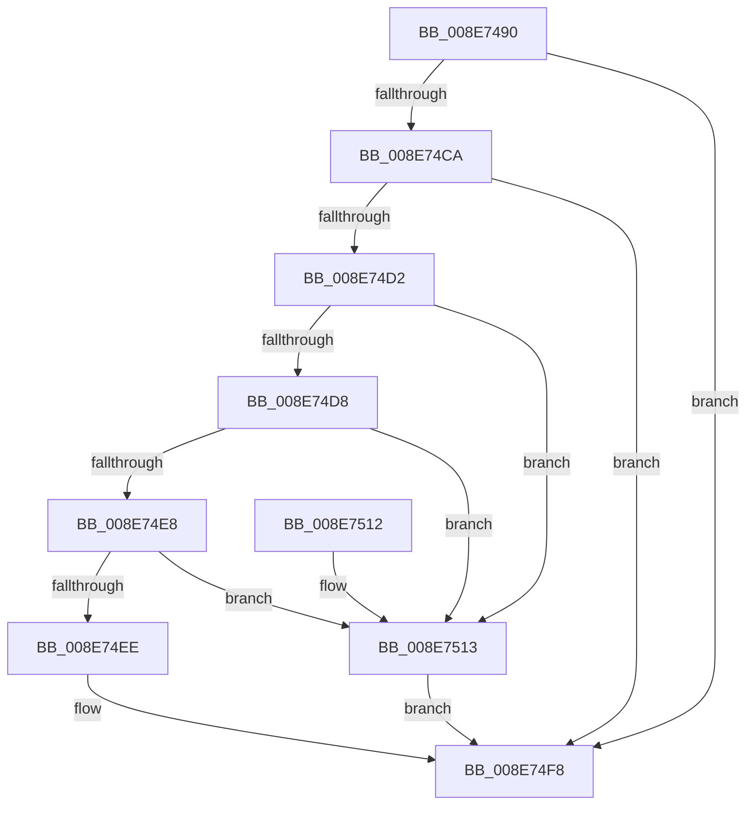

# PnpDeviceObjectFromDeviceInstanceWithTag

- RVA: `0x008E7490`–`0x008E7517` (길이 `135` bytes)
- VA: `0x00000001408E7490`
- 실행 섹션: `PAGE`
- PDB 이름 있음: `예`; PDB Function 태그: `아니요`
- unwind 정보 RVA: `0x0005DBFC`
- 디코드: `38`개 명령, `135/135` bytes 표시
- 미해석 바이트: `0` (있으면 어셈블리에 `.byte`로 보존)

> 이 문서는 커널 이미지의 기계어와 PDB 기호를 분석해 생성했습니다. 4번과 5번은 함수 원형과 자료형을 바이너리 사용 방식에서 추정한 C 해석이며 원본 소스 복구 결과는 아닙니다.

## 1. Dependencies

- 직접 호출 지점: **4**; 고유 호출 대상: **4**
- 직접 호출자로 확인된 함수: **27**
- RIP 상대 이미지 참조: **2**

### Outgoing calls
- `0x008E74AF` → [ExAcquireFastMutex](../../text/20/ExAcquireFastMutex_function_0020E5A0.md) (function, `0x0020E5A0`)
- `0x008E74C0` → [RtlLookupElementGenericTableAvl](../../text/3F/RtlLookupElementGenericTableAvl_function_003FEFB0.md) (function, `0x003FEFB0`)
- `0x008E74F3` → [ObfReferenceObjectWithTag](../../text/21/ObfReferenceObjectWithTag_function_00210710.md) (function, `0x00210710`)
- `0x008E74FF` → [ExReleaseFastMutex](../../text/25/ExReleaseFastMutex_function_002519C0.md) (function, `0x002519C0`)

### Direct callers
- [NtReplacePartitionUnit](../../text/6A/NtReplacePartitionUnit_function_006A85A0.md) at `0x006A877A`
- [NtReplacePartitionUnit](../../text/6A/NtReplacePartitionUnit_function_006A85A0.md) at `0x006A87B7`
- [IoReportDetectedDevice](../72/IoReportDetectedDevice_function_00725CD0.md) at `0x00725FF6`
- [PiDcResetChildDeviceContainerCallback](../73/PiDcResetChildDeviceContainerCallback_function_00730DE0.md) at `0x00730E60`
- [PiSwIrpCleanup](../73/PiSwIrpCleanup_function_0073AC10.md) at `0x0073ACBD`
- [PiInitializeDevice](../73/PiInitializeDevice_function_0073EC5C.md) at `0x0073ECCE`
- [PiSwIrpStartCreateWorker](../8D/PiSwIrpStartCreateWorker_function_008DB398.md) at `0x008DB608`
- [PiGetRelatedDevice](PiGetRelatedDevice_function_008E846C.md) at `0x008E8672`
- [PipProcessDevNodeTree](../8F/PipProcessDevNodeTree_function_008F9068.md) at `0x008F94C0`
- [PiControlGetPropertyData](../8F/PiControlGetPropertyData_function_008FA330.md) at `0x008FA3CB`
- [PiSwProcessRemove](../94/PiSwProcessRemove_function_0094E3B8.md) at `0x0094E5B0`
- [PnpQueueQueryAndRemoveEvent](../94/PnpQueueQueryAndRemoveEvent_function_0094FD2C.md) at `0x0094FD9C`
- [IopProcessSetInterfaceState](../95/IopProcessSetInterfaceState_function_00950964.md) at `0x00950DF0`
- [PiCMDeviceAction](../96/PiCMDeviceAction_function_0096488C.md) at `0x00964A49`
- [PiProcessNewDeviceNode](../A2/PiProcessNewDeviceNode_function_00A28F20.md) at `0x00A29384`
- [PiQueryDeviceRelations](../A4/PiQueryDeviceRelations_function_00A4BE8C.md) at `0x00A4BF0E`
- [PiGetDeviceDepth](../A5/PiGetDeviceDepth_function_00A5EBA0.md) at `0x00A5EBE4`
- [PnpIsDeviceInstanceEnabled](../A7/PnpIsDeviceInstanceEnabled_function_00A75A3C.md) at `0x00A75A7D`
- [IopInitializeDeviceInstanceKey](../A7/IopInitializeDeviceInstanceKey_function_00A7A6DC.md) at `0x00A7A7C5`
- [PiSwCloseDevice](../AA/PiSwCloseDevice_function_00AAB6F4.md) at `0x00AAB729`
- [PnpDriverLoadingFailed](../AB/PnpDriverLoadingFailed_function_00AB8928.md) at `0x00AB8AB6`
- [PiSwGetChildPdo](../AC/PiSwGetChildPdo_function_00AC3544.md) at `0x00AC368D`
- [PiCMCreateDevice](../AC/PiCMCreateDevice_function_00ACB824.md) at `0x00ACBB82`
- [PiQueueDeviceRequest](../AD/PiQueueDeviceRequest_function_00AD1878.md) at `0x00AD18B3`
- [IopDeviceObjectFromSymbolicName](../AD/IopDeviceObjectFromSymbolicName_function_00AD63EC.md) at `0x00AD64DE`
- [sub_00B1C4F6](../B1/Unknown_function_00B1C4F6.md) at `0x00B1C63C`
- [sub_00B1C4F6](../B1/Unknown_function_00B1C4F6.md) at `0x00B1C6E0`
- [sub_00B1DC0E](../B1/Unknown_function_00B1DC0E.md) at `0x00B1DDDD`
- [PipAddDevicesToBootDriverWorker](../../init/C3/PipAddDevicesToBootDriverWorker_function_00C30448.md) at `0x00C30456`

### Static image references
- `0x008E74A1` → RVA `0x00F8CB40` (`.data`; read)
- `0x008E74B9` → RVA `0x00F8CB80` (`.data`; read)

## 2. Other-region calls and transfers

- 다른 실행 섹션으로 향하는 call: **4**
  - `0x008E74AF` → [ExAcquireFastMutex](../../text/20/ExAcquireFastMutex_function_0020E5A0.md) (`PAGE` → `.text`)
  - `0x008E74C0` → [RtlLookupElementGenericTableAvl](../../text/3F/RtlLookupElementGenericTableAvl_function_003FEFB0.md) (`PAGE` → `.text`)
  - `0x008E74F3` → [ObfReferenceObjectWithTag](../../text/21/ObfReferenceObjectWithTag_function_00210710.md) (`PAGE` → `.text`)
  - `0x008E74FF` → [ExReleaseFastMutex](../../text/25/ExReleaseFastMutex_function_002519C0.md) (`PAGE` → `.text`)
- 별도 외부 분기/꼬리 이동을 확인하지 못했습니다.

## 3. Assembly (complete function range)

```asm
008E7490  48 89 5C 24 08                  mov qword ptr [rsp + 8], rbx
008E7495  57                              push rdi
008E7496  48 83 EC 30                     sub rsp, 0x30
008E749A  48 89 4C 24 28                  mov qword ptr [rsp + 0x28], rcx
008E749F  33 DB                           xor ebx, ebx
008E74A1  48 8D 0D 98 56 6A 00            lea rcx, [rip + 0x6a5698]
008E74A8  48 89 5C 24 20                  mov qword ptr [rsp + 0x20], rbx
008E74AD  8B FA                           mov edi, edx
008E74AF  E8 EC 70 92 FF                  call 0x14020e5a0
008E74B4  48 8D 54 24 20                  lea rdx, [rsp + 0x20]
008E74B9  48 8D 0D C0 56 6A 00            lea rcx, [rip + 0x6a56c0]
008E74C0  E8 EB 7A B1 FF                  call 0x1403fefb0
008E74C5  48 85 C0                        test rax, rax
008E74C8  74 2E                           je 0x1408e74f8
008E74CA  48 8B 18                        mov rbx, qword ptr [rax]
008E74CD  48 85 DB                        test rbx, rbx
008E74D0  74 26                           je 0x1408e74f8
008E74D2  66 83 3B 03                     cmp word ptr [rbx], 3
008E74D6  75 3B                           jne 0x1408e7513
008E74D8  48 8B 83 38 01 00 00            mov rax, qword ptr [rbx + 0x138]
008E74DF  48 8B 48 28                     mov rcx, qword ptr [rax + 0x28]
008E74E3  48 85 C9                        test rcx, rcx
008E74E6  74 2B                           je 0x1408e7513
008E74E8  48 39 59 20                     cmp qword ptr [rcx + 0x20], rbx
008E74EC  75 25                           jne 0x1408e7513
008E74EE  8B D7                           mov edx, edi
008E74F0  48 8B CB                        mov rcx, rbx
008E74F3  E8 18 92 92 FF                  call 0x140210710
008E74F8  48 8D 0D 41 56 6A 00            lea rcx, [rip + 0x6a5641]
008E74FF  E8 BC A4 96 FF                  call 0x1402519c0
008E7504  48 8B C3                        mov rax, rbx
008E7507  48 8B 5C 24 40                  mov rbx, qword ptr [rsp + 0x40]
008E750C  48 83 C4 30                     add rsp, 0x30
008E7510  5F                              pop rdi
008E7511  C3                              ret
008E7512  CC                              int3
008E7513  33 DB                           xor ebx, ebx
008E7515  EB E1                           jmp 0x1408e74f8
```

## 4. C-style interpretation (structured pseudocode)

```c
__int64 __fastcall PnpDeviceObjectFromDeviceInstanceWithTag(__int64 a1, int a2)
{
    __int64 result;
    __int64 v_rbx;
    __int64 v_rsp;
    unsigned __int64 v_stack_m10;
    unsigned __int64 v_stack_m18;
    unsigned __int64 v_stack_p8;

    v_stack_p8 = v_rbx;
    v_rsp = (v_rsp) - (48);
    v_stack_m10 = a1;
    v_rbx = 0;
    v_stack_m18 = 0;
    result = ExAcquireFastMutex(v_rip + 6968984, a2, a3, a4);
    result = RtlLookupElementGenericTableAvl(v_rip + 6969024, v_stack_m18, a3, a4);
    if (result == 0) goto loc_008E74F8;
    if (*(unsigned __int64 *)(result) == 0) goto loc_008E74F8;
    if ((*(unsigned __int16 *)(*(unsigned __int64 *)(result))) != 3) goto loc_008E7513;
    if (*(unsigned __int64 *)(*(unsigned __int64 *)(*(unsigned __int64 *)(result) + 312) + 40) == 0) goto loc_008E7513;
    if ((*(unsigned __int64 *)(*(unsigned __int64 *)(*(unsigned __int64 *)(*(unsigned __int64 *)(result) + 312) + 40) + 32)) != (*(unsigned __int64 *)(result))) goto loc_008E7513;
    result = ObfReferenceObjectWithTag(*(unsigned __int64 *)(result), (unsigned int)((unsigned int)((unsigned int)(a2))), a3, a4);
loc_008E74F8:
    result = ExReleaseFastMutex(v_rip + 6968897, (unsigned int)((unsigned int)((unsigned int)(a2))), a3, a4);
    v_rsp = (v_rsp) + (48);
    return *(unsigned __int64 *)(result);
loc_008E7513:
    v_rbx = 0;
    goto loc_008E74F8;
}
```

## 5. (Beta) C Style

```c
int64_t PnpDeviceObjectFromDeviceInstanceWithTag(int64_t Arg1, int32_t Arg2)
{
    int64_t result;
    int64_t local_rbx;
    int64_t local_rsp;
    uint64_t v_stack_m10;
    uint64_t v_stack_m18;
    uint64_t v_stack_p8;

    v_stack_p8 = local_rbx;
    local_rsp = (local_rsp) - (48);
    v_stack_m10 = Arg1;
    local_rbx = 0;
    v_stack_m18 = 0;
    result = ExAcquireFastMutex(v_rip + 6968984, Arg2, a3, a4);
    result = RtlLookupElementGenericTableAvl(v_rip + 6969024, v_stack_m18, a3, a4);
    if (result == 0) goto loc_008E74F8;
    if (*(uint64_t *)(result) == 0) goto loc_008E74F8;
    if ((*(uint16_t *)(*(uint64_t *)(result))) != 3) goto loc_008E7513;
    if (*(uint64_t *)(*(uint64_t *)(*(uint64_t *)(result) + 0x138) + 0x28) == 0) goto loc_008E7513;
    if ((*(uint64_t *)(*(uint64_t *)(*(uint64_t *)(*(uint64_t *)(result) + 0x138) + 0x28) + 0x20)) != (*(uint64_t *)(result))) goto loc_008E7513;
    result = ObfReferenceObjectWithTag(*(uint64_t *)(result), (uint32_t)((uint32_t)((uint32_t)(Arg2))), a3, a4);
loc_008E74F8:
    result = ExReleaseFastMutex(v_rip + 6968897, (uint32_t)((uint32_t)((uint32_t)(Arg2))), a3, a4);
    local_rsp = (local_rsp) + (48);
    return *(uint64_t *)(result);
loc_008E7513:
    local_rbx = 0;
    goto loc_008E74F8;
}
```

## 6. Execution-region graph

[열기: 2D/3D 그래프와 함수 탐색 컨트롤 패널](../../../control-panel.html?section=page&rva=0x008E7490&view=graph)

- 2D 그래프는 위에서 아래로 흐르고, 3D 그래프는 빈 공간을 드래그해 회전합니다. Shift+드래그는 이동, 휠은 확대·축소, 함수 노드 선택은 대상 보고서 이동입니다.

### Static fallback


