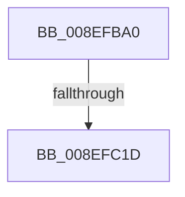

# PnpGetGenericStoreProperty

- RVA: `0x008EFBA0`–`0x008EFC77` (길이 `215` bytes)
- VA: `0x00000001408EFBA0`
- 실행 섹션: `PAGE`
- PDB 이름 있음: `예`; PDB Function 태그: `아니요`
- unwind 정보 RVA: `0x00087158`
- 디코드: `49`개 명령, `215/215` bytes 표시
- 미해석 바이트: `0` (있으면 어셈블리에 `.byte`로 보존)

> 이 문서는 커널 이미지의 기계어와 PDB 기호를 분석해 생성했습니다. 4번과 5번은 함수 원형과 자료형을 바이너리 사용 방식에서 추정한 C 해석이며 원본 소스 복구 결과는 아닙니다.

## 1. Dependencies

- 직접 호출 지점: **0**; 고유 호출 대상: **0**
- 직접 호출자로 확인된 함수: **5**
- RIP 상대 이미지 참조: **1**

### Outgoing calls
- 직접 디코드된 call 명령이 없습니다.

### Direct callers
- [PiDqPnPGetObjectPropertyInBestLocale](../8D/PiDqPnPGetObjectPropertyInBestLocale_function_008DEE10.md) at `0x008DF254`
- [PiDqPnPGetObjectProperty](../8D/PiDqPnPGetObjectProperty_function_008DFD90.md) at `0x008E0126`
- [PnpGetObjectProperty](PnpGetObjectProperty_function_008E1110.md) at `0x008E14D2`
- [PiCreateDriverSwDeviceCallback](../AB/PiCreateDriverSwDeviceCallback_function_00ABB420.md) at `0x00ABBD50`
- [sub_00B2834C](../B2/Unknown_function_00B2834C.md) at `0x00B283E8`

### Static image references
- `0x008EFBB8` → RVA `0x00E0A740` (`.data`; read)

## 2. Other-region calls and transfers

- 다른 실행 섹션으로 향하는 call: **0**
- call이 아닌 외부 분기/꼬리 이동: **1**
  - `0x008EFC17` → [sub_008EFDE5 + 0x27](Unknown_function_008EFDE5.md) (`tail-transfer`)

## 3. Assembly (complete function range)

```asm
008EFBA0  40 55                           push rbp
008EFBA2  57                              push rdi
008EFBA3  41 54                           push r12
008EFBA5  41 55                           push r13
008EFBA7  41 57                           push r15
008EFBA9  48 8D AC 24 30 FF FF FF         lea rbp, [rsp - 0xd0]
008EFBB1  48 81 EC E0 01 00 00            sub rsp, 0x1e0
008EFBB8  48 8B 05 81 AB 51 00            mov rax, qword ptr [rip + 0x51ab81]
008EFBBF  48 33 C4                        xor rax, rsp
008EFBC2  48 89 85 A0 00 00 00            mov qword ptr [rbp + 0xa0], rax
008EFBC9  45 33 E4                        xor r12d, r12d
008EFBCC  48 89 55 A8                     mov qword ptr [rbp - 0x58], rdx
008EFBD0  48 8B 95 20 01 00 00            mov rdx, qword ptr [rbp + 0x120]
008EFBD7  4C 8B E9                        mov r13, rcx
008EFBDA  48 8B 8D 28 01 00 00            mov rcx, qword ptr [rbp + 0x128]
008EFBE1  49 8B C0                        mov rax, r8
008EFBE4  48 89 4D 98                     mov qword ptr [rbp - 0x68], rcx
008EFBE8  4D 8B F9                        mov r15, r9
008EFBEB  48 8B 8D 38 01 00 00            mov rcx, qword ptr [rbp + 0x138]
008EFBF2  44 89 22                        mov dword ptr [rdx], r12d
008EFBF5  48 89 45 A0                     mov qword ptr [rbp - 0x60], rax
008EFBF9  48 89 55 B0                     mov qword ptr [rbp - 0x50], rdx
008EFBFD  44 89 21                        mov dword ptr [rcx], r12d
008EFC00  48 89 4D B8                     mov qword ptr [rbp - 0x48], rcx
008EFC04  4C 89 65 90                     mov qword ptr [rbp - 0x70], r12
008EFC08  44 89 65 88                     mov dword ptr [rbp - 0x78], r12d
008EFC0C  44 89 65 84                     mov dword ptr [rbp - 0x7c], r12d
008EFC10  44 88 65 80                     mov byte ptr [rbp - 0x80], r12b
008EFC14  4D 85 C0                        test r8, r8
008EFC17  0F 85 EF 01 00 00               jne 0x1408efe0c
008EFC1D  41 0F B6 49 0F                  movzx ecx, byte ptr [r9 + 0xf]
008EFC22  41 0F B6 51 0E                  movzx edx, byte ptr [r9 + 0xe]
008EFC27  45 0F B6 41 0D                  movzx r8d, byte ptr [r9 + 0xd]
008EFC2C  41 8B 47 10                     mov eax, dword ptr [r15 + 0x10]
008EFC30  45 0F B6 49 0C                  movzx r9d, byte ptr [r9 + 0xc]
008EFC35  45 0F B6 57 0B                  movzx r10d, byte ptr [r15 + 0xb]
008EFC3A  45 0F B6 5F 0A                  movzx r11d, byte ptr [r15 + 0xa]
008EFC3F  41 0F B6 7F 08                  movzx edi, byte ptr [r15 + 8]
008EFC44  89 84 24 88 00 00 00            mov dword ptr [rsp + 0x88], eax
008EFC4B  41 8B 07                        mov eax, dword ptr [r15]
008EFC4E  89 8C 24 80 00 00 00            mov dword ptr [rsp + 0x80], ecx
008EFC55  48 8D 4D C0                     lea rcx, [rbp - 0x40]
008EFC59  89 54 24 78                     mov dword ptr [rsp + 0x78], edx
008EFC5D  44 89 44 24 70                  mov dword ptr [rsp + 0x70], r8d
008EFC62  45 33 C0                        xor r8d, r8d
008EFC65  44 89 4C 24 68                  mov dword ptr [rsp + 0x68], r9d
008EFC6A  45 33 C9                        xor r9d, r9d
008EFC6D  44 89 54 24 60                  mov dword ptr [rsp + 0x60], r10d
008EFC72  44 89 5C 24 58                  mov dword ptr [rsp + 0x58], r11d
```

## 4. C-style interpretation (structured pseudocode)

```c
__int64 __fastcall PnpGetGenericStoreProperty(__int64 a1, __int64 a2, __int64 a3, __int64 a4, __int64 a5, __int64 a6, __int64 a7, __int64 a8)
{
    __int64 result;
    __int64 v_r12;
    __int64 v_rsp;
    unsigned __int64 v_stack_m138;
    unsigned __int64 v_stack_m140;
    unsigned __int64 v_stack_m148;
    unsigned __int64 v_stack_m150;
    unsigned __int64 v_stack_m158;
    unsigned __int64 v_stack_m160;
    unsigned __int64 v_stack_m168;
    unsigned int v_stack_m170;
    unsigned int v_stack_m174;
    unsigned __int8 v_stack_m178;
    unsigned int v_stack_m180;
    unsigned int v_stack_m188;
    unsigned int v_stack_m190;
    unsigned int v_stack_m198;
    unsigned int v_stack_m1A0;
    unsigned int v_stack_m1A8;
    unsigned int v_stack_m1B0;
    unsigned __int64 v_stack_m58;
    unsigned __int64 v_stack_mF8;

    v_rsp = (v_rsp) - (480);
    result = (*(unsigned __int64 *)(v_rip + 5352321)) ^ (v_rsp);
    v_stack_m58 = result;
    v_r12 = 0;
    v_stack_m150 = a2;
    v_stack_m160 = a6;
    *(unsigned int *)(a5) = 0;
    v_stack_m158 = a3;
    v_stack_m148 = a5;
    *(unsigned int *)(a8) = 0;
    v_stack_m140 = a8;
    v_stack_m168 = 0;
    v_stack_m170 = 0;
    v_stack_m174 = 0;
    v_stack_m178 = 0;
    v_stack_m180 = (unsigned int)((unsigned int)(*(unsigned int *)(a4 + 16)));
    v_stack_m188 = (unsigned int)(*(unsigned __int8 *)(a4 + 15));
    v_stack_m190 = (unsigned int)(*(unsigned __int8 *)(a4 + 14));
    v_stack_m198 = (unsigned int)(*(unsigned __int8 *)(a4 + 13));
    a3 = 0;
    v_stack_m1A0 = (unsigned int)(*(unsigned __int8 *)(a4 + 12));
    a4 = 0;
    v_stack_m1A8 = (unsigned int)(*(unsigned __int8 *)(a4 + 11));
    v_stack_m1B0 = (unsigned int)(*(unsigned __int8 *)(a4 + 10));
    return (unsigned int)(*(unsigned int *)(a4));
}
```

## 5. (Beta) C Style

```c
int64_t PnpGetGenericStoreProperty(int64_t Arg1, int64_t Arg2, int64_t Arg3, void *Arg4, void *Arg5, int64_t Arg6, uint64_t Arg7, void *Arg8)
{
    uint8_t *arg4 = (uint8_t *)Arg4;
    uint8_t *arg5 = (uint8_t *)Arg5;
    uint8_t *arg8 = (uint8_t *)Arg8;

    int64_t result;
    int64_t local_r12;
    int64_t local_rsp;
    uint64_t v_stack_m138;
    uint64_t v_stack_m140;
    uint64_t v_stack_m148;
    uint64_t v_stack_m150;
    uint64_t v_stack_m158;
    uint64_t v_stack_m160;
    uint64_t v_stack_m168;
    uint32_t v_stack_m170;
    uint32_t v_stack_m174;
    uint8_t v_stack_m178;
    uint32_t v_stack_m180;
    uint32_t v_stack_m188;
    uint32_t v_stack_m190;
    uint32_t v_stack_m198;
    uint32_t v_stack_m1A0;
    uint32_t v_stack_m1A8;
    uint32_t v_stack_m1B0;
    uint64_t v_stack_m58;
    uint64_t v_stack_mF8;

    local_rsp = (local_rsp) - (480);
    result = (*(uint64_t *)(v_rip + 0x51AB81)) ^ (local_rsp);
    v_stack_m58 = result;
    local_r12 = 0;
    v_stack_m150 = Arg2;
    v_stack_m160 = Arg6;
    *(uint32_t *)(arg5) = 0;
    v_stack_m158 = Arg3;
    v_stack_m148 = Arg5;
    *(uint32_t *)(arg8) = 0;
    v_stack_m140 = Arg8;
    v_stack_m168 = 0;
    v_stack_m170 = 0;
    v_stack_m174 = 0;
    v_stack_m178 = 0;
    v_stack_m180 = (uint32_t)((uint32_t)(*(uint32_t *)(arg4 + 0x10)));
    v_stack_m188 = (uint32_t)(*(uint8_t *)(arg4 + 0xF));
    v_stack_m190 = (uint32_t)(*(uint8_t *)(arg4 + 0xE));
    v_stack_m198 = (uint32_t)(*(uint8_t *)(arg4 + 0xD));
    Arg3 = 0;
    v_stack_m1A0 = (uint32_t)(*(uint8_t *)(arg4 + 0xC));
    Arg4 = 0;
    v_stack_m1A8 = (uint32_t)(*(uint8_t *)(arg4 + 0xB));
    v_stack_m1B0 = (uint32_t)(*(uint8_t *)(arg4 + 0xA));
    return (uint32_t)(*(uint32_t *)(arg4));
}
```

### 관측된 메모리 오프셋

구조체 형식이 확인되지 않은 접근은 인자 기준의 오프셋으로만 기록했습니다.

| 기준 인자 | 오프셋 표현 | 폭 (bit) | 접근 |
|---|---:|---:|---|
| `Arg4` | `+ 0x0` | `32` | `R` |
| `Arg4` | `+ 0x8` | `8` | `R` |
| `Arg4` | `+ 0xA` | `8` | `R` |
| `Arg4` | `+ 0xB` | `8` | `R` |
| `Arg4` | `+ 0xC` | `8` | `R` |
| `Arg4` | `+ 0xD` | `8` | `R` |
| `Arg4` | `+ 0xE` | `8` | `R` |
| `Arg4` | `+ 0xF` | `8` | `R` |
| `Arg4` | `+ 0x10` | `32` | `R` |
| `Arg5` | `+ 0x0` | `32` | `W` |
| `Arg8` | `+ 0x0` | `32` | `W` |

## 6. Execution-region graph

[열기: 2D/3D 그래프와 함수 탐색 컨트롤 패널](../../../control-panel.html?section=page&rva=0x008EFBA0&view=graph)

- 2D 그래프는 위에서 아래로 흐르고, 3D 그래프는 빈 공간을 드래그해 회전합니다. Shift+드래그는 이동, 휠은 확대·축소, 함수 노드 선택은 대상 보고서 이동입니다.

### Static fallback


