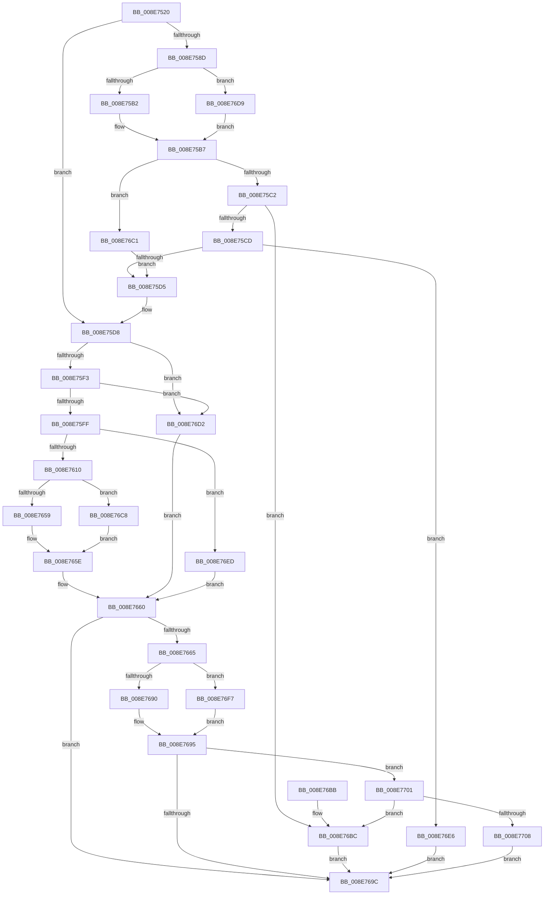

# PnpGetObjectList

- RVA: `0x008E7520`–`0x008E7718` (길이 `504` bytes)
- VA: `0x00000001408E7520`
- 실행 섹션: `PAGE`
- PDB 이름 있음: `예`; PDB Function 태그: `아니요`
- unwind 정보 RVA: `0x000868A4`
- 디코드: `133`개 명령, `504/504` bytes 표시
- 미해석 바이트: `0` (있으면 어셈블리에 `.byte`로 보존)

> 이 문서는 커널 이미지의 기계어와 PDB 기호를 분석해 생성했습니다. 4번과 5번은 함수 원형과 자료형을 바이너리 사용 방식에서 추정한 C 해석이며 원본 소스 복구 결과는 아닙니다.

## 1. Dependencies

- 직접 호출 지점: **7**; 고유 호출 대상: **4**
- 직접 호출자로 확인된 함수: **2**
- RIP 상대 이미지 참조: **3**

### Outgoing calls
- `0x008E7553` → [memset](../../text/6C/memset_function_006C6C40.md) (function, `0x006C6C40`)
- `0x008E75B2` → [PiPnpRtlObjectActionCallback](PiPnpRtlObjectActionCallback_function_008E2850.md) (function, `0x008E2850`)
- `0x008E7659` → [DrvDbDispatchDriverDatabase](DrvDbDispatchDriverDatabase_function_008E6EC0.md) (function, `0x008E6EC0`)
- `0x008E7690` → [PiPnpRtlObjectActionCallback](PiPnpRtlObjectActionCallback_function_008E2850.md) (function, `0x008E2850`)
- `0x008E76CB` → [guard_dispatch_icall](../../text/6B/guard_dispatch_icall_function_006BAAD0.md) (function, `0x006BAAD0`)
- `0x008E76DC` → [guard_dispatch_icall](../../text/6B/guard_dispatch_icall_function_006BAAD0.md) (function, `0x006BAAD0`)
- `0x008E76FA` → [guard_dispatch_icall](../../text/6B/guard_dispatch_icall_function_006BAAD0.md) (function, `0x006BAAD0`)

### Direct callers
- [PiDmObjectManagerPopulate](../73/PiDmObjectManagerPopulate_function_00730598.md) at `0x00730613`
- [PiCMGetObjectList](PiCMGetObjectList_function_008E7720.md) at `0x008E783C`

### Static image references
- `0x008E753F` → RVA `0x00E66398` (`.data`; read)
- `0x008E757E` → RVA `0x008E2850` (`PiPnpRtlObjectActionCallback`; read)
- `0x008E763E` → RVA `0x008E6EC0` (`DrvDbDispatchDriverDatabase`; read)

## 2. Other-region calls and transfers

- 다른 실행 섹션으로 향하는 call: **4**
  - `0x008E7553` → [memset](../../text/6C/memset_function_006C6C40.md) (`PAGE` → `.text`)
  - `0x008E76CB` → [guard_dispatch_icall](../../text/6B/guard_dispatch_icall_function_006BAAD0.md) (`PAGE` → `.text`)
  - `0x008E76DC` → [guard_dispatch_icall](../../text/6B/guard_dispatch_icall_function_006BAAD0.md) (`PAGE` → `.text`)
  - `0x008E76FA` → [guard_dispatch_icall](../../text/6B/guard_dispatch_icall_function_006BAAD0.md) (`PAGE` → `.text`)
- 별도 외부 분기/꼬리 이동을 확인하지 못했습니다.

## 3. Assembly (complete function range)

```asm
008E7520  48 8B C4                        mov rax, rsp
008E7523  48 89 58 08                     mov qword ptr [rax + 8], rbx
008E7527  48 89 70 10                     mov qword ptr [rax + 0x10], rsi
008E752B  48 89 78 18                     mov qword ptr [rax + 0x18], rdi
008E752F  55                              push rbp
008E7530  41 55                           push r13
008E7532  41 56                           push r14
008E7534  48 8D 68 C1                     lea rbp, [rax - 0x3f]
008E7538  48 81 EC D0 00 00 00            sub rsp, 0xd0
008E753F  4C 8B 35 52 EE 57 00            mov r14, qword ptr [rip + 0x57ee52]
008E7546  48 8D 4D 97                     lea rcx, [rbp - 0x69]
008E754A  48 63 F2                        movsxd rsi, edx
008E754D  33 D2                           xor edx, edx
008E754F  44 8D 42 50                     lea r8d, [rdx + 0x50]
008E7553  E8 E8 F6 DD FF                  call 0x1406c6c40
008E7558  49 8B BE E8 01 00 00            mov rdi, qword ptr [r14 + 0x1e8]
008E755F  41 BD 05 00 00 00               mov r13d, 5
008E7565  48 8B 45 67                     mov rax, qword ptr [rbp + 0x67]
008E7569  8B 4D 7F                        mov ecx, dword ptr [rbp + 0x7f]
008E756C  48 89 45 B7                     mov qword ptr [rbp - 0x49], rax
008E7570  8B 45 6F                        mov eax, dword ptr [rbp + 0x6f]
008E7573  89 45 BF                        mov dword ptr [rbp - 0x41], eax
008E7576  48 8B 45 77                     mov rax, qword ptr [rbp + 0x77]
008E757A  48 89 45 C7                     mov qword ptr [rbp - 0x39], rax
008E757E  48 8D 05 CB B2 FF FF            lea rax, [rip - 0x4d35]
008E7585  89 4D CF                        mov dword ptr [rbp - 0x31], ecx
008E7588  48 85 FF                        test rdi, rdi
008E758B  74 4B                           je 0x1408e75d8
008E758D  33 D2                           xor edx, edx
008E758F  45 8B CD                        mov r9d, r13d
008E7592  48 3B F8                        cmp rdi, rax
008E7595  44 8B C6                        mov r8d, esi
008E7598  48 8D 45 97                     lea rax, [rbp - 0x69]
008E759C  49 8B CE                        mov rcx, r14
008E759F  48 89 44 24 28                  mov qword ptr [rsp + 0x28], rax
008E75A4  C7 44 24 20 01 00 00 00         mov dword ptr [rsp + 0x20], 1
008E75AC  0F 85 27 01 00 00               jne 0x1408e76d9
008E75B2  E8 99 B2 FF FF                  call 0x1408e2850
008E75B7  3D 02 00 00 C0                  cmp eax, 0xc0000002
008E75BC  0F 84 FF 00 00 00               je 0x1408e76c1
008E75C2  3D 20 01 00 C0                  cmp eax, 0xc0000120
008E75C7  0F 84 EF 00 00 00               je 0x1408e76bc
008E75CD  85 C0                           test eax, eax
008E75CF  0F 85 11 01 00 00               jne 0x1408e76e6
008E75D5  8B 4D CF                        mov ecx, dword ptr [rbp - 0x31]
008E75D8  83 65 03 00                     and dword ptr [rbp + 3], 0
008E75DC  48 83 65 13 00                  and qword ptr [rbp + 0x13], 0
008E75E1  48 83 65 1B 00                  and qword ptr [rbp + 0x1b], 0
008E75E6  83 65 23 00                     and dword ptr [rbp + 0x23], 0
008E75EA  66 85 C9                        test cx, cx
008E75ED  0F 85 DF 00 00 00               jne 0x1408e76d2
008E75F3  8D 46 FF                        lea eax, [rsi - 1]
008E75F6  83 F8 0A                        cmp eax, 0xa
008E75F9  0F 87 D3 00 00 00               ja 0x1408e76d2
008E75FF  4D 8B 94 F6 28 01 00 00         mov r10, qword ptr [r14 + rsi*8 + 0x128]
008E7607  4D 85 D2                        test r10, r10
008E760A  0F 84 DD 00 00 00               je 0x1408e76ed
008E7610  48 8B 45 A7                     mov rax, qword ptr [rbp - 0x59]
008E7614  33 D2                           xor edx, edx
008E7616  48 89 45 E7                     mov qword ptr [rbp - 0x19], rax
008E761A  45 8B CD                        mov r9d, r13d
008E761D  48 8B 45 AF                     mov rax, qword ptr [rbp - 0x51]
008E7621  44 8B C6                        mov r8d, esi
008E7624  48 89 45 EF                     mov qword ptr [rbp - 0x11], rax
008E7628  48 8B 45 B7                     mov rax, qword ptr [rbp - 0x49]
008E762C  48 89 45 F7                     mov qword ptr [rbp - 9], rax
008E7630  8B 45 BF                        mov eax, dword ptr [rbp - 0x41]
008E7633  89 45 FF                        mov dword ptr [rbp - 1], eax
008E7636  48 8B 45 C7                     mov rax, qword ptr [rbp - 0x39]
008E763A  48 89 45 07                     mov qword ptr [rbp + 7], rax
008E763E  48 8D 05 7B F8 FF FF            lea rax, [rip - 0x785]
008E7645  4C 3B D0                        cmp r10, rax
008E7648  89 4D 0F                        mov dword ptr [rbp + 0xf], ecx
008E764B  48 8D 45 E7                     lea rax, [rbp - 0x19]
008E764F  49 8B CE                        mov rcx, r14
008E7652  48 89 44 24 20                  mov qword ptr [rsp + 0x20], rax
008E7657  75 6F                           jne 0x1408e76c8
008E7659  E8 62 F8 FF FF                  call 0x1408e6ec0
008E765E  8B D8                           mov ebx, eax
008E7660  48 85 FF                        test rdi, rdi
008E7663  74 37                           je 0x1408e769c
008E7665  48 8D 05 E4 B1 FF FF            lea rax, [rip - 0x4e1c]
008E766C  89 5D 97                        mov dword ptr [rbp - 0x69], ebx
008E766F  33 D2                           xor edx, edx
008E7671  45 8B CD                        mov r9d, r13d
008E7674  48 3B F8                        cmp rdi, rax
008E7677  44 8B C6                        mov r8d, esi
008E767A  48 8D 45 97                     lea rax, [rbp - 0x69]
008E767E  49 8B CE                        mov rcx, r14
008E7681  48 89 44 24 28                  mov qword ptr [rsp + 0x28], rax
008E7686  C7 44 24 20 02 00 00 00         mov dword ptr [rsp + 0x20], 2
008E768E  75 67                           jne 0x1408e76f7
008E7690  E8 BB B1 FF FF                  call 0x1408e2850
008E7695  3D 02 00 00 C0                  cmp eax, 0xc0000002
008E769A  75 65                           jne 0x1408e7701
008E769C  4C 8D 9C 24 D0 00 00 00         lea r11, [rsp + 0xd0]
008E76A4  8B C3                           mov eax, ebx
008E76A6  49 8B 5B 20                     mov rbx, qword ptr [r11 + 0x20]
008E76AA  49 8B 73 28                     mov rsi, qword ptr [r11 + 0x28]
008E76AE  49 8B 7B 30                     mov rdi, qword ptr [r11 + 0x30]
008E76B2  49 8B E3                        mov rsp, r11
008E76B5  41 5E                           pop r14
008E76B7  41 5D                           pop r13
008E76B9  5D                              pop rbp
008E76BA  C3                              ret
008E76BB  CC                              int3
008E76BC  8B 5D 97                        mov ebx, dword ptr [rbp - 0x69]
008E76BF  EB DB                           jmp 0x1408e769c
008E76C1  33 FF                           xor edi, edi
008E76C3  E9 0D FF FF FF                  jmp 0x1408e75d5
008E76C8  49 8B C2                        mov rax, r10
008E76CB  E8 00 34 DD FF                  call 0x1406baad0
008E76D0  EB 8C                           jmp 0x1408e765e
008E76D2  BB 0D 00 00 C0                  mov ebx, 0xc000000d
008E76D7  EB 87                           jmp 0x1408e7660
008E76D9  48 8B C7                        mov rax, rdi
008E76DC  E8 EF 33 DD FF                  call 0x1406baad0
008E76E1  E9 D1 FE FF FF                  jmp 0x1408e75b7
008E76E6  BB E5 00 00 C0                  mov ebx, 0xc00000e5
008E76EB  EB AF                           jmp 0x1408e769c
008E76ED  BB 02 00 00 C0                  mov ebx, 0xc0000002
008E76F2  E9 69 FF FF FF                  jmp 0x1408e7660
008E76F7  48 8B C7                        mov rax, rdi
008E76FA  E8 D1 33 DD FF                  call 0x1406baad0
008E76FF  EB 94                           jmp 0x1408e7695
008E7701  3D 20 01 00 C0                  cmp eax, 0xc0000120
008E7706  74 B4                           je 0x1408e76bc
008E7708  8B CB                           mov ecx, ebx
008E770A  85 C0                           test eax, eax
008E770C  BB E5 00 00 C0                  mov ebx, 0xc00000e5
008E7711  0F 45 CB                        cmovne ecx, ebx
008E7714  8B D9                           mov ebx, ecx
008E7716  EB 84                           jmp 0x1408e769c
```

## 4. C-style interpretation (structured pseudocode)

```c
__int64 __fastcall PnpGetObjectList(__int64 a1, int a2)
{
    __int64 result;
    __int64 v_rdi;
    __int64 v_rsp;
    unsigned __int64 v_stack_m18;
    unsigned __int64 v_stack_mC0;
    unsigned int v_stack_mC8;

    *(unsigned __int64 *)(v_rsp + 8) = v_rbx;
    *(unsigned __int64 *)(v_rsp + 16) = v_rsi;
    *(unsigned __int64 *)(v_rsp + 24) = v_rdi;
    v_rsp = (v_rsp) - (208);
    a2 = 0;
    result = memset(v_rsp - 63 - 105, a2, a2 + 80, a4);
    *(unsigned __int64 *)(v_rsp - 63 - 73) = *(unsigned __int64 *)(v_rsp - 63 + 103);
    *(unsigned int *)(v_rsp - 63 - 65) = (unsigned int)((unsigned int)(*(unsigned int *)(v_rsp - 63 + 111)));
    *(unsigned __int64 *)(v_rsp - 63 - 57) = *(unsigned __int64 *)(v_rsp - 63 + 119);
    *(unsigned int *)(v_rsp - 63 - 49) = (unsigned int)((unsigned int)(*(unsigned int *)(v_rsp - 63 + 127)));
    if (*(unsigned __int64 *)(*(unsigned __int64 *)(v_rip + 5762642) + 488) == 0) goto loc_008E75D8;
    a2 = 0;
    v_stack_mC0 = v_rsp - 63 - 105;
    v_stack_mC8 = 1;
    if ((*(unsigned __int64 *)(*(unsigned __int64 *)(v_rip + 5762642) + 488)) != (v_rip - 19765)) goto loc_008E76D9;
    result = PiPnpRtlObjectActionCallback(*(unsigned __int64 *)(v_rip + 5762642), a2, (unsigned int)((unsigned int)((int)(a2))), 5);
loc_008E75B7:
    if (((unsigned int)(result)) == 0xC0000002ULL) goto loc_008E76C1;
    if (((unsigned int)(result)) == 0xC0000120ULL) goto loc_008E76BC;
    if ((unsigned int)(result) != 0) goto loc_008E76E6;
loc_008E75D5:
loc_008E75D8:
    if ((unsigned __int16)((unsigned int)(*(unsigned int *)(v_rsp - 63 - 49))) != 0) goto loc_008E76D2;
    if (((unsigned int)((int)(a2) - 1)) > 10) goto loc_008E76D2;
    if (*(unsigned __int64 *)(*(unsigned __int64 *)(v_rip + 5762642) + (int)(a2) * 8 + 296) == 0) goto loc_008E76ED;
    a2 = 0;
    *(unsigned __int64 *)(v_rsp - 63 - 25) = *(unsigned __int64 *)(v_rsp - 63 - 89);
    *(unsigned __int64 *)(v_rsp - 63 - 17) = *(unsigned __int64 *)(v_rsp - 63 - 81);
    *(unsigned __int64 *)(v_rsp - 63 - 9) = *(unsigned __int64 *)(v_rsp - 63 - 73);
    *(unsigned int *)(v_rsp - 63 - 1) = (unsigned int)((unsigned int)(*(unsigned int *)(v_rsp - 63 - 65)));
    *(unsigned __int64 *)(v_rsp - 63 + 7) = *(unsigned __int64 *)(v_rsp - 63 - 57);
    *(unsigned int *)(v_rsp - 63 + 15) = (unsigned int)((unsigned int)(*(unsigned int *)(v_rsp - 63 - 49)));
    v_stack_mC8 = v_rsp - 63 - 25;
    if ((*(unsigned __int64 *)(*(unsigned __int64 *)(v_rip + 5762642) + (int)(a2) * 8 + 296)) != (v_rip - 1925)) goto loc_008E76C8;
    result = DrvDbDispatchDriverDatabase(*(unsigned __int64 *)(v_rip + 5762642), a2, (unsigned int)((unsigned int)((int)(a2))), 5);
loc_008E765E:
loc_008E7660:
    if (*(unsigned __int64 *)(*(unsigned __int64 *)(v_rip + 5762642) + 488) == 0) goto loc_008E769C;
    *(unsigned int *)(v_rsp - 63 - 105) = (unsigned int)((unsigned int)((unsigned int)(result)));
    a2 = 0;
    v_stack_mC0 = v_rsp - 63 - 105;
    v_stack_mC8 = 2;
    if ((*(unsigned __int64 *)(*(unsigned __int64 *)(v_rip + 5762642) + 488)) != (v_rip - 19996)) goto loc_008E76F7;
    result = PiPnpRtlObjectActionCallback(*(unsigned __int64 *)(v_rip + 5762642), a2, (unsigned int)((unsigned int)((int)(a2))), 5);
loc_008E7695:
    if (((unsigned int)(result)) != 0xC0000002ULL) goto loc_008E7701;
loc_008E769C:
    return (unsigned int)((unsigned int)((unsigned int)((unsigned int)(result))));
loc_008E76BC:
    goto loc_008E769C;
loc_008E76C1:
    v_rdi = 0;
    goto loc_008E75D5;
loc_008E76C8:
    result = guard_dispatch_icall(*(unsigned __int64 *)(v_rip + 5762642), a2, (unsigned int)((unsigned int)((int)(a2))), 5);
    goto loc_008E765E;
loc_008E76D2:
    goto loc_008E7660;
loc_008E76D9:
    result = guard_dispatch_icall(*(unsigned __int64 *)(v_rip + 5762642), a2, (unsigned int)((unsigned int)((int)(a2))), 5);
    goto loc_008E75B7;
loc_008E76E6:
    goto loc_008E769C;
loc_008E76ED:
    goto loc_008E7660;
loc_008E76F7:
    result = guard_dispatch_icall(*(unsigned __int64 *)(v_rip + 5762642), a2, (unsigned int)((unsigned int)((int)(a2))), 5);
    goto loc_008E7695;
loc_008E7701:
    if (((unsigned int)(result)) == 0xC0000120ULL) goto loc_008E76BC;
    a1 = (unsigned int)((unsigned int)((unsigned int)(0xC0000002ULL)));
    if ((unsigned int)(result) != 0) { a1 = (unsigned int)((unsigned int)(0xC00000E5ULL)); }
    goto loc_008E769C;
}
```

## 5. (Beta) C Style

```c
int64_t PnpGetObjectList(int64_t Arg1, void *Arg2)
{
    uint8_t *arg2 = (uint8_t *)Arg2;

    int64_t result;
    int64_t local_rdi;
    int64_t local_rsp;
    uint64_t v_stack_m18;
    uint64_t v_stack_mC0;
    uint32_t v_stack_mC8;

    *(uint64_t *)(local_rsp + 0x8) = local_rbx;
    *(uint64_t *)(local_rsp + 0x10) = local_rsi;
    *(uint64_t *)(local_rsp + 0x18) = local_rdi;
    local_rsp = (local_rsp) - (208);
    Arg2 = 0;
    result = memset(local_rsp - 63 - 105, Arg2, Arg2 + 80, a4);
    *(uint64_t *)(local_rsp - 0x3F - 0x49) = *(uint64_t *)(local_rsp - 0x3F + 0x67);
    *(uint32_t *)(local_rsp - 0x3F - 0x41) = (uint32_t)((uint32_t)(*(uint32_t *)(local_rsp - 0x3F + 0x6F)));
    *(uint64_t *)(local_rsp - 0x3F - 0x39) = *(uint64_t *)(local_rsp - 0x3F + 0x77);
    *(uint32_t *)(local_rsp - 0x3F - 0x31) = (uint32_t)((uint32_t)(*(uint32_t *)(local_rsp - 0x3F + 0x7F)));
    if (*(uint64_t *)(*(uint64_t *)(v_rip + 0x57EE52) + 0x1E8) == 0) goto loc_008E75D8;
    Arg2 = 0;
    v_stack_mC0 = local_rsp - 63 - 105;
    v_stack_mC8 = 1;
    if ((*(uint64_t *)(*(uint64_t *)(v_rip + 0x57EE52) + 0x1E8)) != (v_rip - 19765)) goto loc_008E76D9;
    result = PiPnpRtlObjectActionCallback(*(uint64_t *)(v_rip + 0x57EE52), Arg2, (uint32_t)((uint32_t)((int32_t)(Arg2))), 5);
loc_008E75B7:
    if (((uint32_t)(result)) == 0xC0000002ULL) goto loc_008E76C1;
    if (((uint32_t)(result)) == 0xC0000120ULL) goto loc_008E76BC;
    if ((uint32_t)(result) != 0) goto loc_008E76E6;
loc_008E75D5:
loc_008E75D8:
    if ((uint16_t)((uint32_t)(*(uint32_t *)(local_rsp - 0x3F - 0x31))) != 0) goto loc_008E76D2;
    if (((uint32_t)((int32_t)(Arg2) - 1)) > 10) goto loc_008E76D2;
    if (*(uint64_t *)(*(uint64_t *)(v_rip + 0x57EE52) + (int32_t)(arg2) * 8 + 0x128) == 0) goto loc_008E76ED;
    Arg2 = 0;
    *(uint64_t *)(local_rsp - 0x3F - 0x19) = *(uint64_t *)(local_rsp - 0x3F - 0x59);
    *(uint64_t *)(local_rsp - 0x3F - 0x11) = *(uint64_t *)(local_rsp - 0x3F - 0x51);
    *(uint64_t *)(local_rsp - 0x3F - 0x9) = *(uint64_t *)(local_rsp - 0x3F - 0x49);
    *(uint32_t *)(local_rsp - 0x3F - 0x1) = (uint32_t)((uint32_t)(*(uint32_t *)(local_rsp - 0x3F - 0x41)));
    *(uint64_t *)(local_rsp - 0x3F + 0x7) = *(uint64_t *)(local_rsp - 0x3F - 0x39);
    *(uint32_t *)(local_rsp - 0x3F + 0xF) = (uint32_t)((uint32_t)(*(uint32_t *)(local_rsp - 0x3F - 0x31)));
    v_stack_mC8 = local_rsp - 63 - 25;
    if ((*(uint64_t *)(*(uint64_t *)(v_rip + 0x57EE52) + (int32_t)(arg2) * 8 + 0x128)) != (v_rip - 1925)) goto loc_008E76C8;
    result = DrvDbDispatchDriverDatabase(*(uint64_t *)(v_rip + 0x57EE52), Arg2, (uint32_t)((uint32_t)((int32_t)(Arg2))), 5);
loc_008E765E:
loc_008E7660:
    if (*(uint64_t *)(*(uint64_t *)(v_rip + 0x57EE52) + 0x1E8) == 0) goto loc_008E769C;
    *(uint32_t *)(local_rsp - 0x3F - 0x69) = (uint32_t)((uint32_t)((uint32_t)(result)));
    Arg2 = 0;
    v_stack_mC0 = local_rsp - 63 - 105;
    v_stack_mC8 = 2;
    if ((*(uint64_t *)(*(uint64_t *)(v_rip + 0x57EE52) + 0x1E8)) != (v_rip - 19996)) goto loc_008E76F7;
    result = PiPnpRtlObjectActionCallback(*(uint64_t *)(v_rip + 0x57EE52), Arg2, (uint32_t)((uint32_t)((int32_t)(Arg2))), 5);
loc_008E7695:
    if (((uint32_t)(result)) != 0xC0000002ULL) goto loc_008E7701;
loc_008E769C:
    return (uint32_t)((uint32_t)((uint32_t)((uint32_t)(result))));
loc_008E76BC:
    goto loc_008E769C;
loc_008E76C1:
    local_rdi = 0;
    goto loc_008E75D5;
loc_008E76C8:
    result = guard_dispatch_icall(*(uint64_t *)(v_rip + 0x57EE52), Arg2, (uint32_t)((uint32_t)((int32_t)(Arg2))), 5);
    goto loc_008E765E;
loc_008E76D2:
    goto loc_008E7660;
loc_008E76D9:
    result = guard_dispatch_icall(*(uint64_t *)(v_rip + 0x57EE52), Arg2, (uint32_t)((uint32_t)((int32_t)(Arg2))), 5);
    goto loc_008E75B7;
loc_008E76E6:
    goto loc_008E769C;
loc_008E76ED:
    goto loc_008E7660;
loc_008E76F7:
    result = guard_dispatch_icall(*(uint64_t *)(v_rip + 0x57EE52), Arg2, (uint32_t)((uint32_t)((int32_t)(Arg2))), 5);
    goto loc_008E7695;
loc_008E7701:
    if (((uint32_t)(result)) == 0xC0000120ULL) goto loc_008E76BC;
    Arg1 = (uint32_t)((uint32_t)((uint32_t)(0xC0000002ULL)));
    if ((uint32_t)(result) != 0) { Arg1 = (uint32_t)((uint32_t)(0xC00000E5ULL)); }
    goto loc_008E769C;
}
```

### 관측된 메모리 오프셋

구조체 형식이 확인되지 않은 접근은 인자 기준의 오프셋으로만 기록했습니다.

| 기준 인자 | 오프셋 표현 | 폭 (bit) | 접근 |
|---|---:|---:|---|
| `Arg2` | `- 0x1` | `32` | `R` |

## 6. Execution-region graph

[열기: 2D/3D 그래프와 함수 탐색 컨트롤 패널](../../../control-panel.html?section=page&rva=0x008E7520&view=graph)

- 2D 그래프는 위에서 아래로 흐르고, 3D 그래프는 빈 공간을 드래그해 회전합니다. Shift+드래그는 이동, 휠은 확대·축소, 함수 노드 선택은 대상 보고서 이동입니다.

### Static fallback


