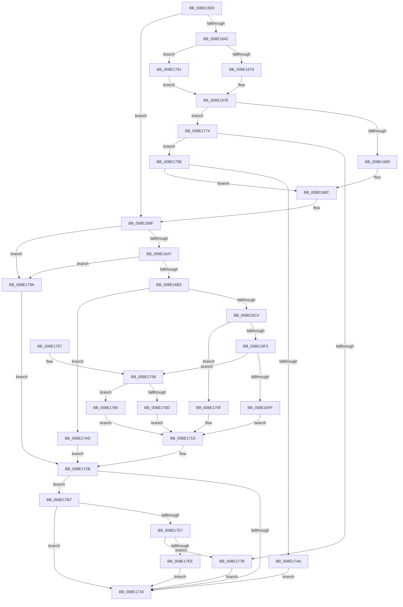

# PnpOpenObjectRegKey

- RVA: `0x008E15E8`–`0x008E1801` (길이 `537` bytes)
- VA: `0x00000001408E15E8`
- 실행 섹션: `PAGE`
- PDB 이름 있음: `예`; PDB Function 태그: `아니요`
- unwind 정보 RVA: `0x00085E2C`
- 디코드: `144`개 명령, `537/537` bytes 표시
- 미해석 바이트: `0` (있으면 어셈블리에 `.byte`로 보존)

> 이 문서는 커널 이미지의 기계어와 PDB 기호를 분석해 생성했습니다. 4번과 5번은 함수 원형과 자료형을 바이너리 사용 방식에서 추정한 C 해석이며 원본 소스 복구 결과는 아닙니다.

## 1. Dependencies

- 직접 호출 지점: **9**; 고유 호출 대상: **6**
- 직접 호출자로 확인된 함수: **25**
- RIP 상대 이미지 참조: **4**

### Outgoing calls
- `0x008E1621` → [memset](../../text/6C/memset_function_006C6C40.md) (function, `0x006C6C40`)
- `0x008E1679` → [PiPnpRtlObjectActionCallback](PiPnpRtlObjectActionCallback_function_008E2850.md) (function, `0x008E2850`)
- `0x008E1699` → [memset](../../text/6C/memset_function_006C6C40.md) (function, `0x006C6C40`)
- `0x008E1708` → [_PnpDispatchDeviceInterface](_PnpDispatchDeviceInterface_function_008E0DB0.md) (function, `0x008E0DB0`)
- `0x008E1718` → [_PnpDispatchDevice](_PnpDispatchDevice_function_008E1D60.md) (function, `0x008E1D60`)
- `0x008E176D` → [DrvDbDispatchDriverPackage](../93/DrvDbDispatchDriverPackage_function_009303A0.md) (function, `0x009303A0`)
- `0x008E1783` → [guard_dispatch_icall](../../text/6B/guard_dispatch_icall_function_006BAAD0.md) (function, `0x006BAAD0`)
- `0x008E1794` → [guard_dispatch_icall](../../text/6B/guard_dispatch_icall_function_006BAAD0.md) (function, `0x006BAAD0`)
- `0x008E17D7` → [guard_dispatch_icall](../../text/6B/guard_dispatch_icall_function_006BAAD0.md) (function, `0x006BAAD0`)

### Direct callers
- [PiDevCfgCheckDeviceNeedsUpdate](../73/PiDevCfgCheckDeviceNeedsUpdate_function_00731DDC.md) at `0x007320C8`
- [PiDevCfgInitDeviceCallback](../73/PiDevCfgInitDeviceCallback_function_00733800.md) at `0x00733867`
- [PiDevCfgQueryDriverNode](../73/PiDevCfgQueryDriverNode_function_0073435C.md) at `0x0073443E`
- [PiDevCfgQueryIncludedDriverNode](../73/PiDevCfgQueryIncludedDriverNode_function_00734D88.md) at `0x00734E84`
- [PiDevCfgQueryIncludedDriverNode](../73/PiDevCfgQueryIncludedDriverNode_function_00734D88.md) at `0x00734F9D`
- [PpDevCfgProcessDeviceClass](../73/PpDevCfgProcessDeviceClass_function_00736824.md) at `0x00736993`
- [CmEnumDevicesInContainerWithCallbackWorker](../82/CmEnumDevicesInContainerWithCallbackWorker_function_0082B688.md) at `0x0082B6EC`
- [sub_008E0A15](Unknown_function_008E0A15.md) at `0x008E0A30`
- [PnpGetObjectProperty](PnpGetObjectProperty_function_008E1110.md) at `0x008E1596`
- [PnpGetObjectPropertyWorker](PnpGetObjectPropertyWorker_function_008E1810.md) at `0x008E1CB6`
- [PnpGetObjectProperty](PnpGetObjectProperty_function_008E2180.md) at `0x008E2778`
- [PiCMValidateDeviceInstance](PiCMValidateDeviceInstance_function_008E799C.md) at `0x008E7A85`
- [PiSwPropertySet](../8F/PiSwPropertySet_function_008F5EEC.md) at `0x008F5F4F`
- [PnpSetObjectPropertyWorker](../8F/PnpSetObjectPropertyWorker_function_008F7438.md) at `0x008F75D6`
- [PiCMOpenObjectKey](../96/PiCMOpenObjectKey_function_00961E08.md) at `0x00961EEE`
- [PiDqIrpPropertySet](../96/PiDqIrpPropertySet_function_00963770.md) at `0x009638AD`
- [PiDevCfgCopyObjectProperties](../96/PiDevCfgCopyObjectProperties_function_009645D8.md) at `0x0096476E`
- [PiDevCfgCopyObjectProperties](../96/PiDevCfgCopyObjectProperties_function_009645D8.md) at `0x009647A2`
- [PpDevCfgProcessDeviceReset](../96/PpDevCfgProcessDeviceReset_function_00965498.md) at `0x009655E2`
- [PiDevCfgResetDeviceDriverSettings](../96/PiDevCfgResetDeviceDriverSettings_function_00966168.md) at `0x0096644A`
- [PiDevCfgGetDriverPackageId](../97/PiDevCfgGetDriverPackageId_function_00977690.md) at `0x009776D5`
- [PiDevCfgQueryObjectProperties](../97/PiDevCfgQueryObjectProperties_function_0097776C.md) at `0x009777D5`
- [PiDevCfgConfigureDevice](../97/PiDevCfgConfigureDevice_function_00977BB4.md) at `0x009783C2`
- [PiDqActionDataGetAllPropertiesInBestLanguage](../98/PiDqActionDataGetAllPropertiesInBestLanguage_function_0098FB7C.md) at `0x0098FD19`
- [PiDqOpenObjectRegKey](../98/PiDqOpenObjectRegKey_function_0098FF30.md) at `0x0098FF99`
- [PnpGetObjectPropertyKeysWorker](../99/PnpGetObjectPropertyKeysWorker_function_0099211C.md) at `0x00992273`
- [PnpGetObjectPropertyLocalesWorker](../99/PnpGetObjectPropertyLocalesWorker_function_00995B8C.md) at `0x00995CAA`

### Static image references
- `0x008E164C` → RVA `0x008E2850` (`PiPnpRtlObjectActionCallback`; read)
- `0x008E16E4` → RVA `0x008E1D60` (`_PnpDispatchDevice`; read)
- `0x008E16F3` → RVA `0x008E0DB0` (`_PnpDispatchDeviceInterface`; read)
- `0x008E1758` → RVA `0x009303A0` (`DrvDbDispatchDriverPackage`; read)

## 2. Other-region calls and transfers

- 다른 실행 섹션으로 향하는 call: **5**
  - `0x008E1621` → [memset](../../text/6C/memset_function_006C6C40.md) (`PAGE` → `.text`)
  - `0x008E1699` → [memset](../../text/6C/memset_function_006C6C40.md) (`PAGE` → `.text`)
  - `0x008E1783` → [guard_dispatch_icall](../../text/6B/guard_dispatch_icall_function_006BAAD0.md) (`PAGE` → `.text`)
  - `0x008E1794` → [guard_dispatch_icall](../../text/6B/guard_dispatch_icall_function_006BAAD0.md) (`PAGE` → `.text`)
  - `0x008E17D7` → [guard_dispatch_icall](../../text/6B/guard_dispatch_icall_function_006BAAD0.md) (`PAGE` → `.text`)
- 별도 외부 분기/꼬리 이동을 확인하지 못했습니다.

## 3. Assembly (complete function range)

```asm
008E15E8  48 8B C4                        mov rax, rsp
008E15EB  48 89 58 08                     mov qword ptr [rax + 8], rbx
008E15EF  48 89 70 10                     mov qword ptr [rax + 0x10], rsi
008E15F3  48 89 78 18                     mov qword ptr [rax + 0x18], rdi
008E15F7  4C 89 60 20                     mov qword ptr [rax + 0x20], r12
008E15FB  55                              push rbp
008E15FC  41 56                           push r14
008E15FE  41 57                           push r15
008E1600  48 8D 68 C1                     lea rbp, [rax - 0x3f]
008E1604  48 81 EC D0 00 00 00            sub rsp, 0xd0
008E160B  4C 8B FA                        mov r15, rdx
008E160E  49 63 F8                        movsxd rdi, r8d
008E1611  33 D2                           xor edx, edx
008E1613  48 8B F1                        mov rsi, rcx
008E1616  48 8D 4D 97                     lea rcx, [rbp - 0x69]
008E161A  41 8B D9                        mov ebx, r9d
008E161D  44 8D 42 50                     lea r8d, [rdx + 0x50]
008E1621  E8 1A 56 DE FF                  call 0x1406c6c40
008E1626  8A 45 67                        mov al, byte ptr [rbp + 0x67]
008E1629  4C 8B B6 E8 01 00 00            mov r14, qword ptr [rsi + 0x1e8]
008E1630  89 5D A7                        mov dword ptr [rbp - 0x59], ebx
008E1633  33 DB                           xor ebx, ebx
008E1635  88 45 AB                        mov byte ptr [rbp - 0x55], al
008E1638  48 8B 45 6F                     mov rax, qword ptr [rbp + 0x6f]
008E163C  48 89 45 AF                     mov qword ptr [rbp - 0x51], rax
008E1640  89 5D BB                        mov dword ptr [rbp - 0x45], ebx
008E1643  44 8D 63 02                     lea r12d, [rbx + 2]
008E1647  4D 85 F6                        test r14, r14
008E164A  74 43                           je 0x1408e168f
008E164C  48 8D 05 FD 11 00 00            lea rax, [rip + 0x11fd]
008E1653  45 8B CC                        mov r9d, r12d
008E1656  4C 3B F0                        cmp r14, rax
008E1659  44 8B C7                        mov r8d, edi
008E165C  48 8D 45 97                     lea rax, [rbp - 0x69]
008E1660  49 8B D7                        mov rdx, r15
008E1663  48 89 44 24 28                  mov qword ptr [rsp + 0x28], rax
008E1668  48 8B CE                        mov rcx, rsi
008E166B  C7 44 24 20 01 00 00 00         mov dword ptr [rsp + 0x20], 1
008E1673  0F 85 18 01 00 00               jne 0x1408e1791
008E1679  E8 D2 11 00 00                  call 0x1408e2850
008E167E  3D 02 00 00 C0                  cmp eax, 0xc0000002
008E1683  0F 85 EB 00 00 00               jne 0x1408e1774
008E1689  45 33 F6                        xor r14d, r14d
008E168C  8B 5D BB                        mov ebx, dword ptr [rbp - 0x45]
008E168F  33 D2                           xor edx, edx
008E1691  48 8D 4D E7                     lea rcx, [rbp - 0x19]
008E1695  44 8D 42 40                     lea r8d, [rdx + 0x40]
008E1699  E8 A2 55 DE FF                  call 0x1406c6c40
008E169E  66 85 DB                        test bx, bx
008E16A1  0F 85 E3 00 00 00               jne 0x1408e178a
008E16A7  8D 47 FF                        lea eax, [rdi - 1]
008E16AA  83 F8 0A                        cmp eax, 0xa
008E16AD  0F 87 D7 00 00 00               ja 0x1408e178a
008E16B3  4C 8B 94 FE 28 01 00 00         mov r10, qword ptr [rsi + rdi*8 + 0x128]
008E16BB  4D 85 D2                        test r10, r10
008E16BE  0F 84 E9 00 00 00               je 0x1408e17ad
008E16C4  8B 45 A7                        mov eax, dword ptr [rbp - 0x59]
008E16C7  45 8B CC                        mov r9d, r12d
008E16CA  89 45 E7                        mov dword ptr [rbp - 0x19], eax
008E16CD  44 8B C7                        mov r8d, edi
008E16D0  8A 45 AB                        mov al, byte ptr [rbp - 0x55]
008E16D3  49 8B D7                        mov rdx, r15
008E16D6  88 45 EB                        mov byte ptr [rbp - 0x15], al
008E16D9  48 8B CE                        mov rcx, rsi
008E16DC  48 8B 45 AF                     mov rax, qword ptr [rbp - 0x51]
008E16E0  48 89 45 EF                     mov qword ptr [rbp - 0x11], rax
008E16E4  48 8D 05 75 06 00 00            lea rax, [rip + 0x675]
008E16EB  89 5D FB                        mov dword ptr [rbp - 5], ebx
008E16EE  4C 3B D0                        cmp r10, rax
008E16F1  74 1C                           je 0x1408e170f
008E16F3  48 8D 05 B6 F6 FF FF            lea rax, [rip - 0x94a]
008E16FA  4C 3B D0                        cmp r10, rax
008E16FD  75 59                           jne 0x1408e1758
008E16FF  48 8D 45 E7                     lea rax, [rbp - 0x19]
008E1703  48 89 44 24 20                  mov qword ptr [rsp + 0x20], rax
008E1708  E8 A3 F6 FF FF                  call 0x1408e0db0
008E170D  EB 0E                           jmp 0x1408e171d
008E170F  48 8D 45 E7                     lea rax, [rbp - 0x19]
008E1713  48 89 44 24 20                  mov qword ptr [rsp + 0x20], rax
008E1718  E8 43 06 00 00                  call 0x1408e1d60
008E171D  8B D8                           mov ebx, eax
008E171F  8B 45 B7                        mov eax, dword ptr [rbp - 0x49]
008E1722  85 DB                           test ebx, ebx
008E1724  0F 49 45 F7                     cmovns eax, dword ptr [rbp - 9]
008E1728  89 45 B7                        mov dword ptr [rbp - 0x49], eax
008E172B  4D 85 F6                        test r14, r14
008E172E  0F 85 83 00 00 00               jne 0x1408e17b7
008E1734  4C 8D 9C 24 D0 00 00 00         lea r11, [rsp + 0xd0]
008E173C  8B C3                           mov eax, ebx
008E173E  49 8B 5B 20                     mov rbx, qword ptr [r11 + 0x20]
008E1742  49 8B 73 28                     mov rsi, qword ptr [r11 + 0x28]
008E1746  49 8B 7B 30                     mov rdi, qword ptr [r11 + 0x30]
008E174A  4D 8B 63 38                     mov r12, qword ptr [r11 + 0x38]
008E174E  49 8B E3                        mov rsp, r11
008E1751  41 5F                           pop r15
008E1753  41 5E                           pop r14
008E1755  5D                              pop rbp
008E1756  C3                              ret
008E1757  CC                              int3
008E1758  48 8D 05 41 EC 04 00            lea rax, [rip + 0x4ec41]
008E175F  4C 3B D0                        cmp r10, rax
008E1762  48 8D 45 E7                     lea rax, [rbp - 0x19]
008E1766  48 89 44 24 20                  mov qword ptr [rsp + 0x20], rax
008E176B  75 13                           jne 0x1408e1780
008E176D  E8 2E EC 04 00                  call 0x1409303a0
008E1772  EB A9                           jmp 0x1408e171d
008E1774  3D 20 01 00 C0                  cmp eax, 0xc0000120
008E1779  75 23                           jne 0x1408e179e
008E177B  8B 5D 97                        mov ebx, dword ptr [rbp - 0x69]
008E177E  EB B4                           jmp 0x1408e1734
008E1780  49 8B C2                        mov rax, r10
008E1783  E8 48 93 DD FF                  call 0x1406baad0
008E1788  EB 93                           jmp 0x1408e171d
008E178A  BB 0D 00 00 C0                  mov ebx, 0xc000000d
008E178F  EB 9A                           jmp 0x1408e172b
008E1791  49 8B C6                        mov rax, r14
008E1794  E8 37 93 DD FF                  call 0x1406baad0
008E1799  E9 E0 FE FF FF                  jmp 0x1408e167e
008E179E  85 C0                           test eax, eax
008E17A0  0F 84 E6 FE FF FF               je 0x1408e168c
008E17A6  BB E5 00 00 C0                  mov ebx, 0xc00000e5
008E17AB  EB 87                           jmp 0x1408e1734
008E17AD  BB 02 00 00 C0                  mov ebx, 0xc0000002
008E17B2  E9 74 FF FF FF                  jmp 0x1408e172b
008E17B7  48 8D 45 97                     lea rax, [rbp - 0x69]
008E17BB  89 5D 97                        mov dword ptr [rbp - 0x69], ebx
008E17BE  48 89 44 24 28                  mov qword ptr [rsp + 0x28], rax
008E17C3  45 8B CC                        mov r9d, r12d
008E17C6  49 8B C6                        mov rax, r14
008E17C9  44 89 64 24 20                  mov dword ptr [rsp + 0x20], r12d
008E17CE  44 8B C7                        mov r8d, edi
008E17D1  49 8B D7                        mov rdx, r15
008E17D4  48 8B CE                        mov rcx, rsi
008E17D7  E8 F4 92 DD FF                  call 0x1406baad0
008E17DC  3D 02 00 00 C0                  cmp eax, 0xc0000002
008E17E1  0F 84 4D FF FF FF               je 0x1408e1734
008E17E7  3D 20 01 00 C0                  cmp eax, 0xc0000120
008E17EC  74 8D                           je 0x1408e177b
008E17EE  8B CB                           mov ecx, ebx
008E17F0  85 C0                           test eax, eax
008E17F2  BB E5 00 00 C0                  mov ebx, 0xc00000e5
008E17F7  0F 45 CB                        cmovne ecx, ebx
008E17FA  8B D9                           mov ebx, ecx
008E17FC  E9 33 FF FF FF                  jmp 0x1408e1734
```

## 4. C-style interpretation (structured pseudocode)

```c
__int64 __fastcall PnpOpenObjectRegKey(__int64 a1, __int64 a2, int a3, int a4)
{
    __int64 result;
    __int64 v_r14;
    __int64 v_rbx;
    __int64 v_rsp;
    unsigned __int64 v_stack_m18;
    unsigned __int64 v_stack_mA8;
    unsigned __int64 v_stack_mB0;
    unsigned __int64 v_stack_mC0;
    unsigned int v_stack_mC8;

    *(unsigned __int64 *)(v_rsp + 8) = v_rbx;
    *(unsigned __int64 *)(v_rsp + 16) = v_rsi;
    *(unsigned __int64 *)(v_rsp + 24) = v_rdi;
    *(unsigned __int64 *)(v_rsp + 32) = v_r12;
    v_rsp = (v_rsp) - (208);
    a2 = 0;
    result = memset(v_rsp - 63 - 105, a2, a2 + 80, a4);
    *(unsigned int *)(v_rsp - 63 - 89) = (unsigned int)((unsigned int)(a4));
    v_rbx = 0;
    *(unsigned __int8 *)(v_rsp - 63 - 85) = (unsigned __int8)(*(unsigned __int8 *)(v_rsp - 63 + 103));
    *(unsigned __int64 *)(v_rsp - 63 - 81) = *(unsigned __int64 *)(v_rsp - 63 + 111);
    *(unsigned int *)(v_rsp - 63 - 69) = 0;
    if (*(unsigned __int64 *)(a1 + 488) == 0) goto loc_008E168F;
    v_stack_mC0 = v_rsp - 63 - 105;
    v_stack_mC8 = 1;
    if ((*(unsigned __int64 *)(a1 + 488)) != (v_rip + 4605)) goto loc_008E1791;
    result = PiPnpRtlObjectActionCallback(a1, 0, (unsigned int)((unsigned int)((int)(a3))), (unsigned int)((unsigned int)(v_rbx + 2)));
loc_008E167E:
    if (((unsigned int)(result)) != 0xC0000002ULL) goto loc_008E1774;
    v_r14 = 0;
loc_008E168C:
loc_008E168F:
    a2 = 0;
    result = memset(v_rsp - 63 - 25, a2, a2 + 64, (unsigned int)((unsigned int)(v_rbx + 2)));
    if ((unsigned __int16)((unsigned int)(*(unsigned int *)(v_rsp - 63 - 69))) != 0) goto loc_008E178A;
    if (((unsigned int)((int)(a3) - 1)) > 10) goto loc_008E178A;
    if (*(unsigned __int64 *)(a1 + (int)(a3) * 8 + 296) == 0) goto loc_008E17AD;
    *(unsigned int *)(v_rsp - 63 - 25) = (unsigned int)((unsigned int)(*(unsigned int *)(v_rsp - 63 - 89)));
    *(unsigned __int8 *)(v_rsp - 63 - 21) = (unsigned __int8)(*(unsigned __int8 *)(v_rsp - 63 - 85));
    *(unsigned __int64 *)(v_rsp - 63 - 17) = *(unsigned __int64 *)(v_rsp - 63 - 81);
    *(unsigned int *)(v_rsp - 63 - 5) = (unsigned int)((unsigned int)(*(unsigned int *)(v_rsp - 63 - 69)));
    if ((*(unsigned __int64 *)(a1 + (int)(a3) * 8 + 296)) == (v_rip + 1653)) goto loc_008E170F;
    if ((*(unsigned __int64 *)(a1 + (int)(a3) * 8 + 296)) != (v_rip - 2378)) goto loc_008E1758;
    v_stack_mC8 = v_rsp - 63 - 25;
    result = _PnpDispatchDeviceInterface(a1, 0, (unsigned int)((unsigned int)((int)(a3))), (unsigned int)((unsigned int)(v_rbx + 2)));
    goto loc_008E171D;
loc_008E170F:
    v_stack_mC8 = v_rsp - 63 - 25;
    result = _PnpDispatchDevice(a1, 0, (unsigned int)((unsigned int)((int)(a3))), (unsigned int)((unsigned int)(v_rbx + 2)));
loc_008E171D:
    result = (unsigned int)(*(unsigned int *)(v_rsp - 63 - 73));
    if (!sign_flag) { result = *(unsigned int *)(v_rsp - 63 - 9); }
    *(unsigned int *)(v_rsp - 63 - 73) = (unsigned int)(result);
loc_008E172B:
    if (0 != 0) goto loc_008E17B7;
loc_008E1734:
    return (unsigned int)((unsigned int)((unsigned int)((unsigned int)(result))));
loc_008E1758:
    v_stack_mB0 = v_rsp - 63 - 25;
    if ((*(unsigned __int64 *)(a1 + (int)(a3) * 8 + 296)) != (v_rip + 322625)) goto loc_008E1780;
    result = DrvDbDispatchDriverPackage(a1, 0, (unsigned int)((unsigned int)((int)(a3))), (unsigned int)((unsigned int)(v_rbx + 2)));
    goto loc_008E171D;
loc_008E1774:
    if (((unsigned int)(result)) != 0xC0000120ULL) goto loc_008E179E;
loc_008E177B:
    goto loc_008E1734;
loc_008E1780:
    result = guard_dispatch_icall(a1, 0, (unsigned int)((unsigned int)((int)(a3))), (unsigned int)((unsigned int)(v_rbx + 2)));
    goto loc_008E171D;
loc_008E178A:
    goto loc_008E172B;
loc_008E1791:
    result = guard_dispatch_icall(a1, 0, (unsigned int)((unsigned int)((int)(a3))), (unsigned int)((unsigned int)(v_rbx + 2)));
    goto loc_008E167E;
loc_008E179E:
    if ((unsigned int)(result) == 0) goto loc_008E168C;
    goto loc_008E1734;
loc_008E17AD:
    goto loc_008E172B;
loc_008E17B7:
    *(unsigned int *)(v_rsp - 63 - 105) = (unsigned int)((unsigned int)(0xC0000002ULL));
    v_stack_mA8 = v_rsp - 63 - 105;
    v_stack_mB0 = (unsigned int)(*(unsigned __int64 *)(v_stack_m18 + 56));
    result = guard_dispatch_icall(*(unsigned __int64 *)(v_stack_m18 + 40), 0, (unsigned int)((unsigned int)(*(unsigned __int64 *)(v_stack_m18 + 48))), (unsigned int)((unsigned int)(*(unsigned __int64 *)(v_stack_m18 + 56))));
    if (((unsigned int)(result)) == 0xC0000002ULL) goto loc_008E1734;
    if (((unsigned int)(result)) == 0xC0000120ULL) goto loc_008E177B;
    a1 = (unsigned int)((unsigned int)((unsigned int)(0xC0000002ULL)));
    if ((unsigned int)(result) != 0) { a1 = (unsigned int)((unsigned int)(0xC00000E5ULL)); }
    goto loc_008E1734;
}
```

## 5. (Beta) C Style

```c
int64_t PnpOpenObjectRegKey(void *Arg1, int64_t Arg2, void *Arg3, int32_t Arg4)
{
    uint8_t *arg1 = (uint8_t *)Arg1;
    uint8_t *arg3 = (uint8_t *)Arg3;

    int64_t result;
    int64_t local_r14;
    int64_t local_rbx;
    int64_t local_rsp;
    uint64_t v_stack_m18;
    uint64_t v_stack_mA8;
    uint64_t v_stack_mB0;
    uint64_t v_stack_mC0;
    uint32_t v_stack_mC8;

    *(uint64_t *)(local_rsp + 0x8) = local_rbx;
    *(uint64_t *)(local_rsp + 0x10) = local_rsi;
    *(uint64_t *)(local_rsp + 0x18) = local_rdi;
    *(uint64_t *)(local_rsp + 0x20) = local_r12;
    local_rsp = (local_rsp) - (208);
    Arg2 = 0;
    result = memset(local_rsp - 63 - 105, Arg2, Arg2 + 80, Arg4);
    *(uint32_t *)(local_rsp - 0x3F - 0x59) = (uint32_t)((uint32_t)(Arg4));
    local_rbx = 0;
    *(uint8_t *)(local_rsp - 0x3F - 0x55) = (uint8_t)(*(uint8_t *)(local_rsp - 0x3F + 0x67));
    *(uint64_t *)(local_rsp - 0x3F - 0x51) = *(uint64_t *)(local_rsp - 0x3F + 0x6F);
    *(uint32_t *)(local_rsp - 0x3F - 0x45) = 0;
    if (*(uint64_t *)(arg1 + 0x1E8) == 0) goto loc_008E168F;
    v_stack_mC0 = local_rsp - 63 - 105;
    v_stack_mC8 = 1;
    if ((*(uint64_t *)(arg1 + 0x1E8)) != (v_rip + 4605)) goto loc_008E1791;
    result = PiPnpRtlObjectActionCallback(Arg1, 0, (uint32_t)((uint32_t)((int32_t)(Arg3))), (uint32_t)((uint32_t)(local_rbx + 2)));
loc_008E167E:
    if (((uint32_t)(result)) != 0xC0000002ULL) goto loc_008E1774;
    local_r14 = 0;
loc_008E168C:
loc_008E168F:
    Arg2 = 0;
    result = memset(local_rsp - 63 - 25, Arg2, Arg2 + 64, (uint32_t)((uint32_t)(local_rbx + 2)));
    if ((uint16_t)((uint32_t)(*(uint32_t *)(local_rsp - 0x3F - 0x45))) != 0) goto loc_008E178A;
    if (((uint32_t)((int32_t)(Arg3) - 1)) > 10) goto loc_008E178A;
    if (*(uint64_t *)(arg1 + (int32_t)(arg3) * 8 + 0x128) == 0) goto loc_008E17AD;
    *(uint32_t *)(local_rsp - 0x3F - 0x19) = (uint32_t)((uint32_t)(*(uint32_t *)(local_rsp - 0x3F - 0x59)));
    *(uint8_t *)(local_rsp - 0x3F - 0x15) = (uint8_t)(*(uint8_t *)(local_rsp - 0x3F - 0x55));
    *(uint64_t *)(local_rsp - 0x3F - 0x11) = *(uint64_t *)(local_rsp - 0x3F - 0x51);
    *(uint32_t *)(local_rsp - 0x3F - 0x5) = (uint32_t)((uint32_t)(*(uint32_t *)(local_rsp - 0x3F - 0x45)));
    if ((*(uint64_t *)(arg1 + (int32_t)(arg3) * 8 + 0x128)) == (v_rip + 1653)) goto loc_008E170F;
    if ((*(uint64_t *)(arg1 + (int32_t)(arg3) * 8 + 0x128)) != (v_rip - 2378)) goto loc_008E1758;
    v_stack_mC8 = local_rsp - 63 - 25;
    result = _PnpDispatchDeviceInterface(Arg1, 0, (uint32_t)((uint32_t)((int32_t)(Arg3))), (uint32_t)((uint32_t)(local_rbx + 2)));
    goto loc_008E171D;
loc_008E170F:
    v_stack_mC8 = local_rsp - 63 - 25;
    result = _PnpDispatchDevice(Arg1, 0, (uint32_t)((uint32_t)((int32_t)(Arg3))), (uint32_t)((uint32_t)(local_rbx + 2)));
loc_008E171D:
    result = (uint32_t)(*(uint32_t *)(local_rsp - 0x3F - 0x49));
    if (!sign_flag) { result = *(uint32_t *)(local_rsp - 0x3F - 0x9); }
    *(uint32_t *)(local_rsp - 0x3F - 0x49) = (uint32_t)(result);
loc_008E172B:
    if (0 != 0) goto loc_008E17B7;
loc_008E1734:
    return (uint32_t)((uint32_t)((uint32_t)((uint32_t)(result))));
loc_008E1758:
    v_stack_mB0 = local_rsp - 63 - 25;
    if ((*(uint64_t *)(arg1 + (int32_t)(arg3) * 8 + 0x128)) != (v_rip + 322625)) goto loc_008E1780;
    result = DrvDbDispatchDriverPackage(Arg1, 0, (uint32_t)((uint32_t)((int32_t)(Arg3))), (uint32_t)((uint32_t)(local_rbx + 2)));
    goto loc_008E171D;
loc_008E1774:
    if (((uint32_t)(result)) != 0xC0000120ULL) goto loc_008E179E;
loc_008E177B:
    goto loc_008E1734;
loc_008E1780:
    result = guard_dispatch_icall(Arg1, 0, (uint32_t)((uint32_t)((int32_t)(Arg3))), (uint32_t)((uint32_t)(local_rbx + 2)));
    goto loc_008E171D;
loc_008E178A:
    goto loc_008E172B;
loc_008E1791:
    result = guard_dispatch_icall(Arg1, 0, (uint32_t)((uint32_t)((int32_t)(Arg3))), (uint32_t)((uint32_t)(local_rbx + 2)));
    goto loc_008E167E;
loc_008E179E:
    if ((uint32_t)(result) == 0) goto loc_008E168C;
    goto loc_008E1734;
loc_008E17AD:
    goto loc_008E172B;
loc_008E17B7:
    *(uint32_t *)(local_rsp - 0x3F - 0x69) = (uint32_t)((uint32_t)(0xC0000002ULL));
    v_stack_mA8 = local_rsp - 63 - 105;
    v_stack_mB0 = (uint32_t)(*(uint64_t *)(v_stack_m18 + 0x38));
    result = guard_dispatch_icall(*(uint64_t *)(v_stack_m18 + 0x28), 0, (uint32_t)((uint32_t)(*(uint64_t *)(v_stack_m18 + 0x30))), (uint32_t)((uint32_t)(*(uint64_t *)(v_stack_m18 + 0x38))));
    if (((uint32_t)(result)) == 0xC0000002ULL) goto loc_008E1734;
    if (((uint32_t)(result)) == 0xC0000120ULL) goto loc_008E177B;
    Arg1 = (uint32_t)((uint32_t)((uint32_t)(0xC0000002ULL)));
    if ((uint32_t)(result) != 0) { Arg1 = (uint32_t)((uint32_t)(0xC00000E5ULL)); }
    goto loc_008E1734;
}
```

### 관측된 메모리 오프셋

구조체 형식이 확인되지 않은 접근은 인자 기준의 오프셋으로만 기록했습니다.

| 기준 인자 | 오프셋 표현 | 폭 (bit) | 접근 |
|---|---:|---:|---|
| `Arg1` | `+ 0x128 + rdi*8` | `64` | `R` |
| `Arg1` | `+ 0x1E8` | `64` | `R` |
| `Arg3` | `- 0x1` | `32` | `R` |

## 6. Execution-region graph

[열기: 2D/3D 그래프와 함수 탐색 컨트롤 패널](../../../control-panel.html?section=page&rva=0x008E15E8&view=graph)

- 2D 그래프는 위에서 아래로 흐르고, 3D 그래프는 빈 공간을 드래그해 회전합니다. Shift+드래그는 이동, 휠은 확대·축소, 함수 노드 선택은 대상 보고서 이동입니다.

### Static fallback


