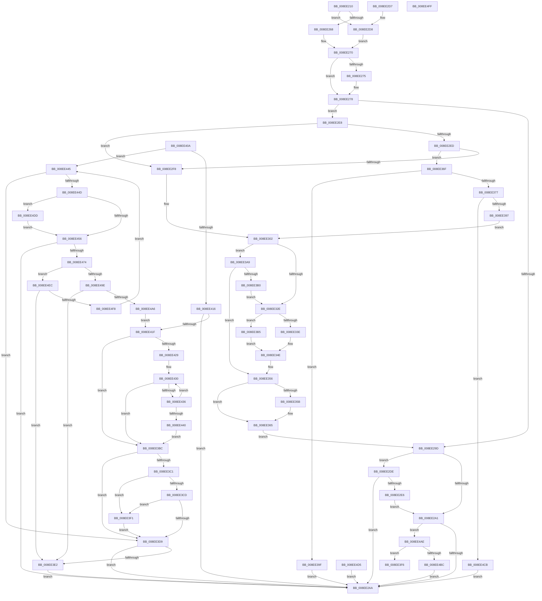

# PnpRegQueryValueIndirect

- RVA: `0x008EE210`–`0x008EE530` (길이 `800` bytes)
- VA: `0x00000001408EE210`
- 실행 섹션: `PAGE`
- PDB 이름 있음: `예`; PDB Function 태그: `아니요`
- unwind 정보 RVA: `0x00086EC0`
- 디코드: `231`개 명령, `800/800` bytes 표시
- 미해석 바이트: `2` (있으면 어셈블리에 `.byte`로 보존)

> 이 문서는 커널 이미지의 기계어와 PDB 기호를 분석해 생성했습니다. 4번과 5번은 함수 원형과 자료형을 바이너리 사용 방식에서 추정한 C 해석이며 원본 소스 복구 결과는 아닙니다.

## 1. Dependencies

- 직접 호출 지점: **12**; 고유 호출 대상: **9**
- 직접 호출자로 확인된 함수: **8**
- RIP 상대 이미지 참조: **2**

### Outgoing calls
- `0x008EE292` → [RtlInitUnicodeStringEx](../../text/46/RtlInitUnicodeStringEx_function_00463960.md) (function, `0x00463960`)
- `0x008EE2B7` → [_security_check_cookie](../../text/6A/_security_check_cookie_function_006AC640.md) (function, `0x006AC640`)
- `0x008EE323` → [ZwQueryValueKey](../../text/6A/ZwQueryValueKey_function_006AD3B0.md) (function, `0x006AD3B0`)
- `0x008EE349` → [memcpy](../../text/6C/memcpy_function_006C6840.md) (function, `0x006C6840`)
- `0x008EE360` → [ExFreePoolWithTag](../../poolcode/B8/ExFreePoolWithTag_function_00B82870.md) (function, `0x00B82870`)
- `0x008EE386` → [ExAllocatePool2](../../poolcode/B8/ExAllocatePool2_function_00B820F0.md) (function, `0x00B820F0`)
- `0x008EE3C4` → [PnpParseIndirectInfString](../9D/PnpParseIndirectInfString_function_009D3374.md) (function, `0x009D3374`)
- `0x008EE3D0` → [PnpParseIndirectResourceString](../9D/PnpParseIndirectResourceString_function_009D3444.md) (function, `0x009D3444`)
- `0x008EE3E7` → [ExFreePoolWithTag](../../poolcode/B8/ExFreePoolWithTag_function_00B82870.md) (function, `0x00B82870`)
- `0x008EE463` → [ExAllocatePool2](../../poolcode/B8/ExAllocatePool2_function_00B820F0.md) (function, `0x00B820F0`)
- `0x008EE492` → [PnpCtxRegQueryValue](../99/PnpCtxRegQueryValue_function_009940FC.md) (function, `0x009940FC`)
- `0x008EE4E2` → [ExFreePoolWithTag](../../poolcode/B8/ExFreePoolWithTag_function_00B82870.md) (function, `0x00B82870`)

### Direct callers
- [PnpGetObjectPropertyWorker](PnpGetObjectPropertyWorker_function_008E1810.md) at `0x008E1C17`
- [PnpGetObjectProperty](PnpGetObjectProperty_function_008E2180.md) at `0x008E26D6`
- [sub_008EDAC3](Unknown_function_008EDAC3.md) at `0x008EDBBC`
- [PnpCtxRegQueryValueIndirect](PnpCtxRegQueryValueIndirect_function_008EE188.md) at `0x008EE1C2`
- [sub_008EFE2C](Unknown_function_008EFE2C.md) at `0x008EFE75`
- [CmGetDeviceInterfaceMappedPropertyFromRegValue](../8F/CmGetDeviceInterfaceMappedPropertyFromRegValue_function_008F40BC.md) at `0x008F4335`
- [CmGetInstallerClassRegPropWorker](../99/CmGetInstallerClassRegPropWorker_function_00994AF4.md) at `0x00994C21`
- [_CmGetInstallerClassMappedPropertyFromRegValue](../9D/_CmGetInstallerClassMappedPropertyFromRegValue_function_009D4058.md) at `0x009D41D5`

### Static image references
- `0x008EE227` → RVA `0x00E0A740` (`.data`; read)
- `0x008EE3F6` → RVA `0x00000000` (`image boundary/outside`; read)

## 2. Other-region calls and transfers

- 다른 실행 섹션으로 향하는 call: **9**
  - `0x008EE292` → [RtlInitUnicodeStringEx](../../text/46/RtlInitUnicodeStringEx_function_00463960.md) (`PAGE` → `.text`)
  - `0x008EE2B7` → [_security_check_cookie](../../text/6A/_security_check_cookie_function_006AC640.md) (`PAGE` → `.text`)
  - `0x008EE323` → [ZwQueryValueKey](../../text/6A/ZwQueryValueKey_function_006AD3B0.md) (`PAGE` → `.text`)
  - `0x008EE349` → [memcpy](../../text/6C/memcpy_function_006C6840.md) (`PAGE` → `.text`)
  - `0x008EE360` → [ExFreePoolWithTag](../../poolcode/B8/ExFreePoolWithTag_function_00B82870.md) (`PAGE` → `POOLCODE`)
  - `0x008EE386` → [ExAllocatePool2](../../poolcode/B8/ExAllocatePool2_function_00B820F0.md) (`PAGE` → `POOLCODE`)
  - `0x008EE3E7` → [ExFreePoolWithTag](../../poolcode/B8/ExFreePoolWithTag_function_00B82870.md) (`PAGE` → `POOLCODE`)
  - `0x008EE463` → [ExAllocatePool2](../../poolcode/B8/ExAllocatePool2_function_00B820F0.md) (`PAGE` → `POOLCODE`)
  - `0x008EE4E2` → [ExFreePoolWithTag](../../poolcode/B8/ExFreePoolWithTag_function_00B82870.md) (`PAGE` → `POOLCODE`)
- 별도 외부 분기/꼬리 이동을 확인하지 못했습니다.

## 3. Assembly (complete function range)

```asm
008EE210  48 89 5C 24 08                  mov qword ptr [rsp + 8], rbx
008EE215  55                              push rbp
008EE216  56                              push rsi
008EE217  57                              push rdi
008EE218  41 54                           push r12
008EE21A  41 55                           push r13
008EE21C  41 56                           push r14
008EE21E  41 57                           push r15
008EE220  48 81 EC F0 00 00 00            sub rsp, 0xf0
008EE227  48 8B 05 12 C5 51 00            mov rax, qword ptr [rip + 0x51c512]
008EE22E  48 33 C4                        xor rax, rsp
008EE231  48 89 84 24 E8 00 00 00         mov qword ptr [rsp + 0xe8], rax
008EE239  4C 8B B4 24 50 01 00 00         mov r14, qword ptr [rsp + 0x150]
008EE241  33 FF                           xor edi, edi
008EE243  4C 8B A4 24 58 01 00 00         mov r12, qword ptr [rsp + 0x158]
008EE24B  4D 8B E9                        mov r13, r9
008EE24E  48 8B B4 24 60 01 00 00         mov rsi, qword ptr [rsp + 0x160]
008EE256  4D 8B F8                        mov r15, r8
008EE259  4C 89 44 24 38                  mov qword ptr [rsp + 0x38], r8
008EE25E  48 89 54 24 40                  mov qword ptr [rsp + 0x40], rdx
008EE263  4D 85 F6                        test r14, r14
008EE266  74 70                           je 0x1408ee2d8
008EE268  41 39 3C 24                     cmp dword ptr [r12], edi
008EE26C  4C 0F 44 F7                     cmove r14, rdi
008EE270  48 85 F6                        test rsi, rsi
008EE273  74 03                           je 0x1408ee278
008EE275  C6 06 00                        mov byte ptr [rsi], 0
008EE278  0F 57 C0                        xorps xmm0, xmm0
008EE27B  41 89 39                        mov dword ptr [r9], edi
008EE27E  49 8B D0                        mov rdx, r8
008EE281  89 7C 24 30                     mov dword ptr [rsp + 0x30], edi
008EE285  48 8D 4C 24 48                  lea rcx, [rsp + 0x48]
008EE28A  48 8B EF                        mov rbp, rdi
008EE28D  0F 11 44 24 48                  movups xmmword ptr [rsp + 0x48], xmm0
008EE292  E8 C9 56 B7 FF                  call 0x140463960
008EE297  8B D8                           mov ebx, eax
008EE299  85 C0                           test eax, eax
008EE29B  79 4B                           jns 0x1408ee2e8
008EE29D  85 DB                           test ebx, ebx
008EE29F  75 3D                           jne 0x1408ee2de
008EE2A1  48 85 F6                        test rsi, rsi
008EE2A4  0F 85 04 02 00 00               jne 0x1408ee4ae
008EE2AA  8B C3                           mov eax, ebx
008EE2AC  48 8B 8C 24 E8 00 00 00         mov rcx, qword ptr [rsp + 0xe8]
008EE2B4  48 33 CC                        xor rcx, rsp
008EE2B7  E8 84 E3 DB FF                  call 0x1406ac640
008EE2BC  48 8B 9C 24 30 01 00 00         mov rbx, qword ptr [rsp + 0x130]
008EE2C4  48 81 C4 F0 00 00 00            add rsp, 0xf0
008EE2CB  41 5F                           pop r15
008EE2CD  41 5E                           pop r14
008EE2CF  41 5D                           pop r13
008EE2D1  41 5C                           pop r12
008EE2D3  5F                              pop rdi
008EE2D4  5E                              pop rsi
008EE2D5  5D                              pop rbp
008EE2D6  C3                              ret
008EE2D7  CC                              int3
008EE2D8  41 89 3C 24                     mov dword ptr [r12], edi
008EE2DC  EB 92                           jmp 0x1408ee270
008EE2DE  81 FB 23 00 00 C0               cmp ebx, 0xc0000023
008EE2E4  75 C4                           jne 0x1408ee2aa
008EE2E6  EB B9                           jmp 0x1408ee2a1
008EE2E8  4D 85 F6                        test r14, r14
008EE2EB  74 0B                           je 0x1408ee2f8
008EE2ED  41 8B 04 24                     mov eax, dword ptr [r12]
008EE2F1  3D 80 00 00 00                  cmp eax, 0x80
008EE2F6  77 77                           ja 0x1408ee36f
008EE2F8  4C 8D 7C 24 58                  lea r15, [rsp + 0x58]
008EE2FD  BB 8C 00 00 00                  mov ebx, 0x8c
008EE302  48 8B 4C 24 40                  mov rcx, qword ptr [rsp + 0x40]
008EE307  48 8D 44 24 30                  lea rax, [rsp + 0x30]
008EE30C  48 89 44 24 28                  mov qword ptr [rsp + 0x28], rax
008EE311  48 8D 54 24 48                  lea rdx, [rsp + 0x48]
008EE316  4D 8B CF                        mov r9, r15
008EE319  89 5C 24 20                     mov dword ptr [rsp + 0x20], ebx
008EE31D  41 B8 02 00 00 00               mov r8d, 2
008EE323  E8 88 F0 DB FF                  call 0x1406ad3b0
008EE328  8B D8                           mov ebx, eax
008EE32A  85 C0                           test eax, eax
008EE32C  75 7B                           jne 0x1408ee3a9
008EE32E  41 8B 0C 24                     mov ecx, dword ptr [r12]
008EE332  41 8B 47 08                     mov eax, dword ptr [r15 + 8]
008EE336  41 89 04 24                     mov dword ptr [r12], eax
008EE33A  3B C8                           cmp ecx, eax
008EE33C  72 77                           jb 0x1408ee3b5
008EE33E  45 8B 47 08                     mov r8d, dword ptr [r15 + 8]
008EE342  49 8D 57 0C                     lea rdx, [r15 + 0xc]
008EE346  49 8B CE                        mov rcx, r14
008EE349  E8 F2 84 DD FF                  call 0x1406c6840
008EE34E  41 8B 47 04                     mov eax, dword ptr [r15 + 4]
008EE352  41 89 45 00                     mov dword ptr [r13], eax
008EE356  48 85 ED                        test rbp, rbp
008EE359  74 0A                           je 0x1408ee365
008EE35B  33 D2                           xor edx, edx
008EE35D  48 8B CD                        mov rcx, rbp
008EE360  E8 0B 45 29 00                  call 0x140b82870
008EE365  4C 8B 7C 24 38                  mov r15, qword ptr [rsp + 0x38]
008EE36A  E9 2E FF FF FF                  jmp 0x1408ee29d
008EE36F  83 C0 0C                        add eax, 0xc
008EE372  83 F8 0C                        cmp eax, 0xc
008EE375  72 28                           jb 0x1408ee39f
008EE377  8B D0                           mov edx, eax
008EE379  B9 00 01 00 00                  mov ecx, 0x100
008EE37E  41 B8 52 45 47 4C               mov r8d, 0x4c474552
008EE384  8B D8                           mov ebx, eax
008EE386  E8 65 3D 29 00                  call 0x140b820f0
008EE38B  48 8B E8                        mov rbp, rax
008EE38E  48 85 C0                        test rax, rax
008EE391  0F 84 34 01 00 00               je 0x1408ee4cb
008EE397  4C 8B F8                        mov r15, rax
008EE39A  E9 63 FF FF FF                  jmp 0x1408ee302
008EE39F  BB 95 00 00 C0                  mov ebx, 0xc0000095
008EE3A4  E9 01 FF FF FF                  jmp 0x1408ee2aa
008EE3A9  3D 05 00 00 80                  cmp eax, 0x80000005
008EE3AE  75 A6                           jne 0x1408ee356
008EE3B0  E9 79 FF FF FF                  jmp 0x1408ee32e
008EE3B5  BB 23 00 00 C0                  mov ebx, 0xc0000023
008EE3BA  EB 92                           jmp 0x1408ee34e
008EE3BC  48 85 C9                        test rcx, rcx
008EE3BF  74 18                           je 0x1408ee3d9
008EE3C1  49 8B CE                        mov rcx, r14
008EE3C4  E8 AB 4F 0E 00                  call 0x1409d3374
008EE3C9  84 C0                           test al, al
008EE3CB  75 24                           jne 0x1408ee3f1
008EE3CD  49 8B CE                        mov rcx, r14
008EE3D0  E8 6F 50 0E 00                  call 0x1409d3444
008EE3D5  84 C0                           test al, al
008EE3D7  75 18                           jne 0x1408ee3f1
008EE3D9  48 85 FF                        test rdi, rdi
008EE3DC  0F 84 C8 FE FF FF               je 0x1408ee2aa
008EE3E2  33 D2                           xor edx, edx
008EE3E4  48 8B CF                        mov rcx, rdi
008EE3E7  E8 84 44 29 00                  call 0x140b82870
008EE3EC  E9 B9 FE FF FF                  jmp 0x1408ee2aa
008EE3F1  C6 06 01                        mov byte ptr [rsi], 1
008EE3F4  EB E3                           jmp 0x1408ee3d9
008EE3F6  4C 8D 0D 03 1C 71 FF            lea r9, [rip - 0x8ee3fd]
008EE3FD  43 8B 8C 81 00 E5 8E 00         mov ecx, dword ptr [r9 + r8*4 + 0x8ee500]
008EE405  49 03 C9                        add rcx, r9
008EE408  FF E1                           jmp rcx
008EE40A  CC                              int3
008EE40B  CC                              int3
008EE40C  CC                              int3
008EE40D  CC                              int3
008EE40E  41 8B 2C 24                     mov ebp, dword ptr [r12]
008EE412  85 DB                           test ebx, ebx
008EE414  75 2F                           jne 0x1408ee445
008EE416  4D 85 F6                        test r14, r14
008EE419  0F 84 8B FE FF FF               je 0x1408ee2aa
008EE41F  8B CD                           mov ecx, ebp
008EE421  49 8B C6                        mov rax, r14
008EE424  48 D1 E9                        shr rcx, 1
008EE427  74 93                           je 0x1408ee3bc
008EE429  0F 1F 80 00 00 00 00            nop dword ptr [rax]
008EE430  66 83 38 00                     cmp word ptr [rax], 0
008EE434  74 86                           je 0x1408ee3bc
008EE436  48 83 C0 02                     add rax, 2
008EE43A  48 83 E9 01                     sub rcx, 1
008EE43E  75 F0                           jne 0x1408ee430
008EE440  E9 77 FF FF FF                  jmp 0x1408ee3bc
008EE445  81 FD FE FF 00 00               cmp ebp, 0xfffe
008EE44B  77 8C                           ja 0x1408ee3d9
008EE44D  48 85 FF                        test rdi, rdi
008EE450  0F 85 87 00 00 00               jne 0x1408ee4dd
008EE456  8B D5                           mov edx, ebp
008EE458  B9 00 01 00 00                  mov ecx, 0x100
008EE45D  41 B8 50 4E 50 52               mov r8d, 0x52504e50
008EE463  E8 88 3C 29 00                  call 0x140b820f0
008EE468  48 8B F8                        mov rdi, rax
008EE46B  48 85 C0                        test rax, rax
008EE46E  0F 84 36 FE FF FF               je 0x1408ee2aa
008EE474  48 8B 54 24 40                  mov rdx, qword ptr [rsp + 0x40]
008EE479  48 8D 44 24 30                  lea rax, [rsp + 0x30]
008EE47E  48 89 44 24 28                  mov qword ptr [rsp + 0x28], rax
008EE483  45 33 C9                        xor r9d, r9d
008EE486  4D 8B C7                        mov r8, r15
008EE489  48 89 7C 24 20                  mov qword ptr [rsp + 0x20], rdi
008EE48E  89 6C 24 30                     mov dword ptr [rsp + 0x30], ebp
008EE492  E8 65 5C 0A 00                  call 0x1409940fc
008EE497  3D 23 00 00 C0                  cmp eax, 0xc0000023
008EE49C  74 4E                           je 0x1408ee4ec
008EE49E  85 C0                           test eax, eax
008EE4A0  0F 85 3C FF FF FF               jne 0x1408ee3e2
008EE4A6  4C 8B F7                        mov r14, rdi
008EE4A9  E9 71 FF FF FF                  jmp 0x1408ee41f
008EE4AE  45 8B 45 00                     mov r8d, dword ptr [r13]
008EE4B2  41 83 F8 0B                     cmp r8d, 0xb
008EE4B6  0F 86 3A FF FF FF               jbe 0x1408ee3f6
008EE4BC  66 41 83 F8 19                  cmp r8w, 0x19
008EE4C1  0F 94 C0                        sete al
008EE4C4  88 06                           mov byte ptr [rsi], al
008EE4C6  E9 DF FD FF FF                  jmp 0x1408ee2aa
008EE4CB  BB 17 00 00 C0                  mov ebx, 0xc0000017
008EE4D0  E9 D5 FD FF FF                  jmp 0x1408ee2aa
008EE4D5  C6 06 00                        mov byte ptr [rsi], 0
008EE4D8  E9 CD FD FF FF                  jmp 0x1408ee2aa
008EE4DD  33 D2                           xor edx, edx
008EE4DF  48 8B CF                        mov rcx, rdi
008EE4E2  E8 89 43 29 00                  call 0x140b82870
008EE4E7  E9 6A FF FF FF                  jmp 0x1408ee456
008EE4EC  8B 44 24 30                     mov eax, dword ptr [rsp + 0x30]
008EE4F0  3B C5                           cmp eax, ebp
008EE4F2  0F 86 EA FE FF FF               jbe 0x1408ee3e2
008EE4F8  8B E8                           mov ebp, eax
008EE4FA  E9 46 FF FF FF                  jmp 0x1408ee445
008EE4FF  90                              nop
008EE500  0E                              .byte 0x0e
008EE501  E4 8E                           in al, 0x8e
008EE503  00 0E                           add byte ptr [rsi], cl
008EE505  E4 8E                           in al, 0x8e
008EE507  00 0E                           add byte ptr [rsi], cl
008EE509  E4 8E                           in al, 0x8e
008EE50B  00 0E                           add byte ptr [rsi], cl
008EE50D  E4 8E                           in al, 0x8e
008EE50F  00 D5                           add ch, dl
008EE511  E4 8E                           in al, 0x8e
008EE513  00 D5                           add ch, dl
008EE515  E4 8E                           in al, 0x8e
008EE517  00 D5                           add ch, dl
008EE519  E4 8E                           in al, 0x8e
008EE51B  00 0E                           add byte ptr [rsi], cl
008EE51D  E4 8E                           in al, 0x8e
008EE51F  00 D5                           add ch, dl
008EE521  E4 8E                           in al, 0x8e
008EE523  00 D5                           add ch, dl
008EE525  E4 8E                           in al, 0x8e
008EE527  00 D5                           add ch, dl
008EE529  E4 8E                           in al, 0x8e
008EE52B  00 D5                           add ch, dl
008EE52D  E4 8E                           in al, 0x8e
008EE52F  00                              .byte 0x00
```

## 4. C-style interpretation (structured pseudocode)

```c
__int64 __fastcall PnpRegQueryValueIndirect(__int64 a1, __int64 a2, __int64 a3, __int64 a4, __int64 a5, __int64 a6, __int64 a7)
{
    __int64 result;
    __int64 v_rdi;
    __int64 v_rsp;
    unsigned __int64 v_stack_m40;
    unsigned __int64 v_stack_mE0;
    unsigned __int64 v_stack_mE8;
    unsigned __int64 v_stack_mF0;
    unsigned int v_stack_mF8;
    unsigned int v_stack_p20;
    unsigned __int64 v_stack_p28;
    unsigned __int64 v_stack_p30;
    unsigned __int64 v_stack_p38;
    unsigned __int64 v_stack_p40;
    unsigned __int64 v_stack_p48;
    unsigned __int64 v_stack_p58;
    unsigned __int64 v_stack_p8;

    v_stack_p8 = v_rbx;
    v_rsp = (v_rsp) - (240);
    result = (*(unsigned __int64 *)(v_rip + 5358866)) ^ (v_rsp);
    v_stack_m40 = result;
    v_rdi = 0;
    v_stack_mF0 = a3;
    v_stack_mE8 = a2;
    if (a5 == 0) goto loc_008EE2D8;
    if ((*(unsigned int *)(a6)) == 0) { a5 = 0; }
loc_008EE270:
    if (a7 != 0) {
        *(unsigned __int8 *)(a7) = 0;
    }
    *(unsigned int *)(a4) = 0;
    v_stack_mF8 = 0;
    v_stack_mE0 = v_xmm0;
    result = RtlInitUnicodeStringEx(v_stack_mE0, a3, a3, a4);
    if (!sign_flag) goto loc_008EE2E8;
loc_008EE29D:
    if ((unsigned int)((unsigned int)((unsigned int)(result))) != 0) goto loc_008EE2DE;
loc_008EE2A1:
    if (a7 != 0) goto loc_008EE4AE;
loc_008EE2AA:
    a1 = (v_stack_m40) ^ (v_rsp);
    result = _security_check_cookie(a1, a3, a3, a4);
    v_rsp = (v_rsp) + (240);
    return result;
loc_008EE2D8:
    *(unsigned int *)(a6) = 0;
    goto loc_008EE270;
loc_008EE2DE:
    if (((unsigned int)(v_stack_p8)) != 0xC0000023ULL) goto loc_008EE2AA;
    goto loc_008EE2A1;
loc_008EE2E8:
    if (a5 == 0) goto loc_008EE2F8;
    if (((unsigned int)((unsigned int)(*(unsigned int *)(a6)))) > 128) goto loc_008EE36F;
loc_008EE2F8:
loc_008EE302:
    v_stack_p28 = v_stack_p30;
    v_stack_p20 = 140;
    result = ZwQueryValueKey(v_stack_p40, v_stack_p48, 2, v_stack_p58);
    if ((unsigned int)(result) != 0) goto loc_008EE3A9;
loc_008EE32E:
    *(unsigned int *)(a6) = (unsigned int)((unsigned int)(*(unsigned int *)(v_stack_p58 + 8)));
    if (((unsigned int)((unsigned int)(*(unsigned int *)(a6)))) < ((unsigned int)((unsigned int)(*(unsigned int *)(v_stack_p58 + 8))))) goto loc_008EE3B5;
    result = memcpy(a5, v_stack_p58 + 12, (unsigned int)(*(unsigned int *)(v_stack_p58 + 8)), v_stack_p58);
loc_008EE34E:
    *(unsigned int *)(a4) = (unsigned int)((unsigned int)(*(unsigned int *)(v_stack_p58 + 4)));
loc_008EE356:
    result = (unsigned int)(*(unsigned int *)(v_stack_p58 + 4));
    if (0 != 0) {
        a2 = 0;
        a1 = 0;
        result = ExFreePoolWithTag(a1, a2, (unsigned int)(*(unsigned int *)(v_stack_p58 + 8)), v_stack_p58);
    }
    goto loc_008EE29D;
loc_008EE36F:
    result = (unsigned int)((result) + (12));
    if (((unsigned int)(result)) < 12) goto loc_008EE39F;
    result = ExAllocatePool2(256, (unsigned int)((unsigned int)(result)), (unsigned int)(0x4C474552ULL), v_stack_p58);
    if (result == 0) goto loc_008EE4CB;
    goto loc_008EE302;
loc_008EE39F:
    goto loc_008EE2AA;
loc_008EE3A9:
    if (((unsigned int)(result)) != 0x80000005ULL) goto loc_008EE356;
    goto loc_008EE32E;
loc_008EE3B5:
    goto loc_008EE34E;
loc_008EE3F6:
    a1 = ((unsigned int)(*(unsigned int *)(v_rip - 9364477 + (unsigned int)(0x4C474552ULL) * 4 + 9364736))) + (v_rip - 9364477);
loc_008EE4AE:
    if (((unsigned int)((unsigned int)(*(unsigned int *)(a4)))) <= 11) goto loc_008EE3F6;
    result = (((unsigned __int16)((unsigned int)(*(unsigned int *)(a4)))) == 25) ? 1 : 0;
    *(unsigned __int8 *)(a7) = (unsigned __int8)(result);
    goto loc_008EE2AA;
loc_008EE4CB:
    goto loc_008EE2AA;
}
```

## 5. (Beta) C Style

```c
int64_t PnpRegQueryValueIndirect(int64_t Arg1, int64_t Arg2, int64_t Arg3, void *Arg4, int64_t Arg5, void *Arg6, int64_t Arg7)
{
    uint8_t *arg4 = (uint8_t *)Arg4;
    uint8_t *arg6 = (uint8_t *)Arg6;

    int64_t result;
    int64_t local_rdi;
    int64_t local_rsp;
    uint64_t v_stack_m40;
    uint64_t v_stack_mE0;
    uint64_t v_stack_mE8;
    uint64_t v_stack_mF0;
    uint32_t v_stack_mF8;
    uint32_t v_stack_p20;
    uint64_t v_stack_p28;
    uint64_t v_stack_p30;
    uint64_t v_stack_p38;
    uint64_t v_stack_p40;
    uint64_t v_stack_p48;
    uint64_t v_stack_p58;
    uint64_t v_stack_p8;

    v_stack_p8 = local_rbx;
    local_rsp = (local_rsp) - (240);
    result = (*(uint64_t *)(v_rip + 0x51C512)) ^ (local_rsp);
    v_stack_m40 = result;
    local_rdi = 0;
    v_stack_mF0 = Arg3;
    v_stack_mE8 = Arg2;
    if (Arg5 == 0) goto loc_008EE2D8;
    if ((*(uint32_t *)(arg6)) == 0) { Arg5 = 0; }
loc_008EE270:
    if (Arg7 != 0) {
        *(uint8_t *)(Arg7) = 0;
    }
    *(uint32_t *)(arg4) = 0;
    v_stack_mF8 = 0;
    v_stack_mE0 = v_xmm0;
    result = RtlInitUnicodeStringEx(v_stack_mE0, Arg3, Arg3, Arg4);
    if (!sign_flag) goto loc_008EE2E8;
loc_008EE29D:
    if ((uint32_t)((uint32_t)((uint32_t)(result))) != 0) goto loc_008EE2DE;
loc_008EE2A1:
    if (Arg7 != 0) goto loc_008EE4AE;
loc_008EE2AA:
    Arg1 = (v_stack_m40) ^ (local_rsp);
    result = _security_check_cookie(Arg1, Arg3, Arg3, Arg4);
    local_rsp = (local_rsp) + (240);
    return result;
loc_008EE2D8:
    *(uint32_t *)(arg6) = 0;
    goto loc_008EE270;
loc_008EE2DE:
    if (((uint32_t)(v_stack_p8)) != 0xC0000023ULL) goto loc_008EE2AA;
    goto loc_008EE2A1;
loc_008EE2E8:
    if (Arg5 == 0) goto loc_008EE2F8;
    if (((uint32_t)((uint32_t)(*(uint32_t *)(arg6)))) > 128) goto loc_008EE36F;
loc_008EE2F8:
loc_008EE302:
    v_stack_p28 = v_stack_p30;
    v_stack_p20 = 140;
    result = ZwQueryValueKey(v_stack_p40, v_stack_p48, 2, v_stack_p58);
    if ((uint32_t)(result) != 0) goto loc_008EE3A9;
loc_008EE32E:
    *(uint32_t *)(arg6) = (uint32_t)((uint32_t)(*(uint32_t *)(v_stack_p58 + 0x8)));
    if (((uint32_t)((uint32_t)(*(uint32_t *)(arg6)))) < ((uint32_t)((uint32_t)(*(uint32_t *)(v_stack_p58 + 0x8))))) goto loc_008EE3B5;
    result = memcpy(Arg5, v_stack_p58 + 12, (uint32_t)(*(uint32_t *)(v_stack_p58 + 0x8)), v_stack_p58);
loc_008EE34E:
    *(uint32_t *)(arg4) = (uint32_t)((uint32_t)(*(uint32_t *)(v_stack_p58 + 0x4)));
loc_008EE356:
    result = (uint32_t)(*(uint32_t *)(v_stack_p58 + 0x4));
    if (0 != 0) {
        Arg2 = 0;
        Arg1 = 0;
        result = ExFreePoolWithTag(Arg1, Arg2, (uint32_t)(*(uint32_t *)(v_stack_p58 + 0x8)), v_stack_p58);
    }
    goto loc_008EE29D;
loc_008EE36F:
    result = (uint32_t)((result) + (12));
    if (((uint32_t)(result)) < 12) goto loc_008EE39F;
    result = ExAllocatePool2(256, (uint32_t)((uint32_t)(result)), (uint32_t)(0x4C474552ULL), v_stack_p58);
    if (result == 0) goto loc_008EE4CB;
    goto loc_008EE302;
loc_008EE39F:
    goto loc_008EE2AA;
loc_008EE3A9:
    if (((uint32_t)(result)) != 0x80000005ULL) goto loc_008EE356;
    goto loc_008EE32E;
loc_008EE3B5:
    goto loc_008EE34E;
loc_008EE3F6:
    Arg1 = ((uint32_t)(*(uint32_t *)(v_rip - 0x8EE3FD + (uint32_t)(0x4C474552ULL) * 4 + 0x8EE500))) + (v_rip - 9364477);
loc_008EE4AE:
    if (((uint32_t)((uint32_t)(*(uint32_t *)(arg4)))) <= 11) goto loc_008EE3F6;
    result = (((uint16_t)((uint32_t)(*(uint32_t *)(arg4)))) == 25) ? 1 : 0;
    *(uint8_t *)(Arg7) = (uint8_t)(result);
    goto loc_008EE2AA;
loc_008EE4CB:
    goto loc_008EE2AA;
}
```

### 관측된 메모리 오프셋

구조체 형식이 확인되지 않은 접근은 인자 기준의 오프셋으로만 기록했습니다.

| 기준 인자 | 오프셋 표현 | 폭 (bit) | 접근 |
|---|---:|---:|---|
| `Arg4` | `+ 0x0` | `32` | `R` |
| `Arg4` | `+ 0x0` | `32` | `W` |
| `Arg6` | `+ 0x0` | `32` | `R` |
| `Arg6` | `+ 0x0` | `32` | `W` |

## 6. Execution-region graph

[열기: 2D/3D 그래프와 함수 탐색 컨트롤 패널](../../../control-panel.html?section=page&rva=0x008EE210&view=graph)

- 2D 그래프는 위에서 아래로 흐르고, 3D 그래프는 빈 공간을 드래그해 회전합니다. Shift+드래그는 이동, 휠은 확대·축소, 함수 노드 선택은 대상 보고서 이동입니다.

### Static fallback


