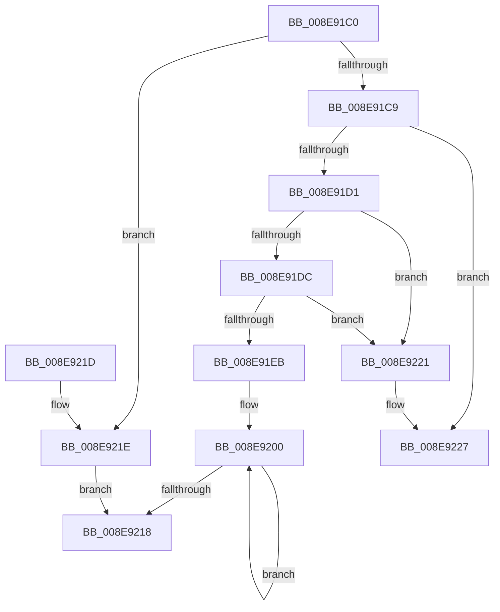

# ProbeForWrite

- RVA: `0x008E91C0`–`0x008E922D` (길이 `109` bytes)
- VA: `0x00000001408E91C0`
- 실행 섹션: `PAGE`
- PDB 이름 있음: `예`; PDB Function 태그: `아니요`
- unwind 정보 RVA: `0x0005D35C`
- 디코드: `31`개 명령, `109/109` bytes 표시
- 미해석 바이트: `0` (있으면 어셈블리에 `.byte`로 보존)

> 이 문서는 커널 이미지의 기계어와 PDB 기호를 분석해 생성했습니다. 4번과 5번은 함수 원형과 자료형을 바이너리 사용 방식에서 추정한 C 해석이며 원본 소스 복구 결과는 아닙니다.

## 1. Dependencies

- 직접 호출 지점: **2**; 고유 호출 대상: **2**
- 직접 호출자로 확인된 함수: **106**
- RIP 상대 이미지 참조: **0**

### Outgoing calls
- `0x008E9221` → [ExRaiseAccessViolation](ExRaiseAccessViolation_function_008E9240.md) (function, `0x008E9240`)
- `0x008E9227` → [ExRaiseDatatypeMisalignment](../89/ExRaiseDatatypeMisalignment_function_00899FD0.md) (function, `0x00899FD0`)

### Direct callers
- [NtGetWriteWatch](../../text/2A/NtGetWriteWatch_function_002A7CE0.md) at `0x002A7E17`
- [NtWaitForWorkViaWorkerFactory](../../text/39/NtWaitForWorkViaWorkerFactory_function_00394270.md) at `0x003943A3`
- [PfpMemoryListQuery](../../text/3B/PfpMemoryListQuery_function_003B9DB8.md) at `0x003B9E2F`
- [KiDispatchException](../../text/3D/KiDispatchException_function_003D7650.md) at `0x003D7AFB`
- [KiInitializeUserApc](../../text/3D/KiInitializeUserApc_function_003D8D38.md) at `0x003D8EA6`
- [SeAccessCheckByType](../../text/44/SeAccessCheckByType_function_00440BC8.md) at `0x00440F91`
- [SeAccessCheckByType](../../text/44/SeAccessCheckByType_function_00440BC8.md) at `0x00440FA7`
- [SeAccessCheckByType](../../text/44/SeAccessCheckByType_function_00440BC8.md) at `0x00440FF5`
- [PfpMemoryRangesQuery](../../text/4D/PfpMemoryRangesQuery_function_004D1D54.md) at `0x004D1D88`
- [PsQueryCpuQuotaInformation](../../text/5E/PsQueryCpuQuotaInformation_function_005E27C0.md) at `0x005E2845`
- [DifProbeForWriteWrapper](../../text/63/DifProbeForWriteWrapper_function_0063A770.md) at `0x0063A854`
- [MiDbgCopyMemory](../../text/68/MiDbgCopyMemory_function_00684A18.md) at `0x00684B64`
- [IopIoRingDispatchRegisterBuffers](../71/IopIoRingDispatchRegisterBuffers_function_0071FC18.md) at `0x0071FE9B`
- [NtCreateIoRing](../72/NtCreateIoRing_function_00720530.md) at `0x007205F1`
- [NtQueryIoRingCapabilities](../72/NtQueryIoRingCapabilities_function_00720D00.md) at `0x00720D38`
- [NtQueryQuotaInformationFile](../72/NtQueryQuotaInformationFile_function_00720FE0.md) at `0x007210BD`
- [NtQueryInformationPort](../74/NtQueryInformationPort_function_0074BEB0.md) at `0x0074BEE1`
- [ObQueryRefTraceInformation](../74/ObQueryRefTraceInformation_function_0074F4D4.md) at `0x0074F510`
- [PfpQueryFileExtentsRequest](../75/PfpQueryFileExtentsRequest_function_007508E8.md) at `0x007509C9`
- [PfpQueryFileExtentsRequest](../75/PfpQueryFileExtentsRequest_function_007508E8.md) at `0x00750E5D`
- [NtGetCurrentProcessorNumberEx](../78/NtGetCurrentProcessorNumberEx_function_00781AC0.md) at `0x00781AE4`
- [NtQueryInformationCpuPartition](../78/NtQueryInformationCpuPartition_function_00783320.md) at `0x007833A7`
- [SmProcessCompressionAcceleratorRequest](../7A/SmProcessCompressionAcceleratorRequest_function_007A5EEC.md) at `0x007A5F72`
- [SmProcessCompressionReadStatsRequest](../7A/SmProcessCompressionReadStatsRequest_function_007A6090.md) at `0x007A612E`
- [SmProcessListRequest](../7A/SmProcessListRequest_function_007A67A8.md) at `0x007A68C8`
- [EtwpSetCoverageSamplerInformation](../7C/EtwpSetCoverageSamplerInformation_function_007C288C.md) at `0x007C2A13`
- [ExpGetSystemPlatformBinary](../7C/ExpGetSystemPlatformBinary_function_007C3C18.md) at `0x007C3FA9`
- [ExpGetSystemPlatformBinary](../7C/ExpGetSystemPlatformBinary_function_007C3C18.md) at `0x007C3FD8`
- [NtEnumerateDriverEntries](../7C/NtEnumerateDriverEntries_function_007CD5D0.md) at `0x007CD686`
- [NtEnumerateSystemEnvironmentValuesEx](../7C/NtEnumerateSystemEnvironmentValuesEx_function_007CDA30.md) at `0x007CDAC7`
- [NtQueryDriverEntryOrder](../7C/NtQueryDriverEntryOrder_function_007CDCE0.md) at `0x007CDD7F`
- [NtQuerySystemEnvironmentValue](../7C/NtQuerySystemEnvironmentValue_function_007CDFB0.md) at `0x007CE09E`
- [ExpProfileCreate](../7D/ExpProfileCreate_function_007D1AB8.md) at `0x007D1C8C`
- [NtQueryAuxiliaryCounterFrequency](../7D/NtQueryAuxiliaryCounterFrequency_function_007D2190.md) at `0x007D21BA`
- [NtPssCaptureVaSpaceBulk](../7D/NtPssCaptureVaSpaceBulk_function_007D4EA0.md) at `0x007D4F8E`
- [NtQueryOpenSubKeysEx](../7E/NtQueryOpenSubKeysEx_function_007E0190.md) at `0x007E02C8`
- [MiAllocateUserPhysicalPages](../80/MiAllocateUserPhysicalPages_function_00809828.md) at `0x00809A37`
- [MmManagePartitionCharges](../80/MmManagePartitionCharges_function_0080DDAC.md) at `0x0080DF41`
- [MmManagePartitionNodeInformation](../80/MmManagePartitionNodeInformation_function_0080E490.md) at `0x0080E552`
- [MiQuerySpecialPurposeMemoryInformation](../80/MiQuerySpecialPurposeMemoryInformation_function_0080FBC8.md) at `0x0080FC35`
- [AlpcpCaptureAttributes](../88/AlpcpCaptureAttributes_function_0088CD20.md) at `0x0088CFB8`
- [AlpcpReceiveMessage](../89/AlpcpReceiveMessage_function_00897ED0.md) at `0x00898158`
- [AlpcpProbeMessageAttributes](../89/AlpcpProbeMessageAttributes_function_008995A0.md) at `0x00899708`
- [EtwQueryProcessTelemetryInfo](../8A/EtwQueryProcessTelemetryInfo_function_008A51A0.md) at `0x008A5369`
- [NtQueryEaFile](../8A/NtQueryEaFile_function_008AC1B0.md) at `0x008AC245`
- [NtQueryVolumeInformationFile](../8A/NtQueryVolumeInformationFile_function_008AC8C0.md) at `0x008ACA07`
- [IopReadFile](../8A/IopReadFile_function_008AEFF0.md) at `0x008AF176`
- [NtQueryMultipleValueKey](../8B/NtQueryMultipleValueKey_function_008B13B0.md) at `0x008B1583`
- [NtQueryMultipleValueKey](../8B/NtQueryMultipleValueKey_function_008B13B0.md) at `0x008B15A7`
- [NtEnumerateKey](../8B/NtEnumerateKey_function_008B1F70.md) at `0x008B245A`
- [EtwpGetLoggerInfoFromContext](../8B/EtwpGetLoggerInfoFromContext_function_008BEF90.md) at `0x008BF261`
- [EtwpGetLoggerInfoFromContext](../8B/EtwpGetLoggerInfoFromContext_function_008BEF90.md) at `0x008BF2FE`
- [NtSetInformationThread](../8C/NtSetInformationThread_function_008C9F60.md) at `0x008CA109`
- [PspInitializeThunkContext](../8D/PspInitializeThunkContext_function_008D5418.md) at `0x008D56BA`
- [PiDqIrpQueryGetResult](../8D/PiDqIrpQueryGetResult_function_008DBF28.md) at `0x008DBFE6`
- [PiCMReturnBasicResultData](PiCMReturnBasicResultData_function_008E86E8.md) at `0x008E8720`
- [BuildQueryDirectoryIrp](BuildQueryDirectoryIrp_function_008EC770.md) at `0x008EC9A1`
- [PfQuerySuperfetchInformation](../90/PfQuerySuperfetchInformation_function_0090210C.md) at `0x009023AF`
- [PfpPfnPrioRequest](../90/PfpPfnPrioRequest_function_00902488.md) at `0x00902545`
- [PfGetCompletedTrace](../90/PfGetCompletedTrace_function_00902950.md) at `0x00902B8E`
- [NtManagePartition](../90/NtManagePartition_function_00902FC0.md) at `0x00903194`
- [PfpQueryGpuUtilization](../90/PfpQueryGpuUtilization_function_00903974.md) at `0x009039A3`
- [PfpPrivSourceEnum](../91/PfpPrivSourceEnum_function_0091BF00.md) at `0x0091BFAB`
- [NtSecureConnectPort](../92/NtSecureConnectPort_function_00922F20.md) at `0x009230A3`
- [PfpPrefetchRequest](../93/PfpPrefetchRequest_function_009385CC.md) at `0x00938757`
- [NtQuerySystemEnvironmentValueEx](../95/NtQuerySystemEnvironmentValueEx_function_00952180.md) at `0x009522D0`
- [NtPowerInformation](../95/NtPowerInformation_function_00955D80.md) at `0x00956159`
- [ExpGetDeviceDataInformation](../95/ExpGetDeviceDataInformation_function_0095A300.md) at `0x0095A3C6`
- [NtQuerySecurityPolicy](../97/NtQuerySecurityPolicy_function_00973410.md) at `0x009734D2`
- [NtQuerySecurityPolicy](../97/NtQuerySecurityPolicy_function_00973410.md) at `0x00973511`
- [NtQuerySecurityPolicy](../97/NtQuerySecurityPolicy_function_00973410.md) at `0x00973530`
- [NtQueryDirectoryObject](../99/NtQueryDirectoryObject_function_0099EA20.md) at `0x0099EA87`
- [MiCaptureAllocateMapExtendedParameters](../9A/MiCaptureAllocateMapExtendedParameters_function_009A2110.md) at `0x009A21C2`
- [NtAdjustGroupsToken](../9C/NtAdjustGroupsToken_function_009C6640.md) at `0x009C66D9`
- [NtAdjustPrivilegesToken](../9C/NtAdjustPrivilegesToken_function_009C86C0.md) at `0x009C8798`
- [PiCMReturnStatusResultData](../9D/PiCMReturnStatusResultData_function_009D149C.md) at `0x009D14ED`
- [MmQueryVirtualMemory](../9D/MmQueryVirtualMemory_function_009D9280.md) at `0x009D949B`
- [NtNotifyChangeMultipleKeys](../9D/NtNotifyChangeMultipleKeys_function_009DC6B0.md) at `0x009DC84C`
- [NtNotifyChangeMultipleKeys](../9D/NtNotifyChangeMultipleKeys_function_009DC6B0.md) at `0x009DC861`
- [AuthzBasepProbeAndInsertTailList](../9E/AuthzBasepProbeAndInsertTailList_function_009EA448.md) at `0x009EA49D`
- [NtQueryWnfStateNameInformation](../9E/NtQueryWnfStateNameInformation_function_009EBD20.md) at `0x009EBE4B`
- [NtGetMUIRegistryInfo](../9E/NtGetMUIRegistryInfo_function_009EC780.md) at `0x009EC8EA`
- [NtSetInformationVirtualMemory](../9F/NtSetInformationVirtualMemory_function_009F4580.md) at `0x009F47BE`
- [SmProcessCompressionInfoRequest](../A0/SmProcessCompressionInfoRequest_function_00A0E980.md) at `0x00A0EA38`
- [sub_00A179B0](../A1/Unknown_function_00A179B0.md) at `0x00A17B9D`
- [SepAccessCheckAndAuditAlarm](../A1/SepAccessCheckAndAuditAlarm_function_00A1AF4C.md) at `0x00A1B333`
- [SepAccessCheckAndAuditAlarm](../A1/SepAccessCheckAndAuditAlarm_function_00A1AF4C.md) at `0x00A1B349`
- [NtNotifyChangeDirectoryFileEx](../A1/NtNotifyChangeDirectoryFileEx_function_00A1DEA0.md) at `0x00A1DF21`
- [NtTranslateFilePath](../A2/NtTranslateFilePath_function_00A24D50.md) at `0x00A24EAC`
- [NtEnumerateBootEntries](../A2/NtEnumerateBootEntries_function_00A25040.md) at `0x00A25105`
- [NtGetCachedSigningLevel](../A4/NtGetCachedSigningLevel_function_00A42820.md) at `0x00A429C8`
- [NtGetCachedSigningLevel](../A4/NtGetCachedSigningLevel_function_00A42820.md) at `0x00A429D8`
- [NtGetCachedSigningLevel](../A4/NtGetCachedSigningLevel_function_00A42820.md) at `0x00A42A07`
- [NtGetCachedSigningLevel](../A4/NtGetCachedSigningLevel_function_00A42820.md) at `0x00A42A3C`
- [NtGetCachedSigningLevel](../A4/NtGetCachedSigningLevel_function_00A42820.md) at `0x00A42A86`
- [NtQueryMutant](../A4/NtQueryMutant_function_00A458D0.md) at `0x00A4592B`
- [PfSnGetCompletedTrace](../A5/PfSnGetCompletedTrace_function_00A51C74.md) at `0x00A51D77`
- [ExpQuerySystemInformation](../A5/ExpQuerySystemInformation_function_00A57858.md) at `0x00A57A94`
- [ExpQuerySystemInformation](../A5/ExpQuerySystemInformation_function_00A57858.md) at `0x00A58898`
- [EtwpRealtimeConnect](../A6/EtwpRealtimeConnect_function_00A65C88.md) at `0x00A65D32`
- [EtwpRealtimeConnect](../A6/EtwpRealtimeConnect_function_00A65C88.md) at `0x00A65D43`
- [EtwpRealtimeConnect](../A6/EtwpRealtimeConnect_function_00A65C88.md) at `0x00A65DEB`
- [SmProcessSystemStoreTrimRequest](../A7/SmProcessSystemStoreTrimRequest_function_00A784E0.md) at `0x00A78565`
- [NtQueryBootEntryOrder](../A9/NtQueryBootEntryOrder_function_00A91720.md) at `0x00A917C9`
- [PiCMReturnDepthResultData](../A9/PiCMReturnDepthResultData_function_00A96CAC.md) at `0x00A96CF9`
- [NtTraceControl](../A9/NtTraceControl_function_00A9ED40.md) at `0x00A9EE15`
- [NtConvertBetweenAuxiliaryCounterAndPerformanceCounter](../AA/NtConvertBetweenAuxiliaryCounterAndPerformanceCounter_function_00AA5B90.md) at `0x00AA5BFF`
- [NtConvertBetweenAuxiliaryCounterAndPerformanceCounter](../AA/NtConvertBetweenAuxiliaryCounterAndPerformanceCounter_function_00AA5B90.md) at `0x00AA5C15`
- [NtQueryBootOptions](../AA/NtQueryBootOptions_function_00AAFBC0.md) at `0x00AAFC58`
- [PopBootStatCheckIntegrity](../AC/PopBootStatCheckIntegrity_function_00ACDF4C.md) at `0x00ACE052`
- [MiQueryMemoryPhysicalContiguity](../AD/MiQueryMemoryPhysicalContiguity_function_00AD5B98.md) at `0x00AD5C2C`
- [MiQueryMemoryPhysicalContiguity](../AD/MiQueryMemoryPhysicalContiguity_function_00AD5B98.md) at `0x00AD5D9A`
- [PfpDeprioritizeOldPagesInWs](../AD/PfpDeprioritizeOldPagesInWs_function_00ADF310.md) at `0x00ADF364`
- [NtQueryInformationThread](../AE/NtQueryInformationThread_function_00AE3760.md) at `0x00AE42D1`
- [NtSetInformationProcess](../AE/NtSetInformationProcess_function_00AE5370.md) at `0x00AE6FE1`
- [NtSetInformationProcess](../AE/NtSetInformationProcess_function_00AE5370.md) at `0x00AE999D`
- [NtSetInformationProcess](../AE/NtSetInformationProcess_function_00AE5370.md) at `0x00AE9B71`
- [NtQueryInformationToken](../AE/NtQueryInformationToken_function_00AECDD0.md) at `0x00AECE92`
- [NtQueryInformationAtom](../AF/NtQueryInformationAtom_function_00AF7720.md) at `0x00AF77AF`
- [NtManageHotPatch](../AF/NtManageHotPatch_function_00AF8660.md) at `0x00AF88AB`
- [sub_00B2081E](../B2/Unknown_function_00B2081E.md) at `0x00B20830`
- [sub_00B2A9C6](../B2/Unknown_function_00B2A9C6.md) at `0x00B2AA00`
- [sub_00B3B9F4](../B3/Unknown_function_00B3B9F4.md) at `0x00B3BA5F`
- [sub_00B3F842](../B3/Unknown_function_00B3F842.md) at `0x00B3F8A2`
- [sub_00B4A930](../B4/Unknown_function_00B4A930.md) at `0x00B4A94C`
- [KdpPrompt](../../pagekd/B8/KdpPrompt_function_00B890AC.md) at `0x00B8916C`
- [RtlpIcAccessMemory](../../tracesup/BC/RtlpIcAccessMemory_function_00BC7198.md) at `0x00BC71E4`

### Static image references
- 디코드된 RIP-relative 메모리 참조가 없습니다.

## 2. Other-region calls and transfers

- 다른 실행 섹션으로 향하는 call: **0**
- 별도 외부 분기/꼬리 이동을 확인하지 못했습니다.

## 3. Assembly (complete function range)

```asm
008E91C0  48 83 EC 28                     sub rsp, 0x28
008E91C4  48 85 D2                        test rdx, rdx
008E91C7  74 55                           je 0x1408e921e
008E91C9  41 FF C8                        dec r8d
008E91CC  4C 85 C1                        test rcx, r8
008E91CF  75 56                           jne 0x1408e9227
008E91D1  48 FF CA                        dec rdx
008E91D4  48 03 D1                        add rdx, rcx
008E91D7  48 3B CA                        cmp rcx, rdx
008E91DA  77 45                           ja 0x1408e9221
008E91DC  48 B8 00 00 FF FF FF 7F 00 00   movabs rax, 0x7fffffff0000
008E91E6  48 3B D0                        cmp rdx, rax
008E91E9  73 36                           jae 0x1408e9221
008E91EB  48 81 E2 00 F0 FF FF            and rdx, 0xfffffffffffff000
008E91F2  48 81 C2 00 10 00 00            add rdx, 0x1000
008E91F9  0F 1F 80 00 00 00 00            nop dword ptr [rax]
008E9200  0F B6 01                        movzx eax, byte ptr [rcx]
008E9203  88 01                           mov byte ptr [rcx], al
008E9205  48 81 E1 00 F0 FF FF            and rcx, 0xfffffffffffff000
008E920C  48 81 C1 00 10 00 00            add rcx, 0x1000
008E9213  48 3B CA                        cmp rcx, rdx
008E9216  75 E8                           jne 0x1408e9200
008E9218  48 83 C4 28                     add rsp, 0x28
008E921C  C3                              ret
008E921D  CC                              int3
008E921E  90                              nop
008E921F  EB F7                           jmp 0x1408e9218
008E9221  E8 1A 00 00 00                  call 0x1408e9240
008E9226  CC                              int3
008E9227  E8 A4 0D FB FF                  call 0x140899fd0
008E922C  CC                              int3
```

## 4. C-style interpretation (structured pseudocode)

```c
__int64 __fastcall ProbeForWrite(__int64 a1, __int64 a2, int a3)
{
    __int64 result;
    __int64 v_rsp;

    v_rsp = (v_rsp) - (40);
    if (a2 == 0) goto loc_008E921E;
    a3 = (unsigned int)((a3) - 1);
    if (((a1) & (a3)) != 0) goto loc_008E9227;
    a2 = (a2) - 1;
    a2 = (a2) + (a1);
    if (a1 > a2) goto loc_008E9221;
    if (a2 >= result) goto loc_008E9221;
    a2 = (a2) & (0xFFFFFFFFFFFFF000ULL);
    a2 = (a2) + (0x1000ULL);
loc_008E9200:
    *(unsigned __int8 *)(a1) = (unsigned __int8)(*(unsigned __int8 *)(a1));
    a1 = (a1) & (0xFFFFFFFFFFFFF000ULL);
    a1 = (a1) + (0x1000ULL);
    if (a1 != a2) goto loc_008E9200;
loc_008E9218:
    v_rsp = (v_rsp) + (40);
    return *(unsigned __int8 *)(a1);
loc_008E921E:
    goto loc_008E9218;
loc_008E9221:
    result = ExRaiseAccessViolation(a1, a2, a3, a4);
loc_008E9227:
    result = ExRaiseDatatypeMisalignment(a1, a2, a3, a4);
    return result;
}
```

## 5. (Beta) C Style

```c
int64_t ProbeForWrite(int64_t Arg1, int64_t Arg2, int32_t Arg3)
{
    int64_t result;
    int64_t local_rsp;

    local_rsp = (local_rsp) - (40);
    if (Arg2 == 0) goto loc_008E921E;
    Arg3 = (uint32_t)((Arg3) - 1);
    if (((Arg1) & (Arg3)) != 0) goto loc_008E9227;
    Arg2 = (Arg2) - 1;
    Arg2 = (Arg2) + (Arg1);
    if (Arg1 > Arg2) goto loc_008E9221;
    if (Arg2 >= result) goto loc_008E9221;
    Arg2 = (Arg2) & (0xFFFFFFFFFFFFF000ULL);
    Arg2 = (Arg2) + (0x1000ULL);
loc_008E9200:
    *(uint8_t *)(Arg1) = (uint8_t)(*(uint8_t *)(Arg1));
    Arg1 = (Arg1) & (0xFFFFFFFFFFFFF000ULL);
    Arg1 = (Arg1) + (0x1000ULL);
    if (Arg1 != Arg2) goto loc_008E9200;
loc_008E9218:
    local_rsp = (local_rsp) + (40);
    return *(uint8_t *)(Arg1);
loc_008E921E:
    goto loc_008E9218;
loc_008E9221:
    result = ExRaiseAccessViolation(Arg1, Arg2, Arg3, a4);
loc_008E9227:
    result = ExRaiseDatatypeMisalignment(Arg1, Arg2, Arg3, a4);
    return result;
}
```

## 6. Execution-region graph

[열기: 2D/3D 그래프와 함수 탐색 컨트롤 패널](../../../control-panel.html?section=page&rva=0x008E91C0&view=graph)

- 2D 그래프는 위에서 아래로 흐르고, 3D 그래프는 빈 공간을 드래그해 회전합니다. Shift+드래그는 이동, 휠은 확대·축소, 함수 노드 선택은 대상 보고서 이동입니다.

### Static fallback


