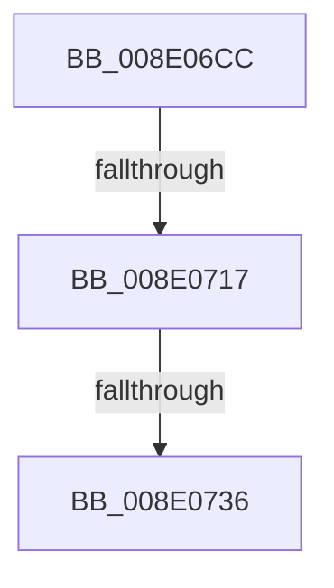

# sub_008E06CC

- RVA: `0x008E06CC`–`0x008E0753` (길이 `135` bytes)
- VA: `0x00000001408E06CC`
- 실행 섹션: `PAGE`
- PDB 이름 있음: `아니요`; PDB Function 태그: `아니요`
- unwind 정보 RVA: `0x00085D38`
- 디코드: `26`개 명령, `135/135` bytes 표시
- 미해석 바이트: `0` (있으면 어셈블리에 `.byte`로 보존)

> 이 문서는 커널 이미지의 기계어와 PDB 기호를 분석해 생성했습니다. 4번과 5번은 함수 원형과 자료형을 바이너리 사용 방식에서 추정한 C 해석이며 원본 소스 복구 결과는 아닙니다.

## 1. Dependencies

- 직접 호출 지점: **3**; 고유 호출 대상: **3**
- 직접 호출자로 확인된 함수: **0**
- RIP 상대 이미지 참조: **2**

### Outgoing calls
- `0x008E06FF` → [ExAcquireResourceSharedLite](../../text/21/ExAcquireResourceSharedLite_function_00211BC0.md) (function, `0x00211BC0`)
- `0x008E071E` → [ExReleaseResourceLite](../../text/25/ExReleaseResourceLite_function_0025FA10.md) (function, `0x0025FA10`)
- `0x008E072C` → [KeLeaveCriticalRegionThread](../../text/25/KeLeaveCriticalRegionThread_function_0025EFF0.md) (function, `0x0025EFF0`)

### Direct callers
- 이 함수 시작 RVA로 연결되는 직접 call은 확인되지 않았습니다. 간접 호출은 완전히 역산할 수 없습니다.

### Static image references
- `0x008E06D0` → RVA `0x00F8B9E0` (`.data`; read)
- `0x008E0704` → RVA `0x00F8B9D0` (`.data`; read)

## 2. Other-region calls and transfers

- 다른 실행 섹션으로 향하는 call: **3**
  - `0x008E06FF` → [ExAcquireResourceSharedLite](../../text/21/ExAcquireResourceSharedLite_function_00211BC0.md) (`PAGE` → `.text`)
  - `0x008E071E` → [ExReleaseResourceLite](../../text/25/ExReleaseResourceLite_function_0025FA10.md) (`PAGE` → `.text`)
  - `0x008E072C` → [KeLeaveCriticalRegionThread](../../text/25/KeLeaveCriticalRegionThread_function_0025EFF0.md) (`PAGE` → `.text`)
- call이 아닌 외부 분기/꼬리 이동: **2**
  - `0x008E0715` → [sub_008E0776](Unknown_function_008E0776.md) (`tail-transfer`)
  - `0x008E0734` → [sub_008E078C](Unknown_function_008E078C.md) (`tail-transfer`)

## 3. Assembly (complete function range)

```asm
008E06CC  49 89 5B D8                     mov qword ptr [r11 - 0x28], rbx
008E06D0  48 8D 0D 09 B3 6A 00            lea rcx, [rip + 0x6ab309]
008E06D7  65 48 8B 1C 25 88 01 00 00      mov rbx, qword ptr gs:[0x188]
008E06E0  B2 01                           mov dl, 1
008E06E2  65 48 8B 04 25 88 01 00 00      mov rax, qword ptr gs:[0x188]
008E06EB  49 89 73 D0                     mov qword ptr [r11 - 0x30], rsi
008E06EF  49 89 7B C8                     mov qword ptr [r11 - 0x38], rdi
008E06F3  33 FF                           xor edi, edi
008E06F5  8B F7                           mov esi, edi
008E06F7  66 FF 88 E4 01 00 00            dec word ptr [rax + 0x1e4]
008E06FE  90                              nop
008E06FF  E8 BC 14 93 FF                  call 0x140211bc0
008E0704  48 8B 05 C5 B2 6A 00            mov rax, qword ptr [rip + 0x6ab2c5]
008E070B  48 8D 0D BE B2 6A 00            lea rcx, [rip + 0x6ab2be]
008E0712  48 3B C1                        cmp rax, rcx
008E0715  75 5F                           jne 0x1408e0776
008E0717  48 8D 0D C2 B2 6A 00            lea rcx, [rip + 0x6ab2c2]
008E071E  E8 ED F2 97 FF                  call 0x14025fa10
008E0723  65 48 8B 0C 25 88 01 00 00      mov rcx, qword ptr gs:[0x188]
008E072C  E8 BF E8 97 FF                  call 0x14025eff0
008E0731  48 85 F6                        test rsi, rsi
008E0734  75 56                           jne 0x1408e078c
008E0736  B8 25 02 00 C0                  mov eax, 0xc0000225
008E073B  48 8B B4 24 68 01 00 00         mov rsi, qword ptr [rsp + 0x168]
008E0743  48 8B 9C 24 70 01 00 00         mov rbx, qword ptr [rsp + 0x170]
008E074B  48 8B BC 24 60 01 00 00         mov rdi, qword ptr [rsp + 0x160]
```

## 4. C-style interpretation (structured pseudocode)

```c
__int64 __fastcall sub_008E06CC(__int64 a1, __int64 a2, __int64 a3, __int64 a4, __int64 a5, __int64 a6, __int64 a7, __int64 a8, __int64 a9, __int64 a10, __int64 a11, __int64 a12, __int64 a13, __int64 a14, __int64 a15, __int64 a16, __int64 a17, __int64 a18, __int64 a19, __int64 a20, __int64 a21, __int64 a22, __int64 a23, __int64 a24, __int64 a25, __int64 a26, __int64 a27, __int64 a28, __int64 a29, __int64 a30, __int64 a31, __int64 a32, __int64 a33, __int64 a34, __int64 a35, __int64 a36, __int64 a37, __int64 a38, __int64 a39, __int64 a40, __int64 a41, __int64 a42, __int64 a43, __int64 a44, __int64 a45, __int64 a46)
{
    __int64 result;
    __int64 v_rdi;

    *(unsigned __int64 *)(v_r11 - 40) = v_rbx;
    *(unsigned __int64 *)(v_r11 - 48) = v_rsi;
    *(unsigned __int64 *)(v_r11 - 56) = v_rdi;
    v_rdi = 0;
    result = ExAcquireResourceSharedLite(v_rip + 6992649, 1, a3, a4);
    result = ExReleaseResourceLite(v_rip + 6992578, 1, a3, a4);
    result = KeLeaveCriticalRegionThread(*(unsigned __int64 *)(gs_base + (0 + 392)), 1, a3, a4);
    return (unsigned int)(0xC0000225ULL);
}
```

## 5. (Beta) C Style

```c
int64_t sub_008E06CC(int64_t Arg1, int64_t Arg2, int64_t Arg3, int64_t Arg4, uint64_t Arg5, uint64_t Arg6, uint64_t Arg7, uint64_t Arg8, uint64_t Arg9, uint64_t Arg10, uint64_t Arg11, uint64_t Arg12, uint64_t Arg13, uint64_t Arg14, uint64_t Arg15, uint64_t Arg16, uint64_t Arg17, uint64_t Arg18, uint64_t Arg19, uint64_t Arg20, uint64_t Arg21, uint64_t Arg22, uint64_t Arg23, uint64_t Arg24, uint64_t Arg25, uint64_t Arg26, uint64_t Arg27, uint64_t Arg28, uint64_t Arg29, uint64_t Arg30, uint64_t Arg31, uint64_t Arg32, uint64_t Arg33, uint64_t Arg34, uint64_t Arg35, uint64_t Arg36, uint64_t Arg37, uint64_t Arg38, uint64_t Arg39, uint64_t Arg40, uint64_t Arg41, uint64_t Arg42, uint64_t Arg43, int64_t Arg44, int64_t Arg45, int64_t Arg46)
{
    int64_t result;
    int64_t local_rdi;

    *(uint64_t *)(local_r11 - 0x28) = local_rbx;
    *(uint64_t *)(local_r11 - 0x30) = local_rsi;
    *(uint64_t *)(local_r11 - 0x38) = local_rdi;
    local_rdi = 0;
    result = ExAcquireResourceSharedLite(v_rip + 6992649, 1, Arg3, Arg4);
    result = ExReleaseResourceLite(v_rip + 6992578, 1, Arg3, Arg4);
    result = KeLeaveCriticalRegionThread(*(uint64_t *)(gs_base + (0 + 0x188)), 1, Arg3, Arg4);
    return (uint32_t)(0xC0000225ULL);
}
```

## 6. Execution-region graph

[열기: 2D/3D 그래프와 함수 탐색 컨트롤 패널](../../../control-panel.html?section=page&rva=0x008E06CC&view=graph)

- 2D 그래프는 위에서 아래로 흐르고, 3D 그래프는 빈 공간을 드래그해 회전합니다. Shift+드래그는 이동, 휠은 확대·축소, 함수 노드 선택은 대상 보고서 이동입니다.

### Static fallback


