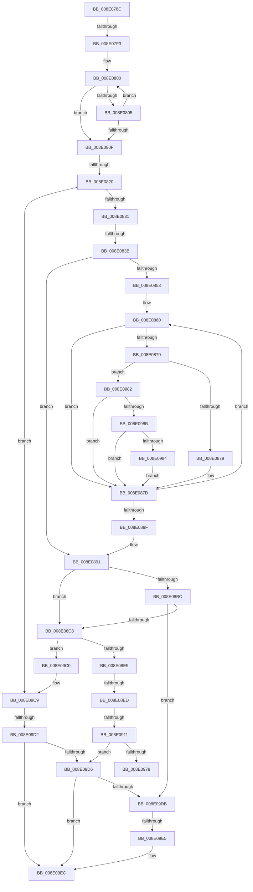

# sub_008E078C

- RVA: `0x008E078C`–`0x008E0A15` (길이 `649` bytes)
- VA: `0x00000001408E078C`
- 실행 섹션: `PAGE`
- PDB 이름 있음: `아니요`; PDB Function 태그: `아니요`
- unwind 정보 RVA: `0x00085D84`
- 디코드: `162`개 명령, `649/649` bytes 표시
- 미해석 바이트: `0` (있으면 어셈블리에 `.byte`로 보존)

> 이 문서는 커널 이미지의 기계어와 PDB 기호를 분석해 생성했습니다. 4번과 5번은 함수 원형과 자료형을 바이너리 사용 방식에서 추정한 C 해석이며 원본 소스 복구 결과는 아닙니다.

## 1. Dependencies

- 직접 호출 지점: **10**; 고유 호출 대상: **9**
- 직접 호출자로 확인된 함수: **0**
- RIP 상대 이미지 참조: **1**

### Outgoing calls
- `0x008E0794` → [PiPnpRtlDisableRemoveOperationDispatch](PiPnpRtlDisableRemoveOperationDispatch_function_008E0AAC.md) (function, `0x008E0AAC`)
- `0x008E07A7` → [memset](../../text/6C/memset_function_006C6C40.md) (function, `0x006C6C40`)
- `0x008E07B9` → [memset](../../text/6C/memset_function_006C6C40.md) (function, `0x006C6C40`)
- `0x008E083E` → [PsGetCurrentServerSiloGlobals](../../text/2F/PsGetCurrentServerSiloGlobals_function_002FE1F0.md) (function, `0x002FE1F0`)
- `0x008E08B2` → [RtlLookupElementGenericTableFullAvl](../../text/3E/RtlLookupElementGenericTableFullAvl_function_003EF460.md) (function, `0x003EF460`)
- `0x008E08D3` → [PiDmGetObject](../8D/PiDmGetObject_function_008DFAE0.md) (function, `0x008DFAE0`)
- `0x008E08FB` → [ExAllocatePool2](../../poolcode/B8/ExAllocatePool2_function_00B820F0.md) (function, `0x00B820F0`)
- `0x008E0969` → [RtlInsertElementGenericTableFullAvl](../../text/3E/RtlInsertElementGenericTableFullAvl_function_003EED00.md) (function, `0x003EED00`)
- `0x008E09F3` → [ExReleaseResourceLite](../../text/25/ExReleaseResourceLite_function_0025FA10.md) (function, `0x0025FA10`)
- `0x008E0A01` → [KeLeaveCriticalRegionThread](../../text/25/KeLeaveCriticalRegionThread_function_0025EFF0.md) (function, `0x0025EFF0`)

### Direct callers
- 이 함수 시작 RVA로 연결되는 직접 call은 확인되지 않았습니다. 간접 호출은 완전히 역산할 수 없습니다.

### Static image references
- `0x008E09EC` → RVA `0x00F8B960` (`.data`; read)

## 2. Other-region calls and transfers

- 다른 실행 섹션으로 향하는 call: **8**
  - `0x008E07A7` → [memset](../../text/6C/memset_function_006C6C40.md) (`PAGE` → `.text`)
  - `0x008E07B9` → [memset](../../text/6C/memset_function_006C6C40.md) (`PAGE` → `.text`)
  - `0x008E083E` → [PsGetCurrentServerSiloGlobals](../../text/2F/PsGetCurrentServerSiloGlobals_function_002FE1F0.md) (`PAGE` → `.text`)
  - `0x008E08B2` → [RtlLookupElementGenericTableFullAvl](../../text/3E/RtlLookupElementGenericTableFullAvl_function_003EF460.md) (`PAGE` → `.text`)
  - `0x008E08FB` → [ExAllocatePool2](../../poolcode/B8/ExAllocatePool2_function_00B820F0.md) (`PAGE` → `POOLCODE`)
  - `0x008E0969` → [RtlInsertElementGenericTableFullAvl](../../text/3E/RtlInsertElementGenericTableFullAvl_function_003EED00.md) (`PAGE` → `.text`)
  - `0x008E09F3` → [ExReleaseResourceLite](../../text/25/ExReleaseResourceLite_function_0025FA10.md) (`PAGE` → `.text`)
  - `0x008E0A01` → [KeLeaveCriticalRegionThread](../../text/25/KeLeaveCriticalRegionThread_function_0025EFF0.md) (`PAGE` → `.text`)
- call이 아닌 외부 분기/꼬리 이동: **9**
  - `0x008E07ED` → [sub_008E0A15 + 0x5F](Unknown_function_008E0A15.md) (`tail-transfer`)
  - `0x008E081A` → [sub_008E0A15 + 0x5F](Unknown_function_008E0A15.md) (`tail-transfer`)
  - `0x008E0835` → [sub_008E0A15 + 0x2F](Unknown_function_008E0A15.md) (`tail-transfer`)
  - `0x008E08E7` → [sub_008E0A15 + 0x46](Unknown_function_008E0A15.md) (`tail-transfer`)
  - `0x008E090B` → [sub_008E0A15 + 0x78](Unknown_function_008E0A15.md) (`tail-transfer`)
  - `0x008E097D` → [sub_008E0A15 + 0x4B](Unknown_function_008E0A15.md) (`tail-transfer`)
  - `0x008E09CC` → [sub_008E0A15 + 0x7F](Unknown_function_008E0A15.md) (`tail-transfer`)
  - `0x008E09E3` → [sub_008E0A15](Unknown_function_008E0A15.md) (`tail-transfer`)
  - `0x008E0A10` → [sub_008E06CC + 0x6F](Unknown_function_008E06CC.md) (`tail-transfer`)

## 3. Assembly (complete function range)

```asm
008E078C  4C 89 BC 24 58 01 00 00         mov qword ptr [rsp + 0x158], r15
008E0794  E8 13 03 00 00                  call 0x1408e0aac
008E0799  33 D2                           xor edx, edx
008E079B  48 89 7D D0                     mov qword ptr [rbp - 0x30], rdi
008E079F  48 8D 4D D8                     lea rcx, [rbp - 0x28]
008E07A3  44 8D 42 68                     lea r8d, [rdx + 0x68]
008E07A7  E8 94 64 DE FF                  call 0x1406c6c40
008E07AC  33 D2                           xor edx, edx
008E07AE  89 7D 80                        mov dword ptr [rbp - 0x80], edi
008E07B1  48 8D 4D 84                     lea rcx, [rbp - 0x7c]
008E07B5  44 8D 42 4C                     lea r8d, [rdx + 0x4c]
008E07B9  E8 82 64 DE FF                  call 0x1406c6c40
008E07BE  48 89 7C 24 60                  mov qword ptr [rsp + 0x60], rdi
008E07C3  48 8D 45 80                     lea rax, [rbp - 0x80]
008E07C7  48 89 44 24 68                  mov qword ptr [rsp + 0x68], rax
008E07CC  0F 57 C0                        xorps xmm0, xmm0
008E07CF  89 7C 24 40                     mov dword ptr [rsp + 0x40], edi
008E07D3  4C 8B FF                        mov r15, rdi
008E07D6  48 89 7C 24 48                  mov qword ptr [rsp + 0x48], rdi
008E07DB  8B DF                           mov ebx, edi
008E07DD  4C 89 65 E0                     mov qword ptr [rbp - 0x20], r12
008E07E1  44 89 75 EC                     mov dword ptr [rbp - 0x14], r14d
008E07E5  0F 11 44 24 50                  movups xmmword ptr [rsp + 0x50], xmm0
008E07EA  4D 85 E4                        test r12, r12
008E07ED  0F 84 81 02 00 00               je 0x1408e0a74
008E07F3  BA FF 7F 00 00                  mov edx, 0x7fff
008E07F8  49 8B C4                        mov rax, r12
008E07FB  8B CA                           mov ecx, edx
008E07FD  0F 1F 00                        nop dword ptr [rax]
008E0800  66 39 18                        cmp word ptr [rax], bx
008E0803  74 0A                           je 0x1408e080f
008E0805  48 83 C0 02                     add rax, 2
008E0809  48 83 E9 01                     sub rcx, 1
008E080D  75 F1                           jne 0x1408e0800
008E080F  48 85 C9                        test rcx, rcx
008E0812  BB 0D 00 00 C0                  mov ebx, 0xc000000d
008E0817  0F 45 DF                        cmovne ebx, edi
008E081A  0F 84 54 02 00 00               je 0x1408e0a74
008E0820  48 2B D1                        sub rdx, rcx
008E0823  4D 8B D4                        mov r10, r12
008E0826  66 03 D2                        add dx, dx
008E0829  85 DB                           test ebx, ebx
008E082B  0F 88 98 01 00 00               js 0x1408e09c9
008E0831  41 83 FE 03                     cmp r14d, 3
008E0835  0F 84 09 02 00 00               je 0x1408e0a44
008E083B  44 8B CF                        mov r9d, edi
008E083E  E8 AD D9 A1 FF                  call 0x1402fe1f0
008E0843  44 0F B7 DA                     movzx r11d, dx
008E0847  41 D1 EB                        shr r11d, 1
008E084A  48 8B 98 B0 04 00 00            mov rbx, qword ptr [rax + 0x4b0]
008E0851  74 3E                           je 0x1408e0891
008E0853  BF C0 00 00 00                  mov edi, 0xc0
008E0858  0F 1F 84 00 00 00 00 00         nop dword ptr [rax + rax]
008E0860  41 0F B7 02                     movzx eax, word ptr [r10]
008E0864  4D 8D 52 02                     lea r10, [r10 + 2]
008E0868  41 FF CB                        dec r11d
008E086B  83 F8 61                        cmp eax, 0x61
008E086E  72 0D                           jb 0x1408e087d
008E0870  83 F8 7A                        cmp eax, 0x7a
008E0873  0F 87 09 01 00 00               ja 0x1408e0982
008E0879  66 83 E8 20                     sub ax, 0x20
008E087D  45 69 C9 3F 00 01 00            imul r9d, r9d, 0x1003f
008E0884  0F B7 C8                        movzx ecx, ax
008E0887  44 03 C9                        add r9d, ecx
008E088A  45 85 DB                        test r11d, r11d
008E088D  75 D1                           jne 0x1408e0860
008E088F  33 FF                           xor edi, edi
008E0891  44 89 4D E8                     mov dword ptr [rbp - 0x18], r9d
008E0895  48 8D 45 D0                     lea rax, [rbp - 0x30]
008E0899  8B DF                           mov ebx, edi
008E089B  4C 8D 4C 24 40                  lea r9, [rsp + 0x40]
008E08A0  48 89 45 88                     mov qword ptr [rbp - 0x78], rax
008E08A4  4C 8D 44 24 60                  lea r8, [rsp + 0x60]
008E08A9  48 8D 54 24 68                  lea rdx, [rsp + 0x68]
008E08AE  48 8D 4E 18                     lea rcx, [rsi + 0x18]
008E08B2  E8 A9 EB B0 FF                  call 0x1403ef460
008E08B7  48 85 C0                        test rax, rax
008E08BA  74 0C                           je 0x1408e08c8
008E08BC  48 8B 38                        mov rdi, qword ptr [rax]
008E08BF  48 85 FF                        test rdi, rdi
008E08C2  0F 85 13 01 00 00               jne 0x1408e09db
008E08C8  4C 8D 44 24 48                  lea r8, [rsp + 0x48]
008E08CD  49 8B D4                        mov rdx, r12
008E08D0  41 8B CE                        mov ecx, r14d
008E08D3  E8 08 F2 FF FF                  call 0x1408dfae0
008E08D8  8B D8                           mov ebx, eax
008E08DA  3D 34 00 00 C0                  cmp eax, 0xc0000034
008E08DF  0F 84 DB 00 00 00               je 0x1408e09c0
008E08E5  85 C0                           test eax, eax
008E08E7  0F 88 6E 01 00 00               js 0x1408e0a5b
008E08ED  BA F0 00 00 00                  mov edx, 0xf0
008E08F2  41 B8 50 6E 70 41               mov r8d, 0x41706e50
008E08F8  8D 4A 10                        lea ecx, [rdx + 0x10]
008E08FB  E8 F0 17 2A 00                  call 0x140b820f0
008E0900  48 89 44 24 50                  mov qword ptr [rsp + 0x50], rax
008E0905  48 8B F8                        mov rdi, rax
008E0908  48 85 C0                        test rax, rax
008E090B  0F 84 7C 01 00 00               je 0x1408e0a8d
008E0911  4C 89 38                        mov qword ptr [rax], r15
008E0914  48 8D 54 24 50                  lea rdx, [rsp + 0x50]
008E0919  4C 89 78 10                     mov qword ptr [rax + 0x10], r15
008E091D  48 8D 4E 18                     lea rcx, [rsi + 0x18]
008E0921  4C 89 78 18                     mov qword ptr [rax + 0x18], r15
008E0925  45 33 C9                        xor r9d, r9d
008E0928  4C 89 78 20                     mov qword ptr [rax + 0x20], r15
008E092C  4C 89 78 28                     mov qword ptr [rax + 0x28], r15
008E0930  4C 89 78 30                     mov qword ptr [rax + 0x30], r15
008E0934  4C 89 78 38                     mov qword ptr [rax + 0x38], r15
008E0938  45 8D 41 08                     lea r8d, [r9 + 8]
008E093C  4C 89 78 40                     mov qword ptr [rax + 0x40], r15
008E0940  48 C7 40 48 05 00 00 00         mov qword ptr [rax + 0x48], 5
008E0948  C7 00 01 00 00 00               mov dword ptr [rax], 1
008E094E  48 8B 44 24 48                  mov rax, qword ptr [rsp + 0x48]
008E0953  48 89 47 08                     mov qword ptr [rdi + 8], rax
008E0957  8B 44 24 40                     mov eax, dword ptr [rsp + 0x40]
008E095B  89 44 24 28                     mov dword ptr [rsp + 0x28], eax
008E095F  48 8B 44 24 60                  mov rax, qword ptr [rsp + 0x60]
008E0964  48 89 44 24 20                  mov qword ptr [rsp + 0x20], rax
008E0969  E8 92 E3 B0 FF                  call 0x1403eed00
008E096E  48 8B 7C 24 50                  mov rdi, qword ptr [rsp + 0x50]
008E0973  48 85 C0                        test rax, rax
008E0976  75 5E                           jne 0x1408e09d6
008E0978  BB 9A 00 00 C0                  mov ebx, 0xc000009a
008E097D  E9 DE 00 00 00                  jmp 0x1408e0a60
008E0982  48 85 DB                        test rbx, rbx
008E0985  0F 84 F2 FE FF FF               je 0x1408e087d
008E098B  66 3B C7                        cmp ax, di
008E098E  0F 82 E9 FE FF FF               jb 0x1408e087d
008E0994  48 8B C8                        mov rcx, rax
008E0997  44 8B C0                        mov r8d, eax
008E099A  48 C1 E9 08                     shr rcx, 8
008E099E  41 83 E0 0F                     and r8d, 0xf
008E09A2  0F B7 14 4B                     movzx edx, word ptr [rbx + rcx*2]
008E09A6  8B C8                           mov ecx, eax
008E09A8  C1 E9 04                        shr ecx, 4
008E09AB  83 E1 0F                        and ecx, 0xf
008E09AE  03 D1                           add edx, ecx
008E09B0  0F B7 14 53                     movzx edx, word ptr [rbx + rdx*2]
008E09B4  41 03 D0                        add edx, r8d
008E09B7  66 03 04 53                     add ax, word ptr [rbx + rdx*2]
008E09BB  E9 BD FE FF FF                  jmp 0x1408e087d
008E09C0  4C 8B 7C 24 48                  mov r15, qword ptr [rsp + 0x48]
008E09C5  33 FF                           xor edi, edi
008E09C7  8B DF                           mov ebx, edi
008E09C9  4D 85 FF                        test r15, r15
008E09CC  0F 85 C2 00 00 00               jne 0x1408e0a94
008E09D2  85 DB                           test ebx, ebx
008E09D4  78 16                           js 0x1408e09ec
008E09D6  48 85 FF                        test rdi, rdi
008E09D9  74 11                           je 0x1408e09ec
008E09DB  48 83 C7 10                     add rdi, 0x10
008E09DF  48 83 3F 00                     cmp qword ptr [rdi], 0
008E09E3  74 30                           je 0x1408e0a15
008E09E5  48 8B 07                        mov rax, qword ptr [rdi]
008E09E8  49 89 45 00                     mov qword ptr [r13], rax
008E09EC  48 8D 0D 6D AF 6A 00            lea rcx, [rip + 0x6aaf6d]
008E09F3  E8 18 F0 97 FF                  call 0x14025fa10
008E09F8  65 48 8B 0C 25 88 01 00 00      mov rcx, qword ptr gs:[0x188]
008E0A01  E8 EA E5 97 FF                  call 0x14025eff0
008E0A06  4C 8B BC 24 58 01 00 00         mov r15, qword ptr [rsp + 0x158]
008E0A0E  8B C3                           mov eax, ebx
008E0A10  E9 26 FD FF FF                  jmp 0x1408e073b
```

## 4. C-style interpretation (structured pseudocode)

```c
__int64 __fastcall sub_008E078C(__int64 a1, int a2, __int64 a3, __int64 a4, __int64 a5, __int64 a6, __int64 a7, unsigned int a8, __int64 a9, __int64 a10, __int64 a11, __int64 a12, __int64 a13, __int64 a14, __int64 a15, __int64 a16, __int64 a17, __int64 a18, __int64 a19, __int64 a20, __int64 a21, __int64 a22, __int64 a23, __int64 a24, __int64 a25, __int64 a26, __int64 a27, __int64 a28, __int64 a29, __int64 a30, __int64 a31, __int64 a32, __int64 a33, __int64 a34, __int64 a35, __int64 a36, __int64 a37, __int64 a38, __int64 a39, __int64 a40, __int64 a41, __int64 a42, __int64 a43)
{
    __int64 result;
    __int64 v_r11;
    __int64 v_rbx;
    __int64 v_rdi;
    unsigned __int64 v_stack_p158;
    unsigned __int64 v_stack_p20;
    unsigned int v_stack_p28;
    unsigned int v_stack_p40;
    unsigned __int64 v_stack_p48;
    unsigned __int64 v_stack_p50;
    unsigned __int64 v_stack_p60;
    unsigned __int64 v_stack_p68;

    v_stack_p158 = v_r15;
    result = PiPnpRtlDisableRemoveOperationDispatch(a1, a2, a3, a4);
    a2 = 0;
    *(unsigned __int64 *)(v_rbp - 48) = v_rdi;
    result = memset(v_rbp - 40, a2, a2 + 104, a4);
    a2 = 0;
    *(unsigned int *)(v_rbp - 128) = (unsigned int)(v_rdi);
    result = memset(v_rbp - 124, a2, a2 + 76, a4);
    v_stack_p60 = v_rdi;
    v_stack_p68 = v_rbp - 128;
    v_stack_p40 = (unsigned int)(v_rdi);
    v_stack_p48 = v_rdi;
    *(unsigned __int64 *)(v_rbp - 32) = v_r12;
    *(unsigned int *)(v_rbp - 20) = (unsigned int)(v_r14);
    a10 = v_xmm0;
loc_008E0800:
    if ((*(unsigned __int16 *)(v_r12)) == ((unsigned __int16)((unsigned int)((unsigned int)(v_rdi))))) goto loc_008E080F;
    result = (v_r12) + (2);
    a1 = ((unsigned int)((unsigned int)((unsigned int)(0x7FFFULL)))) - (1);
    if (condition_is_not_equal) goto loc_008E0800;
loc_008E080F:
    v_rbx = (unsigned int)(0xC000000DULL);
    if (a1 != 0) { v_rbx = (unsigned int)(v_rdi); }
    a2 = ((unsigned int)(0x7FFFULL)) - (a1);
    a2 = (unsigned __int16)((a2) + ((unsigned __int16)(a2)));
    if (sign_flag) goto loc_008E09C9;
    result = PsGetCurrentServerSiloGlobals(a1, a2, a2 + 76, (unsigned int)((unsigned int)(v_rdi)));
    v_r11 = (unsigned int)(((unsigned __int16)(a2)) >> (1));
    if (condition_is_equal) goto loc_008E0891;
loc_008E0860:
    v_r11 = (unsigned int)((v_r11) - 1);
    if (((unsigned int)(*(unsigned __int16 *)(v_r12))) < 97) goto loc_008E087D;
    if (((unsigned int)(*(unsigned __int16 *)(v_r12))) > 122) goto loc_008E0982;
    result = (unsigned __int16)((*(unsigned __int16 *)(v_r12)) - (32));
loc_008E087D:
    a4 = (unsigned int)(((unsigned int)((unsigned int)(v_rdi))) * ((unsigned int)((unsigned int)((unsigned int)(v_rdi)))));
    a4 = (unsigned int)((a4) + ((unsigned int)((unsigned __int16)(result))));
    if ((unsigned int)(v_r11) != 0) goto loc_008E0860;
    v_rdi = 0;
loc_008E0891:
    *(unsigned int *)(v_rbp - 24) = (unsigned int)(a4);
    *(unsigned __int64 *)(v_rbp - 120) = v_rbp - 48;
    result = RtlLookupElementGenericTableFullAvl(v_rsi + 24, a13, a12, a8);
    if (result == 0) goto loc_008E08C8;
    if (*(unsigned __int64 *)(result) != 0) goto loc_008E09DB;
loc_008E08C8:
    result = PiDmGetObject((unsigned int)((unsigned int)(v_r14)), v_r12, a9, a8);
    if (((unsigned int)(result)) == 0xC0000034ULL) goto loc_008E09C0;
    result = ExAllocatePool2(240 + 16, 240, (unsigned int)(0x41706E50ULL), a8);
    v_stack_p50 = result;
    *(unsigned __int64 *)(result) = 0;
    *(unsigned __int64 *)(result + 16) = 0;
    *(unsigned __int64 *)(result + 24) = 0;
    a4 = 0;
    *(unsigned __int64 *)(result + 32) = 0;
    *(unsigned __int64 *)(result + 40) = 0;
    *(unsigned __int64 *)(result + 48) = 0;
    *(unsigned __int64 *)(result + 56) = 0;
    *(unsigned __int64 *)(result + 64) = 0;
    *(unsigned __int64 *)(result + 72) = 5;
    *(unsigned int *)(result) = 1;
    *(unsigned __int64 *)(result + 8) = a9;
    v_stack_p28 = (unsigned int)((unsigned int)(a8));
    v_stack_p20 = a12;
    result = RtlInsertElementGenericTableFullAvl(v_rsi + 24, a10, a4 + 8, a4);
    if (result != 0) goto loc_008E09D6;
loc_008E0982:
    if ((unsigned int)(0xC000009AULL) == 0) goto loc_008E087D;
    if (((unsigned __int16)(result)) < ((unsigned __int16)(a10))) goto loc_008E087D;
    a1 = (result) >> (8);
    a3 = (unsigned int)(((unsigned int)((unsigned int)(result))) & (15));
    a1 = (unsigned int)(((unsigned int)((unsigned int)(result))) >> (4));
    a1 = (unsigned int)((a1) & (15));
    a2 = (unsigned int)((*(unsigned __int16 *)((unsigned int)(0xC000009AULL) + a1 * 2)) + ((unsigned int)(a1)));
    a2 = (unsigned int)((*(unsigned __int16 *)((unsigned int)(0xC000009AULL) + a2 * 2)) + ((unsigned int)(a3)));
    result = (unsigned __int16)((result) + (*(unsigned __int16 *)((unsigned int)(0xC000009AULL) + a2 * 2)));
    goto loc_008E087D;
loc_008E09C0:
    v_rdi = 0;
loc_008E09C9:
    if (sign_flag) goto loc_008E09EC;
loc_008E09D6:
    if (0 == 0) goto loc_008E09EC;
loc_008E09DB:
    v_rdi = (v_rdi) + (16);
    *(unsigned __int64 *)(v_r13) = *(unsigned __int64 *)(v_rdi);
loc_008E09EC:
    result = ExReleaseResourceLite(v_rip + 6991725, a2, a3, a4);
    result = KeLeaveCriticalRegionThread(*(unsigned __int64 *)(gs_base + (0 + 392)), a2, a3, a4);
}
```

## 5. (Beta) C Style

```c
int64_t sub_008E078C(int64_t Arg1, int32_t Arg2, int64_t Arg3, int64_t Arg4, uint64_t Arg5, uint64_t Arg6, uint64_t Arg7, uint32_t Arg8, int64_t Arg9, int64_t Arg10, uint64_t Arg11, int64_t Arg12, int64_t Arg13, uint64_t Arg14, uint64_t Arg15, uint64_t Arg16, uint64_t Arg17, uint64_t Arg18, uint64_t Arg19, uint64_t Arg20, uint64_t Arg21, uint64_t Arg22, uint64_t Arg23, uint64_t Arg24, uint64_t Arg25, uint64_t Arg26, uint64_t Arg27, uint64_t Arg28, uint64_t Arg29, uint64_t Arg30, uint64_t Arg31, uint64_t Arg32, uint64_t Arg33, uint64_t Arg34, uint64_t Arg35, uint64_t Arg36, uint64_t Arg37, uint64_t Arg38, uint64_t Arg39, uint64_t Arg40, uint64_t Arg41, uint64_t Arg42, int64_t Arg43)
{
    int64_t result;
    int64_t local_r11;
    int64_t local_rbx;
    int64_t local_rdi;
    uint64_t v_stack_p158;
    uint64_t v_stack_p20;
    uint32_t v_stack_p28;
    uint32_t v_stack_p40;
    uint64_t v_stack_p48;
    uint64_t v_stack_p50;
    uint64_t v_stack_p60;
    uint64_t v_stack_p68;

    v_stack_p158 = local_r15;
    result = PiPnpRtlDisableRemoveOperationDispatch(Arg1, Arg2, Arg3, Arg4);
    Arg2 = 0;
    *(uint64_t *)(local_rbp - 0x30) = local_rdi;
    result = memset(local_rbp - 40, Arg2, Arg2 + 104, Arg4);
    Arg2 = 0;
    *(uint32_t *)(local_rbp - 0x80) = (uint32_t)(local_rdi);
    result = memset(local_rbp - 124, Arg2, Arg2 + 76, Arg4);
    v_stack_p60 = local_rdi;
    v_stack_p68 = local_rbp - 128;
    v_stack_p40 = (uint32_t)(local_rdi);
    v_stack_p48 = local_rdi;
    *(uint64_t *)(local_rbp - 0x20) = local_r12;
    *(uint32_t *)(local_rbp - 0x14) = (uint32_t)(local_r14);
    Arg10 = v_xmm0;
loc_008E0800:
    if ((*(uint16_t *)(local_r12)) == ((uint16_t)((uint32_t)((uint32_t)(local_rdi))))) goto loc_008E080F;
    result = (local_r12) + (2);
    Arg1 = ((uint32_t)((uint32_t)((uint32_t)(0x7FFFULL)))) - (1);
    if (condition_is_not_equal) goto loc_008E0800;
loc_008E080F:
    local_rbx = (uint32_t)(0xC000000DULL);
    if (Arg1 != 0) { local_rbx = (uint32_t)(local_rdi); }
    Arg2 = ((uint32_t)(0x7FFFULL)) - (Arg1);
    Arg2 = (uint16_t)((Arg2) + ((uint16_t)(Arg2)));
    if (sign_flag) goto loc_008E09C9;
    result = PsGetCurrentServerSiloGlobals(Arg1, Arg2, Arg2 + 76, (uint32_t)((uint32_t)(local_rdi)));
    local_r11 = (uint32_t)(((uint16_t)(Arg2)) >> (1));
    if (condition_is_equal) goto loc_008E0891;
loc_008E0860:
    local_r11 = (uint32_t)((local_r11) - 1);
    if (((uint32_t)(*(uint16_t *)(local_r12))) < 97) goto loc_008E087D;
    if (((uint32_t)(*(uint16_t *)(local_r12))) > 122) goto loc_008E0982;
    result = (uint16_t)((*(uint16_t *)(local_r12)) - (32));
loc_008E087D:
    Arg4 = (uint32_t)(((uint32_t)((uint32_t)(local_rdi))) * ((uint32_t)((uint32_t)((uint32_t)(local_rdi)))));
    Arg4 = (uint32_t)((Arg4) + ((uint32_t)((uint16_t)(result))));
    if ((uint32_t)(local_r11) != 0) goto loc_008E0860;
    local_rdi = 0;
loc_008E0891:
    *(uint32_t *)(local_rbp - 0x18) = (uint32_t)(Arg4);
    *(uint64_t *)(local_rbp - 0x78) = local_rbp - 48;
    result = RtlLookupElementGenericTableFullAvl(local_rsi + 24, Arg13, Arg12, Arg8);
    if (result == 0) goto loc_008E08C8;
    if (*(uint64_t *)(result) != 0) goto loc_008E09DB;
loc_008E08C8:
    result = PiDmGetObject((uint32_t)((uint32_t)(local_r14)), local_r12, Arg9, Arg8);
    if (((uint32_t)(result)) == 0xC0000034ULL) goto loc_008E09C0;
    result = ExAllocatePool2(240 + 16, 240, (uint32_t)(0x41706E50ULL), Arg8);
    v_stack_p50 = result;
    *(uint64_t *)(result) = 0;
    *(uint64_t *)(result + 0x10) = 0;
    *(uint64_t *)(result + 0x18) = 0;
    Arg4 = 0;
    *(uint64_t *)(result + 0x20) = 0;
    *(uint64_t *)(result + 0x28) = 0;
    *(uint64_t *)(result + 0x30) = 0;
    *(uint64_t *)(result + 0x38) = 0;
    *(uint64_t *)(result + 0x40) = 0;
    *(uint64_t *)(result + 0x48) = 5;
    *(uint32_t *)(result) = 1;
    *(uint64_t *)(result + 0x8) = Arg9;
    v_stack_p28 = (uint32_t)((uint32_t)(Arg8));
    v_stack_p20 = Arg12;
    result = RtlInsertElementGenericTableFullAvl(local_rsi + 24, Arg10, Arg4 + 8, Arg4);
    if (result != 0) goto loc_008E09D6;
loc_008E0982:
    if ((uint32_t)(0xC000009AULL) == 0) goto loc_008E087D;
    if (((uint16_t)(result)) < ((uint16_t)(Arg10))) goto loc_008E087D;
    Arg1 = (result) >> (8);
    Arg3 = (uint32_t)(((uint32_t)((uint32_t)(result))) & (15));
    Arg1 = (uint32_t)(((uint32_t)((uint32_t)(result))) >> (4));
    Arg1 = (uint32_t)((Arg1) & (15));
    Arg2 = (uint32_t)((*(uint16_t *)((uint32_t)(0xC000009AULL) + Arg1 * 2)) + ((uint32_t)(Arg1)));
    Arg2 = (uint32_t)((*(uint16_t *)((uint32_t)(0xC000009AULL) + Arg2 * 2)) + ((uint32_t)(Arg3)));
    result = (uint16_t)((result) + (*(uint16_t *)((uint32_t)(0xC000009AULL) + Arg2 * 2)));
    goto loc_008E087D;
loc_008E09C0:
    local_rdi = 0;
loc_008E09C9:
    if (sign_flag) goto loc_008E09EC;
loc_008E09D6:
    if (0 == 0) goto loc_008E09EC;
loc_008E09DB:
    local_rdi = (local_rdi) + (16);
    *(uint64_t *)(local_r13) = *(uint64_t *)(local_rdi);
loc_008E09EC:
    result = ExReleaseResourceLite(v_rip + 6991725, Arg2, Arg3, Arg4);
    result = KeLeaveCriticalRegionThread(*(uint64_t *)(gs_base + (0 + 0x188)), Arg2, Arg3, Arg4);
}
```

## 6. Execution-region graph

[열기: 2D/3D 그래프와 함수 탐색 컨트롤 패널](../../../control-panel.html?section=page&rva=0x008E078C&view=graph)

- 2D 그래프는 위에서 아래로 흐르고, 3D 그래프는 빈 공간을 드래그해 회전합니다. Shift+드래그는 이동, 휠은 확대·축소, 함수 노드 선택은 대상 보고서 이동입니다.

### Static fallback


