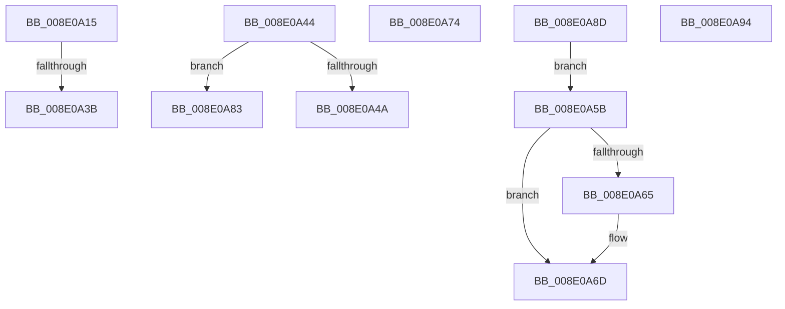

# sub_008E0A15

- RVA: `0x008E0A15`–`0x008E0AA3` (길이 `142` bytes)
- VA: `0x00000001408E0A15`
- 실행 섹션: `PAGE`
- PDB 이름 있음: `아니요`; PDB Function 태그: `아니요`
- unwind 정보 RVA: `0x00085D98`
- 디코드: `36`개 명령, `142/142` bytes 표시
- 미해석 바이트: `0` (있으면 어셈블리에 `.byte`로 보존)

> 이 문서는 커널 이미지의 기계어와 PDB 기호를 분석해 생성했습니다. 4번과 5번은 함수 원형과 자료형을 바이너리 사용 방식에서 추정한 C 해석이며 원본 소스 복구 결과는 아닙니다.

## 1. Dependencies

- 직접 호출 지점: **3**; 고유 호출 대상: **3**
- 직접 호출자로 확인된 함수: **0**
- RIP 상대 이미지 참조: **0**

### Outgoing calls
- `0x008E0A30` → [PnpOpenObjectRegKey](PnpOpenObjectRegKey_function_008E15E8.md) (function, `0x008E15E8`)
- `0x008E0A68` → [PiPnpRtlObjectEventRelease](PiPnpRtlObjectEventRelease_function_008E6E24.md) (function, `0x008E6E24`)
- `0x008E0A97` → [PiDmObjectRelease](PiDmObjectRelease_function_008E4F70.md) (function, `0x008E4F70`)

### Direct callers
- 이 함수 시작 RVA로 연결되는 직접 call은 확인되지 않았습니다. 간접 호출은 완전히 역산할 수 없습니다.

### Static image references
- 디코드된 RIP-relative 메모리 참조가 없습니다.

## 2. Other-region calls and transfers

- 다른 실행 섹션으로 향하는 call: **0**
- call이 아닌 외부 분기/꼬리 이동: **7**
  - `0x008E0A39` → [sub_008E078C + 0x259](Unknown_function_008E078C.md) (`tail-transfer`)
  - `0x008E0A42` → [sub_008E078C + 0x260](Unknown_function_008E078C.md) (`tail-transfer`)
  - `0x008E0A56` → [sub_008E078C + 0xAF](Unknown_function_008E078C.md) (`tail-transfer`)
  - `0x008E0A6F` → [sub_008E078C + 0x23D](Unknown_function_008E078C.md) (`tail-transfer`)
  - `0x008E0A7E` → [sub_008E078C + 0x9D](Unknown_function_008E078C.md) (`tail-transfer`)
  - `0x008E0A88` → [sub_008E078C + 0x23D](Unknown_function_008E078C.md) (`tail-transfer`)
  - `0x008E0A9E` → [sub_008E078C + 0x246](Unknown_function_008E078C.md) (`tail-transfer`)

## 3. Assembly (complete function range)

```asm
008E0A15  48 8B 4C 24 70                  mov rcx, qword ptr [rsp + 0x70]
008E0A1A  41 B9 00 00 00 02               mov r9d, 0x2000000
008E0A20  48 89 7C 24 28                  mov qword ptr [rsp + 0x28], rdi
008E0A25  45 8B C6                        mov r8d, r14d
008E0A28  49 8B D4                        mov rdx, r12
008E0A2B  C6 44 24 20 00                  mov byte ptr [rsp + 0x20], 0
008E0A30  E8 B3 0B 00 00                  call 0x1408e15e8
008E0A35  8B D8                           mov ebx, eax
008E0A37  85 C0                           test eax, eax
008E0A39  79 AA                           jns 0x1408e09e5
008E0A3B  48 C7 07 00 00 00 00            mov qword ptr [rdi], 0
008E0A42  EB A8                           jmp 0x1408e09ec
008E0A44  66 83 FA 08                     cmp dx, 8
008E0A48  76 39                           jbe 0x1408e0a83
008E0A4A  B8 F8 FF 00 00                  mov eax, 0xfff8
008E0A4F  66 03 D0                        add dx, ax
008E0A52  49 83 C2 08                     add r10, 8
008E0A56  E9 E0 FD FF FF                  jmp 0x1408e083b
008E0A5B  4C 8B 7C 24 48                  mov r15, qword ptr [rsp + 0x48]
008E0A60  48 85 FF                        test rdi, rdi
008E0A63  74 08                           je 0x1408e0a6d
008E0A65  48 8B CF                        mov rcx, rdi
008E0A68  E8 B7 63 00 00                  call 0x1408e6e24
008E0A6D  33 FF                           xor edi, edi
008E0A6F  E9 55 FF FF FF                  jmp 0x1408e09c9
008E0A74  0F B7 54 24 50                  movzx edx, word ptr [rsp + 0x50]
008E0A79  4C 8B 54 24 58                  mov r10, qword ptr [rsp + 0x58]
008E0A7E  E9 A6 FD FF FF                  jmp 0x1408e0829
008E0A83  BB 34 00 00 C0                  mov ebx, 0xc0000034
008E0A88  E9 3C FF FF FF                  jmp 0x1408e09c9
008E0A8D  BB 9A 00 00 C0                  mov ebx, 0xc000009a
008E0A92  EB C7                           jmp 0x1408e0a5b
008E0A94  49 8B CF                        mov rcx, r15
008E0A97  E8 D4 44 00 00                  call 0x1408e4f70
008E0A9C  33 FF                           xor edi, edi
008E0A9E  E9 2F FF FF FF                  jmp 0x1408e09d2
```

## 4. C-style interpretation (structured pseudocode)

```c
__int64 __fastcall sub_008E0A15(__int64 a1, __int64 a2, __int64 a3, __int64 a4, __int64 a5, __int64 a6, __int64 a7, __int64 a8, __int64 a9, __int64 a10, __int64 a11, __int64 a12, __int64 a13, __int64 a14)
{
    __int64 result;
    unsigned __int8 v_stack_p20;
    unsigned __int64 v_stack_p28;
    unsigned __int64 v_stack_p48;
    unsigned __int16 v_stack_p50;
    unsigned __int64 v_stack_p58;

    v_stack_p28 = v_rdi;
    v_stack_p20 = 0;
    result = PnpOpenObjectRegKey(a14, v_r12, (unsigned int)((unsigned int)(v_r14)), (unsigned int)(0x2000000ULL));
    *(unsigned __int64 *)(v_rdi) = 0;
}
```

## 5. (Beta) C Style

```c
int64_t sub_008E0A15(int64_t Arg1, int64_t Arg2, int64_t Arg3, int64_t Arg4, uint64_t Arg5, uint64_t Arg6, uint64_t Arg7, uint64_t Arg8, uint64_t Arg9, uint64_t Arg10, uint64_t Arg11, uint64_t Arg12, uint64_t Arg13, int64_t Arg14)
{
    int64_t result;
    uint8_t v_stack_p20;
    uint64_t v_stack_p28;
    uint64_t v_stack_p48;
    uint16_t v_stack_p50;
    uint64_t v_stack_p58;

    v_stack_p28 = local_rdi;
    v_stack_p20 = 0;
    result = PnpOpenObjectRegKey(Arg14, local_r12, (uint32_t)((uint32_t)(local_r14)), (uint32_t)(0x2000000ULL));
    *(uint64_t *)(local_rdi) = 0;
}
```

## 6. Execution-region graph

[열기: 2D/3D 그래프와 함수 탐색 컨트롤 패널](../../../control-panel.html?section=page&rva=0x008E0A15&view=graph)

- 2D 그래프는 위에서 아래로 흐르고, 3D 그래프는 빈 공간을 드래그해 회전합니다. Shift+드래그는 이동, 휠은 확대·축소, 함수 노드 선택은 대상 보고서 이동입니다.

### Static fallback


