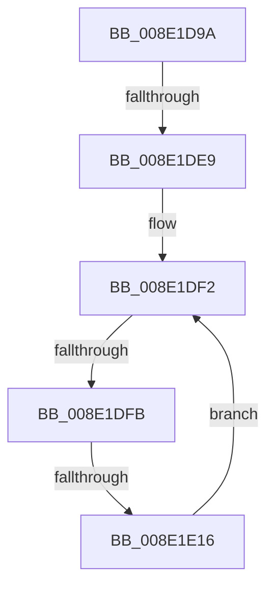

# sub_008E1D9A

- RVA: `0x008E1D9A`–`0x008E1E1A` (길이 `128` bytes)
- VA: `0x00000001408E1D9A`
- 실행 섹션: `PAGE`
- PDB 이름 있음: `아니요`; PDB Function 태그: `아니요`
- unwind 정보 RVA: `0x00085E84`
- 디코드: `31`개 명령, `128/128` bytes 표시
- 미해석 바이트: `0` (있으면 어셈블리에 `.byte`로 보존)

> 이 문서는 커널 이미지의 기계어와 PDB 기호를 분석해 생성했습니다. 4번과 5번은 함수 원형과 자료형을 바이너리 사용 방식에서 추정한 C 해석이며 원본 소스 복구 결과는 아닙니다.

## 1. Dependencies

- 직접 호출 지점: **0**; 고유 호출 대상: **0**
- 직접 호출자로 확인된 함수: **0**
- RIP 상대 이미지 참조: **1**

### Outgoing calls
- 직접 디코드된 call 명령이 없습니다.

### Direct callers
- 이 함수 시작 RVA로 연결되는 직접 call은 확인되지 않았습니다. 간접 호출은 완전히 역산할 수 없습니다.

### Static image references
- `0x008E1DEB` → RVA `0x00000000` (`image boundary/outside`; read)

## 2. Other-region calls and transfers

- 다른 실행 섹션으로 향하는 call: **0**
- call이 아닌 외부 분기/꼬리 이동: **3**
  - `0x008E1DE3` → [sub_008E1E60 + 0x51](Unknown_function_008E1E60.md) (`tail-transfer`)
  - `0x008E1DF5` → [sub_008E1EE8 + 0x5C](Unknown_function_008E1EE8.md) (`tail-transfer`)
  - `0x008E1E10` → [sub_008E1EE8](Unknown_function_008E1EE8.md) (`tail-transfer`)

## 3. Assembly (complete function range)

```asm
008E1D9A  48 89 68 08                     mov qword ptr [rax + 8], rbp
008E1D9E  48 89 78 10                     mov qword ptr [rax + 0x10], rdi
008E1DA2  4C 89 68 18                     mov qword ptr [rax + 0x18], r13
008E1DA6  8B 69 38                        mov ebp, dword ptr [rcx + 0x38]
008E1DA9  4C 8B 49 20                     mov r9, qword ptr [rcx + 0x20]
008E1DAD  81 E5 00 00 FF FF               and ebp, 0xffff0000
008E1DB3  4C 8B 59 18                     mov r11, qword ptr [rcx + 0x18]
008E1DB7  44 8B 69 28                     mov r13d, dword ptr [rcx + 0x28]
008E1DBB  48 8B 79 10                     mov rdi, qword ptr [rcx + 0x10]
008E1DBF  4C 89 70 D8                     mov qword ptr [rax - 0x28], r14
008E1DC3  48 8B 41 08                     mov rax, qword ptr [rcx + 8]
008E1DC7  4C 8B 71 30                     mov r14, qword ptr [rcx + 0x30]
008E1DCB  48 8B 09                        mov rcx, qword ptr [rcx]
008E1DCE  4C 89 4C 24 58                  mov qword ptr [rsp + 0x58], r9
008E1DD3  4C 89 5C 24 60                  mov qword ptr [rsp + 0x60], r11
008E1DD8  41 89 1E                        mov dword ptr [r14], ebx
008E1DDB  48 89 4C 24 50                  mov qword ptr [rsp + 0x50], rcx
008E1DE0  48 85 C0                        test rax, rax
008E1DE3  0F 85 C8 00 00 00               jne 0x1408e1eb1
008E1DE9  8B C3                           mov eax, ebx
008E1DEB  48 8D 35 0E E2 71 FF            lea rsi, [rip - 0x8e1df2]
008E1DF2  83 F8 21                        cmp eax, 0x21
008E1DF5  0F 83 49 01 00 00               jae 0x1408e1f44
008E1DFB  8B C8                           mov ecx, eax
008E1DFD  48 8D 14 49                     lea rdx, [rcx + rcx*2]
008E1E01  4C 8B 84 D6 A0 DE B4 00         mov r8, qword ptr [rsi + rdx*8 + 0xb4dea0]
008E1E09  41 8B 48 10                     mov ecx, dword ptr [r8 + 0x10]
008E1E0D  39 4F 10                        cmp dword ptr [rdi + 0x10], ecx
008E1E10  0F 84 D2 00 00 00               je 0x1408e1ee8
008E1E16  FF C0                           inc eax
008E1E18  EB D8                           jmp 0x1408e1df2
```

## 4. C-style interpretation (structured pseudocode)

```c
__int64 __fastcall sub_008E1D9A(__int64 a1)
{
    __int64 result;
    __int64 v_rbp;
    unsigned __int64 v_stack_p50;
    unsigned __int64 v_stack_p58;
    unsigned __int64 v_stack_p60;

    *(unsigned __int64 *)(result + 8) = v_rbp;
    *(unsigned __int64 *)(result + 16) = v_rdi;
    *(unsigned __int64 *)(result + 24) = v_r13;
    v_rbp = (unsigned int)(((unsigned int)(*(unsigned int *)(a1 + 56))) & (0xFFFF0000ULL));
    *(unsigned __int64 *)(result - 40) = v_r14;
    v_stack_p58 = *(unsigned __int64 *)(a1 + 32);
    v_stack_p60 = *(unsigned __int64 *)(a1 + 24);
    *(unsigned int *)(*(unsigned __int64 *)(a1 + 48)) = (unsigned int)(v_rbx);
    v_stack_p50 = *(unsigned __int64 *)(a1);
loc_008E1DF2:
    result = (unsigned int)(((unsigned int)((unsigned int)(v_rbx))) + 1);
    goto loc_008E1DF2;
}
```

## 5. (Beta) C Style

```c
int64_t sub_008E1D9A(void *Arg1)
{
    uint8_t *arg1 = (uint8_t *)Arg1;

    int64_t result;
    int64_t local_rbp;
    uint64_t v_stack_p50;
    uint64_t v_stack_p58;
    uint64_t v_stack_p60;

    *(uint64_t *)(result + 0x8) = local_rbp;
    *(uint64_t *)(result + 0x10) = local_rdi;
    *(uint64_t *)(result + 0x18) = local_r13;
    local_rbp = (uint32_t)(((uint32_t)(*(uint32_t *)(arg1 + 0x38))) & (0xFFFF0000ULL));
    *(uint64_t *)(result - 0x28) = local_r14;
    v_stack_p58 = *(uint64_t *)(arg1 + 0x20);
    v_stack_p60 = *(uint64_t *)(arg1 + 0x18);
    *(uint32_t *)(*(uint64_t *)(arg1 + 0x30)) = (uint32_t)(local_rbx);
    v_stack_p50 = *(uint64_t *)(arg1);
loc_008E1DF2:
    result = (uint32_t)(((uint32_t)((uint32_t)(local_rbx))) + 1);
    goto loc_008E1DF2;
}
```

### 관측된 메모리 오프셋

구조체 형식이 확인되지 않은 접근은 인자 기준의 오프셋으로만 기록했습니다.

| 기준 인자 | 오프셋 표현 | 폭 (bit) | 접근 |
|---|---:|---:|---|
| `Arg1` | `+ 0x0` | `64` | `R` |
| `Arg1` | `+ 0x8` | `64` | `R` |
| `Arg1` | `+ 0x10` | `64` | `R` |
| `Arg1` | `+ 0x18` | `64` | `R` |
| `Arg1` | `+ 0x20` | `64` | `R` |
| `Arg1` | `+ 0x28` | `32` | `R` |
| `Arg1` | `+ 0x30` | `64` | `R` |
| `Arg1` | `+ 0x38` | `32` | `R` |

## 6. Execution-region graph

[열기: 2D/3D 그래프와 함수 탐색 컨트롤 패널](../../../control-panel.html?section=page&rva=0x008E1D9A&view=graph)

- 2D 그래프는 위에서 아래로 흐르고, 3D 그래프는 빈 공간을 드래그해 회전합니다. Shift+드래그는 이동, 휠은 확대·축소, 함수 노드 선택은 대상 보고서 이동입니다.

### Static fallback


