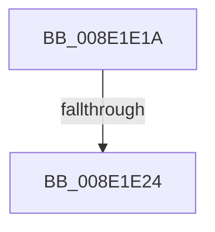

# sub_008E1E1A

- RVA: `0x008E1E1A`–`0x008E1E60` (길이 `70` bytes)
- VA: `0x00000001408E1E1A`
- 실행 섹션: `PAGE`
- PDB 이름 있음: `아니요`; PDB Function 태그: `아니요`
- unwind 정보 RVA: `0x00085EA4`
- 디코드: `17`개 명령, `70/70` bytes 표시
- 미해석 바이트: `0` (있으면 어셈블리에 `.byte`로 보존)

> 이 문서는 커널 이미지의 기계어와 PDB 기호를 분석해 생성했습니다. 4번과 5번은 함수 원형과 자료형을 바이너리 사용 방식에서 추정한 C 해석이며 원본 소스 복구 결과는 아닙니다.

## 1. Dependencies

- 직접 호출 지점: **1**; 고유 호출 대상: **1**
- 직접 호출자로 확인된 함수: **0**
- RIP 상대 이미지 참조: **0**

### Outgoing calls
- `0x008E1E56` → [_CmOpenDeviceRegKey](_CmOpenDeviceRegKey_function_008EE540.md) (function, `0x008EE540`)

### Direct callers
- 이 함수 시작 RVA로 연결되는 직접 call은 확인되지 않았습니다. 간접 호출은 완전히 역산할 수 없습니다.

### Static image references
- 디코드된 RIP-relative 메모리 참조가 없습니다.

## 2. Other-region calls and transfers

- 다른 실행 섹션으로 향하는 call: **0**
- call이 아닌 외부 분기/꼬리 이동: **2**
  - `0x008E1E1E` → [sub_008E1F8B](Unknown_function_008E1F8B.md) (`tail-transfer`)
  - `0x008E1E5E` → [sub_008E1ED1](Unknown_function_008E1ED1.md) (`tail-transfer`)

## 3. Assembly (complete function range)

```asm
008E1E1A  41 83 F9 02                     cmp r9d, 2
008E1E1E  0F 85 67 01 00 00               jne 0x1408e1f8b
008E1E24  48 8B 8C 24 D0 00 00 00         mov rcx, qword ptr [rsp + 0xd0]
008E1E2C  45 33 C9                        xor r9d, r9d
008E1E2F  48 8D 41 10                     lea rax, [rcx + 0x10]
008E1E33  48 89 44 24 38                  mov qword ptr [rsp + 0x38], rax
008E1E38  45 8D 41 10                     lea r8d, [r9 + 0x10]
008E1E3C  48 8B 41 08                     mov rax, qword ptr [rcx + 8]
008E1E40  48 89 44 24 30                  mov qword ptr [rsp + 0x30], rax
008E1E45  0F B6 41 04                     movzx eax, byte ptr [rcx + 4]
008E1E49  88 44 24 28                     mov byte ptr [rsp + 0x28], al
008E1E4D  8B 01                           mov eax, dword ptr [rcx]
008E1E4F  49 8B CC                        mov rcx, r12
008E1E52  89 44 24 20                     mov dword ptr [rsp + 0x20], eax
008E1E56  E8 E5 C6 00 00                  call 0x1408ee540
008E1E5B  44 8B D0                        mov r10d, eax
008E1E5E  EB 71                           jmp 0x1408e1ed1
```

## 4. C-style interpretation (structured pseudocode)

```c
__int64 __fastcall sub_008E1E1A(__int64 a1, __int64 a2, __int64 a3, int a4, __int64 a5, __int64 a6, __int64 a7, __int64 a8, __int64 a9, __int64 a10, __int64 a11, __int64 a12, __int64 a13, __int64 a14, __int64 a15, __int64 a16, __int64 a17, __int64 a18, __int64 a19, __int64 a20, __int64 a21, __int64 a22, __int64 a23, __int64 a24, __int64 a25, __int64 a26)
{
    __int64 result;
    unsigned int v_stack_p20;
    unsigned __int8 v_stack_p28;
    unsigned __int64 v_stack_p30;
    unsigned __int64 v_stack_p38;

    a4 = 0;
    v_stack_p38 = a26 + 16;
    v_stack_p30 = *(unsigned __int64 *)(a26 + 8);
    v_stack_p28 = (unsigned __int8)(*(unsigned __int8 *)(a26 + 4));
    v_stack_p20 = (unsigned int)((unsigned int)(*(unsigned int *)(a26)));
    result = _CmOpenDeviceRegKey(v_r12, a2, a4 + 16, a4);
}
```

## 5. (Beta) C Style

```c
int64_t sub_008E1E1A(int64_t Arg1, int64_t Arg2, int64_t Arg3, int32_t Arg4, uint64_t Arg5, uint64_t Arg6, uint64_t Arg7, uint64_t Arg8, uint64_t Arg9, uint64_t Arg10, uint64_t Arg11, uint64_t Arg12, uint64_t Arg13, uint64_t Arg14, uint64_t Arg15, uint64_t Arg16, uint64_t Arg17, uint64_t Arg18, uint64_t Arg19, uint64_t Arg20, uint64_t Arg21, uint64_t Arg22, uint64_t Arg23, uint64_t Arg24, uint64_t Arg25, void *Arg26)
{
    uint8_t *arg26 = (uint8_t *)Arg26;

    int64_t result;
    uint32_t v_stack_p20;
    uint8_t v_stack_p28;
    uint64_t v_stack_p30;
    uint64_t v_stack_p38;

    Arg4 = 0;
    v_stack_p38 = Arg26 + 16;
    v_stack_p30 = *(uint64_t *)(arg26 + 0x8);
    v_stack_p28 = (uint8_t)(*(uint8_t *)(arg26 + 0x4));
    v_stack_p20 = (uint32_t)((uint32_t)(*(uint32_t *)(arg26)));
    result = _CmOpenDeviceRegKey(local_r12, Arg2, Arg4 + 16, Arg4);
}
```

### 관측된 메모리 오프셋

구조체 형식이 확인되지 않은 접근은 인자 기준의 오프셋으로만 기록했습니다.

| 기준 인자 | 오프셋 표현 | 폭 (bit) | 접근 |
|---|---:|---:|---|
| `Arg26` | `+ 0x0` | `32` | `R` |
| `Arg26` | `+ 0x4` | `8` | `R` |
| `Arg26` | `+ 0x8` | `64` | `R` |
| `Arg26` | `+ 0x10` | `64` | `R` |

## 6. Execution-region graph

[열기: 2D/3D 그래프와 함수 탐색 컨트롤 패널](../../../control-panel.html?section=page&rva=0x008E1E1A&view=graph)

- 2D 그래프는 위에서 아래로 흐르고, 3D 그래프는 빈 공간을 드래그해 회전합니다. Shift+드래그는 이동, 휠은 확대·축소, 함수 노드 선택은 대상 보고서 이동입니다.

### Static fallback


