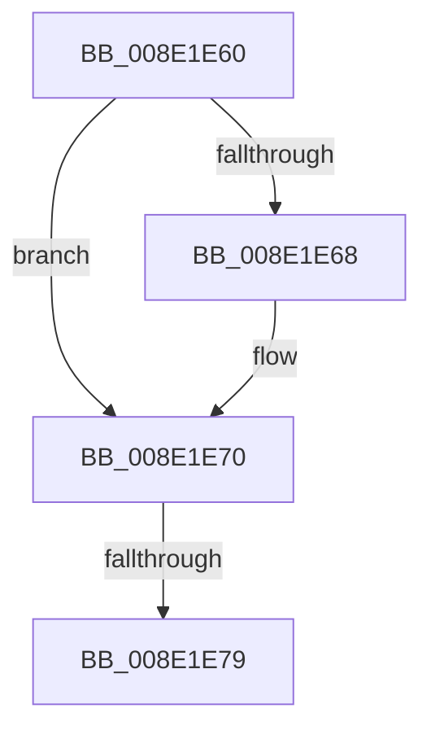

# sub_008E1E60

- RVA: `0x008E1E60`–`0x008E1ED1` (길이 `113` bytes)
- VA: `0x00000001408E1E60`
- 실행 섹션: `PAGE`
- PDB 이름 있음: `아니요`; PDB Function 태그: `아니요`
- unwind 정보 RVA: `0x00085EB4`
- 디코드: `24`개 명령, `113/113` bytes 표시
- 미해석 바이트: `0` (있으면 어셈블리에 `.byte`로 보존)

> 이 문서는 커널 이미지의 기계어와 PDB 기호를 분석해 생성했습니다. 4번과 5번은 함수 원형과 자료형을 바이너리 사용 방식에서 추정한 C 해석이며 원본 소스 복구 결과는 아닙니다.

## 1. Dependencies

- 직접 호출 지점: **1**; 고유 호출 대상: **1**
- 직접 호출자로 확인된 함수: **0**
- RIP 상대 이미지 참조: **0**

### Outgoing calls
- `0x008E1EA9` → [_CmGetDeviceMappedPropertyFromComposite](../9D/_CmGetDeviceMappedPropertyFromComposite_function_009D1684.md) (function, `0x009D1684`)

### Direct callers
- 이 함수 시작 RVA로 연결되는 직접 call은 확인되지 않았습니다. 간접 호출은 완전히 역산할 수 없습니다.

### Static image references
- 디코드된 RIP-relative 메모리 참조가 없습니다.

## 2. Other-region calls and transfers

- 다른 실행 섹션으로 향하는 call: **0**
- call이 아닌 외부 분기/꼬리 이동: **1**
  - `0x008E1E73` → [sub_008E1EE8 + 0x9F](Unknown_function_008E1EE8.md) (`tail-transfer`)

## 3. Assembly (complete function range)

```asm
008E1E60  48 8B 17                        mov rdx, qword ptr [rdi]
008E1E63  48 2B 11                        sub rdx, qword ptr [rcx]
008E1E66  75 08                           jne 0x1408e1e70
008E1E68  48 8B 57 08                     mov rdx, qword ptr [rdi + 8]
008E1E6C  48 2B 51 08                     sub rdx, qword ptr [rcx + 8]
008E1E70  48 85 D2                        test rdx, rdx
008E1E73  0F 85 0E 01 00 00               jne 0x1408e1f87
008E1E79  48 8B 44 24 58                  mov rax, qword ptr [rsp + 0x58]
008E1E7E  4C 8B CF                        mov r9, rdi
008E1E81  4C 8B 44 24 50                  mov r8, qword ptr [rsp + 0x50]
008E1E86  49 8B D7                        mov rdx, r15
008E1E89  89 6C 24 40                     mov dword ptr [rsp + 0x40], ebp
008E1E8D  49 8B CC                        mov rcx, r12
008E1E90  4C 89 74 24 38                  mov qword ptr [rsp + 0x38], r14
008E1E95  44 89 6C 24 30                  mov dword ptr [rsp + 0x30], r13d
008E1E9A  48 89 44 24 28                  mov qword ptr [rsp + 0x28], rax
008E1E9F  48 8B 44 24 60                  mov rax, qword ptr [rsp + 0x60]
008E1EA4  48 89 44 24 20                  mov qword ptr [rsp + 0x20], rax
008E1EA9  E8 D6 F7 0E 00                  call 0x1409d1684
008E1EAE  44 8B D0                        mov r10d, eax
008E1EB1  4C 8B AC 24 C0 00 00 00         mov r13, qword ptr [rsp + 0xc0]
008E1EB9  48 8B BC 24 B8 00 00 00         mov rdi, qword ptr [rsp + 0xb8]
008E1EC1  48 8B AC 24 B0 00 00 00         mov rbp, qword ptr [rsp + 0xb0]
008E1EC9  4C 8B B4 24 80 00 00 00         mov r14, qword ptr [rsp + 0x80]
```

## 4. C-style interpretation (structured pseudocode)

```c
__int64 __fastcall sub_008E1E60(__int64 a1, __int64 a2, __int64 a3, __int64 a4, __int64 a5, __int64 a6, __int64 a7, __int64 a8, __int64 a9, __int64 a10, __int64 a11, __int64 a12, __int64 a13, __int64 a14, __int64 a15, __int64 a16, __int64 a17, __int64 a18, __int64 a19, __int64 a20, __int64 a21, __int64 a22, __int64 a23, __int64 a24)
{
    __int64 result;
    unsigned __int64 v_stack_p20;
    unsigned __int64 v_stack_p28;
    unsigned int v_stack_p30;
    unsigned __int64 v_stack_p38;
    unsigned int v_stack_p40;

    a2 = (*(unsigned __int64 *)(v_rdi)) - (*(unsigned __int64 *)(a1));
    if (!(condition_is_not_equal)) {
        a2 = *(unsigned __int64 *)(v_rdi + 8);
        a2 = (a2) - (*(unsigned __int64 *)(a1 + 8));
    }
    v_stack_p40 = (unsigned int)(v_rbp);
    v_stack_p38 = v_r14;
    v_stack_p30 = (unsigned int)(v_r13);
    v_stack_p28 = a11;
    v_stack_p20 = a12;
    result = _CmGetDeviceMappedPropertyFromComposite(v_r12, v_r15, a10, v_rdi);
    return result;
}
```

## 5. (Beta) C Style

```c
int64_t sub_008E1E60(void *Arg1, int64_t Arg2, int64_t Arg3, int64_t Arg4, uint64_t Arg5, uint64_t Arg6, uint64_t Arg7, uint64_t Arg8, uint64_t Arg9, int64_t Arg10, int64_t Arg11, int64_t Arg12, uint64_t Arg13, uint64_t Arg14, uint64_t Arg15, int64_t Arg16, uint64_t Arg17, uint64_t Arg18, uint64_t Arg19, uint64_t Arg20, uint64_t Arg21, int64_t Arg22, int64_t Arg23, int64_t Arg24)
{
    uint8_t *arg1 = (uint8_t *)Arg1;

    int64_t result;
    uint64_t v_stack_p20;
    uint64_t v_stack_p28;
    uint32_t v_stack_p30;
    uint64_t v_stack_p38;
    uint32_t v_stack_p40;

    Arg2 = (*(uint64_t *)(local_rdi)) - (*(uint64_t *)(arg1));
    if (!(condition_is_not_equal)) {
        Arg2 = *(uint64_t *)(local_rdi + 0x8);
        Arg2 = (Arg2) - (*(uint64_t *)(arg1 + 0x8));
    }
    v_stack_p40 = (uint32_t)(local_rbp);
    v_stack_p38 = local_r14;
    v_stack_p30 = (uint32_t)(local_r13);
    v_stack_p28 = Arg11;
    v_stack_p20 = Arg12;
    result = _CmGetDeviceMappedPropertyFromComposite(local_r12, local_r15, Arg10, local_rdi);
    return result;
}
```

### 관측된 메모리 오프셋

구조체 형식이 확인되지 않은 접근은 인자 기준의 오프셋으로만 기록했습니다.

| 기준 인자 | 오프셋 표현 | 폭 (bit) | 접근 |
|---|---:|---:|---|
| `Arg1` | `+ 0x0` | `64` | `R` |
| `Arg1` | `+ 0x8` | `64` | `R` |

## 6. Execution-region graph

[열기: 2D/3D 그래프와 함수 탐색 컨트롤 패널](../../../control-panel.html?section=page&rva=0x008E1E60&view=graph)

- 2D 그래프는 위에서 아래로 흐르고, 3D 그래프는 빈 공간을 드래그해 회전합니다. Shift+드래그는 이동, 휠은 확대·축소, 함수 노드 선택은 대상 보고서 이동입니다.

### Static fallback


