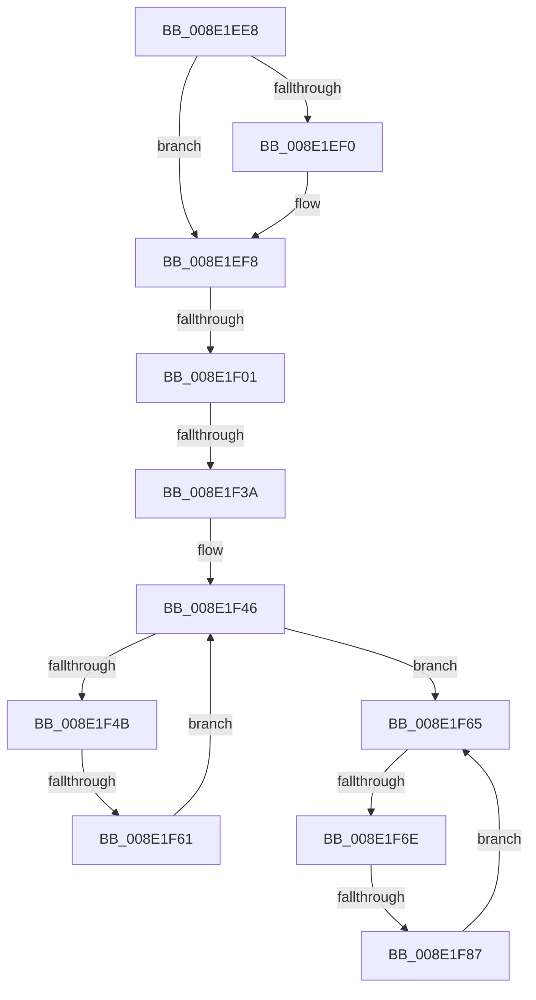

# sub_008E1EE8

- RVA: `0x008E1EE8`–`0x008E1F8B` (길이 `163` bytes)
- VA: `0x00000001408E1EE8`
- 실행 섹션: `PAGE`
- PDB 이름 있음: `아니요`; PDB Function 태그: `아니요`
- unwind 정보 RVA: `0x00085EE8`
- 디코드: `43`개 명령, `163/163` bytes 표시
- 미해석 바이트: `0` (있으면 어셈블리에 `.byte`로 보존)

> 이 문서는 커널 이미지의 기계어와 PDB 기호를 분석해 생성했습니다. 4번과 5번은 함수 원형과 자료형을 바이너리 사용 방식에서 추정한 C 해석이며 원본 소스 복구 결과는 아닙니다.

## 1. Dependencies

- 직접 호출 지점: **1**; 고유 호출 대상: **1**
- 직접 호출자로 확인된 함수: **0**
- RIP 상대 이미지 참조: **0**

### Outgoing calls
- `0x008E1F27` → [CmGetDeviceMappedPropertyFromRegProp](../9D/CmGetDeviceMappedPropertyFromRegProp_function_009D2A60.md) (function, `0x009D2A60`)

### Direct callers
- 이 함수 시작 RVA로 연결되는 직접 call은 확인되지 않았습니다. 간접 호출은 완전히 역산할 수 없습니다.

### Static image references
- 디코드된 RIP-relative 메모리 참조가 없습니다.

## 2. Other-region calls and transfers

- 다른 실행 섹션으로 향하는 call: **0**
- call이 아닌 외부 분기/꼬리 이동: **5**
  - `0x008E1EFB` → [sub_008E1D9A + 0x7C](Unknown_function_008E1D9A.md) (`tail-transfer`)
  - `0x008E1F34` → [sub_008E1E60 + 0x51](Unknown_function_008E1E60.md) (`tail-transfer`)
  - `0x008E1F5F` → [sub_008E1FBF](Unknown_function_008E1FBF.md) (`tail-transfer`)
  - `0x008E1F68` → [sub_008E1E60 + 0x51](Unknown_function_008E1E60.md) (`tail-transfer`)
  - `0x008E1F81` → [sub_008E1E60](Unknown_function_008E1E60.md) (`tail-transfer`)

## 3. Assembly (complete function range)

```asm
008E1EE8  48 8B 17                        mov rdx, qword ptr [rdi]
008E1EEB  49 2B 10                        sub rdx, qword ptr [r8]
008E1EEE  75 08                           jne 0x1408e1ef8
008E1EF0  48 8B 57 08                     mov rdx, qword ptr [rdi + 8]
008E1EF4  49 2B 50 08                     sub rdx, qword ptr [r8 + 8]
008E1EF8  48 85 D2                        test rdx, rdx
008E1EFB  0F 85 15 FF FF FF               jne 0x1408e1e16
008E1F01  4C 8B 44 24 50                  mov r8, qword ptr [rsp + 0x50]
008E1F06  49 8B D7                        mov rdx, r15
008E1F09  89 6C 24 40                     mov dword ptr [rsp + 0x40], ebp
008E1F0D  49 8B CC                        mov rcx, r12
008E1F10  4C 89 74 24 38                  mov qword ptr [rsp + 0x38], r14
008E1F15  44 89 6C 24 30                  mov dword ptr [rsp + 0x30], r13d
008E1F1A  4C 89 4C 24 28                  mov qword ptr [rsp + 0x28], r9
008E1F1F  4C 8B CF                        mov r9, rdi
008E1F22  4C 89 5C 24 20                  mov qword ptr [rsp + 0x20], r11
008E1F27  E8 34 0B 0F 00                  call 0x1409d2a60
008E1F2C  44 8B D0                        mov r10d, eax
008E1F2F  3D 16 00 00 C0                  cmp eax, 0xc0000016
008E1F34  0F 85 77 FF FF FF               jne 0x1408e1eb1
008E1F3A  4C 8B 4C 24 58                  mov r9, qword ptr [rsp + 0x58]
008E1F3F  4C 8B 5C 24 60                  mov r11, qword ptr [rsp + 0x60]
008E1F44  8B CB                           mov ecx, ebx
008E1F46  83 F9 02                        cmp ecx, 2
008E1F49  73 1A                           jae 0x1408e1f65
008E1F4B  8B C1                           mov eax, ecx
008E1F4D  48 C1 E0 05                     shl rax, 5
008E1F51  48 8B 94 30 20 B7 B4 00         mov rdx, qword ptr [rax + rsi + 0xb4b720]
008E1F59  8B 42 10                        mov eax, dword ptr [rdx + 0x10]
008E1F5C  39 47 10                        cmp dword ptr [rdi + 0x10], eax
008E1F5F  74 5E                           je 0x1408e1fbf
008E1F61  FF C1                           inc ecx
008E1F63  EB E1                           jmp 0x1408e1f46
008E1F65  83 FB 1C                        cmp ebx, 0x1c
008E1F68  0F 83 43 FF FF FF               jae 0x1408e1eb1
008E1F6E  8B C3                           mov eax, ebx
008E1F70  48 03 C0                        add rax, rax
008E1F73  48 8B 8C C6 A0 DB B4 00         mov rcx, qword ptr [rsi + rax*8 + 0xb4dba0]
008E1F7B  8B 41 10                        mov eax, dword ptr [rcx + 0x10]
008E1F7E  39 47 10                        cmp dword ptr [rdi + 0x10], eax
008E1F81  0F 84 D9 FE FF FF               je 0x1408e1e60
008E1F87  FF C3                           inc ebx
008E1F89  EB DA                           jmp 0x1408e1f65
```

## 4. C-style interpretation (structured pseudocode)

```c
__int64 __fastcall sub_008E1EE8(__int64 a1, __int64 a2, __int64 a3, __int64 a4, __int64 a5, __int64 a6, __int64 a7, __int64 a8, __int64 a9, __int64 a10, __int64 a11, __int64 a12)
{
    __int64 result;
    __int64 v_rbx;
    unsigned __int64 v_stack_p20;
    unsigned __int64 v_stack_p28;
    unsigned int v_stack_p30;
    unsigned __int64 v_stack_p38;
    unsigned int v_stack_p40;

    a2 = (*(unsigned __int64 *)(v_rdi)) - (*(unsigned __int64 *)(a3));
    if (!(condition_is_not_equal)) {
        a2 = *(unsigned __int64 *)(v_rdi + 8);
        a2 = (a2) - (*(unsigned __int64 *)(a3 + 8));
    }
    v_stack_p40 = (unsigned int)(v_rbp);
    v_stack_p38 = v_r14;
    v_stack_p30 = (unsigned int)(v_r13);
    v_stack_p28 = a4;
    v_stack_p20 = v_r11;
    result = CmGetDeviceMappedPropertyFromRegProp(v_r12, v_r15, a10, v_rdi);
loc_008E1F46:
    if (((unsigned int)((unsigned int)((unsigned int)(v_rbx)))) >= 2) goto loc_008E1F65;
    result = ((unsigned int)((unsigned int)((unsigned int)((unsigned int)(v_rbx))))) << (5);
    a1 = (unsigned int)(((unsigned int)((unsigned int)(v_rbx))) + 1);
    goto loc_008E1F46;
loc_008E1F65:
    result = ((unsigned int)((unsigned int)(v_rbx))) + ((unsigned int)((unsigned int)(v_rbx)));
    v_rbx = (unsigned int)((v_rbx) + 1);
    goto loc_008E1F65;
}
```

## 5. (Beta) C Style

```c
int64_t sub_008E1EE8(int64_t Arg1, int64_t Arg2, void *Arg3, int64_t Arg4, uint64_t Arg5, uint64_t Arg6, uint64_t Arg7, uint64_t Arg8, uint64_t Arg9, int64_t Arg10, int64_t Arg11, int64_t Arg12)
{
    uint8_t *arg3 = (uint8_t *)Arg3;

    int64_t result;
    int64_t local_rbx;
    uint64_t v_stack_p20;
    uint64_t v_stack_p28;
    uint32_t v_stack_p30;
    uint64_t v_stack_p38;
    uint32_t v_stack_p40;

    Arg2 = (*(uint64_t *)(local_rdi)) - (*(uint64_t *)(arg3));
    if (!(condition_is_not_equal)) {
        Arg2 = *(uint64_t *)(local_rdi + 0x8);
        Arg2 = (Arg2) - (*(uint64_t *)(arg3 + 0x8));
    }
    v_stack_p40 = (uint32_t)(local_rbp);
    v_stack_p38 = local_r14;
    v_stack_p30 = (uint32_t)(local_r13);
    v_stack_p28 = Arg4;
    v_stack_p20 = local_r11;
    result = CmGetDeviceMappedPropertyFromRegProp(local_r12, local_r15, Arg10, local_rdi);
loc_008E1F46:
    if (((uint32_t)((uint32_t)((uint32_t)(local_rbx)))) >= 2) goto loc_008E1F65;
    result = ((uint32_t)((uint32_t)((uint32_t)((uint32_t)(local_rbx))))) << (5);
    Arg1 = (uint32_t)(((uint32_t)((uint32_t)(local_rbx))) + 1);
    goto loc_008E1F46;
loc_008E1F65:
    result = ((uint32_t)((uint32_t)(local_rbx))) + ((uint32_t)((uint32_t)(local_rbx)));
    local_rbx = (uint32_t)((local_rbx) + 1);
    goto loc_008E1F65;
}
```

### 관측된 메모리 오프셋

구조체 형식이 확인되지 않은 접근은 인자 기준의 오프셋으로만 기록했습니다.

| 기준 인자 | 오프셋 표현 | 폭 (bit) | 접근 |
|---|---:|---:|---|
| `Arg3` | `+ 0x0` | `64` | `R` |
| `Arg3` | `+ 0x8` | `64` | `R` |

## 6. Execution-region graph

[열기: 2D/3D 그래프와 함수 탐색 컨트롤 패널](../../../control-panel.html?section=page&rva=0x008E1EE8&view=graph)

- 2D 그래프는 위에서 아래로 흐르고, 3D 그래프는 빈 공간을 드래그해 회전합니다. Shift+드래그는 이동, 휠은 확대·축소, 함수 노드 선택은 대상 보고서 이동입니다.

### Static fallback


