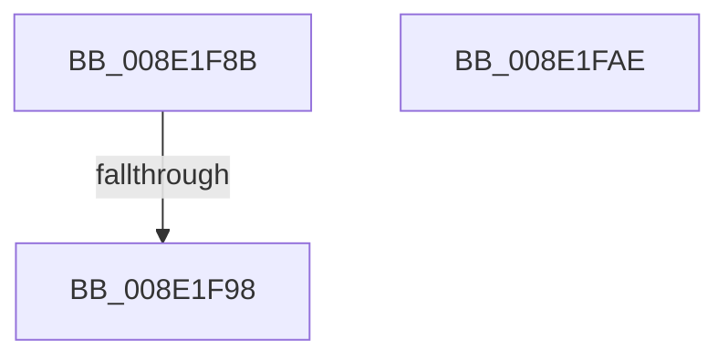

# sub_008E1F8B

- RVA: `0x008E1F8B`–`0x008E1FBF` (길이 `52` bytes)
- VA: `0x00000001408E1F8B`
- 실행 섹션: `PAGE`
- PDB 이름 있음: `아니요`; PDB Function 태그: `아니요`
- unwind 정보 RVA: `0x00085F08`
- 디코드: `15`개 명령, `52/52` bytes 표시
- 미해석 바이트: `0` (있으면 어셈블리에 `.byte`로 보존)

> 이 문서는 커널 이미지의 기계어와 PDB 기호를 분석해 생성했습니다. 4번과 5번은 함수 원형과 자료형을 바이너리 사용 방식에서 추정한 C 해석이며 원본 소스 복구 결과는 아닙니다.

## 1. Dependencies

- 직접 호출 지점: **1**; 고유 호출 대상: **1**
- 직접 호출자로 확인된 함수: **0**
- RIP 상대 이미지 참조: **1**

### Outgoing calls
- `0x008E1FB2` → [CmValidateDeviceName](../8F/CmValidateDeviceName_function_008F3CF0.md) (function, `0x008F3CF0`)

### Direct callers
- 이 함수 시작 RVA로 연결되는 직접 call은 확인되지 않았습니다. 간접 호출은 완전히 역산할 수 없습니다.

### Static image references
- `0x008E1F98` → RVA `0x00000000` (`image boundary/outside`; read)

## 2. Other-region calls and transfers

- 다른 실행 섹션으로 향하는 call: **0**
- call이 아닌 외부 분기/꼬리 이동: **2**
  - `0x008E1F92` → [sub_008E200E + 0x12E](Unknown_function_008E200E.md) (`tail-transfer`)
  - `0x008E1FBA` → [sub_008E1ED1](Unknown_function_008E1ED1.md) (`tail-transfer`)

## 3. Assembly (complete function range)

```asm
008E1F8B  41 FF C9                        dec r9d
008E1F8E  41 83 F9 08                     cmp r9d, 8
008E1F92  0F 87 A4 01 00 00               ja 0x1408e213c
008E1F98  48 8D 35 61 E0 71 FF            lea rsi, [rip - 0x8e1f9f]
008E1F9F  49 63 C1                        movsxd rax, r9d
008E1FA2  8B 84 86 48 21 8E 00            mov eax, dword ptr [rsi + rax*4 + 0x8e2148]
008E1FA9  48 03 C6                        add rax, rsi
008E1FAC  FF E0                           jmp rax
008E1FAE  CC                              int3
008E1FAF  CC                              int3
008E1FB0  CC                              int3
008E1FB1  CC                              int3
008E1FB2  E8 39 1D 01 00                  call 0x1408f3cf0
008E1FB7  44 8B D0                        mov r10d, eax
008E1FBA  E9 12 FF FF FF                  jmp 0x1408e1ed1
```

## 4. C-style interpretation (structured pseudocode)

```c
__int64 __fastcall sub_008E1F8B(__int64 a1, __int64 a2, __int64 a3, int a4)
{
    __int64 result;

    a4 = (unsigned int)((a4) - 1);
    result = ((unsigned int)(*(unsigned int *)(v_rip - 9314207 + (int)(a4) * 4 + 9314632))) + (v_rip - 9314207);
}
```

## 5. (Beta) C Style

```c
int64_t sub_008E1F8B(int64_t Arg1, int64_t Arg2, int64_t Arg3, int32_t Arg4)
{
    int64_t result;

    Arg4 = (uint32_t)((Arg4) - 1);
    result = ((uint32_t)(*(uint32_t *)(v_rip - 0x8E1F9F + (int32_t)(Arg4) * 4 + 0x8E2148))) + (v_rip - 9314207);
}
```

## 6. Execution-region graph

[열기: 2D/3D 그래프와 함수 탐색 컨트롤 패널](../../../control-panel.html?section=page&rva=0x008E1F8B&view=graph)

- 2D 그래프는 위에서 아래로 흐르고, 3D 그래프는 빈 공간을 드래그해 회전합니다. Shift+드래그는 이동, 휠은 확대·축소, 함수 노드 선택은 대상 보고서 이동입니다.

### Static fallback


