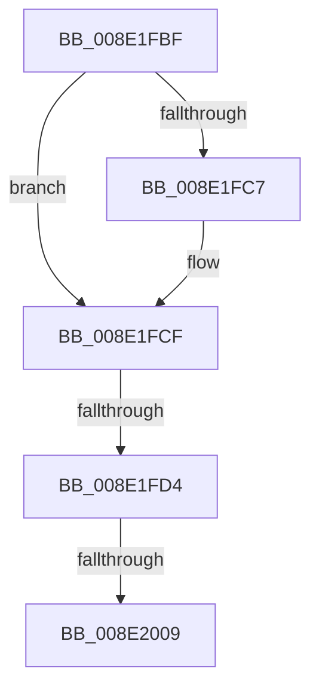

# sub_008E1FBF

- RVA: `0x008E1FBF`–`0x008E200E` (길이 `79` bytes)
- VA: `0x00000001408E1FBF`
- 실행 섹션: `PAGE`
- PDB 이름 있음: `아니요`; PDB Function 태그: `아니요`
- unwind 정보 RVA: `0x00085F18`
- 디코드: `20`개 명령, `79/79` bytes 표시
- 미해석 바이트: `0` (있으면 어셈블리에 `.byte`로 보존)

> 이 문서는 커널 이미지의 기계어와 PDB 기호를 분석해 생성했습니다. 4번과 5번은 함수 원형과 자료형을 바이너리 사용 방식에서 추정한 C 해석이며 원본 소스 복구 결과는 아닙니다.

## 1. Dependencies

- 직접 호출 지점: **1**; 고유 호출 대상: **1**
- 직접 호출자로 확인된 함수: **0**
- RIP 상대 이미지 참조: **0**

### Outgoing calls
- `0x008E1FF6` → [_CmGetDeviceMappedPropertyFromInstanceKeyRegValue](../9D/_CmGetDeviceMappedPropertyFromInstanceKeyRegValue_function_009D2F44.md) (function, `0x009D2F44`)

### Direct callers
- 이 함수 시작 RVA로 연결되는 직접 call은 확인되지 않았습니다. 간접 호출은 완전히 역산할 수 없습니다.

### Static image references
- 디코드된 RIP-relative 메모리 참조가 없습니다.

## 2. Other-region calls and transfers

- 다른 실행 섹션으로 향하는 call: **0**
- call이 아닌 외부 분기/꼬리 이동: **3**
  - `0x008E1FD2` → [sub_008E1EE8 + 0x79](Unknown_function_008E1EE8.md) (`tail-transfer`)
  - `0x008E2003` → [sub_008E1E60 + 0x51](Unknown_function_008E1E60.md) (`tail-transfer`)
  - `0x008E2009` → [sub_008E1EE8 + 0x7D](Unknown_function_008E1EE8.md) (`tail-transfer`)

## 3. Assembly (complete function range)

```asm
008E1FBF  4C 8B 07                        mov r8, qword ptr [rdi]
008E1FC2  4C 2B 02                        sub r8, qword ptr [rdx]
008E1FC5  75 08                           jne 0x1408e1fcf
008E1FC7  4C 8B 47 08                     mov r8, qword ptr [rdi + 8]
008E1FCB  4C 2B 42 08                     sub r8, qword ptr [rdx + 8]
008E1FCF  4D 85 C0                        test r8, r8
008E1FD2  75 8D                           jne 0x1408e1f61
008E1FD4  4C 8B 44 24 50                  mov r8, qword ptr [rsp + 0x50]
008E1FD9  49 8B D7                        mov rdx, r15
008E1FDC  4C 89 74 24 38                  mov qword ptr [rsp + 0x38], r14
008E1FE1  49 8B CC                        mov rcx, r12
008E1FE4  44 89 6C 24 30                  mov dword ptr [rsp + 0x30], r13d
008E1FE9  4C 89 4C 24 28                  mov qword ptr [rsp + 0x28], r9
008E1FEE  4C 8B CF                        mov r9, rdi
008E1FF1  4C 89 5C 24 20                  mov qword ptr [rsp + 0x20], r11
008E1FF6  E8 49 0F 0F 00                  call 0x1409d2f44
008E1FFB  44 8B D0                        mov r10d, eax
008E1FFE  3D 16 00 00 C0                  cmp eax, 0xc0000016
008E2003  0F 85 A8 FE FF FF               jne 0x1408e1eb1
008E2009  E9 57 FF FF FF                  jmp 0x1408e1f65
```

## 4. C-style interpretation (structured pseudocode)

```c
__int64 __fastcall sub_008E1FBF(__int64 a1, __int64 a2, __int64 a3, __int64 a4, __int64 a5, __int64 a6, __int64 a7, __int64 a8, __int64 a9, __int64 a10)
{
    __int64 result;
    unsigned __int64 v_stack_p20;
    unsigned __int64 v_stack_p28;
    unsigned int v_stack_p30;
    unsigned __int64 v_stack_p38;

    a3 = (*(unsigned __int64 *)(v_rdi)) - (*(unsigned __int64 *)(a2));
    if (!(condition_is_not_equal)) {
        a3 = *(unsigned __int64 *)(v_rdi + 8);
        a3 = (a3) - (*(unsigned __int64 *)(a2 + 8));
    }
    v_stack_p38 = v_r14;
    v_stack_p30 = (unsigned int)(v_r13);
    v_stack_p28 = a4;
    v_stack_p20 = v_r11;
    result = _CmGetDeviceMappedPropertyFromInstanceKeyRegValue(v_r12, v_r15, a10, v_rdi);
}
```

## 5. (Beta) C Style

```c
int64_t sub_008E1FBF(int64_t Arg1, void *Arg2, int64_t Arg3, int64_t Arg4, uint64_t Arg5, uint64_t Arg6, uint64_t Arg7, uint64_t Arg8, uint64_t Arg9, int64_t Arg10)
{
    uint8_t *arg2 = (uint8_t *)Arg2;

    int64_t result;
    uint64_t v_stack_p20;
    uint64_t v_stack_p28;
    uint32_t v_stack_p30;
    uint64_t v_stack_p38;

    Arg3 = (*(uint64_t *)(local_rdi)) - (*(uint64_t *)(arg2));
    if (!(condition_is_not_equal)) {
        Arg3 = *(uint64_t *)(local_rdi + 0x8);
        Arg3 = (Arg3) - (*(uint64_t *)(arg2 + 0x8));
    }
    v_stack_p38 = local_r14;
    v_stack_p30 = (uint32_t)(local_r13);
    v_stack_p28 = Arg4;
    v_stack_p20 = local_r11;
    result = _CmGetDeviceMappedPropertyFromInstanceKeyRegValue(local_r12, local_r15, Arg10, local_rdi);
}
```

### 관측된 메모리 오프셋

구조체 형식이 확인되지 않은 접근은 인자 기준의 오프셋으로만 기록했습니다.

| 기준 인자 | 오프셋 표현 | 폭 (bit) | 접근 |
|---|---:|---:|---|
| `Arg2` | `+ 0x0` | `64` | `R` |
| `Arg2` | `+ 0x8` | `64` | `R` |

## 6. Execution-region graph

[열기: 2D/3D 그래프와 함수 탐색 컨트롤 패널](../../../control-panel.html?section=page&rva=0x008E1FBF&view=graph)

- 2D 그래프는 위에서 아래로 흐르고, 3D 그래프는 빈 공간을 드래그해 회전합니다. Shift+드래그는 이동, 휠은 확대·축소, 함수 노드 선택은 대상 보고서 이동입니다.

### Static fallback


