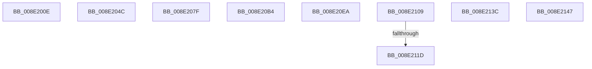

# sub_008E200E

- RVA: `0x008E200E`–`0x008E216C` (길이 `350` bytes)
- VA: `0x00000001408E200E`
- 실행 섹션: `PAGE`
- PDB 이름 있음: `아니요`; PDB Function 태그: `아니요`
- unwind 정보 RVA: `0x00085F38`
- 디코드: `82`개 명령, `350/350` bytes 표시
- 미해석 바이트: `2` (있으면 어셈블리에 `.byte`로 보존)

> 이 문서는 커널 이미지의 기계어와 PDB 기호를 분석해 생성했습니다. 4번과 5번은 함수 원형과 자료형을 바이너리 사용 방식에서 추정한 C 해석이며 원본 소스 복구 결과는 아닙니다.

## 1. Dependencies

- 직접 호출 지점: **5**; 고유 호출 대상: **5**
- 직접 호출자로 확인된 함수: **0**
- RIP 상대 이미지 참조: **1**

### Outgoing calls
- `0x008E203F` → [_CmSetDeviceMappedProperty](../A0/_CmSetDeviceMappedProperty_function_00A0B098.md) (function, `0x00A0B098`)
- `0x008E2072` → [_CmGetDeviceMappedPropertyLocales](../A6/_CmGetDeviceMappedPropertyLocales_function_00A6396C.md) (function, `0x00A6396C`)
- `0x008E20A7` → [_CmGetDeviceMappedPropertyKeys](../9D/_CmGetDeviceMappedPropertyKeys_function_009D0D78.md) (function, `0x009D0D78`)
- `0x008E20DD` → [CmCreateDevice](../8F/CmCreateDevice_function_008FFABC.md) (function, `0x008FFABC`)
- `0x008E20FC` → [CmDeleteDevice](../82/CmDeleteDevice_function_00829BB8.md) (function, `0x00829BB8`)

### Direct callers
- 이 함수 시작 RVA로 연결되는 직접 call은 확인되지 않았습니다. 간접 호출은 완전히 역산할 수 없습니다.

### Static image references
- `0x008E2122` → RVA `0x008317F0` (`PnpCmMatchCallbackRoutine`; read)

## 2. Other-region calls and transfers

- 다른 실행 섹션으로 향하는 call: **0**
- call이 아닌 외부 분기/꼬리 이동: **8**
  - `0x008E2047` → [sub_008E1ED1](Unknown_function_008E1ED1.md) (`tail-transfer`)
  - `0x008E207A` → [sub_008E1ED1](Unknown_function_008E1ED1.md) (`tail-transfer`)
  - `0x008E20AF` → [sub_008E1ED1](Unknown_function_008E1ED1.md) (`tail-transfer`)
  - `0x008E20E5` → [sub_008E1ED1](Unknown_function_008E1ED1.md) (`tail-transfer`)
  - `0x008E2104` → [sub_008E1ED1](Unknown_function_008E1ED1.md) (`tail-transfer`)
  - `0x008E2117` → [sub_00B1D0DA](../B1/Unknown_function_00B1D0DA.md) (`tail-transfer`)
  - `0x008E2137` → [sub_00B1D0DA](../B1/Unknown_function_00B1D0DA.md) (`tail-transfer`)
  - `0x008E2142` → [sub_008E1ED1](Unknown_function_008E1ED1.md) (`tail-transfer`)

## 3. Assembly (complete function range)

```asm
008E200E  4C 8B 84 24 D0 00 00 00         mov r8, qword ptr [rsp + 0xd0]
008E2016  41 8B 40 28                     mov eax, dword ptr [r8 + 0x28]
008E201A  4D 8B 48 08                     mov r9, qword ptr [r8 + 8]
008E201E  89 44 24 38                     mov dword ptr [rsp + 0x38], eax
008E2022  49 8B 40 20                     mov rax, qword ptr [r8 + 0x20]
008E2026  48 89 44 24 30                  mov qword ptr [rsp + 0x30], rax
008E202B  41 8B 40 18                     mov eax, dword ptr [r8 + 0x18]
008E202F  89 44 24 28                     mov dword ptr [rsp + 0x28], eax
008E2033  49 8B 40 10                     mov rax, qword ptr [r8 + 0x10]
008E2037  4D 8B 00                        mov r8, qword ptr [r8]
008E203A  48 89 44 24 20                  mov qword ptr [rsp + 0x20], rax
008E203F  E8 54 90 12 00                  call 0x140a0b098
008E2044  44 8B D0                        mov r10d, eax
008E2047  E9 85 FE FF FF                  jmp 0x1408e1ed1
008E204C  4C 8B 8C 24 D0 00 00 00         mov r9, qword ptr [rsp + 0xd0]
008E2054  49 8B 41 20                     mov rax, qword ptr [r9 + 0x20]
008E2058  48 89 44 24 30                  mov qword ptr [rsp + 0x30], rax
008E205D  41 8B 41 18                     mov eax, dword ptr [r9 + 0x18]
008E2061  89 44 24 28                     mov dword ptr [rsp + 0x28], eax
008E2065  49 8B 41 10                     mov rax, qword ptr [r9 + 0x10]
008E2069  4D 8B 49 08                     mov r9, qword ptr [r9 + 8]
008E206D  48 89 44 24 20                  mov qword ptr [rsp + 0x20], rax
008E2072  E8 F5 18 18 00                  call 0x140a6396c
008E2077  44 8B D0                        mov r10d, eax
008E207A  E9 52 FE FF FF                  jmp 0x1408e1ed1
008E207F  4C 8B 84 24 D0 00 00 00         mov r8, qword ptr [rsp + 0xd0]
008E2087  45 33 C9                        xor r9d, r9d
008E208A  49 8B 40 28                     mov rax, qword ptr [r8 + 0x28]
008E208E  48 89 44 24 30                  mov qword ptr [rsp + 0x30], rax
008E2093  41 8B 40 20                     mov eax, dword ptr [r8 + 0x20]
008E2097  89 44 24 28                     mov dword ptr [rsp + 0x28], eax
008E209B  49 8B 40 18                     mov rax, qword ptr [r8 + 0x18]
008E209F  4D 8B 00                        mov r8, qword ptr [r8]
008E20A2  48 89 44 24 20                  mov qword ptr [rsp + 0x20], rax
008E20A7  E8 CC EC 0E 00                  call 0x1409d0d78
008E20AC  44 8B D0                        mov r10d, eax
008E20AF  E9 1D FE FF FF                  jmp 0x1408e1ed1
008E20B4  4C 8B 84 24 D0 00 00 00         mov r8, qword ptr [rsp + 0xd0]
008E20BC  41 8B 48 14                     mov ecx, dword ptr [r8 + 0x14]
008E20C0  49 8D 40 10                     lea rax, [r8 + 0x10]
008E20C4  81 E1 00 00 FF FF               and ecx, 0xffff0000
008E20CA  4D 8D 48 08                     lea r9, [r8 + 8]
008E20CE  45 8B 00                        mov r8d, dword ptr [r8]
008E20D1  89 4C 24 28                     mov dword ptr [rsp + 0x28], ecx
008E20D5  49 8B CC                        mov rcx, r12
008E20D8  48 89 44 24 20                  mov qword ptr [rsp + 0x20], rax
008E20DD  E8 DA D9 01 00                  call 0x1408ffabc
008E20E2  44 8B D0                        mov r10d, eax
008E20E5  E9 E7 FD FF FF                  jmp 0x1408e1ed1
008E20EA  48 8B 84 24 D0 00 00 00         mov rax, qword ptr [rsp + 0xd0]
008E20F2  44 8B 00                        mov r8d, dword ptr [rax]
008E20F5  41 81 E0 00 00 FF FF            and r8d, 0xffff0000
008E20FC  E8 B7 7A F4 FF                  call 0x140829bb8
008E2101  44 8B D0                        mov r10d, eax
008E2104  E9 C8 FD FF FF                  jmp 0x1408e1ed1
008E2109  4C 8B 8C 24 D0 00 00 00         mov r9, qword ptr [rsp + 0xd0]
008E2111  49 8B 01                        mov rax, qword ptr [r9]
008E2114  48 85 C0                        test rax, rax
008E2117  0F 84 BD AF 23 00               je 0x140b1d0da
008E211D  48 89 44 24 68                  mov qword ptr [rsp + 0x68], rax
008E2122  48 8D 1D C7 F6 F4 FF            lea rbx, [rip - 0xb0939]
008E2129  49 8B 41 08                     mov rax, qword ptr [r9 + 8]
008E212D  4C 8D 44 24 68                  lea r8, [rsp + 0x68]
008E2132  48 89 44 24 70                  mov qword ptr [rsp + 0x70], rax
008E2137  E9 9E AF 23 00                  jmp 0x140b1d0da
008E213C  41 BA 0D 00 00 C0               mov r10d, 0xc000000d
008E2142  E9 8A FD FF FF                  jmp 0x1408e1ed1
008E2147  90                              nop
008E2148  B2 1F                           mov dl, 0x1f
008E214A  8E 00                           mov es, word ptr [rax]
008E214C  3C 21                           cmp al, 0x21
008E214E  8E 00                           mov es, word ptr [rax]
008E2150  B4 20                           mov ah, 0x20
008E2152  8E 00                           mov es, word ptr [rax]
008E2154  EA                              .byte 0xea
008E2155  20 8E 00 09 21 8E               and byte ptr [rsi - 0x71def700], cl
008E215B  00 7F 20                        add byte ptr [rdi + 0x20], bh
008E215E  8E 00                           mov es, word ptr [rax]
008E2160  4C 20 8E 00 3C 21 8E            and byte ptr [rsi - 0x71dec400], r9b
008E2167  00 0E                           add byte ptr [rsi], cl
008E2169  20                              .byte 0x20
008E216A  8E 00                           mov es, word ptr [rax]
```

## 4. C-style interpretation (structured pseudocode)

```c
__int64 __fastcall sub_008E200E(__int64 a1, __int64 a2, __int64 a3, __int64 a4, __int64 a5, __int64 a6, __int64 a7, __int64 a8, __int64 a9, __int64 a10, __int64 a11, __int64 a12, __int64 a13, __int64 a14, __int64 a15, __int64 a16, __int64 a17, __int64 a18, __int64 a19, __int64 a20, __int64 a21, __int64 a22, __int64 a23, __int64 a24, __int64 a25, __int64 a26)
{
    __int64 result;
    unsigned __int64 v_stack_p20;
    unsigned int v_stack_p28;
    unsigned __int64 v_stack_p30;
    unsigned int v_stack_p38;
    unsigned __int64 v_stack_p68;
    unsigned __int64 v_stack_p70;
    unsigned __int64 v_stack_pD0;

    v_stack_p38 = (unsigned int)((unsigned int)(*(unsigned int *)(a26 + 40)));
    v_stack_p30 = *(unsigned __int64 *)(a26 + 32);
    v_stack_p28 = (unsigned int)((unsigned int)(*(unsigned int *)(a26 + 24)));
    v_stack_p20 = *(unsigned __int64 *)(a26 + 16);
    result = _CmSetDeviceMappedProperty(a1, a2, *(unsigned __int64 *)(a26), *(unsigned __int64 *)(a26 + 8));
}
```

## 5. (Beta) C Style

```c
int64_t sub_008E200E(int64_t Arg1, int64_t Arg2, int64_t Arg3, int64_t Arg4, uint64_t Arg5, uint64_t Arg6, uint64_t Arg7, uint64_t Arg8, uint64_t Arg9, uint64_t Arg10, uint64_t Arg11, uint64_t Arg12, uint64_t Arg13, uint64_t Arg14, uint64_t Arg15, uint64_t Arg16, uint64_t Arg17, uint64_t Arg18, uint64_t Arg19, uint64_t Arg20, uint64_t Arg21, uint64_t Arg22, uint64_t Arg23, uint64_t Arg24, uint64_t Arg25, void *Arg26)
{
    uint8_t *arg26 = (uint8_t *)Arg26;

    int64_t result;
    uint64_t v_stack_p20;
    uint32_t v_stack_p28;
    uint64_t v_stack_p30;
    uint32_t v_stack_p38;
    uint64_t v_stack_p68;
    uint64_t v_stack_p70;
    uint64_t v_stack_pD0;

    v_stack_p38 = (uint32_t)((uint32_t)(*(uint32_t *)(arg26 + 0x28)));
    v_stack_p30 = *(uint64_t *)(arg26 + 0x20);
    v_stack_p28 = (uint32_t)((uint32_t)(*(uint32_t *)(arg26 + 0x18)));
    v_stack_p20 = *(uint64_t *)(arg26 + 0x10);
    result = _CmSetDeviceMappedProperty(Arg1, Arg2, *(uint64_t *)(arg26), *(uint64_t *)(arg26 + 0x8));
}
```

### 관측된 메모리 오프셋

구조체 형식이 확인되지 않은 접근은 인자 기준의 오프셋으로만 기록했습니다.

| 기준 인자 | 오프셋 표현 | 폭 (bit) | 접근 |
|---|---:|---:|---|
| `Arg26` | `+ 0x0` | `64` | `R` |
| `Arg26` | `+ 0x8` | `64` | `R` |
| `Arg26` | `+ 0x10` | `64` | `R` |
| `Arg26` | `+ 0x18` | `32` | `R` |
| `Arg26` | `+ 0x20` | `64` | `R` |
| `Arg26` | `+ 0x28` | `32` | `R` |

## 6. Execution-region graph

[열기: 2D/3D 그래프와 함수 탐색 컨트롤 패널](../../../control-panel.html?section=page&rva=0x008E200E&view=graph)

- 2D 그래프는 위에서 아래로 흐르고, 3D 그래프는 빈 공간을 드래그해 회전합니다. Shift+드래그는 이동, 휠은 확대·축소, 함수 노드 선택은 대상 보고서 이동입니다.

### Static fallback


