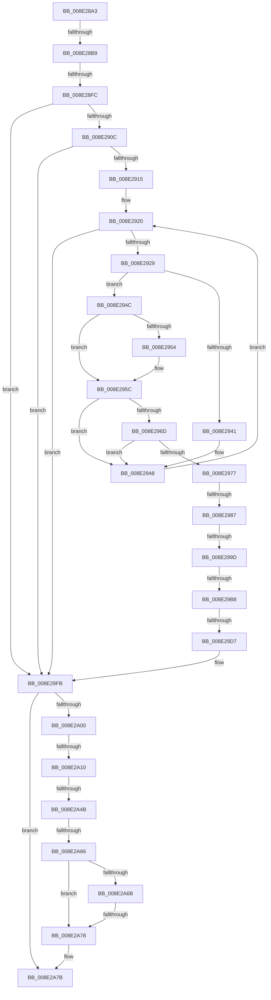

# sub_008E28A3

- RVA: `0x008E28A3`–`0x008E2A93` (길이 `496` bytes)
- VA: `0x00000001408E28A3`
- 실행 섹션: `PAGE`
- PDB 이름 있음: `아니요`; PDB Function 태그: `아니요`
- unwind 정보 RVA: `0x00085F98`
- 디코드: `117`개 명령, `496/496` bytes 표시
- 미해석 바이트: `0` (있으면 어셈블리에 `.byte`로 보존)

> 이 문서는 커널 이미지의 기계어와 PDB 기호를 분석해 생성했습니다. 4번과 5번은 함수 원형과 자료형을 바이너리 사용 방식에서 추정한 C 해석이며 원본 소스 복구 결과는 아닙니다.

## 1. Dependencies

- 직접 호출 지점: **4**; 고유 호출 대상: **4**
- 직접 호출자로 확인된 함수: **0**
- RIP 상대 이미지 참조: **1**

### Outgoing calls
- `0x008E29A8` → [PiDmGetObject](../8D/PiDmGetObject_function_008DFAE0.md) (function, `0x008DFAE0`)
- `0x008E29C3` → [CmpLockSiloKeyLockTrackerExclusive](../8F/CmpLockSiloKeyLockTrackerExclusive_function_008F9EF8.md) (function, `0x008F9EF8`)
- `0x008E29E9` → [PiDmObjectReleaseLock](PiDmObjectReleaseLock_function_008E5584.md) (function, `0x008E5584`)
- `0x008E29F1` → [PiDmObjectRelease](PiDmObjectRelease_function_008E4F70.md) (function, `0x008E4F70`)

### Direct callers
- 이 함수 시작 RVA로 연결되는 직접 call은 확인되지 않았습니다. 간접 호출은 완전히 역산할 수 없습니다.

### Static image references
- `0x008E2918` → RVA `0x00000000` (`image boundary/outside`; read)

## 2. Other-region calls and transfers

- 다른 실행 섹션으로 향하는 call: **0**
- call이 아닌 외부 분기/꼬리 이동: **10**
  - `0x008E28B3` → [sub_008E2EB2](Unknown_function_008E2EB2.md) (`tail-transfer`)
  - `0x008E28F6` → [sub_008E2EB2 + 0x10C](Unknown_function_008E2EB2.md) (`tail-transfer`)
  - `0x008E2981` → [sub_008E3704 + 0x1F](Unknown_function_008E3704.md) (`tail-transfer`)
  - `0x008E2997` → [sub_008E37F5](Unknown_function_008E37F5.md) (`tail-transfer`)
  - `0x008E29B2` → [sub_008E3704 + 0x1A](Unknown_function_008E3704.md) (`tail-transfer`)
  - `0x008E29D1` → [sub_008E359C + 0xC7](Unknown_function_008E359C.md) (`tail-transfer`)
  - `0x008E2A0A` → [sub_008E2EB2 + 0xBA](Unknown_function_008E2EB2.md) (`tail-transfer`)
  - `0x008E2A45` → [sub_008E2EB2 + 0xFF](Unknown_function_008E2EB2.md) (`tail-transfer`)
  - `0x008E2A64` → [sub_008E2AB2](Unknown_function_008E2AB2.md) (`tail-transfer`)
  - `0x008E2A72` → [sub_008E2EB2 + 0xA1](Unknown_function_008E2EB2.md) (`tail-transfer`)

## 3. Assembly (complete function range)

```asm
008E28A3  4C 89 A4 24 C8 01 00 00         mov qword ptr [rsp + 0x1c8], r12
008E28AB  4C 89 BC 24 70 01 00 00         mov qword ptr [rsp + 0x170], r15
008E28B3  0F 85 F9 05 00 00               jne 0x1408e2eb2
008E28B9  48 8B 5F 30                     mov rbx, qword ptr [rdi + 0x30]
008E28BD  45 33 FF                        xor r15d, r15d
008E28C0  48 8B 77 40                     mov rsi, qword ptr [rdi + 0x40]
008E28C4  41 BD 16 00 00 C0               mov r13d, 0xc0000016
008E28CA  8B 57 38                        mov edx, dword ptr [rdi + 0x38]
008E28CD  45 8B E5                        mov r12d, r13d
008E28D0  4C 8B 77 28                     mov r14, qword ptr [rdi + 0x28]
008E28D4  4C 8B 57 20                     mov r10, qword ptr [rdi + 0x20]
008E28D8  48 8B 47 18                     mov rax, qword ptr [rdi + 0x18]
008E28DC  4C 89 7D C8                     mov qword ptr [rbp - 0x38], r15
008E28E0  44 89 7C 24 70                  mov dword ptr [rsp + 0x70], r15d
008E28E5  44 88 7C 24 68                  mov byte ptr [rsp + 0x68], r15b
008E28EA  44 89 7D B0                     mov dword ptr [rbp - 0x50], r15d
008E28EE  44 89 7C 24 60                  mov dword ptr [rsp + 0x60], r15d
008E28F3  48 85 DB                        test rbx, rbx
008E28F6  0F 84 C2 06 00 00               je 0x1408e2fbe
008E28FC  85 D2                           test edx, edx
008E28FE  49 0F 44 DF                     cmove rbx, r15
008E2902  41 83 FB 07                     cmp r11d, 7
008E2906  0F 8D EF 00 00 00               jge 0x1408e29fb
008E290C  48 85 C0                        test rax, rax
008E290F  0F 85 E6 00 00 00               jne 0x1408e29fb
008E2915  41 8B CF                        mov ecx, r15d
008E2918  4C 8D 05 E1 D6 71 FF            lea r8, [rip - 0x8e291f]
008E291F  90                              nop
008E2920  83 F9 03                        cmp ecx, 3
008E2923  0F 83 D2 00 00 00               jae 0x1408e29fb
008E2929  8B C1                           mov eax, ecx
008E292B  4C 6B C8 38                     imul r9, rax, 0x38
008E292F  41 8B 42 10                     mov eax, dword ptr [r10 + 0x10]
008E2933  4F 8B 84 01 00 1F 00 00         mov r8, qword ptr [r9 + r8 + 0x1f00]
008E293B  41 39 40 10                     cmp dword ptr [r8 + 0x10], eax
008E293F  74 0B                           je 0x1408e294c
008E2941  4C 8D 05 B8 D6 71 FF            lea r8, [rip - 0x8e2948]
008E2948  FF C1                           inc ecx
008E294A  EB D4                           jmp 0x1408e2920
008E294C  4D 8B 18                        mov r11, qword ptr [r8]
008E294F  4D 2B 1A                        sub r11, qword ptr [r10]
008E2952  75 08                           jne 0x1408e295c
008E2954  4D 8B 58 08                     mov r11, qword ptr [r8 + 8]
008E2958  4D 2B 5A 08                     sub r11, qword ptr [r10 + 8]
008E295C  4D 85 DB                        test r11, r11
008E295F  4C 8D 05 9A D6 71 FF            lea r8, [rip - 0x8e2966]
008E2966  44 8B 5C 24 6C                  mov r11d, dword ptr [rsp + 0x6c]
008E296B  75 DB                           jne 0x1408e2948
008E296D  47 3B 9C 01 F8 1E 00 00         cmp r11d, dword ptr [r9 + r8 + 0x1ef8]
008E2975  75 D1                           jne 0x1408e2948
008E2977  4D 8D B8 E0 1E 00 00            lea r15, [r8 + 0x1ee0]
008E297E  4D 03 F9                        add r15, r9
008E2981  0F 84 9C 0D 00 00               je 0x1408e3723
008E2987  41 C7 06 11 00 00 00            mov dword ptr [r14], 0x11
008E298E  C7 06 01 00 00 00               mov dword ptr [rsi], 1
008E2994  83 FA 01                        cmp edx, 1
008E2997  0F 82 58 0E 00 00               jb 0x1408e37f5
008E299D  48 8B 55 88                     mov rdx, qword ptr [rbp - 0x78]
008E29A1  4C 8D 45 C8                     lea r8, [rbp - 0x38]
008E29A5  41 8B CB                        mov ecx, r11d
008E29A8  E8 33 D1 FF FF                  call 0x1408dfae0
008E29AD  44 8B E0                        mov r12d, eax
008E29B0  85 C0                           test eax, eax
008E29B2  0F 88 66 0D 00 00               js 0x1408e371e
008E29B8  48 8B 75 C8                     mov rsi, qword ptr [rbp - 0x38]
008E29BC  4D 8B 67 30                     mov r12, qword ptr [r15 + 0x30]
008E29C0  48 8B CE                        mov rcx, rsi
008E29C3  E8 30 75 01 00                  call 0x1408f9ef8
008E29C8  41 8B 04 34                     mov eax, dword ptr [r12 + rsi]
008E29CC  3D 00 00 00 80                  cmp eax, 0x80000000
008E29D1  0F 84 8C 0C 00 00               je 0x1408e3663
008E29D7  85 C0                           test eax, eax
008E29D9  0F 9E C0                        setle al
008E29DC  FE C8                           dec al
008E29DE  45 33 FF                        xor r15d, r15d
008E29E1  88 03                           mov byte ptr [rbx], al
008E29E3  45 8B E7                        mov r12d, r15d
008E29E6  48 8B CE                        mov rcx, rsi
008E29E9  E8 96 2B 00 00                  call 0x1408e5584
008E29EE  48 8B CE                        mov rcx, rsi
008E29F1  E8 7A 25 00 00                  call 0x1408e4f70
008E29F6  44 8B 5C 24 6C                  mov r11d, dword ptr [rsp + 0x6c]
008E29FB  45 3B E5                        cmp r12d, r13d
008E29FE  75 7B                           jne 0x1408e2a7b
008E2A00  F7 47 48 00 00 01 00            test dword ptr [rdi + 0x48], 0x10000
008E2A07  41 8B DF                        mov ebx, r15d
008E2A0A  0F 85 5C 05 00 00               jne 0x1408e2f6c
008E2A10  48 8B 47 40                     mov rax, qword ptr [rdi + 0x40]
008E2A14  4C 8B 77 30                     mov r14, qword ptr [rdi + 0x30]
008E2A18  4C 8B 4F 20                     mov r9, qword ptr [rdi + 0x20]
008E2A1C  44 8B 67 38                     mov r12d, dword ptr [rdi + 0x38]
008E2A20  48 89 45 98                     mov qword ptr [rbp - 0x68], rax
008E2A24  48 8B 47 28                     mov rax, qword ptr [rdi + 0x28]
008E2A28  48 89 45 90                     mov qword ptr [rbp - 0x70], rax
008E2A2C  48 8B 47 18                     mov rax, qword ptr [rdi + 0x18]
008E2A30  44 89 64 24 60                  mov dword ptr [rsp + 0x60], r12d
008E2A35  4C 89 74 24 78                  mov qword ptr [rsp + 0x78], r14
008E2A3A  4C 89 4D 80                     mov qword ptr [rbp - 0x80], r9
008E2A3E  4C 89 7D D0                     mov qword ptr [rbp - 0x30], r15
008E2A42  4D 85 F6                        test r14, r14
008E2A45  0F 84 66 05 00 00               je 0x1408e2fb1
008E2A4B  45 85 E4                        test r12d, r12d
008E2A4E  4D 0F 44 F7                     cmove r14, r15
008E2A52  4C 89 74 24 78                  mov qword ptr [rsp + 0x78], r14
008E2A57  B9 23 00 00 C0                  mov ecx, 0xc0000023
008E2A5C  89 4C 24 64                     mov dword ptr [rsp + 0x64], ecx
008E2A60  41 83 FB 07                     cmp r11d, 7
008E2A64  7C 4C                           jl 0x1408e2ab2
008E2A66  45 85 ED                        test r13d, r13d
008E2A69  79 0D                           jns 0x1408e2a78
008E2A6B  41 81 FD 34 00 00 C0            cmp r13d, 0xc0000034
008E2A72  0F 85 DB 04 00 00               jne 0x1408e2f53
008E2A78  45 8B E5                        mov r12d, r13d
008E2A7B  BB 20 01 00 C0                  mov ebx, 0xc0000120
008E2A80  44 89 27                        mov dword ptr [rdi], r12d
008E2A83  4C 8B A4 24 C8 01 00 00         mov r12, qword ptr [rsp + 0x1c8]
008E2A8B  4C 8B BC 24 70 01 00 00         mov r15, qword ptr [rsp + 0x170]
```

## 4. C-style interpretation (structured pseudocode)

```c
__int64 __fastcall sub_008E28A3(__int64 a1, __int64 a2, __int64 a3, __int64 a4, __int64 a5, __int64 a6, __int64 a7, __int64 a8, __int64 a9, __int64 a10, __int64 a11, __int64 a12, __int64 a13, __int64 a14, __int64 a15, __int64 a16, __int64 a17, __int64 a18, __int64 a19, __int64 a20, __int64 a21, __int64 a22, __int64 a23, __int64 a24, __int64 a25, __int64 a26, __int64 a27, __int64 a28, __int64 a29, __int64 a30, __int64 a31, __int64 a32, __int64 a33, __int64 a34, __int64 a35, __int64 a36, __int64 a37, __int64 a38, __int64 a39, __int64 a40, __int64 a41, __int64 a42, __int64 a43, __int64 a44, __int64 a45, __int64 a46, __int64 a47, __int64 a48, __int64 a49, __int64 a50, __int64 a51, __int64 a52, __int64 a53, __int64 a54, __int64 a55, __int64 a56, __int64 a57)
{
    __int64 result;
    __int64 v_r11;
    __int64 v_r14;
    __int64 v_r15;
    __int64 v_rbx;
    unsigned __int64 v_stack_p170;
    unsigned __int64 v_stack_p1C8;
    unsigned int v_stack_p60;
    unsigned int v_stack_p64;
    unsigned __int8 v_stack_p68;
    unsigned int v_stack_p6C;
    unsigned int v_stack_p70;
    unsigned __int64 v_stack_p78;

    v_stack_p1C8 = v_r12;
    v_stack_p170 = v_r15;
    v_r15 = 0;
    *(unsigned __int64 *)(v_rbp - 56) = 0;
    v_stack_p70 = 0;
    v_stack_p68 = 0;
    *(unsigned int *)(v_rbp - 80) = 0;
    v_stack_p60 = 0;
    v_rbx = *(unsigned __int64 *)(v_rdi + 48);
    if ((unsigned int)((unsigned int)(*(unsigned int *)(v_rdi + 56))) == 0) { v_rbx = 0; }
    if (((unsigned int)(v_r11)) >= 7) goto loc_008E29FB;
    if (*(unsigned __int64 *)(v_rdi + 24) != 0) goto loc_008E29FB;
loc_008E2920:
    if (0 >= 3) goto loc_008E29FB;
    a4 = (a4) * (0);
    if ((*(unsigned int *)(*(unsigned __int64 *)(a4 + v_rip - 9316639 * 1 + 7936) + 16)) == ((unsigned int)((unsigned int)(*(unsigned int *)(*(unsigned __int64 *)(v_rdi + 32) + 16))))) goto loc_008E294C;
loc_008E2948:
    a1 = (unsigned int)((0) + 1);
    goto loc_008E2920;
loc_008E294C:
    v_r11 = (*(unsigned __int64 *)(v_rip - 9316680)) - (*(unsigned __int64 *)(*(unsigned __int64 *)(v_rdi + 32)));
    if (!(condition_is_not_equal)) {
        v_r11 = *(unsigned __int64 *)(v_rip - 9316680 + 8);
        v_r11 = (v_r11) - (*(unsigned __int64 *)(*(unsigned __int64 *)(v_rdi + 32) + 8));
    }
    if (v_r11 != 0) goto loc_008E2948;
    if (((unsigned int)((unsigned int)(v_stack_p6C))) != (*(unsigned int *)(a4 + v_rip - 9316710 * 1 + 7928))) goto loc_008E2948;
    v_r15 = (v_rip - 9316710 + 7904) + (a4);
    *(unsigned int *)(*(unsigned __int64 *)(v_rdi + 40)) = 17;
    *(unsigned int *)(*(unsigned __int64 *)(v_rdi + 64)) = 1;
    result = PiDmGetObject((unsigned int)((unsigned int)((unsigned int)(v_stack_p6C))), *(unsigned __int64 *)(v_rbp - 120), v_rbp - 56, a4);
    result = CmpLockSiloKeyLockTrackerExclusive(*(unsigned __int64 *)(v_rbp - 56), *(unsigned __int64 *)(v_rbp - 120), v_rbp - 56, a4);
    result = (condition_is_less_or_equal) ? 1 : 0;
    result = (unsigned __int8)((result) - 1);
    v_r15 = 0;
    *(unsigned __int8 *)(v_rbx) = (unsigned __int8)(result);
    result = PiDmObjectReleaseLock(*(unsigned __int64 *)(v_rbp - 56), *(unsigned __int64 *)(v_rbp - 120), v_rbp - 56, a4);
    result = PiDmObjectRelease(*(unsigned __int64 *)(v_rbp - 56), *(unsigned __int64 *)(v_rbp - 120), v_rbp - 56, a4);
loc_008E29FB:
    if (0 != ((unsigned int)((unsigned int)(0xC0000016ULL)))) goto loc_008E2A7B;
    *(unsigned __int64 *)(v_rbp - 104) = *(unsigned __int64 *)(v_rdi + 64);
    *(unsigned __int64 *)(v_rbp - 112) = *(unsigned __int64 *)(v_rdi + 40);
    v_stack_p60 = (unsigned int)((unsigned int)(*(unsigned int *)(v_rdi + 56)));
    v_stack_p78 = *(unsigned __int64 *)(v_rdi + 48);
    *(unsigned __int64 *)(v_rbp - 128) = *(unsigned __int64 *)(v_rdi + 32);
    *(unsigned __int64 *)(v_rbp - 48) = 0;
    v_r14 = *(unsigned __int64 *)(v_rdi + 48);
    if ((unsigned int)((unsigned int)(*(unsigned int *)(v_rdi + 56))) == 0) { v_r14 = 0; }
    v_stack_p78 = v_r14;
    v_stack_p64 = (unsigned int)((unsigned int)(0xC0000023ULL));
    if (!sign_flag) goto loc_008E2A78;
loc_008E2A78:
loc_008E2A7B:
    *(unsigned int *)(v_rdi) = (unsigned int)((unsigned int)((unsigned int)((unsigned int)(0xC0000016ULL))));
    return *(unsigned __int64 *)(v_rdi + 24);
}
```

## 5. (Beta) C Style

```c
int64_t sub_008E28A3(int64_t Arg1, int64_t Arg2, int64_t Arg3, void *Arg4, uint64_t Arg5, uint64_t Arg6, uint64_t Arg7, uint64_t Arg8, uint64_t Arg9, uint64_t Arg10, uint64_t Arg11, uint64_t Arg12, uint64_t Arg13, uint64_t Arg14, uint64_t Arg15, uint64_t Arg16, uint64_t Arg17, uint64_t Arg18, uint64_t Arg19, uint64_t Arg20, uint64_t Arg21, uint64_t Arg22, uint64_t Arg23, uint64_t Arg24, uint64_t Arg25, uint64_t Arg26, uint64_t Arg27, uint64_t Arg28, uint64_t Arg29, uint64_t Arg30, uint64_t Arg31, uint64_t Arg32, uint64_t Arg33, uint64_t Arg34, uint64_t Arg35, uint64_t Arg36, uint64_t Arg37, uint64_t Arg38, uint64_t Arg39, uint64_t Arg40, uint64_t Arg41, uint64_t Arg42, uint64_t Arg43, uint64_t Arg44, uint64_t Arg45, int64_t Arg46, uint64_t Arg47, uint64_t Arg48, uint64_t Arg49, uint64_t Arg50, uint64_t Arg51, uint64_t Arg52, uint64_t Arg53, uint64_t Arg54, uint64_t Arg55, uint64_t Arg56, int64_t Arg57)
{
    uint8_t *arg4 = (uint8_t *)Arg4;

    int64_t result;
    int64_t local_r11;
    int64_t local_r14;
    int64_t local_r15;
    int64_t local_rbx;
    uint64_t v_stack_p170;
    uint64_t v_stack_p1C8;
    uint32_t v_stack_p60;
    uint32_t v_stack_p64;
    uint8_t v_stack_p68;
    uint32_t v_stack_p6C;
    uint32_t v_stack_p70;
    uint64_t v_stack_p78;

    v_stack_p1C8 = local_r12;
    v_stack_p170 = local_r15;
    local_r15 = 0;
    *(uint64_t *)(local_rbp - 0x38) = 0;
    v_stack_p70 = 0;
    v_stack_p68 = 0;
    *(uint32_t *)(local_rbp - 0x50) = 0;
    v_stack_p60 = 0;
    local_rbx = *(uint64_t *)(local_rdi + 0x30);
    if ((uint32_t)((uint32_t)(*(uint32_t *)(local_rdi + 0x38))) == 0) { local_rbx = 0; }
    if (((uint32_t)(local_r11)) >= 7) goto loc_008E29FB;
    if (*(uint64_t *)(local_rdi + 0x18) != 0) goto loc_008E29FB;
loc_008E2920:
    if (0 >= 3) goto loc_008E29FB;
    Arg4 = (Arg4) * (0);
    if ((*(uint32_t *)(*(uint64_t *)(arg4 + v_rip - 0x8E291F * 1 + 0x1F00) + 0x10)) == ((uint32_t)((uint32_t)(*(uint32_t *)(*(uint64_t *)(local_rdi + 0x20) + 0x10))))) goto loc_008E294C;
loc_008E2948:
    Arg1 = (uint32_t)((0) + 1);
    goto loc_008E2920;
loc_008E294C:
    local_r11 = (*(uint64_t *)(v_rip - 0x8E2948)) - (*(uint64_t *)(*(uint64_t *)(local_rdi + 0x20)));
    if (!(condition_is_not_equal)) {
        local_r11 = *(uint64_t *)(v_rip - 0x8E2948 + 0x8);
        local_r11 = (local_r11) - (*(uint64_t *)(*(uint64_t *)(local_rdi + 0x20) + 0x8));
    }
    if (local_r11 != 0) goto loc_008E2948;
    if (((uint32_t)((uint32_t)(v_stack_p6C))) != (*(uint32_t *)(arg4 + v_rip - 0x8E2966 * 1 + 0x1EF8))) goto loc_008E2948;
    local_r15 = (v_rip - 9316710 + 7904) + (Arg4);
    *(uint32_t *)(*(uint64_t *)(local_rdi + 0x28)) = 17;
    *(uint32_t *)(*(uint64_t *)(local_rdi + 0x40)) = 1;
    result = PiDmGetObject((uint32_t)((uint32_t)((uint32_t)(v_stack_p6C))), *(uint64_t *)(local_rbp - 0x78), local_rbp - 56, Arg4);
    result = CmpLockSiloKeyLockTrackerExclusive(*(uint64_t *)(local_rbp - 0x38), *(uint64_t *)(local_rbp - 0x78), local_rbp - 56, Arg4);
    result = (condition_is_less_or_equal) ? 1 : 0;
    result = (uint8_t)((result) - 1);
    local_r15 = 0;
    *(uint8_t *)(local_rbx) = (uint8_t)(result);
    result = PiDmObjectReleaseLock(*(uint64_t *)(local_rbp - 0x38), *(uint64_t *)(local_rbp - 0x78), local_rbp - 56, Arg4);
    result = PiDmObjectRelease(*(uint64_t *)(local_rbp - 0x38), *(uint64_t *)(local_rbp - 0x78), local_rbp - 56, Arg4);
loc_008E29FB:
    if (0 != ((uint32_t)((uint32_t)(0xC0000016ULL)))) goto loc_008E2A7B;
    *(uint64_t *)(local_rbp - 0x68) = *(uint64_t *)(local_rdi + 0x40);
    *(uint64_t *)(local_rbp - 0x70) = *(uint64_t *)(local_rdi + 0x28);
    v_stack_p60 = (uint32_t)((uint32_t)(*(uint32_t *)(local_rdi + 0x38)));
    v_stack_p78 = *(uint64_t *)(local_rdi + 0x30);
    *(uint64_t *)(local_rbp - 0x80) = *(uint64_t *)(local_rdi + 0x20);
    *(uint64_t *)(local_rbp - 0x30) = 0;
    local_r14 = *(uint64_t *)(local_rdi + 0x30);
    if ((uint32_t)((uint32_t)(*(uint32_t *)(local_rdi + 0x38))) == 0) { local_r14 = 0; }
    v_stack_p78 = local_r14;
    v_stack_p64 = (uint32_t)((uint32_t)(0xC0000023ULL));
    if (!sign_flag) goto loc_008E2A78;
loc_008E2A78:
loc_008E2A7B:
    *(uint32_t *)(local_rdi) = (uint32_t)((uint32_t)((uint32_t)((uint32_t)(0xC0000016ULL))));
    return *(uint64_t *)(local_rdi + 0x18);
}
```

### 관측된 메모리 오프셋

구조체 형식이 확인되지 않은 접근은 인자 기준의 오프셋으로만 기록했습니다.

| 기준 인자 | 오프셋 표현 | 폭 (bit) | 접근 |
|---|---:|---:|---|
| `Arg4` | `+ 0x1EF8 + r8*1` | `32` | `R` |
| `Arg4` | `+ 0x1F00 + r8*1` | `64` | `R` |

## 6. Execution-region graph

[열기: 2D/3D 그래프와 함수 탐색 컨트롤 패널](../../../control-panel.html?section=page&rva=0x008E28A3&view=graph)

- 2D 그래프는 위에서 아래로 흐르고, 3D 그래프는 빈 공간을 드래그해 회전합니다. Shift+드래그는 이동, 휠은 확대·축소, 함수 노드 선택은 대상 보고서 이동입니다.

### Static fallback


