# sub_008E2AB2

- RVA: `0x008E2AB2`–`0x008E2DBC` (길이 `778` bytes)
- VA: `0x00000001408E2AB2`
- 실행 섹션: `PAGE`
- PDB 이름 있음: `아니요`; PDB Function 태그: `아니요`
- unwind 정보 RVA: `0x00085FC4`
- 디코드: `189`개 명령, `778/778` bytes 표시
- 미해석 바이트: `0` (있으면 어셈블리에 `.byte`로 보존)

> 이 문서는 커널 이미지의 기계어와 PDB 기호를 분석해 생성했습니다. 4번과 5번은 함수 원형과 자료형을 바이너리 사용 방식에서 추정한 C 해석이며 원본 소스 복구 결과는 아닙니다.

## 1. Dependencies

- 직접 호출 지점: **10**; 고유 호출 대상: **9**
- 직접 호출자로 확인된 함수: **0**
- RIP 상대 이미지 참조: **2**

### Outgoing calls
- `0x008E2AE1` → [ExAcquireResourceSharedLite](../../text/21/ExAcquireResourceSharedLite_function_00211BC0.md) (function, `0x00211BC0`)
- `0x008E2AF4` → [memset](../../text/6C/memset_function_006C6C40.md) (function, `0x006C6C40`)
- `0x008E2B78` → [PsGetCurrentServerSiloGlobals](../../text/2F/PsGetCurrentServerSiloGlobals_function_002FE1F0.md) (function, `0x002FE1F0`)
- `0x008E2BDB` → [RtlLookupElementGenericTableAvl](../../text/3F/RtlLookupElementGenericTableAvl_function_003FEFB0.md) (function, `0x003FEFB0`)
- `0x008E2BFD` → [ExReleaseResourceLite](../../text/25/ExReleaseResourceLite_function_0025FA10.md) (function, `0x0025FA10`)
- `0x008E2C0B` → [KeLeaveCriticalRegionThread](../../text/25/KeLeaveCriticalRegionThread_function_0025EFF0.md) (function, `0x0025EFF0`)
- `0x008E2CC3` → [PiDmObjectAcquireSharedLock](PiDmObjectAcquireSharedLock_function_008E38B8.md) (function, `0x008E38B8`)
- `0x008E2D87` → [KeAbPostRelease](../../text/2E/KeAbPostRelease_function_002E1600.md) (function, `0x002E1600`)
- `0x008E2D95` → [KeLeaveCriticalRegionThread](../../text/25/KeLeaveCriticalRegionThread_function_0025EFF0.md) (function, `0x0025EFF0`)
- `0x008E2DA6` → [PiDmObjectRelease](PiDmObjectRelease_function_008E4F70.md) (function, `0x008E4F70`)

### Direct callers
- 이 함수 시작 RVA로 연결되는 직접 call은 확인되지 않았습니다. 간접 호출은 완전히 역산할 수 없습니다.

### Static image references
- `0x008E2AC4` → RVA `0x00F8B7A0` (`.data`; read)
- `0x008E2C35` → RVA `0x00001A70` (`.rdata`; read)

## 2. Other-region calls and transfers

- 다른 실행 섹션으로 향하는 call: **8**
  - `0x008E2AE1` → [ExAcquireResourceSharedLite](../../text/21/ExAcquireResourceSharedLite_function_00211BC0.md) (`PAGE` → `.text`)
  - `0x008E2AF4` → [memset](../../text/6C/memset_function_006C6C40.md) (`PAGE` → `.text`)
  - `0x008E2B78` → [PsGetCurrentServerSiloGlobals](../../text/2F/PsGetCurrentServerSiloGlobals_function_002FE1F0.md) (`PAGE` → `.text`)
  - `0x008E2BDB` → [RtlLookupElementGenericTableAvl](../../text/3F/RtlLookupElementGenericTableAvl_function_003FEFB0.md) (`PAGE` → `.text`)
  - `0x008E2BFD` → [ExReleaseResourceLite](../../text/25/ExReleaseResourceLite_function_0025FA10.md) (`PAGE` → `.text`)
  - `0x008E2C0B` → [KeLeaveCriticalRegionThread](../../text/25/KeLeaveCriticalRegionThread_function_0025EFF0.md) (`PAGE` → `.text`)
  - `0x008E2D87` → [KeAbPostRelease](../../text/2E/KeAbPostRelease_function_002E1600.md) (`PAGE` → `.text`)
  - `0x008E2D95` → [KeLeaveCriticalRegionThread](../../text/25/KeLeaveCriticalRegionThread_function_0025EFF0.md) (`PAGE` → `.text`)
- call이 아닌 외부 분기/꼬리 이동: **19**
  - `0x008E2AB5` → [sub_008E28A3 + 0x1C3](Unknown_function_008E28A3.md) (`tail-transfer`)
  - `0x008E2ABE` → [sub_008E359C + 0x68](Unknown_function_008E359C.md) (`tail-transfer`)
  - `0x008E2B08` → [sub_008E2EB2 + 0xDE](Unknown_function_008E2EB2.md) (`tail-transfer`)
  - `0x008E2B4C` → [sub_008E3772](Unknown_function_008E3772.md) (`tail-transfer`)
  - `0x008E2B65` → [sub_008E2EB2 + 0xDE](Unknown_function_008E2EB2.md) (`tail-transfer`)
  - `0x008E2B6F` → [sub_008E314B + 0x339](Unknown_function_008E314B.md) (`tail-transfer`)
  - `0x008E2BE3` → [sub_008E2EB2 + 0xDE](Unknown_function_008E2EB2.md) (`tail-transfer`)
  - `0x008E2BEF` → [sub_008E2EB2 + 0xDE](Unknown_function_008E2EB2.md) (`tail-transfer`)
  - `0x008E2C1F` → [sub_008E2EB2 + 0x114](Unknown_function_008E2EB2.md) (`tail-transfer`)
  - `0x008E2C2F` → [sub_008E2EB2 + 0x88](Unknown_function_008E2EB2.md) (`tail-transfer`)
  - `0x008E2CB7` → [sub_008E359C + 0x37](Unknown_function_008E359C.md) (`tail-transfer`)
  - `0x008E2CD8` → [sub_008E314B + 0x2CF](Unknown_function_008E314B.md) (`tail-transfer`)
  - `0x008E2CEB` → [sub_008E314B + 0x150](Unknown_function_008E314B.md) (`tail-transfer`)
  - `0x008E2CF7` → [sub_008E314B + 0x2DA](Unknown_function_008E314B.md) (`tail-transfer`)
  - `0x008E2D3D` → [sub_008E314B + 0x2B2](Unknown_function_008E314B.md) (`tail-transfer`)
  - `0x008E2D6B` → [sub_008E314B + 0x328](Unknown_function_008E314B.md) (`tail-transfer`)
  - `0x008E2D7A` → [sub_008E314B + 0x328](Unknown_function_008E314B.md) (`tail-transfer`)
  - `0x008E2D9D` → [sub_008E3554](Unknown_function_008E3554.md) (`tail-transfer`)
  - `0x008E2DB7` → [sub_008E28A3 + 0x1C3](Unknown_function_008E28A3.md) (`tail-transfer`)

## 3. Assembly (complete function range)

```asm
008E2AB2  48 85 C0                        test rax, rax
008E2AB5  75 AF                           jne 0x1408e2a66
008E2AB7  49 8B F7                        mov rsi, r15
008E2ABA  41 83 FB 03                     cmp r11d, 3
008E2ABE  0F 85 40 0B 00 00               jne 0x1408e3604
008E2AC4  48 8D 35 D5 8C 6A 00            lea rsi, [rip + 0x6a8cd5]
008E2ACB  65 48 8B 04 25 88 01 00 00      mov rax, qword ptr gs:[0x188]
008E2AD4  B2 01                           mov dl, 1
008E2AD6  48 8B CE                        mov rcx, rsi
008E2AD9  66 FF 88 E4 01 00 00            dec word ptr [rax + 0x1e4]
008E2AE0  90                              nop
008E2AE1  E8 DA F0 92 FF                  call 0x140211bc0
008E2AE6  33 D2                           xor edx, edx
008E2AE8  4C 89 7D F0                     mov qword ptr [rbp - 0x10], r15
008E2AEC  48 8D 4D F8                     lea rcx, [rbp - 8]
008E2AF0  44 8D 42 68                     lea r8d, [rdx + 0x68]
008E2AF4  E8 47 41 DE FF                  call 0x1406c6c40
008E2AF9  4C 8B 4D 88                     mov r9, qword ptr [rbp - 0x78]
008E2AFD  48 8D 45 F0                     lea rax, [rbp - 0x10]
008E2B01  48 89 45 D8                     mov qword ptr [rbp - 0x28], rax
008E2B05  4D 85 C9                        test r9, r9
008E2B08  0F 84 82 04 00 00               je 0x1408e2f90
008E2B0E  44 8B 86 D0 00 00 00            mov r8d, dword ptr [rsi + 0xd0]
008E2B15  0F 57 C0                        xorps xmm0, xmm0
008E2B18  BA FF 7F 00 00                  mov edx, 0x7fff
008E2B1D  4C 89 4D 00                     mov qword ptr [rbp], r9
008E2B21  0F 11 45 B8                     movups xmmword ptr [rbp - 0x48], xmm0
008E2B25  8B CA                           mov ecx, edx
008E2B27  44 89 45 0C                     mov dword ptr [rbp + 0xc], r8d
008E2B2B  49 8B C1                        mov rax, r9
008E2B2E  66 90                           nop
008E2B30  66 83 38 00                     cmp word ptr [rax], 0
008E2B34  74 0A                           je 0x1408e2b40
008E2B36  48 83 C0 02                     add rax, 2
008E2B3A  48 83 E9 01                     sub rcx, 1
008E2B3E  75 F0                           jne 0x1408e2b30
008E2B40  48 85 C9                        test rcx, rcx
008E2B43  B8 0D 00 00 C0                  mov eax, 0xc000000d
008E2B48  41 0F 45 C7                     cmovne eax, r15d
008E2B4C  0F 84 20 0C 00 00               je 0x1408e3772
008E2B52  48 2B D1                        sub rdx, rcx
008E2B55  4C 89 4D C0                     mov qword ptr [rbp - 0x40], r9
008E2B59  66 03 D2                        add dx, dx
008E2B5C  4D 8B D9                        mov r11, r9
008E2B5F  66 89 55 B8                     mov word ptr [rbp - 0x48], dx
008E2B63  85 C0                           test eax, eax
008E2B65  0F 88 25 04 00 00               js 0x1408e2f90
008E2B6B  41 83 F8 03                     cmp r8d, 3
008E2B6F  0F 84 0F 09 00 00               je 0x1408e3484
008E2B75  45 8B CF                        mov r9d, r15d
008E2B78  E8 73 B6 A1 FF                  call 0x1402fe1f0
008E2B7D  44 0F B7 D2                     movzx r10d, dx
008E2B81  41 D1 EA                        shr r10d, 1
008E2B84  48 8B 98 B0 04 00 00            mov rbx, qword ptr [rax + 0x4b0]
008E2B8B  44 89 7D 08                     mov dword ptr [rbp + 8], r15d
008E2B8F  74 3E                           je 0x1408e2bcf
008E2B91  41 BF C0 00 00 00               mov r15d, 0xc0
008E2B97  66 0F 1F 84 00 00 00 00 00      nop word ptr [rax + rax]
008E2BA0  41 0F B7 03                     movzx eax, word ptr [r11]
008E2BA4  4D 8D 5B 02                     lea r11, [r11 + 2]
008E2BA8  41 FF CA                        dec r10d
008E2BAB  83 F8 61                        cmp eax, 0x61
008E2BAE  72 0D                           jb 0x1408e2bbd
008E2BB0  83 F8 7A                        cmp eax, 0x7a
008E2BB3  0F 87 A7 00 00 00               ja 0x1408e2c60
008E2BB9  66 83 E8 20                     sub ax, 0x20
008E2BBD  45 69 C9 3F 00 01 00            imul r9d, r9d, 0x1003f
008E2BC4  0F B7 C8                        movzx ecx, ax
008E2BC7  44 03 C9                        add r9d, ecx
008E2BCA  45 85 D2                        test r10d, r10d
008E2BCD  75 D1                           jne 0x1408e2ba0
008E2BCF  44 89 4D 08                     mov dword ptr [rbp + 8], r9d
008E2BD3  48 8D 4E 68                     lea rcx, [rsi + 0x68]
008E2BD7  48 8D 55 D8                     lea rdx, [rbp - 0x28]
008E2BDB  E8 D0 C3 B1 FF                  call 0x1403fefb0
008E2BE0  48 85 C0                        test rax, rax
008E2BE3  0F 84 A7 03 00 00               je 0x1408e2f90
008E2BE9  4C 8B 38                        mov r15, qword ptr [rax]
008E2BEC  4D 85 FF                        test r15, r15
008E2BEF  0F 84 9B 03 00 00               je 0x1408e2f90
008E2BF5  F0 41 FF 47 08                  lock inc dword ptr [r15 + 8]
008E2BFA  48 8B CE                        mov rcx, rsi
008E2BFD  E8 0E CE 97 FF                  call 0x14025fa10
008E2C02  65 48 8B 0C 25 88 01 00 00      mov rcx, qword ptr gs:[0x188]
008E2C0B  E8 E0 C3 97 FF                  call 0x14025eff0
008E2C10  8B 5C 24 6C                     mov ebx, dword ptr [rsp + 0x6c]
008E2C14  BE 03 00 00 00                  mov esi, 3
008E2C19  4C 8B 45 80                     mov r8, qword ptr [rbp - 0x80]
008E2C1D  3B DE                           cmp ebx, esi
008E2C1F  0F 84 A1 03 00 00               je 0x1408e2fc6
008E2C25  4C 89 7D 80                     mov qword ptr [rbp - 0x80], r15
008E2C29  4D 8B E7                        mov r12, r15
008E2C2C  83 FB 01                        cmp ebx, 1
008E2C2F  0F 85 05 03 00 00               jne 0x1408e2f3a
008E2C35  4C 8D 35 34 EE 71 FF            lea r14, [rip - 0x8e11cc]
008E2C3C  BE 0A 00 00 00                  mov esi, 0xa
008E2C41  33 DB                           xor ebx, ebx
008E2C43  3B DE                           cmp ebx, esi
008E2C45  0F 83 58 01 00 00               jae 0x1408e2da3
008E2C4B  48 8D 0C 5B                     lea rcx, [rbx + rbx*2]
008E2C4F  49 8B 14 CE                     mov rdx, qword ptr [r14 + rcx*8]
008E2C53  8B 42 10                        mov eax, dword ptr [rdx + 0x10]
008E2C56  41 39 40 10                     cmp dword ptr [r8 + 0x10], eax
008E2C5A  74 43                           je 0x1408e2c9f
008E2C5C  FF C3                           inc ebx
008E2C5E  EB E3                           jmp 0x1408e2c43
008E2C60  48 85 DB                        test rbx, rbx
008E2C63  0F 84 54 FF FF FF               je 0x1408e2bbd
008E2C69  66 41 3B C7                     cmp ax, r15w
008E2C6D  0F 82 4A FF FF FF               jb 0x1408e2bbd
008E2C73  48 8B C8                        mov rcx, rax
008E2C76  44 8B C0                        mov r8d, eax
008E2C79  48 C1 E9 08                     shr rcx, 8
008E2C7D  41 83 E0 0F                     and r8d, 0xf
008E2C81  0F B7 14 4B                     movzx edx, word ptr [rbx + rcx*2]
008E2C85  8B C8                           mov ecx, eax
008E2C87  C1 E9 04                        shr ecx, 4
008E2C8A  83 E1 0F                        and ecx, 0xf
008E2C8D  03 D1                           add edx, ecx
008E2C8F  0F B7 14 53                     movzx edx, word ptr [rbx + rdx*2]
008E2C93  41 03 D0                        add edx, r8d
008E2C96  66 03 04 53                     add ax, word ptr [rbx + rdx*2]
008E2C9A  E9 1E FF FF FF                  jmp 0x1408e2bbd
008E2C9F  49 8B 08                        mov rcx, qword ptr [r8]
008E2CA2  48 2B 0A                        sub rcx, qword ptr [rdx]
008E2CA5  75 08                           jne 0x1408e2caf
008E2CA7  49 8B 48 08                     mov rcx, qword ptr [r8 + 8]
008E2CAB  48 2B 4A 08                     sub rcx, qword ptr [rdx + 8]
008E2CAF  48 85 C9                        test rcx, rcx
008E2CB2  75 A8                           jne 0x1408e2c5c
008E2CB4  4D 85 FF                        test r15, r15
008E2CB7  0F 84 16 09 00 00               je 0x1408e35d3
008E2CBD  40 32 F6                        xor sil, sil
008E2CC0  49 8B CC                        mov rcx, r12
008E2CC3  E8 F0 0B 00 00                  call 0x1408e38b8
008E2CC8  48 8D 0C 5B                     lea rcx, [rbx + rbx*2]
008E2CCC  49 8D 14 CC                     lea rdx, [r12 + rcx*8]
008E2CD0  41 8B 4C CC 70                  mov ecx, dword ptr [r12 + rcx*8 + 0x70]
008E2CD5  83 F9 01                        cmp ecx, 1
008E2CD8  0F 86 3C 07 00 00               jbe 0x1408e341a
008E2CDE  45 33 ED                        xor r13d, r13d
008E2CE1  0F 57 C0                        xorps xmm0, xmm0
008E2CE4  0F 11 45 E0                     movups xmmword ptr [rbp - 0x20], xmm0
008E2CE8  83 F9 06                        cmp ecx, 6
008E2CEB  0F 85 AA 05 00 00               jne 0x1408e329b
008E2CF1  8B 42 78                        mov eax, dword ptr [rdx + 0x78]
008E2CF4  83 F8 12                        cmp eax, 0x12
008E2CF7  0F 85 28 07 00 00               jne 0x1408e3425
008E2CFD  48 8B 4D 90                     mov rcx, qword ptr [rbp - 0x70]
008E2D01  89 01                           mov dword ptr [rcx], eax
008E2D03  48 8B 82 80 00 00 00            mov rax, qword ptr [rdx + 0x80]
008E2D0A  48 8B 48 10                     mov rcx, qword ptr [rax + 0x10]
008E2D0E  48 C7 C0 FF FF FF FF            mov rax, 0xffffffffffffffff
008E2D15  66 66 66 0F 1F 84 00 00 00 00 00  nop word ptr [rax + rax]
008E2D20  66 44 39 6C 41 02               cmp word ptr [rcx + rax*2 + 2], r13w
008E2D26  48 8D 40 01                     lea rax, [rax + 1]
008E2D2A  75 F4                           jne 0x1408e2d20
008E2D2C  48 8B 4D 98                     mov rcx, qword ptr [rbp - 0x68]
008E2D30  8D 04 45 02 00 00 00            lea eax, [rax*2 + 2]
008E2D37  89 01                           mov dword ptr [rcx], eax
008E2D39  39 44 24 60                     cmp dword ptr [rsp + 0x60], eax
008E2D3D  0F 83 BA 06 00 00               jae 0x1408e33fd
008E2D43  44 8B 6C 24 64                  mov r13d, dword ptr [rsp + 0x64]
008E2D48  41 0F 0D 0C 24                  prefetchw byte ptr [r12]
008E2D4D  49 8B 04 24                     mov rax, qword ptr [r12]
008E2D51  48 8B C8                        mov rcx, rax
008E2D54  48 83 E1 F0                     and rcx, 0xfffffffffffffff0
008E2D58  48 83 F9 10                     cmp rcx, 0x10
008E2D5C  B9 00 00 00 00                  mov ecx, 0
008E2D61  48 8D 50 F0                     lea rdx, [rax - 0x10]
008E2D65  48 0F 46 D1                     cmovbe rdx, rcx
008E2D69  A8 02                           test al, 2
008E2D6B  0F 85 02 07 00 00               jne 0x1408e3473
008E2D71  48 8B 4D 80                     mov rcx, qword ptr [rbp - 0x80]
008E2D75  F0 48 0F B1 11                  lock cmpxchg qword ptr [rcx], rdx
008E2D7A  0F 85 F3 06 00 00               jne 0x1408e3473
008E2D80  48 8B 5D 80                     mov rbx, qword ptr [rbp - 0x80]
008E2D84  48 8B CB                        mov rcx, rbx
008E2D87  E8 74 E8 9F FF                  call 0x1402e1600
008E2D8C  65 48 8B 0C 25 88 01 00 00      mov rcx, qword ptr gs:[0x188]
008E2D95  E8 56 C2 97 FF                  call 0x14025eff0
008E2D9A  40 84 F6                        test sil, sil
008E2D9D  0F 85 B1 07 00 00               jne 0x1408e3554
008E2DA3  49 8B CF                        mov rcx, r15
008E2DA6  E8 C5 21 00 00                  call 0x1408e4f70
008E2DAB  8B 4C 24 64                     mov ecx, dword ptr [rsp + 0x64]
008E2DAF  45 33 FF                        xor r15d, r15d
008E2DB2  44 8B 5C 24 6C                  mov r11d, dword ptr [rsp + 0x6c]
008E2DB7  E9 AA FC FF FF                  jmp 0x1408e2a66
```

## 4. C-style interpretation (structured pseudocode)

```c
__int64 __fastcall sub_008E2AB2(__int64 a1, __int64 a2, __int64 a3, __int64 a4, __int64 a5, __int64 a6, __int64 a7, __int64 a8, __int64 a9, __int64 a10, __int64 a11, unsigned int a12)
{
    __int64 result;
    __int64 v_r10;
    __int64 v_r13;
    __int64 v_r15;
    __int64 v_rbx;
    __int64 v_rsi;
    unsigned int v_stack_p64;
    unsigned int v_stack_p6C;

    result = ExAcquireResourceSharedLite(v_rip + 6982869, 1, a3, a4);
    a2 = 0;
    *(unsigned __int64 *)(v_rbp - 16) = v_r15;
    result = memset(v_rbp - 8, a2, a2 + 104, a4);
    *(unsigned __int64 *)(v_rbp - 40) = v_rbp - 16;
    *(unsigned __int64 *)(v_rbp) = *(unsigned __int64 *)(v_rbp - 120);
    *(unsigned __int64 *)(v_rbp - 72) = v_xmm0;
    *(unsigned int *)(v_rbp + 12) = (unsigned int)((unsigned int)(*(unsigned int *)(v_rip + 6982869 + 208)));
loc_008E2B30:
    if ((*(unsigned __int16 *)(*(unsigned __int64 *)(v_rbp - 120))) == 0) goto loc_008E2B40;
    result = (*(unsigned __int64 *)(v_rbp - 120)) + (2);
    a1 = ((unsigned int)((unsigned int)((unsigned int)(0x7FFFULL)))) - (1);
    if (condition_is_not_equal) goto loc_008E2B30;
loc_008E2B40:
    result = (unsigned int)(0xC000000DULL);
    if (a1 != 0) { result = (unsigned int)(v_r15); }
    a2 = ((unsigned int)(0x7FFFULL)) - (a1);
    *(unsigned __int64 *)(v_rbp - 64) = *(unsigned __int64 *)(v_rbp - 120);
    a2 = (unsigned __int16)((a2) + ((unsigned __int16)(a2)));
    *(unsigned __int16 *)(v_rbp - 72) = (unsigned __int16)(a2);
    result = PsGetCurrentServerSiloGlobals(a1, a2, (unsigned int)(*(unsigned int *)(v_rip + 6982869 + 208)), (unsigned int)((unsigned int)(v_r15)));
    v_r10 = (unsigned int)(((unsigned __int16)(a2)) >> (1));
    *(unsigned int *)(v_rbp + 8) = (unsigned int)(v_r15);
    if (condition_is_equal) goto loc_008E2BCF;
loc_008E2BA0:
    v_r10 = (unsigned int)((v_r10) - 1);
    if (((unsigned int)(*(unsigned __int16 *)(*(unsigned __int64 *)(v_rbp - 120)))) < 97) goto loc_008E2BBD;
    if (((unsigned int)(*(unsigned __int16 *)(*(unsigned __int64 *)(v_rbp - 120)))) > 122) goto loc_008E2C60;
    result = (unsigned __int16)((*(unsigned __int16 *)(*(unsigned __int64 *)(v_rbp - 120))) - (32));
loc_008E2BBD:
    a4 = (unsigned int)(((unsigned int)((unsigned int)(v_r15))) * ((unsigned int)((unsigned int)((unsigned int)(v_r15)))));
    a4 = (unsigned int)((a4) + ((unsigned int)((unsigned __int16)(result))));
    if ((unsigned int)(v_r10) != 0) goto loc_008E2BA0;
loc_008E2BCF:
    *(unsigned int *)(v_rbp + 8) = (unsigned int)(a4);
    result = RtlLookupElementGenericTableAvl(v_rip + 6982869 + 104, v_rbp - 40, (unsigned int)(*(unsigned int *)(v_rip + 6982869 + 208)), a4);
    result = ExReleaseResourceLite(v_rip + 6982869, v_rbp - 40, (unsigned int)(*(unsigned int *)(v_rip + 6982869 + 208)), a4);
    result = KeLeaveCriticalRegionThread(*(unsigned __int64 *)(gs_base + (0 + 392)), v_rbp - 40, (unsigned int)(*(unsigned int *)(v_rip + 6982869 + 208)), a4);
    *(unsigned __int64 *)(v_rbp - 128) = *(unsigned __int64 *)(result);
    v_rbx = 0;
loc_008E2C43:
    if (0 >= 10) goto loc_008E2DA3;
    if ((*(unsigned int *)(*(unsigned __int64 *)(v_rbp - 128) + 16)) == ((unsigned int)((unsigned int)(*(unsigned int *)(*(unsigned __int64 *)(v_rip - 9310668 + v_rbx + v_rbx * 2 * 8) + 16))))) goto loc_008E2C9F;
loc_008E2C5C:
    v_rbx = (unsigned int)((v_rbx) + 1);
    goto loc_008E2C43;
loc_008E2C60:
    if (v_rbx == 0) goto loc_008E2BBD;
    if (((unsigned __int16)((unsigned int)(*(unsigned int *)(*(unsigned __int64 *)(v_rip - 9310668 + v_rbx + v_rbx * 2 * 8) + 16)))) < ((unsigned __int16)(*(unsigned __int64 *)(result)))) goto loc_008E2BBD;
    a1 = ((unsigned int)(*(unsigned int *)(*(unsigned __int64 *)(v_rip - 9310668 + v_rbx + v_rbx * 2 * 8) + 16))) >> (8);
    a3 = (unsigned int)(((unsigned int)((unsigned int)((unsigned int)(*(unsigned int *)(*(unsigned __int64 *)(v_rip - 9310668 + v_rbx + v_rbx * 2 * 8) + 16))))) & (15));
    a1 = (unsigned int)(((unsigned int)((unsigned int)((unsigned int)(*(unsigned int *)(*(unsigned __int64 *)(v_rip - 9310668 + v_rbx + v_rbx * 2 * 8) + 16))))) >> (4));
    a1 = (unsigned int)((a1) & (15));
    a2 = (unsigned int)((*(unsigned __int16 *)(v_rbx + a1 * 2)) + ((unsigned int)(a1)));
    a2 = (unsigned int)((*(unsigned __int16 *)(v_rbx + a2 * 2)) + ((unsigned int)(a3)));
    result = (unsigned __int16)(((unsigned int)(*(unsigned int *)(*(unsigned __int64 *)(v_rip - 9310668 + v_rbx + v_rbx * 2 * 8) + 16))) + (*(unsigned __int16 *)(v_rbx + a2 * 2)));
    goto loc_008E2BBD;
loc_008E2C9F:
    a1 = (*(unsigned __int64 *)(a3)) - (*(unsigned __int64 *)(a2));
    if (!(condition_is_not_equal)) {
        a1 = *(unsigned __int64 *)(a3 + 8);
        a1 = (a1) - (*(unsigned __int64 *)(a2 + 8));
    }
    if (a1 != 0) goto loc_008E2C5C;
    v_rsi = 0;
    result = PiDmObjectAcquireSharedLock(*(unsigned __int64 *)(result), a2, a3, a4);
    v_r13 = 0;
    *(unsigned __int64 *)(v_rbp - 32) = v_xmm0;
    *(unsigned int *)(*(unsigned __int64 *)(v_rbp - 112)) = (unsigned int)((unsigned int)(*(unsigned int *)(*(unsigned __int64 *)(result) + v_rbx + v_rbx * 2 * 8 + 120)));
loc_008E2D20:
    if ((*(unsigned __int16 *)(*(unsigned __int64 *)(*(unsigned __int64 *)(*(unsigned __int64 *)(result) + v_rbx + v_rbx * 2 * 8 + 128) + 16) + -1 * 2 + 2)) != 0) goto loc_008E2D20;
    *(unsigned int *)(*(unsigned __int64 *)(v_rbp - 104)) = (unsigned int)(-1 + 1 * 2 + 2);
    a1 = (*(unsigned __int64 *)(*(unsigned __int64 *)(result))) & (-16);
    a2 = *(unsigned __int64 *)(*(unsigned __int64 *)(result)) - 16;
    if (a1 <= 16) { a2 = 0; }
    result = KeAbPostRelease(*(unsigned __int64 *)(v_rbp - 128), a2, a3, a4);
    result = KeLeaveCriticalRegionThread(*(unsigned __int64 *)(gs_base + (0 + 392)), a2, a3, a4);
loc_008E2DA3:
    result = PiDmObjectRelease(*(unsigned __int64 *)(result), a2, a3, a4);
    v_r15 = 0;
}
```

## 5. (Beta) C Style

```c
int64_t sub_008E2AB2(int64_t Arg1, int64_t Arg2, int64_t Arg3, int64_t Arg4, uint64_t Arg5, uint64_t Arg6, uint64_t Arg7, uint64_t Arg8, uint64_t Arg9, uint64_t Arg10, uint64_t Arg11, uint32_t Arg12)
{
    int64_t result;
    int64_t local_r10;
    int64_t local_r13;
    int64_t local_r15;
    int64_t local_rbx;
    int64_t local_rsi;
    uint32_t v_stack_p64;
    uint32_t v_stack_p6C;

    result = ExAcquireResourceSharedLite(v_rip + 6982869, 1, Arg3, Arg4);
    Arg2 = 0;
    *(uint64_t *)(local_rbp - 0x10) = local_r15;
    result = memset(local_rbp - 8, Arg2, Arg2 + 104, Arg4);
    *(uint64_t *)(local_rbp - 0x28) = local_rbp - 16;
    *(uint64_t *)(local_rbp) = *(uint64_t *)(local_rbp - 0x78);
    *(uint64_t *)(local_rbp - 0x48) = v_xmm0;
    *(uint32_t *)(local_rbp + 0xC) = (uint32_t)((uint32_t)(*(uint32_t *)(v_rip + 0x6A8CD5 + 0xD0)));
loc_008E2B30:
    if ((*(uint16_t *)(*(uint64_t *)(local_rbp - 0x78))) == 0) goto loc_008E2B40;
    result = (*(uint64_t *)(local_rbp - 0x78)) + (2);
    Arg1 = ((uint32_t)((uint32_t)((uint32_t)(0x7FFFULL)))) - (1);
    if (condition_is_not_equal) goto loc_008E2B30;
loc_008E2B40:
    result = (uint32_t)(0xC000000DULL);
    if (Arg1 != 0) { result = (uint32_t)(local_r15); }
    Arg2 = ((uint32_t)(0x7FFFULL)) - (Arg1);
    *(uint64_t *)(local_rbp - 0x40) = *(uint64_t *)(local_rbp - 0x78);
    Arg2 = (uint16_t)((Arg2) + ((uint16_t)(Arg2)));
    *(uint16_t *)(local_rbp - 0x48) = (uint16_t)(Arg2);
    result = PsGetCurrentServerSiloGlobals(Arg1, Arg2, (uint32_t)(*(uint32_t *)(v_rip + 0x6A8CD5 + 0xD0)), (uint32_t)((uint32_t)(local_r15)));
    local_r10 = (uint32_t)(((uint16_t)(Arg2)) >> (1));
    *(uint32_t *)(local_rbp + 0x8) = (uint32_t)(local_r15);
    if (condition_is_equal) goto loc_008E2BCF;
loc_008E2BA0:
    local_r10 = (uint32_t)((local_r10) - 1);
    if (((uint32_t)(*(uint16_t *)(*(uint64_t *)(local_rbp - 0x78)))) < 97) goto loc_008E2BBD;
    if (((uint32_t)(*(uint16_t *)(*(uint64_t *)(local_rbp - 0x78)))) > 122) goto loc_008E2C60;
    result = (uint16_t)((*(uint16_t *)(*(uint64_t *)(local_rbp - 0x78))) - (32));
loc_008E2BBD:
    Arg4 = (uint32_t)(((uint32_t)((uint32_t)(local_r15))) * ((uint32_t)((uint32_t)((uint32_t)(local_r15)))));
    Arg4 = (uint32_t)((Arg4) + ((uint32_t)((uint16_t)(result))));
    if ((uint32_t)(local_r10) != 0) goto loc_008E2BA0;
loc_008E2BCF:
    *(uint32_t *)(local_rbp + 0x8) = (uint32_t)(Arg4);
    result = RtlLookupElementGenericTableAvl(v_rip + 6982869 + 104, local_rbp - 40, (uint32_t)(*(uint32_t *)(v_rip + 0x6A8CD5 + 0xD0)), Arg4);
    result = ExReleaseResourceLite(v_rip + 6982869, local_rbp - 40, (uint32_t)(*(uint32_t *)(v_rip + 0x6A8CD5 + 0xD0)), Arg4);
    result = KeLeaveCriticalRegionThread(*(uint64_t *)(gs_base + (0 + 0x188)), local_rbp - 40, (uint32_t)(*(uint32_t *)(v_rip + 0x6A8CD5 + 0xD0)), Arg4);
    *(uint64_t *)(local_rbp - 0x80) = *(uint64_t *)(result);
    local_rbx = 0;
loc_008E2C43:
    if (0 >= 10) goto loc_008E2DA3;
    if ((*(uint32_t *)(*(uint64_t *)(local_rbp - 0x80) + 0x10)) == ((uint32_t)((uint32_t)(*(uint32_t *)(*(uint64_t *)(v_rip - 0x8E11CC + local_rbx + local_rbx * 2 * 8) + 0x10))))) goto loc_008E2C9F;
loc_008E2C5C:
    local_rbx = (uint32_t)((local_rbx) + 1);
    goto loc_008E2C43;
loc_008E2C60:
    if (local_rbx == 0) goto loc_008E2BBD;
    if (((uint16_t)((uint32_t)(*(uint32_t *)(*(uint64_t *)(v_rip - 0x8E11CC + local_rbx + local_rbx * 2 * 8) + 0x10)))) < ((uint16_t)(*(uint64_t *)(result)))) goto loc_008E2BBD;
    Arg1 = ((uint32_t)(*(uint32_t *)(*(uint64_t *)(v_rip - 0x8E11CC + local_rbx + local_rbx * 2 * 8) + 0x10))) >> (8);
    Arg3 = (uint32_t)(((uint32_t)((uint32_t)((uint32_t)(*(uint32_t *)(*(uint64_t *)(v_rip - 0x8E11CC + local_rbx + local_rbx * 2 * 8) + 0x10))))) & (15));
    Arg1 = (uint32_t)(((uint32_t)((uint32_t)((uint32_t)(*(uint32_t *)(*(uint64_t *)(v_rip - 0x8E11CC + local_rbx + local_rbx * 2 * 8) + 0x10))))) >> (4));
    Arg1 = (uint32_t)((Arg1) & (15));
    Arg2 = (uint32_t)((*(uint16_t *)(local_rbx + Arg1 * 2)) + ((uint32_t)(Arg1)));
    Arg2 = (uint32_t)((*(uint16_t *)(local_rbx + Arg2 * 2)) + ((uint32_t)(Arg3)));
    result = (uint16_t)(((uint32_t)(*(uint32_t *)(*(uint64_t *)(v_rip - 0x8E11CC + local_rbx + local_rbx * 2 * 8) + 0x10))) + (*(uint16_t *)(local_rbx + Arg2 * 2)));
    goto loc_008E2BBD;
loc_008E2C9F:
    Arg1 = (*(uint64_t *)(Arg3)) - (*(uint64_t *)(Arg2));
    if (!(condition_is_not_equal)) {
        Arg1 = *(uint64_t *)(Arg3 + 0x8);
        Arg1 = (Arg1) - (*(uint64_t *)(Arg2 + 0x8));
    }
    if (Arg1 != 0) goto loc_008E2C5C;
    local_rsi = 0;
    result = PiDmObjectAcquireSharedLock(*(uint64_t *)(result), Arg2, Arg3, Arg4);
    local_r13 = 0;
    *(uint64_t *)(local_rbp - 0x20) = v_xmm0;
    *(uint32_t *)(*(uint64_t *)(local_rbp - 0x70)) = (uint32_t)((uint32_t)(*(uint32_t *)(*(uint64_t *)(result) + local_rbx + local_rbx * 2 * 8 + 0x78)));
loc_008E2D20:
    if ((*(uint16_t *)(*(uint64_t *)(*(uint64_t *)(*(uint64_t *)(result) + local_rbx + local_rbx * 2 * 8 + 0x80) + 0x10) + - 0x1 * 2 + 0x2)) != 0) goto loc_008E2D20;
    *(uint32_t *)(*(uint64_t *)(local_rbp - 0x68)) = (uint32_t)(-1 + 1 * 2 + 2);
    Arg1 = (*(uint64_t *)(*(uint64_t *)(result))) & (-16);
    Arg2 = *(uint64_t *)(*(uint64_t *)(result)) - 16;
    if (Arg1 <= 16) { Arg2 = 0; }
    result = KeAbPostRelease(*(uint64_t *)(local_rbp - 0x80), Arg2, Arg3, Arg4);
    result = KeLeaveCriticalRegionThread(*(uint64_t *)(gs_base + (0 + 0x188)), Arg2, Arg3, Arg4);
loc_008E2DA3:
    result = PiDmObjectRelease(*(uint64_t *)(result), Arg2, Arg3, Arg4);
    local_r15 = 0;
}
```

## 6. Execution-region graph

[열기: 2D/3D 그래프와 함수 탐색 컨트롤 패널](../../../control-panel.html?section=page&rva=0x008E2AB2&view=graph)

- 2D 그래프는 위에서 아래로 흐르고, 3D 그래프는 빈 공간을 드래그해 회전합니다. Shift+드래그는 이동, 휠은 확대·축소, 함수 노드 선택은 대상 보고서 이동입니다.

### Static fallback

```mermaid
flowchart TD
  bb_008E2AB2[BB_008E2AB2]
  bb_008E2AB7[BB_008E2AB7]
  bb_008E2AC4[BB_008E2AC4]
  bb_008E2B0E[BB_008E2B0E]
  bb_008E2B30[BB_008E2B30]
  bb_008E2B36[BB_008E2B36]
  bb_008E2B40[BB_008E2B40]
  bb_008E2B52[BB_008E2B52]
  bb_008E2B6B[BB_008E2B6B]
  bb_008E2B75[BB_008E2B75]
  bb_008E2B91[BB_008E2B91]
  bb_008E2BA0[BB_008E2BA0]
  bb_008E2BB0[BB_008E2BB0]
  bb_008E2BB9[BB_008E2BB9]
  bb_008E2BBD[BB_008E2BBD]
  bb_008E2BCF[BB_008E2BCF]
  bb_008E2BE9[BB_008E2BE9]
  bb_008E2BF5[BB_008E2BF5]
  bb_008E2C25[BB_008E2C25]
  bb_008E2C35[BB_008E2C35]
  bb_008E2C43[BB_008E2C43]
  bb_008E2C4B[BB_008E2C4B]
  bb_008E2C5C[BB_008E2C5C]
  bb_008E2C60[BB_008E2C60]
  bb_008E2C69[BB_008E2C69]
  bb_008E2C73[BB_008E2C73]
  bb_008E2C9F[BB_008E2C9F]
  bb_008E2CA7[BB_008E2CA7]
  bb_008E2CAF[BB_008E2CAF]
  bb_008E2CB4[BB_008E2CB4]
  bb_008E2CBD[BB_008E2CBD]
  bb_008E2CDE[BB_008E2CDE]
  bb_008E2CF1[BB_008E2CF1]
  bb_008E2CFD[BB_008E2CFD]
  bb_008E2D20[BB_008E2D20]
  bb_008E2D2C[BB_008E2D2C]
  bb_008E2D43[BB_008E2D43]
  bb_008E2D71[BB_008E2D71]
  bb_008E2D80[BB_008E2D80]
  bb_008E2DA3[BB_008E2DA3]
  bb_008E2AB2 -->|fallthrough| bb_008E2AB7
  bb_008E2AB7 -->|fallthrough| bb_008E2AC4
  bb_008E2AC4 -->|fallthrough| bb_008E2B0E
  bb_008E2B0E -->|flow| bb_008E2B30
  bb_008E2B30 -->|branch| bb_008E2B40
  bb_008E2B30 -->|fallthrough| bb_008E2B36
  bb_008E2B36 -->|branch| bb_008E2B30
  bb_008E2B36 -->|fallthrough| bb_008E2B40
  bb_008E2B40 -->|fallthrough| bb_008E2B52
  bb_008E2B52 -->|fallthrough| bb_008E2B6B
  bb_008E2B6B -->|fallthrough| bb_008E2B75
  bb_008E2B75 -->|branch| bb_008E2BCF
  bb_008E2B75 -->|fallthrough| bb_008E2B91
  bb_008E2B91 -->|flow| bb_008E2BA0
  bb_008E2BA0 -->|branch| bb_008E2BBD
  bb_008E2BA0 -->|fallthrough| bb_008E2BB0
  bb_008E2BB0 -->|branch| bb_008E2C60
  bb_008E2BB0 -->|fallthrough| bb_008E2BB9
  bb_008E2BB9 -->|flow| bb_008E2BBD
  bb_008E2BBD -->|branch| bb_008E2BA0
  bb_008E2BBD -->|fallthrough| bb_008E2BCF
  bb_008E2BCF -->|fallthrough| bb_008E2BE9
  bb_008E2BE9 -->|fallthrough| bb_008E2BF5
  bb_008E2BF5 -->|fallthrough| bb_008E2C25
  bb_008E2C25 -->|fallthrough| bb_008E2C35
  bb_008E2C35 -->|flow| bb_008E2C43
  bb_008E2C43 -->|branch| bb_008E2DA3
  bb_008E2C43 -->|fallthrough| bb_008E2C4B
  bb_008E2C4B -->|branch| bb_008E2C9F
  bb_008E2C4B -->|fallthrough| bb_008E2C5C
  bb_008E2C5C -->|branch| bb_008E2C43
  bb_008E2C60 -->|branch| bb_008E2BBD
  bb_008E2C60 -->|fallthrough| bb_008E2C69
  bb_008E2C69 -->|branch| bb_008E2BBD
  bb_008E2C69 -->|fallthrough| bb_008E2C73
  bb_008E2C73 -->|branch| bb_008E2BBD
  bb_008E2C9F -->|branch| bb_008E2CAF
  bb_008E2C9F -->|fallthrough| bb_008E2CA7
  bb_008E2CA7 -->|flow| bb_008E2CAF
  bb_008E2CAF -->|branch| bb_008E2C5C
  bb_008E2CAF -->|fallthrough| bb_008E2CB4
  bb_008E2CB4 -->|fallthrough| bb_008E2CBD
  bb_008E2CBD -->|fallthrough| bb_008E2CDE
  bb_008E2CDE -->|fallthrough| bb_008E2CF1
  bb_008E2CF1 -->|fallthrough| bb_008E2CFD
  bb_008E2CFD -->|flow| bb_008E2D20
  bb_008E2D20 -->|branch| bb_008E2D20
  bb_008E2D20 -->|fallthrough| bb_008E2D2C
  bb_008E2D2C -->|fallthrough| bb_008E2D43
  bb_008E2D43 -->|fallthrough| bb_008E2D71
  bb_008E2D71 -->|fallthrough| bb_008E2D80
  bb_008E2D80 -->|fallthrough| bb_008E2DA3
```


