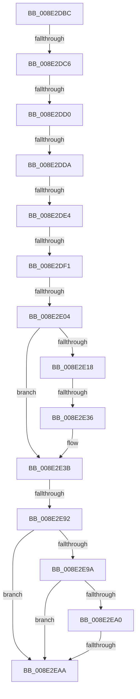

# sub_008E2DBC

- RVA: `0x008E2DBC`–`0x008E2EB2` (길이 `246` bytes)
- VA: `0x00000001408E2DBC`
- 실행 섹션: `PAGE`
- PDB 이름 있음: `아니요`; PDB Function 태그: `아니요`
- unwind 정보 RVA: `0x00085FDC`
- 디코드: `56`개 명령, `246/246` bytes 표시
- 미해석 바이트: `0` (있으면 어셈블리에 `.byte`로 보존)

> 이 문서는 커널 이미지의 기계어와 PDB 기호를 분석해 생성했습니다. 4번과 5번은 함수 원형과 자료형을 바이너리 사용 방식에서 추정한 C 해석이며 원본 소스 복구 결과는 아닙니다.

## 1. Dependencies

- 직접 호출 지점: **2**; 고유 호출 대상: **2**
- 직접 호출자로 확인된 함수: **0**
- RIP 상대 이미지 참조: **1**

### Outgoing calls
- `0x008E2E25` → [ExAllocatePool2](../../poolcode/B8/ExAllocatePool2_function_00B820F0.md) (function, `0x00B820F0`)
- `0x008E2E83` → [PnpGetObjectProperty](PnpGetObjectProperty_function_008E2180.md) (function, `0x008E2180`)

### Direct callers
- 이 함수 시작 RVA로 연결되는 직접 call은 확인되지 않았습니다. 간접 호출은 완전히 역산할 수 없습니다.

### Static image references
- `0x008E2E44` → RVA `0x00E66398` (`.data`; read)

## 2. Other-region calls and transfers

- 다른 실행 섹션으로 향하는 call: **1**
  - `0x008E2E25` → [ExAllocatePool2](../../poolcode/B8/ExAllocatePool2_function_00B820F0.md) (`PAGE` → `POOLCODE`)
- call이 아닌 외부 분기/꼬리 이동: **10**
  - `0x008E2DC0` → [sub_008E369D + 0x35](Unknown_function_008E369D.md) (`tail-transfer`)
  - `0x008E2DCA` → [sub_008E369D](Unknown_function_008E369D.md) (`tail-transfer`)
  - `0x008E2DD4` → [sub_008E3115](Unknown_function_008E3115.md) (`tail-transfer`)
  - `0x008E2DDE` → [sub_008E2A93](Unknown_function_008E2A93.md) (`tail-transfer`)
  - `0x008E2DEB` → [sub_008E3562](Unknown_function_008E3562.md) (`tail-transfer`)
  - `0x008E2DFE` → [sub_008E34DB + 0x5B](Unknown_function_008E34DB.md) (`tail-transfer`)
  - `0x008E2E30` → [sub_008E2A93](Unknown_function_008E2A93.md) (`tail-transfer`)
  - `0x008E2E8C` → [sub_008E34DB](Unknown_function_008E34DB.md) (`tail-transfer`)
  - `0x008E2EA4` → [sub_008E34DB + 0x31](Unknown_function_008E34DB.md) (`tail-transfer`)
  - `0x008E2EAD` → [sub_008E34DB + 0x38](Unknown_function_008E34DB.md) (`tail-transfer`)

## 3. Assembly (complete function range)

```asm
008E2DBC  41 83 E9 03                     sub r9d, 3
008E2DC0  0F 84 0C 09 00 00               je 0x1408e36d2
008E2DC6  41 83 E9 01                     sub r9d, 1
008E2DCA  0F 84 CD 08 00 00               je 0x1408e369d
008E2DD0  41 83 E9 01                     sub r9d, 1
008E2DD4  0F 84 3B 03 00 00               je 0x1408e3115
008E2DDA  41 83 F9 04                     cmp r9d, 4
008E2DDE  0F 85 AF FC FF FF               jne 0x1408e2a93
008E2DE4  83 BD D0 00 00 00 01            cmp dword ptr [rbp + 0xd0], 1
008E2DEB  0F 85 71 07 00 00               jne 0x1408e3562
008E2DF1  45 33 F6                        xor r14d, r14d
008E2DF4  F7 47 3C 00 00 02 00            test dword ptr [rdi + 0x3c], 0x20000
008E2DFB  41 8B DE                        mov ebx, r14d
008E2DFE  0F 85 32 07 00 00               jne 0x1408e3536
008E2E04  8B 47 38                        mov eax, dword ptr [rdi + 0x38]
008E2E07  41 8B F6                        mov esi, r14d
008E2E0A  44 89 74 24 60                  mov dword ptr [rsp + 0x60], r14d
008E2E0F  44 89 74 24 64                  mov dword ptr [rsp + 0x64], r14d
008E2E14  85 C0                           test eax, eax
008E2E16  74 23                           je 0x1408e2e3b
008E2E18  8B D0                           mov edx, eax
008E2E1A  B9 00 01 00 00                  mov ecx, 0x100
008E2E1F  41 B8 50 6E 70 47               mov r8d, 0x47706e50
008E2E25  E8 C6 F2 29 00                  call 0x140b820f0
008E2E2A  48 8B F0                        mov rsi, rax
008E2E2D  48 85 C0                        test rax, rax
008E2E30  0F 84 5D FC FF FF               je 0x1408e2a93
008E2E36  44 8B 5C 24 6C                  mov r11d, dword ptr [rsp + 0x6c]
008E2E3B  4C 8B 4F 10                     mov r9, qword ptr [rdi + 0x10]
008E2E3F  48 8D 44 24 64                  lea rax, [rsp + 0x64]
008E2E44  48 8B 0D 4D 35 58 00            mov rcx, qword ptr [rip + 0x58354d]
008E2E4B  45 8B C3                        mov r8d, r11d
008E2E4E  44 89 74 24 50                  mov dword ptr [rsp + 0x50], r14d
008E2E53  49 8B D5                        mov rdx, r13
008E2E56  48 89 44 24 48                  mov qword ptr [rsp + 0x48], rax
008E2E5B  8B 47 38                        mov eax, dword ptr [rdi + 0x38]
008E2E5E  89 44 24 40                     mov dword ptr [rsp + 0x40], eax
008E2E62  48 8D 44 24 60                  lea rax, [rsp + 0x60]
008E2E67  48 89 74 24 38                  mov qword ptr [rsp + 0x38], rsi
008E2E6C  48 89 44 24 30                  mov qword ptr [rsp + 0x30], rax
008E2E71  48 8B 47 20                     mov rax, qword ptr [rdi + 0x20]
008E2E75  48 89 44 24 28                  mov qword ptr [rsp + 0x28], rax
008E2E7A  48 8B 47 18                     mov rax, qword ptr [rdi + 0x18]
008E2E7E  48 89 44 24 20                  mov qword ptr [rsp + 0x20], rax
008E2E83  E8 F8 F2 FF FF                  call 0x1408e2180
008E2E88  8B D8                           mov ebx, eax
008E2E8A  85 C0                           test eax, eax
008E2E8C  0F 89 49 06 00 00               jns 0x1408e34db
008E2E92  81 FB 25 02 00 C0               cmp ebx, 0xc0000225
008E2E98  75 10                           jne 0x1408e2eaa
008E2E9A  44 39 77 28                     cmp dword ptr [rdi + 0x28], r14d
008E2E9E  75 0A                           jne 0x1408e2eaa
008E2EA0  44 39 77 38                     cmp dword ptr [rdi + 0x38], r14d
008E2EA4  0F 84 62 06 00 00               je 0x1408e350c
008E2EAA  41 8B DE                        mov ebx, r14d
008E2EAD  E9 61 06 00 00                  jmp 0x1408e3513
```

## 4. C-style interpretation (structured pseudocode)

```c
__int64 __fastcall sub_008E2DBC(__int64 a1, __int64 a2, __int64 a3, int a4, __int64 a5, __int64 a6, __int64 a7, __int64 a8, __int64 a9, __int64 a10, __int64 a11, __int64 a12)
{
    __int64 result;
    __int64 v_r14;
    unsigned __int64 v_stack_p20;
    unsigned __int64 v_stack_p28;
    unsigned __int64 v_stack_p30;
    unsigned __int64 v_stack_p38;
    unsigned int v_stack_p40;
    unsigned __int64 v_stack_p48;
    unsigned int v_stack_p50;
    unsigned int v_stack_p60;
    unsigned int v_stack_p64;
    unsigned int v_stack_p6C;

    a4 = (unsigned int)((a4) - (3));
    a4 = (unsigned int)((a4) - (1));
    a4 = (unsigned int)((a4) - (1));
    v_r14 = 0;
    v_stack_p60 = 0;
    v_stack_p64 = 0;
    if ((unsigned int)((unsigned int)(*(unsigned int *)(v_rdi + 56))) == 0) goto loc_008E2E3B;
    result = ExAllocatePool2(256, (unsigned int)((unsigned int)((unsigned int)(*(unsigned int *)(v_rdi + 56)))), (unsigned int)(0x47706E50ULL), a4);
loc_008E2E3B:
    v_stack_p50 = 0;
    v_stack_p48 = v_stack_p64;
    v_stack_p40 = (unsigned int)((unsigned int)(*(unsigned int *)(v_rdi + 56)));
    v_stack_p38 = result;
    v_stack_p30 = a12;
    v_stack_p28 = *(unsigned __int64 *)(v_rdi + 32);
    v_stack_p20 = *(unsigned __int64 *)(v_rdi + 24);
    result = PnpGetObjectProperty(*(unsigned __int64 *)(v_rip + 5780813), v_r13, (unsigned int)((unsigned int)((unsigned int)(v_stack_p6C))), *(unsigned __int64 *)(v_rdi + 16));
    if (((unsigned int)((unsigned int)((unsigned int)(result)))) != 0xC0000225ULL) goto loc_008E2EAA;
    if ((*(unsigned int *)(v_rdi + 40)) != 0) goto loc_008E2EAA;
loc_008E2EAA:
}
```

## 5. (Beta) C Style

```c
int64_t sub_008E2DBC(int64_t Arg1, int64_t Arg2, int64_t Arg3, int32_t Arg4, uint64_t Arg5, uint64_t Arg6, uint64_t Arg7, uint64_t Arg8, uint64_t Arg9, uint64_t Arg10, uint64_t Arg11, int64_t Arg12)
{
    int64_t result;
    int64_t local_r14;
    uint64_t v_stack_p20;
    uint64_t v_stack_p28;
    uint64_t v_stack_p30;
    uint64_t v_stack_p38;
    uint32_t v_stack_p40;
    uint64_t v_stack_p48;
    uint32_t v_stack_p50;
    uint32_t v_stack_p60;
    uint32_t v_stack_p64;
    uint32_t v_stack_p6C;

    Arg4 = (uint32_t)((Arg4) - (3));
    Arg4 = (uint32_t)((Arg4) - (1));
    Arg4 = (uint32_t)((Arg4) - (1));
    local_r14 = 0;
    v_stack_p60 = 0;
    v_stack_p64 = 0;
    if ((uint32_t)((uint32_t)(*(uint32_t *)(local_rdi + 0x38))) == 0) goto loc_008E2E3B;
    result = ExAllocatePool2(256, (uint32_t)((uint32_t)((uint32_t)(*(uint32_t *)(local_rdi + 0x38)))), (uint32_t)(0x47706E50ULL), Arg4);
loc_008E2E3B:
    v_stack_p50 = 0;
    v_stack_p48 = v_stack_p64;
    v_stack_p40 = (uint32_t)((uint32_t)(*(uint32_t *)(local_rdi + 0x38)));
    v_stack_p38 = result;
    v_stack_p30 = Arg12;
    v_stack_p28 = *(uint64_t *)(local_rdi + 0x20);
    v_stack_p20 = *(uint64_t *)(local_rdi + 0x18);
    result = PnpGetObjectProperty(*(uint64_t *)(v_rip + 0x58354D), local_r13, (uint32_t)((uint32_t)((uint32_t)(v_stack_p6C))), *(uint64_t *)(local_rdi + 0x10));
    if (((uint32_t)((uint32_t)((uint32_t)(result)))) != 0xC0000225ULL) goto loc_008E2EAA;
    if ((*(uint32_t *)(local_rdi + 0x28)) != 0) goto loc_008E2EAA;
loc_008E2EAA:
}
```

## 6. Execution-region graph

[열기: 2D/3D 그래프와 함수 탐색 컨트롤 패널](../../../control-panel.html?section=page&rva=0x008E2DBC&view=graph)

- 2D 그래프는 위에서 아래로 흐르고, 3D 그래프는 빈 공간을 드래그해 회전합니다. Shift+드래그는 이동, 휠은 확대·축소, 함수 노드 선택은 대상 보고서 이동입니다.

### Static fallback


