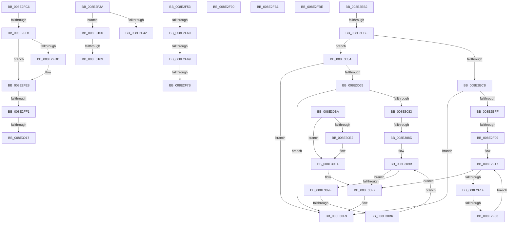

# sub_008E2EB2

- RVA: `0x008E2EB2`–`0x008E3115` (길이 `611` bytes)
- VA: `0x00000001408E2EB2`
- 실행 섹션: `PAGE`
- PDB 이름 있음: `아니요`; PDB Function 태그: `아니요`
- unwind 정보 RVA: `0x00085FEC`
- 디코드: `145`개 명령, `611/611` bytes 표시
- 미해석 바이트: `0` (있으면 어셈블리에 `.byte`로 보존)

> 이 문서는 커널 이미지의 기계어와 PDB 기호를 분석해 생성했습니다. 4번과 5번은 함수 원형과 자료형을 바이너리 사용 방식에서 추정한 C 해석이며 원본 소스 복구 결과는 아닙니다.

## 1. Dependencies

- 직접 호출 지점: **11**; 고유 호출 대상: **10**
- 직접 호출자로 확인된 함수: **0**
- RIP 상대 이미지 참조: **6**

### Outgoing calls
- `0x008E2F86` → [PiPnpRtlCacheObjectBaseKey](PiPnpRtlCacheObjectBaseKey_function_008E0690.md) (function, `0x008E0690`)
- `0x008E2F93` → [ExReleaseResourceLite](../../text/25/ExReleaseResourceLite_function_0025FA10.md) (function, `0x0025FA10`)
- `0x008E2FA1` → [KeLeaveCriticalRegionThread](../../text/25/KeLeaveCriticalRegionThread_function_0025EFF0.md) (function, `0x0025EFF0`)
- `0x008E300A` → [PiDmObjectGetCachedObjectReference](../8F/PiDmObjectGetCachedObjectReference_function_008F7FB0.md) (function, `0x008F7FB0`)
- `0x008E3045` → [PiDmObjectGetCachedObjectPropertyData](../8F/PiDmObjectGetCachedObjectPropertyData_function_008F3430.md) (function, `0x008F3430`)
- `0x008E3050` → [PiDmObjectRelease](PiDmObjectRelease_function_008E4F70.md) (function, `0x008E4F70`)
- `0x008E30BD` → [CmpLockSiloKeyLockTrackerExclusive](../8F/CmpLockSiloKeyLockTrackerExclusive_function_008F9EF8.md) (function, `0x008F9EF8`)
- `0x008E30D0` → [PiDmCacheDataFree](../8F/PiDmCacheDataFree_function_008F9C48.md) (function, `0x008F9C48`)
- `0x008E30D8` → [PiDmObjectReleaseLock](PiDmObjectReleaseLock_function_008E5584.md) (function, `0x008E5584`)
- `0x008E30EA` → [ExFreePoolWithTag](../../poolcode/B8/ExFreePoolWithTag_function_00B82870.md) (function, `0x00B82870`)
- `0x008E30F2` → [PiDmObjectRelease](PiDmObjectRelease_function_008E4F70.md) (function, `0x008E4F70`)

### Direct callers
- 이 함수 시작 RVA로 연결되는 직접 call은 확인되지 않았습니다. 간접 호출은 완전히 역산할 수 없습니다.

### Static image references
- `0x008E2F09` → RVA `0x00001A70` (`.rdata`; read)
- `0x008E2F42` → RVA `0x00001B60` (`.rdata`; read)
- `0x008E2FD4` → RVA `0x00011568` (`.rdata`; read)
- `0x008E2FE1` → RVA `0x00011570` (`.rdata`; read)
- `0x008E2FF9` → RVA `0x00011490` (`.rdata`; read)
- `0x008E3109` → RVA `0x00001B90` (`.rdata`; read)

## 2. Other-region calls and transfers

- 다른 실행 섹션으로 향하는 call: **3**
  - `0x008E2F93` → [ExReleaseResourceLite](../../text/25/ExReleaseResourceLite_function_0025FA10.md) (`PAGE` → `.text`)
  - `0x008E2FA1` → [KeLeaveCriticalRegionThread](../../text/25/KeLeaveCriticalRegionThread_function_0025EFF0.md) (`PAGE` → `.text`)
  - `0x008E30EA` → [ExFreePoolWithTag](../../poolcode/B8/ExFreePoolWithTag_function_00B82870.md) (`PAGE` → `POOLCODE`)
- call이 아닌 외부 분기/꼬리 이동: **20**
  - `0x008E2EB9` → [sub_008E28A3 + 0x1E0](Unknown_function_008E28A3.md) (`tail-transfer`)
  - `0x008E2F03` → [sub_008E314B + 0x27E](Unknown_function_008E314B.md) (`tail-transfer`)
  - `0x008E2F30` → [sub_008E314B](Unknown_function_008E314B.md) (`tail-transfer`)
  - `0x008E2F4E` → [sub_008E2AB2 + 0x18F](Unknown_function_008E2AB2.md) (`tail-transfer`)
  - `0x008E2F5A` → [sub_008E28A3 + 0x1D5](Unknown_function_008E28A3.md) (`tail-transfer`)
  - `0x008E2F63` → [sub_008E28A3 + 0x1D5](Unknown_function_008E28A3.md) (`tail-transfer`)
  - `0x008E2F75` → [sub_008E28A3 + 0x1E0](Unknown_function_008E28A3.md) (`tail-transfer`)
  - `0x008E2F8B` → [sub_008E28A3 + 0x1E0](Unknown_function_008E28A3.md) (`tail-transfer`)
  - `0x008E2FAC` → [sub_008E28A3 + 0x1D5](Unknown_function_008E28A3.md) (`tail-transfer`)
  - `0x008E2FB9` → [sub_008E28A3 + 0x1B4](Unknown_function_008E28A3.md) (`tail-transfer`)
  - `0x008E2FC1` → [sub_008E28A3 + 0x5F](Unknown_function_008E28A3.md) (`tail-transfer`)
  - `0x008E2FCB` → [sub_008E2AB2 + 0x173](Unknown_function_008E2AB2.md) (`tail-transfer`)
  - `0x008E2FEB` → [sub_008E2AB2 + 0x173](Unknown_function_008E2AB2.md) (`tail-transfer`)
  - `0x008E3011` → [sub_008E359C + 0x5F](Unknown_function_008E359C.md) (`tail-transfer`)
  - `0x008E3055` → [sub_008E2AB2 + 0x2F1](Unknown_function_008E2AB2.md) (`tail-transfer`)
  - `0x008E3087` → [sub_008E314B + 0x298](Unknown_function_008E314B.md) (`tail-transfer`)
  - `0x008E30B0` → [sub_008E314B + 0x164](Unknown_function_008E314B.md) (`tail-transfer`)
  - `0x008E30FB` → [sub_008E28A3 + 0x1E0](Unknown_function_008E28A3.md) (`tail-transfer`)
  - `0x008E3103` → [sub_008E2AB2 + 0x2F1](Unknown_function_008E2AB2.md) (`tail-transfer`)
  - `0x008E3110` → [sub_008E2AB2 + 0x18F](Unknown_function_008E2AB2.md) (`tail-transfer`)

## 3. Assembly (complete function range)

```asm
008E2EB2  F7 47 48 00 00 01 00            test dword ptr [rdi + 0x48], 0x10000
008E2EB9  0F 85 C4 FB FF FF               jne 0x1408e2a83
008E2EBF  8B 07                           mov eax, dword ptr [rdi]
008E2EC1  33 C9                           xor ecx, ecx
008E2EC3  85 C0                           test eax, eax
008E2EC5  0F 88 8F 01 00 00               js 0x1408e305a
008E2ECB  48 8B 47 40                     mov rax, qword ptr [rdi + 0x40]
008E2ECF  4C 8B 67 30                     mov r12, qword ptr [rdi + 0x30]
008E2ED3  4C 8B 7F 20                     mov r15, qword ptr [rdi + 0x20]
008E2ED7  48 89 4D A0                     mov qword ptr [rbp - 0x60], rcx
008E2EDB  44 8B 28                        mov r13d, dword ptr [rax]
008E2EDE  48 8B 47 28                     mov rax, qword ptr [rdi + 0x28]
008E2EE2  89 4C 24 60                     mov dword ptr [rsp + 0x60], ecx
008E2EE6  48 89 4C 24 78                  mov qword ptr [rsp + 0x78], rcx
008E2EEB  89 4C 24 64                     mov dword ptr [rsp + 0x64], ecx
008E2EEF  8B 00                           mov eax, dword ptr [rax]
008E2EF1  89 44 24 70                     mov dword ptr [rsp + 0x70], eax
008E2EF5  48 39 4F 18                     cmp qword ptr [rdi + 0x18], rcx
008E2EF9  0F 85 FA 01 00 00               jne 0x1408e30f9
008E2EFF  41 83 FB 01                     cmp r11d, 1
008E2F03  0F 85 C0 04 00 00               jne 0x1408e33c9
008E2F09  4C 8D 35 60 EB 71 FF            lea r14, [rip - 0x8e14a0]
008E2F10  BE 0A 00 00 00                  mov esi, 0xa
008E2F15  8B D9                           mov ebx, ecx
008E2F17  3B DE                           cmp ebx, esi
008E2F19  0F 83 D8 01 00 00               jae 0x1408e30f7
008E2F1F  8B C3                           mov eax, ebx
008E2F21  48 8D 0C 40                     lea rcx, [rax + rax*2]
008E2F25  49 8B 14 CE                     mov rdx, qword ptr [r14 + rcx*8]
008E2F29  8B 42 10                        mov eax, dword ptr [rdx + 0x10]
008E2F2C  41 39 47 10                     cmp dword ptr [r15 + 0x10], eax
008E2F30  0F 84 15 02 00 00               je 0x1408e314b
008E2F36  FF C3                           inc ebx
008E2F38  EB DD                           jmp 0x1408e2f17
008E2F3A  3B DE                           cmp ebx, esi
008E2F3C  0F 85 BE 01 00 00               jne 0x1408e3100
008E2F42  4C 8D 35 17 EC 71 FF            lea r14, [rip - 0x8e13e9]
008E2F49  BE 01 00 00 00                  mov esi, 1
008E2F4E  E9 EE FC FF FF                  jmp 0x1408e2c41
008E2F53  41 81 FD 25 02 00 C0            cmp r13d, 0xc0000225
008E2F5A  0F 84 18 FB FF FF               je 0x1408e2a78
008E2F60  44 3B E9                        cmp r13d, ecx
008E2F63  0F 84 0F FB FF FF               je 0x1408e2a78
008E2F69  41 8B DF                        mov ebx, r15d
008E2F6C  48 83 7F 10 00                  cmp qword ptr [rdi + 0x10], 0
008E2F71  4C 8D 4F 10                     lea r9, [rdi + 0x10]
008E2F75  0F 85 08 FB FF FF               jne 0x1408e2a83
008E2F7B  48 8B 55 88                     mov rdx, qword ptr [rbp - 0x78]
008E2F7F  45 8B C3                        mov r8d, r11d
008E2F82  48 8B 4D A0                     mov rcx, qword ptr [rbp - 0x60]
008E2F86  E8 05 D7 FF FF                  call 0x1408e0690
008E2F8B  E9 F3 FA FF FF                  jmp 0x1408e2a83
008E2F90  48 8B CE                        mov rcx, rsi
008E2F93  E8 78 CA 97 FF                  call 0x14025fa10
008E2F98  65 48 8B 0C 25 88 01 00 00      mov rcx, qword ptr gs:[0x188]
008E2FA1  E8 4A C0 97 FF                  call 0x14025eff0
008E2FA6  41 BD 34 00 00 C0               mov r13d, 0xc0000034
008E2FAC  E9 C7 FA FF FF                  jmp 0x1408e2a78
008E2FB1  45 8B E7                        mov r12d, r15d
008E2FB4  44 89 7C 24 60                  mov dword ptr [rsp + 0x60], r15d
008E2FB9  E9 99 FA FF FF                  jmp 0x1408e2a57
008E2FBE  41 8B D7                        mov edx, r15d
008E2FC1  E9 3C F9 FF FF                  jmp 0x1408e2902
008E2FC6  41 83 78 10 02                  cmp dword ptr [r8 + 0x10], 2
008E2FCB  0F 85 54 FC FF FF               jne 0x1408e2c25
008E2FD1  49 8B 00                        mov rax, qword ptr [r8]
008E2FD4  48 2B 05 8D E5 72 FF            sub rax, qword ptr [rip - 0x8d1a73]
008E2FDB  75 0B                           jne 0x1408e2fe8
008E2FDD  49 8B 40 08                     mov rax, qword ptr [r8 + 8]
008E2FE1  48 2B 05 88 E5 72 FF            sub rax, qword ptr [rip - 0x8d1a78]
008E2FE8  48 85 C0                        test rax, rax
008E2FEB  0F 85 34 FC FF FF               jne 0x1408e2c25
008E2FF1  48 8B 55 88                     mov rdx, qword ptr [rbp - 0x78]
008E2FF5  48 8D 45 D0                     lea rax, [rbp - 0x30]
008E2FF9  4C 8D 0D 90 E4 72 FF            lea r9, [rip - 0x8d1b70]
008E3000  48 89 44 24 20                  mov qword ptr [rsp + 0x20], rax
008E3005  4D 8B C7                        mov r8, r15
008E3008  8B CE                           mov ecx, esi
008E300A  E8 A1 4F 01 00                  call 0x1408f7fb0
008E300F  85 C0                           test eax, eax
008E3011  0F 88 E4 05 00 00               js 0x1408e35fb
008E3017  48 8B 5D D0                     mov rbx, qword ptr [rbp - 0x30]
008E301B  48 8B 4D 98                     mov rcx, qword ptr [rbp - 0x68]
008E301F  4C 8B C3                        mov r8, rbx
008E3022  4C 8B 4D 80                     mov r9, qword ptr [rbp - 0x80]
008E3026  48 89 4C 24 38                  mov qword ptr [rsp + 0x38], rcx
008E302B  48 8B 4D 90                     mov rcx, qword ptr [rbp - 0x70]
008E302F  48 8B 53 10                     mov rdx, qword ptr [rbx + 0x10]
008E3033  44 89 64 24 30                  mov dword ptr [rsp + 0x30], r12d
008E3038  4C 89 74 24 28                  mov qword ptr [rsp + 0x28], r14
008E303D  48 89 4C 24 20                  mov qword ptr [rsp + 0x20], rcx
008E3042  8B 4B 1C                        mov ecx, dword ptr [rbx + 0x1c]
008E3045  E8 E6 03 01 00                  call 0x1408f3430
008E304A  48 8B CB                        mov rcx, rbx
008E304D  44 8B E8                        mov r13d, eax
008E3050  E8 1B 1F 00 00                  call 0x1408e4f70
008E3055  E9 49 FD FF FF                  jmp 0x1408e2da3
008E305A  3D 25 02 00 C0                  cmp eax, 0xc0000225
008E305F  0F 85 94 00 00 00               jne 0x1408e30f9
008E3065  4C 8B 7F 20                     mov r15, qword ptr [rdi + 0x20]
008E3069  45 32 E4                        xor r12b, r12b
008E306C  48 89 4D A0                     mov qword ptr [rbp - 0x60], rcx
008E3070  89 4C 24 60                     mov dword ptr [rsp + 0x60], ecx
008E3074  48 89 4C 24 78                  mov qword ptr [rsp + 0x78], rcx
008E3079  89 4C 24 70                     mov dword ptr [rsp + 0x70], ecx
008E307D  48 39 4F 18                     cmp qword ptr [rdi + 0x18], rcx
008E3081  75 76                           jne 0x1408e30f9
008E3083  41 83 FB 01                     cmp r11d, 1
008E3087  0F 85 56 03 00 00               jne 0x1408e33e3
008E308D  4C 8D 35 DC E9 71 FF            lea r14, [rip - 0x8e1624]
008E3094  BE 0A 00 00 00                  mov esi, 0xa
008E3099  8B D9                           mov ebx, ecx
008E309B  3B DE                           cmp ebx, esi
008E309D  73 58                           jae 0x1408e30f7
008E309F  8B C3                           mov eax, ebx
008E30A1  48 8D 0C 40                     lea rcx, [rax + rax*2]
008E30A5  49 8B 14 CE                     mov rdx, qword ptr [r14 + rcx*8]
008E30A9  8B 42 10                        mov eax, dword ptr [rdx + 0x10]
008E30AC  41 39 47 10                     cmp dword ptr [r15 + 0x10], eax
008E30B0  0F 84 F9 01 00 00               je 0x1408e32af
008E30B6  FF C3                           inc ebx
008E30B8  EB E1                           jmp 0x1408e309b
008E30BA  48 8B CE                        mov rcx, rsi
008E30BD  E8 36 6E 01 00                  call 0x1408f9ef8
008E30C2  8B C3                           mov eax, ebx
008E30C4  4C 8D 40 07                     lea r8, [rax + 7]
008E30C8  4E 8D 04 40                     lea r8, [rax + r8*2]
008E30CC  4A 8D 0C C6                     lea rcx, [rsi + r8*8]
008E30D0  E8 73 6B 01 00                  call 0x1408f9c48
008E30D5  48 8B CE                        mov rcx, rsi
008E30D8  E8 A7 24 00 00                  call 0x1408e5584
008E30DD  48 85 FF                        test rdi, rdi
008E30E0  74 0D                           je 0x1408e30ef
008E30E2  BA 50 6E 70 5A                  mov edx, 0x5a706e50
008E30E7  48 8B CF                        mov rcx, rdi
008E30EA  E8 81 F7 29 00                  call 0x140b82870
008E30EF  48 8B CE                        mov rcx, rsi
008E30F2  E8 79 1E 00 00                  call 0x1408e4f70
008E30F7  33 C9                           xor ecx, ecx
008E30F9  8B D9                           mov ebx, ecx
008E30FB  E9 83 F9 FF FF                  jmp 0x1408e2a83
008E3100  83 FB 05                        cmp ebx, 5
008E3103  0F 85 9A FC FF FF               jne 0x1408e2da3
008E3109  4C 8D 35 80 EA 71 FF            lea r14, [rip - 0x8e1580]
008E3110  E9 2C FB FF FF                  jmp 0x1408e2c41
```

## 4. C-style interpretation (structured pseudocode)

```c
__int64 __fastcall sub_008E2EB2(int a1)
{
    __int64 v_r12;
    __int64 v_rbx;
    unsigned __int64 v_stack_p20;
    unsigned __int64 v_stack_p28;
    unsigned int v_stack_p30;
    unsigned __int64 v_stack_p38;
    unsigned int v_stack_p60;
    unsigned int v_stack_p64;
    unsigned int v_stack_p70;
    unsigned __int64 v_stack_p78;

    a1 = 0;
    if (sign_flag) goto loc_008E305A;
    *(unsigned __int64 *)(v_rbp - 96) = 0;
    v_stack_p60 = 0;
    v_stack_p78 = 0;
    v_stack_p64 = 0;
    v_stack_p70 = (unsigned int)((unsigned int)(*(unsigned int *)(*(unsigned __int64 *)(v_rdi + 40))));
    if ((*(unsigned __int64 *)(v_rdi + 24)) != 0) goto loc_008E30F9;
loc_008E2F17:
    if (0 >= 10) goto loc_008E30F7;
    v_rbx = (unsigned int)((0) + 1);
    goto loc_008E2F17;
loc_008E305A:
    if (((unsigned int)((unsigned int)(*(unsigned int *)(*(unsigned __int64 *)(v_rip - 9311392 + 0 + 0 * 2 * 8) + 16)))) != 0xC0000225ULL) goto loc_008E30F9;
    v_r12 = 0;
    *(unsigned __int64 *)(v_rbp - 96) = 0 + 0 * 2;
    v_stack_p60 = (unsigned int)(0 + 0 * 2);
    v_stack_p78 = 0 + 0 * 2;
    v_stack_p70 = (unsigned int)(0 + 0 * 2);
    if ((*(unsigned __int64 *)(v_rdi + 24)) != (0 + 0 * 2)) goto loc_008E30F9;
loc_008E309B:
    if (((unsigned int)((unsigned int)((unsigned int)(0 + 0 * 2)))) >= 10) goto loc_008E30F7;
    v_rbx = (unsigned int)(((unsigned int)((unsigned int)(0 + 0 * 2))) + 1);
    goto loc_008E309B;
loc_008E30F7:
    a1 = 0;
loc_008E30F9:
}
```

## 5. (Beta) C Style

```c
int64_t sub_008E2EB2(int32_t Arg1)
{
    int64_t local_r12;
    int64_t local_rbx;
    uint64_t v_stack_p20;
    uint64_t v_stack_p28;
    uint32_t v_stack_p30;
    uint64_t v_stack_p38;
    uint32_t v_stack_p60;
    uint32_t v_stack_p64;
    uint32_t v_stack_p70;
    uint64_t v_stack_p78;

    Arg1 = 0;
    if (sign_flag) goto loc_008E305A;
    *(uint64_t *)(local_rbp - 0x60) = 0;
    v_stack_p60 = 0;
    v_stack_p78 = 0;
    v_stack_p64 = 0;
    v_stack_p70 = (uint32_t)((uint32_t)(*(uint32_t *)(*(uint64_t *)(local_rdi + 0x28))));
    if ((*(uint64_t *)(local_rdi + 0x18)) != 0) goto loc_008E30F9;
loc_008E2F17:
    if (0 >= 10) goto loc_008E30F7;
    local_rbx = (uint32_t)((0) + 1);
    goto loc_008E2F17;
loc_008E305A:
    if (((uint32_t)((uint32_t)(*(uint32_t *)(*(uint64_t *)(v_rip - 0x8E14A0 + 0x0 + 0x0 * 2 * 8) + 0x10)))) != 0xC0000225ULL) goto loc_008E30F9;
    local_r12 = 0;
    *(uint64_t *)(local_rbp - 0x60) = 0 + 0 * 2;
    v_stack_p60 = (uint32_t)(0 + 0 * 2);
    v_stack_p78 = 0 + 0 * 2;
    v_stack_p70 = (uint32_t)(0 + 0 * 2);
    if ((*(uint64_t *)(local_rdi + 0x18)) != (0 + 0 * 2)) goto loc_008E30F9;
loc_008E309B:
    if (((uint32_t)((uint32_t)((uint32_t)(0 + 0 * 2)))) >= 10) goto loc_008E30F7;
    local_rbx = (uint32_t)(((uint32_t)((uint32_t)(0 + 0 * 2))) + 1);
    goto loc_008E309B;
loc_008E30F7:
    Arg1 = 0;
loc_008E30F9:
}
```

## 6. Execution-region graph

[열기: 2D/3D 그래프와 함수 탐색 컨트롤 패널](../../../control-panel.html?section=page&rva=0x008E2EB2&view=graph)

- 2D 그래프는 위에서 아래로 흐르고, 3D 그래프는 빈 공간을 드래그해 회전합니다. Shift+드래그는 이동, 휠은 확대·축소, 함수 노드 선택은 대상 보고서 이동입니다.

### Static fallback


