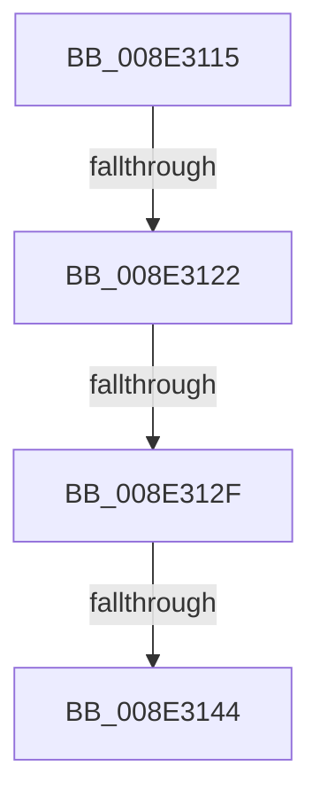

# sub_008E3115

- RVA: `0x008E3115`–`0x008E314B` (길이 `54` bytes)
- VA: `0x00000001408E3115`
- 실행 섹션: `PAGE`
- PDB 이름 있음: `아니요`; PDB Function 태그: `아니요`
- unwind 정보 RVA: `0x00086004`
- 디코드: `11`개 명령, `54/54` bytes 표시
- 미해석 바이트: `0` (있으면 어셈블리에 `.byte`로 보존)

> 이 문서는 커널 이미지의 기계어와 PDB 기호를 분석해 생성했습니다. 4번과 5번은 함수 원형과 자료형을 바이너리 사용 방식에서 추정한 C 해석이며 원본 소스 복구 결과는 아닙니다.

## 1. Dependencies

- 직접 호출 지점: **0**; 고유 호출 대상: **0**
- 직접 호출자로 확인된 함수: **0**
- RIP 상대 이미지 참조: **0**

### Outgoing calls
- 직접 디코드된 call 명령이 없습니다.

### Direct callers
- 이 함수 시작 RVA로 연결되는 직접 call은 확인되지 않았습니다. 간접 호출은 완전히 역산할 수 없습니다.

### Static image references
- 디코드된 RIP-relative 메모리 참조가 없습니다.

## 2. Other-region calls and transfers

- 다른 실행 섹션으로 향하는 call: **0**
- call이 아닌 외부 분기/꼬리 이동: **4**
  - `0x008E311C` → [sub_008E2A93](Unknown_function_008E2A93.md) (`tail-transfer`)
  - `0x008E3129` → [sub_008E2A93](Unknown_function_008E2A93.md) (`tail-transfer`)
  - `0x008E313E` → [sub_008E372B](Unknown_function_008E372B.md) (`tail-transfer`)
  - `0x008E3146` → [sub_008E2A93](Unknown_function_008E2A93.md) (`tail-transfer`)

## 3. Assembly (complete function range)

```asm
008E3115  83 BD D0 00 00 00 01            cmp dword ptr [rbp + 0xd0], 1
008E311C  0F 85 71 F9 FF FF               jne 0x1408e2a93
008E3122  F7 47 38 00 00 01 00            test dword ptr [rdi + 0x38], 0x10000
008E3129  0F 85 64 F9 FF FF               jne 0x1408e2a93
008E312F  48 8B 4F 30                     mov rcx, qword ptr [rdi + 0x30]
008E3133  8B 57 28                        mov edx, dword ptr [rdi + 0x28]
008E3136  4C 8B 4F 20                     mov r9, qword ptr [rdi + 0x20]
008E313A  41 83 FB 07                     cmp r11d, 7
008E313E  0F 8C E7 05 00 00               jl 0x1408e372b
008E3144  33 DB                           xor ebx, ebx
008E3146  E9 48 F9 FF FF                  jmp 0x1408e2a93
```

## 4. C-style interpretation (structured pseudocode)

```c
void __fastcall sub_008E3115(void)
{
    __int64 v_rbx;

    v_rbx = 0;
}
```

## 5. (Beta) C Style

```c
void sub_008E3115(void)
{
    int64_t local_rbx;

    local_rbx = 0;
}
```

## 6. Execution-region graph

[열기: 2D/3D 그래프와 함수 탐색 컨트롤 패널](../../../control-panel.html?section=page&rva=0x008E3115&view=graph)

- 2D 그래프는 위에서 아래로 흐르고, 3D 그래프는 빈 공간을 드래그해 회전합니다. Shift+드래그는 이동, 휠은 확대·축소, 함수 노드 선택은 대상 보고서 이동입니다.

### Static fallback


