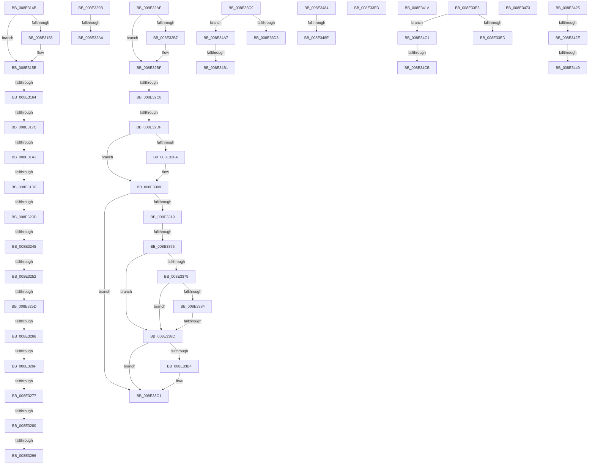

# sub_008E314B

- RVA: `0x008E314B`–`0x008E34DB` (길이 `912` bytes)
- VA: `0x00000001408E314B`
- 실행 섹션: `PAGE`
- PDB 이름 있음: `아니요`; PDB Function 태그: `아니요`
- unwind 정보 RVA: `0x00086014`
- 디코드: `210`개 명령, `912/912` bytes 표시
- 미해석 바이트: `0` (있으면 어셈블리에 `.byte`로 보존)

> 이 문서는 커널 이미지의 기계어와 PDB 기호를 분석해 생성했습니다. 4번과 5번은 함수 원형과 자료형을 바이너리 사용 방식에서 추정한 C 해석이며 원본 소스 복구 결과는 아닙니다.

## 1. Dependencies

- 직접 호출 지점: **18**; 고유 호출 대상: **12**
- 직접 호출자로 확인된 함수: **0**
- RIP 상대 이미지 참조: **2**

### Outgoing calls
- `0x008E316F` → [PiDmGetObject](../8D/PiDmGetObject_function_008DFAE0.md) (function, `0x008DFAE0`)
- `0x008E3183` → [CmpLockSiloKeyLockTrackerExclusive](../8F/CmpLockSiloKeyLockTrackerExclusive_function_008F9EF8.md) (function, `0x008F9EF8`)
- `0x008E31C3` → [PiDmCacheDataEncode](../8F/PiDmCacheDataEncode_function_008FB79C.md) (function, `0x008FB79C`)
- `0x008E31D1` → [PiDmObjectReleaseLock](PiDmObjectReleaseLock_function_008E5584.md) (function, `0x008E5584`)
- `0x008E3228` → [PnpGetObjectProperty](PnpGetObjectProperty_function_008E1110.md) (function, `0x008E1110`)
- `0x008E3289` → [memcmp](../../text/6C/memcmp_function_006C6B10.md) (function, `0x006C6B10`)
- `0x008E32D2` → [PiDmGetObject](../8D/PiDmGetObject_function_008DFAE0.md) (function, `0x008DFAE0`)
- `0x008E32E6` → [CmpLockSiloKeyLockTrackerExclusive](../8F/CmpLockSiloKeyLockTrackerExclusive_function_008F9EF8.md) (function, `0x008F9EF8`)
- `0x008E330B` → [PiDmObjectReleaseLock](PiDmObjectReleaseLock_function_008E5584.md) (function, `0x008E5584`)
- `0x008E3360` → [PnpGetObjectProperty](PnpGetObjectProperty_function_008E1110.md) (function, `0x008E1110`)
- `0x008E338F` → [CmpLockSiloKeyLockTrackerExclusive](../8F/CmpLockSiloKeyLockTrackerExclusive_function_008F9EF8.md) (function, `0x008F9EF8`)
- `0x008E33A2` → [PiDmCacheDataFree](../8F/PiDmCacheDataFree_function_008F9C48.md) (function, `0x008F9C48`)
- `0x008E33AA` → [PiDmObjectReleaseLock](PiDmObjectReleaseLock_function_008E5584.md) (function, `0x008E5584`)
- `0x008E33BC` → [ExFreePoolWithTag](../../poolcode/B8/ExFreePoolWithTag_function_00B82870.md) (function, `0x00B82870`)
- `0x008E3410` → [memcpy](../../text/6C/memcpy_function_006C6840.md) (function, `0x006C6840`)
- `0x008E3458` → [RtlInitUnicodeString](../../text/42/RtlInitUnicodeString_function_0042A780.md) (function, `0x0042A780`)
- `0x008E3466` → [RtlGUIDFromString](../8F/RtlGUIDFromString_function_008F1EF0.md) (function, `0x008F1EF0`)
- `0x008E347A` → [ExfReleasePushLock](../../text/26/ExfReleasePushLock_function_002638D0.md) (function, `0x002638D0`)

### Direct callers
- 이 함수 시작 RVA로 연결되는 직접 call은 확인되지 않았습니다. 간접 호출은 완전히 역산할 수 없습니다.

### Static image references
- `0x008E33D3` → RVA `0x00001B60` (`.rdata`; read)
- `0x008E34B1` → RVA `0x00001B90` (`.rdata`; read)

## 2. Other-region calls and transfers

- 다른 실행 섹션으로 향하는 call: **5**
  - `0x008E3289` → [memcmp](../../text/6C/memcmp_function_006C6B10.md) (`PAGE` → `.text`)
  - `0x008E33BC` → [ExFreePoolWithTag](../../poolcode/B8/ExFreePoolWithTag_function_00B82870.md) (`PAGE` → `POOLCODE`)
  - `0x008E3410` → [memcpy](../../text/6C/memcpy_function_006C6840.md) (`PAGE` → `.text`)
  - `0x008E3458` → [RtlInitUnicodeString](../../text/42/RtlInitUnicodeString_function_0042A780.md) (`PAGE` → `.text`)
  - `0x008E347A` → [ExfReleasePushLock](../../text/26/ExfReleasePushLock_function_002638D0.md) (`PAGE` → `.text`)
- call이 아닌 외부 분기/꼬리 이동: **35**
  - `0x008E315E` → [sub_008E2EB2 + 0x84](Unknown_function_008E2EB2.md) (`tail-transfer`)
  - `0x008E3176` → [sub_008E2EB2 + 0x245](Unknown_function_008E2EB2.md) (`tail-transfer`)
  - `0x008E319C` → [sub_008E3772 + 0x38](Unknown_function_008E3772.md) (`tail-transfer`)
  - `0x008E31D9` → [sub_008E2EB2 + 0x23D](Unknown_function_008E2EB2.md) (`tail-transfer`)
  - `0x008E3237` → [sub_008E37F5 + 0x66](Unknown_function_008E37F5.md) (`tail-transfer`)
  - `0x008E323F` → [sub_008E2EB2 + 0x208](Unknown_function_008E2EB2.md) (`tail-transfer`)
  - `0x008E324C` → [sub_008E2EB2 + 0x208](Unknown_function_008E2EB2.md) (`tail-transfer`)
  - `0x008E3257` → [sub_008E2EB2 + 0x208](Unknown_function_008E2EB2.md) (`tail-transfer`)
  - `0x008E3260` → [sub_008E37F5 + 0x89](Unknown_function_008E37F5.md) (`tail-transfer`)
  - `0x008E3269` → [sub_008E2EB2 + 0x208](Unknown_function_008E2EB2.md) (`tail-transfer`)
  - `0x008E3271` → [sub_008E2EB2 + 0x22B](Unknown_function_008E2EB2.md) (`tail-transfer`)
  - `0x008E327A` → [sub_008E2EB2 + 0x23D](Unknown_function_008E2EB2.md) (`tail-transfer`)
  - `0x008E3290` → [sub_008E2EB2 + 0x22B](Unknown_function_008E2EB2.md) (`tail-transfer`)
  - `0x008E3296` → [sub_008E2EB2 + 0x208](Unknown_function_008E2EB2.md) (`tail-transfer`)
  - `0x008E329E` → [sub_008E359C](Unknown_function_008E359C.md) (`tail-transfer`)
  - `0x008E32AA` → [sub_008E2AB2 + 0x296](Unknown_function_008E2AB2.md) (`tail-transfer`)
  - `0x008E32C2` → [sub_008E2EB2 + 0x204](Unknown_function_008E2EB2.md) (`tail-transfer`)
  - `0x008E32D9` → [sub_008E2EB2 + 0x245](Unknown_function_008E2EB2.md) (`tail-transfer`)
  - `0x008E336F` → [sub_008E37F5 + 0x97](Unknown_function_008E37F5.md) (`tail-transfer`)
  - `0x008E3386` → [sub_008E3772 + 0x2A](Unknown_function_008E3772.md) (`tail-transfer`)
  - `0x008E33C4` → [sub_008E2EB2 + 0x240](Unknown_function_008E2EB2.md) (`tail-transfer`)
  - `0x008E33DE` → [sub_008E2EB2 + 0x63](Unknown_function_008E2EB2.md) (`tail-transfer`)
  - `0x008E33F8` → [sub_008E2EB2 + 0x1E7](Unknown_function_008E2EB2.md) (`tail-transfer`)
  - `0x008E3415` → [sub_008E2AB2 + 0x296](Unknown_function_008E2AB2.md) (`tail-transfer`)
  - `0x008E3420` → [sub_008E2AB2 + 0x296](Unknown_function_008E2AB2.md) (`tail-transfer`)
  - `0x008E3428` → [sub_008E37F5 + 0x5B](Unknown_function_008E37F5.md) (`tail-transfer`)
  - `0x008E3443` → [sub_008E2AB2 + 0x291](Unknown_function_008E2AB2.md) (`tail-transfer`)
  - `0x008E346E` → [sub_008E2AB2 + 0x296](Unknown_function_008E2AB2.md) (`tail-transfer`)
  - `0x008E347F` → [sub_008E2AB2 + 0x2D2](Unknown_function_008E2AB2.md) (`tail-transfer`)
  - `0x008E3488` → [sub_008E2EB2 + 0xDE](Unknown_function_008E2EB2.md) (`tail-transfer`)
  - `0x008E34A2` → [sub_008E2AB2 + 0xC3](Unknown_function_008E2AB2.md) (`tail-transfer`)
  - `0x008E34AB` → [sub_008E2EB2 + 0x247](Unknown_function_008E2EB2.md) (`tail-transfer`)
  - `0x008E34BC` → [sub_008E2EB2 + 0x63](Unknown_function_008E2EB2.md) (`tail-transfer`)
  - `0x008E34C5` → [sub_008E2EB2 + 0x247](Unknown_function_008E2EB2.md) (`tail-transfer`)
  - `0x008E34D6` → [sub_008E2EB2 + 0x1E7](Unknown_function_008E2EB2.md) (`tail-transfer`)

## 3. Assembly (complete function range)

```asm
008E314B  49 8B 0F                        mov rcx, qword ptr [r15]
008E314E  48 2B 0A                        sub rcx, qword ptr [rdx]
008E3151  75 08                           jne 0x1408e315b
008E3153  49 8B 4F 08                     mov rcx, qword ptr [r15 + 8]
008E3157  48 2B 4A 08                     sub rcx, qword ptr [rdx + 8]
008E315B  48 85 C9                        test rcx, rcx
008E315E  0F 85 D2 FD FF FF               jne 0x1408e2f36
008E3164  48 8B 55 88                     mov rdx, qword ptr [rbp - 0x78]
008E3168  4C 8D 45 A0                     lea r8, [rbp - 0x60]
008E316C  41 8B CB                        mov ecx, r11d
008E316F  E8 6C C9 FF FF                  call 0x1408dfae0
008E3174  85 C0                           test eax, eax
008E3176  0F 88 7B FF FF FF               js 0x1408e30f7
008E317C  48 8B 75 A0                     mov rsi, qword ptr [rbp - 0x60]
008E3180  48 8B CE                        mov rcx, rsi
008E3183  E8 70 6D 01 00                  call 0x1408f9ef8
008E3188  8B C3                           mov eax, ebx
008E318A  48 8D 0C 40                     lea rcx, [rax + rax*2]
008E318E  48 8D 46 70                     lea rax, [rsi + 0x70]
008E3192  8B 3C C8                        mov edi, dword ptr [rax + rcx*8]
008E3195  48 8D 04 C8                     lea rax, [rax + rcx*8]
008E3199  83 FF 01                        cmp edi, 1
008E319C  0F 87 08 06 00 00               ja 0x1408e37aa
008E31A2  45 8B 4C CE 08                  mov r9d, dword ptr [r14 + rcx*8 + 8]
008E31A7  45 8B C5                        mov r8d, r13d
008E31AA  48 89 44 24 28                  mov qword ptr [rsp + 0x28], rax
008E31AF  49 8B D4                        mov rdx, r12
008E31B2  41 8B 44 CE 0C                  mov eax, dword ptr [r14 + rcx*8 + 0xc]
008E31B7  44 8B 74 24 70                  mov r14d, dword ptr [rsp + 0x70]
008E31BC  41 8B CE                        mov ecx, r14d
008E31BF  89 44 24 20                     mov dword ptr [rsp + 0x20], eax
008E31C3  E8 D4 85 01 00                  call 0x1408fb79c
008E31C8  85 FF                           test edi, edi
008E31CA  40 0F 94 C7                     sete dil
008E31CE  48 8B CE                        mov rcx, rsi
008E31D1  E8 AE 23 00 00                  call 0x1408e5584
008E31D6  40 84 FF                        test dil, dil
008E31D9  0F 84 10 FF FF FF               je 0x1408e30ef
008E31DF  44 8B 4C 24 6C                  mov r9d, dword ptr [rsp + 0x6c]
008E31E4  48 8D 44 24 64                  lea rax, [rsp + 0x64]
008E31E9  4C 8B 45 88                     mov r8, qword ptr [rbp - 0x78]
008E31ED  41 8B D5                        mov edx, r13d
008E31F0  C7 44 24 50 00 00 01 00         mov dword ptr [rsp + 0x50], 0x10000
008E31F8  B9 50 6E 70 5A                  mov ecx, 0x5a706e50
008E31FD  48 89 44 24 48                  mov qword ptr [rsp + 0x48], rax
008E3202  48 8D 44 24 78                  lea rax, [rsp + 0x78]
008E3207  48 89 44 24 40                  mov qword ptr [rsp + 0x40], rax
008E320C  48 8D 44 24 60                  lea rax, [rsp + 0x60]
008E3211  48 89 44 24 38                  mov qword ptr [rsp + 0x38], rax
008E3216  4C 89 7C 24 30                  mov qword ptr [rsp + 0x30], r15
008E321B  45 33 FF                        xor r15d, r15d
008E321E  4C 89 7C 24 28                  mov qword ptr [rsp + 0x28], r15
008E3223  4C 89 7C 24 20                  mov qword ptr [rsp + 0x20], r15
008E3228  E8 E3 DE FF FF                  call 0x1408e1110
008E322D  48 8B 7C 24 78                  mov rdi, qword ptr [rsp + 0x78]
008E3232  3D 25 02 00 C0                  cmp eax, 0xc0000225
008E3237  0F 84 1E 06 00 00               je 0x1408e385b
008E323D  85 C0                           test eax, eax
008E323F  0F 88 75 FE FF FF               js 0x1408e30ba
008E3245  8B 44 24 64                     mov eax, dword ptr [rsp + 0x64]
008E3249  41 3B C5                        cmp eax, r13d
008E324C  0F 85 68 FE FF FF               jne 0x1408e30ba
008E3252  44 39 74 24 60                  cmp dword ptr [rsp + 0x60], r14d
008E3257  0F 85 5D FE FF FF               jne 0x1408e30ba
008E325D  48 85 FF                        test rdi, rdi
008E3260  0F 84 18 06 00 00               je 0x1408e387e
008E3266  4D 85 E4                        test r12, r12
008E3269  0F 84 4B FE FF FF               je 0x1408e30ba
008E326F  85 C0                           test eax, eax
008E3271  0F 84 66 FE FF FF               je 0x1408e30dd
008E3277  48 85 FF                        test rdi, rdi
008E327A  0F 84 6F FE FF FF               je 0x1408e30ef
008E3280  44 8B C0                        mov r8d, eax
008E3283  49 8B D4                        mov rdx, r12
008E3286  48 8B CF                        mov rcx, rdi
008E3289  E8 82 38 DE FF                  call 0x1406c6b10
008E328E  85 C0                           test eax, eax
008E3290  0F 84 47 FE FF FF               je 0x1408e30dd
008E3296  E9 1F FE FF FF                  jmp 0x1408e30ba
008E329B  83 E9 02                        sub ecx, 2
008E329E  0F 85 F8 02 00 00               jne 0x1408e359c
008E32A4  41 BD 25 02 00 C0               mov r13d, 0xc0000225
008E32AA  E9 99 FA FF FF                  jmp 0x1408e2d48
008E32AF  49 8B 0F                        mov rcx, qword ptr [r15]
008E32B2  48 2B 0A                        sub rcx, qword ptr [rdx]
008E32B5  75 08                           jne 0x1408e32bf
008E32B7  49 8B 4F 08                     mov rcx, qword ptr [r15 + 8]
008E32BB  48 2B 4A 08                     sub rcx, qword ptr [rdx + 8]
008E32BF  48 85 C9                        test rcx, rcx
008E32C2  0F 85 EE FD FF FF               jne 0x1408e30b6
008E32C8  4C 8D 45 A0                     lea r8, [rbp - 0x60]
008E32CC  49 8B D5                        mov rdx, r13
008E32CF  41 8B CB                        mov ecx, r11d
008E32D2  E8 09 C8 FF FF                  call 0x1408dfae0
008E32D7  85 C0                           test eax, eax
008E32D9  0F 88 18 FE FF FF               js 0x1408e30f7
008E32DF  48 8B 7D A0                     mov rdi, qword ptr [rbp - 0x60]
008E32E3  48 8B CF                        mov rcx, rdi
008E32E6  E8 0D 6C 01 00                  call 0x1408f9ef8
008E32EB  8B C3                           mov eax, ebx
008E32ED  48 8D 0C 40                     lea rcx, [rax + rax*2]
008E32F1  8B 44 CF 70                     mov eax, dword ptr [rdi + rcx*8 + 0x70]
008E32F5  83 F8 01                        cmp eax, 1
008E32F8  77 0E                           ja 0x1408e3308
008E32FA  85 C0                           test eax, eax
008E32FC  C7 44 CF 70 02 00 00 00         mov dword ptr [rdi + rcx*8 + 0x70], 2
008E3304  41 0F 94 C4                     sete r12b
008E3308  48 8B CF                        mov rcx, rdi
008E330B  E8 74 22 00 00                  call 0x1408e5584
008E3310  45 84 E4                        test r12b, r12b
008E3313  0F 84 A8 00 00 00               je 0x1408e33c1
008E3319  44 8B 4C 24 6C                  mov r9d, dword ptr [rsp + 0x6c]
008E331E  48 8D 44 24 70                  lea rax, [rsp + 0x70]
008E3323  C7 44 24 50 00 00 01 00         mov dword ptr [rsp + 0x50], 0x10000
008E332B  45 33 F6                        xor r14d, r14d
008E332E  48 89 44 24 48                  mov qword ptr [rsp + 0x48], rax
008E3333  4D 8B C5                        mov r8, r13
008E3336  48 8D 44 24 78                  lea rax, [rsp + 0x78]
008E333B  33 D2                           xor edx, edx
008E333D  48 89 44 24 40                  mov qword ptr [rsp + 0x40], rax
008E3342  B9 50 6E 70 5A                  mov ecx, 0x5a706e50
008E3347  48 8D 44 24 60                  lea rax, [rsp + 0x60]
008E334C  48 89 44 24 38                  mov qword ptr [rsp + 0x38], rax
008E3351  4C 89 7C 24 30                  mov qword ptr [rsp + 0x30], r15
008E3356  4C 89 74 24 28                  mov qword ptr [rsp + 0x28], r14
008E335B  4C 89 74 24 20                  mov qword ptr [rsp + 0x20], r14
008E3360  E8 AB DD FF FF                  call 0x1408e1110
008E3365  48 8B 74 24 78                  mov rsi, qword ptr [rsp + 0x78]
008E336A  3D 25 02 00 C0                  cmp eax, 0xc0000225
008E336F  0F 84 17 05 00 00               je 0x1408e388c
008E3375  85 C0                           test eax, eax
008E3377  78 13                           js 0x1408e338c
008E3379  8B 44 24 70                     mov eax, dword ptr [rsp + 0x70]
008E337D  44 39 74 24 60                  cmp dword ptr [rsp + 0x60], r14d
008E3382  75 08                           jne 0x1408e338c
008E3384  85 C0                           test eax, eax
008E3386  0F 84 10 04 00 00               je 0x1408e379c
008E338C  48 8B CF                        mov rcx, rdi
008E338F  E8 64 6B 01 00                  call 0x1408f9ef8
008E3394  8B C3                           mov eax, ebx
008E3396  48 8D 50 07                     lea rdx, [rax + 7]
008E339A  48 8D 14 50                     lea rdx, [rax + rdx*2]
008E339E  48 8D 0C D7                     lea rcx, [rdi + rdx*8]
008E33A2  E8 A1 68 01 00                  call 0x1408f9c48
008E33A7  48 8B CF                        mov rcx, rdi
008E33AA  E8 D5 21 00 00                  call 0x1408e5584
008E33AF  48 85 F6                        test rsi, rsi
008E33B2  74 0D                           je 0x1408e33c1
008E33B4  BA 50 6E 70 5A                  mov edx, 0x5a706e50
008E33B9  48 8B CE                        mov rcx, rsi
008E33BC  E8 AF F4 29 00                  call 0x140b82870
008E33C1  48 8B CF                        mov rcx, rdi
008E33C4  E9 29 FD FF FF                  jmp 0x1408e30f2
008E33C9  41 83 FB 03                     cmp r11d, 3
008E33CD  0F 85 D4 00 00 00               jne 0x1408e34a7
008E33D3  4C 8D 35 86 E7 71 FF            lea r14, [rip - 0x8e187a]
008E33DA  41 8D 73 FE                     lea esi, [r11 - 2]
008E33DE  E9 32 FB FF FF                  jmp 0x1408e2f15
008E33E3  41 83 FB 03                     cmp r11d, 3
008E33E7  0F 85 D4 00 00 00               jne 0x1408e34c1
008E33ED  4C 8D 35 6C E7 71 FF            lea r14, [rip - 0x8e1894]
008E33F4  41 8D 73 FE                     lea esi, [r11 - 2]
008E33F8  E9 9C FC FF FF                  jmp 0x1408e3099
008E33FD  48 8B 92 80 00 00 00            mov rdx, qword ptr [rdx + 0x80]
008E3404  48 8B 4C 24 78                  mov rcx, qword ptr [rsp + 0x78]
008E3409  44 8B C0                        mov r8d, eax
008E340C  48 8B 52 10                     mov rdx, qword ptr [rdx + 0x10]
008E3410  E8 2B 34 DE FF                  call 0x1406c6840
008E3415  E9 2E F9 FF FF                  jmp 0x1408e2d48
008E341A  41 BD 16 00 00 C0               mov r13d, 0xc0000016
008E3420  E9 23 F9 FF FF                  jmp 0x1408e2d48
008E3425  83 F8 0D                        cmp eax, 0xd
008E3428  0F 85 22 04 00 00               jne 0x1408e3850
008E342E  83 7C 24 60 10                  cmp dword ptr [rsp + 0x60], 0x10
008E3433  48 8B 4D 90                     mov rcx, qword ptr [rbp - 0x70]
008E3437  89 01                           mov dword ptr [rcx], eax
008E3439  48 8B 4D 98                     mov rcx, qword ptr [rbp - 0x68]
008E343D  C7 01 10 00 00 00               mov dword ptr [rcx], 0x10
008E3443  0F 82 FA F8 FF FF               jb 0x1408e2d43
008E3449  48 8B 92 80 00 00 00            mov rdx, qword ptr [rdx + 0x80]
008E3450  48 8D 4D E0                     lea rcx, [rbp - 0x20]
008E3454  48 8B 52 10                     mov rdx, qword ptr [rdx + 0x10]
008E3458  E8 23 73 B4 FF                  call 0x14042a780
008E345D  48 8B 54 24 78                  mov rdx, qword ptr [rsp + 0x78]
008E3462  48 8D 4D E0                     lea rcx, [rbp - 0x20]
008E3466  E8 85 EA 00 00                  call 0x1408f1ef0
008E346B  44 8B E8                        mov r13d, eax
008E346E  E9 D5 F8 FF FF                  jmp 0x1408e2d48
008E3473  48 8B 5D 80                     mov rbx, qword ptr [rbp - 0x80]
008E3477  48 8B CB                        mov rcx, rbx
008E347A  E8 51 04 98 FF                  call 0x1402638d0
008E347F  E9 00 F9 FF FF                  jmp 0x1408e2d84
008E3484  66 83 FA 08                     cmp dx, 8
008E3488  0F 86 02 FB FF FF               jbe 0x1408e2f90
008E348E  B8 F8 FF 00 00                  mov eax, 0xfff8
008E3493  66 03 D0                        add dx, ax
008E3496  49 83 C3 08                     add r11, 8
008E349A  66 89 55 B8                     mov word ptr [rbp - 0x48], dx
008E349E  4C 89 5D C0                     mov qword ptr [rbp - 0x40], r11
008E34A2  E9 CE F6 FF FF                  jmp 0x1408e2b75
008E34A7  41 83 FB 05                     cmp r11d, 5
008E34AB  0F 85 48 FC FF FF               jne 0x1408e30f9
008E34B1  4C 8D 35 D8 E6 71 FF            lea r14, [rip - 0x8e1928]
008E34B8  41 8D 73 FE                     lea esi, [r11 - 2]
008E34BC  E9 54 FA FF FF                  jmp 0x1408e2f15
008E34C1  41 83 FB 05                     cmp r11d, 5
008E34C5  0F 85 2E FC FF FF               jne 0x1408e30f9
008E34CB  4C 8D 35 BE E6 71 FF            lea r14, [rip - 0x8e1942]
008E34D2  41 8D 73 FE                     lea esi, [r11 - 2]
008E34D6  E9 BE FB FF FF                  jmp 0x1408e3099
```

## 4. C-style interpretation (structured pseudocode)

```c
__int64 __fastcall sub_008E314B(__int64 a1, __int64 a2, __int64 a3, __int64 a4, __int64 a5, __int64 a6, __int64 a7, __int64 a8, __int64 a9, __int64 a10, __int64 a11, unsigned int a12, __int64 a13, unsigned int a14, __int64 a15)
{
    __int64 result;
    __int64 v_r15;
    __int64 v_rdi;
    unsigned int v_stack_p20;
    unsigned __int64 v_stack_p28;
    unsigned __int64 v_stack_p30;
    unsigned __int64 v_stack_p38;
    unsigned __int64 v_stack_p40;
    unsigned __int64 v_stack_p48;
    unsigned int v_stack_p50;
    unsigned __int64 v_stack_p60;
    unsigned __int64 v_stack_p64;
    unsigned int v_stack_p6C;
    unsigned __int64 v_stack_p70;
    unsigned __int64 v_stack_p78;

    a1 = (*(unsigned __int64 *)(v_r15)) - (*(unsigned __int64 *)(a2));
    if (!(condition_is_not_equal)) {
        a1 = *(unsigned __int64 *)(v_r15 + 8);
        a1 = (a1) - (*(unsigned __int64 *)(a2 + 8));
    }
    result = PiDmGetObject((unsigned int)((unsigned int)(v_r11)), *(unsigned __int64 *)(v_rbp - 120), v_rbp - 96, a4);
    result = CmpLockSiloKeyLockTrackerExclusive(*(unsigned __int64 *)(v_rbp - 96), *(unsigned __int64 *)(v_rbp - 120), v_rbp - 96, a4);
    v_stack_p28 = *(unsigned __int64 *)(v_rbp - 96) + 112 + (unsigned int)((unsigned int)(v_rbx)) + (unsigned int)((unsigned int)(v_rbx)) * 2 * 8;
    v_stack_p20 = (unsigned int)((unsigned int)(*(unsigned int *)(v_r14 + (unsigned int)((unsigned int)(v_rbx)) + (unsigned int)((unsigned int)(v_rbx)) * 2 * 8 + 12)));
    result = PiDmCacheDataEncode((unsigned int)((unsigned int)((unsigned int)(a14))), v_r12, (unsigned int)((unsigned int)(v_r13)), (unsigned int)(*(unsigned int *)(v_r14 + (unsigned int)((unsigned int)(v_rbx)) + (unsigned int)((unsigned int)(v_rbx)) * 2 * 8 + 8)));
    v_rdi = ((unsigned int)((unsigned int)(*(unsigned int *)(*(unsigned __int64 *)(v_rbp - 96) + 112 + (unsigned int)((unsigned int)(v_rbx)) + (unsigned int)((unsigned int)(v_rbx)) * 2 * 8))) == 0) ? 1 : 0;
    result = PiDmObjectReleaseLock(*(unsigned __int64 *)(v_rbp - 96), v_r12, (unsigned int)((unsigned int)(v_r13)), (unsigned int)(*(unsigned int *)(v_r14 + (unsigned int)((unsigned int)(v_rbx)) + (unsigned int)((unsigned int)(v_rbx)) * 2 * 8 + 8)));
    v_stack_p50 = 0x10000ULL;
    v_stack_p48 = v_stack_p64;
    v_stack_p40 = a15;
    v_stack_p38 = a12;
    v_stack_p30 = v_r15;
    v_r15 = 0;
    v_stack_p28 = 0;
    v_stack_p20 = 0;
    result = PnpGetObjectProperty((unsigned int)(0x5A706E50ULL), (unsigned int)((unsigned int)(v_r13)), *(unsigned __int64 *)(v_rbp - 120), (unsigned int)(v_stack_p6C));
    result = memcmp(a15, v_r12, (unsigned int)((unsigned int)((unsigned int)(v_stack_p64))), (unsigned int)(v_stack_p6C));
}
```

## 5. (Beta) C Style

```c
int64_t sub_008E314B(int64_t Arg1, void *Arg2, int64_t Arg3, int64_t Arg4, uint64_t Arg5, uint64_t Arg6, uint64_t Arg7, uint64_t Arg8, uint64_t Arg9, uint64_t Arg10, uint64_t Arg11, uint32_t Arg12, uint64_t Arg13, uint32_t Arg14, int64_t Arg15)
{
    uint8_t *arg2 = (uint8_t *)Arg2;

    int64_t result;
    int64_t local_r15;
    int64_t local_rdi;
    uint32_t v_stack_p20;
    uint64_t v_stack_p28;
    uint64_t v_stack_p30;
    uint64_t v_stack_p38;
    uint64_t v_stack_p40;
    uint64_t v_stack_p48;
    uint32_t v_stack_p50;
    uint64_t v_stack_p60;
    uint64_t v_stack_p64;
    uint32_t v_stack_p6C;
    uint64_t v_stack_p70;
    uint64_t v_stack_p78;

    Arg1 = (*(uint64_t *)(local_r15)) - (*(uint64_t *)(arg2));
    if (!(condition_is_not_equal)) {
        Arg1 = *(uint64_t *)(local_r15 + 0x8);
        Arg1 = (Arg1) - (*(uint64_t *)(arg2 + 0x8));
    }
    result = PiDmGetObject((uint32_t)((uint32_t)(local_r11)), *(uint64_t *)(local_rbp - 0x78), local_rbp - 96, Arg4);
    result = CmpLockSiloKeyLockTrackerExclusive(*(uint64_t *)(local_rbp - 0x60), *(uint64_t *)(local_rbp - 0x78), local_rbp - 96, Arg4);
    v_stack_p28 = *(uint64_t *)(local_rbp - 0x60) + 112 + (uint32_t)((uint32_t)(local_rbx)) + (uint32_t)((uint32_t)(local_rbx)) * 2 * 8;
    v_stack_p20 = (uint32_t)((uint32_t)(*(uint32_t *)(local_r14 + (uint32_t)((uint32_t)(local_rbx)) + (uint32_t)((uint32_t)(local_rbx)) * 2 * 8 + 0xC)));
    result = PiDmCacheDataEncode((uint32_t)((uint32_t)((uint32_t)(Arg14))), local_r12, (uint32_t)((uint32_t)(local_r13)), (uint32_t)(*(uint32_t *)(local_r14 + (uint32_t)((uint32_t)(local_rbx)) + (uint32_t)((uint32_t)(local_rbx)) * 2 * 8 + 0x8)));
    local_rdi = ((uint32_t)((uint32_t)(*(uint32_t *)(*(uint64_t *)(local_rbp - 0x60) + 0x70 + (uint32_t)((uint32_t)(local_rbx)) + (uint32_t)((uint32_t)(local_rbx)) * 2 * 8))) == 0) ? 1 : 0;
    result = PiDmObjectReleaseLock(*(uint64_t *)(local_rbp - 0x60), local_r12, (uint32_t)((uint32_t)(local_r13)), (uint32_t)(*(uint32_t *)(local_r14 + (uint32_t)((uint32_t)(local_rbx)) + (uint32_t)((uint32_t)(local_rbx)) * 2 * 8 + 0x8)));
    v_stack_p50 = 0x10000ULL;
    v_stack_p48 = v_stack_p64;
    v_stack_p40 = Arg15;
    v_stack_p38 = Arg12;
    v_stack_p30 = local_r15;
    local_r15 = 0;
    v_stack_p28 = 0;
    v_stack_p20 = 0;
    result = PnpGetObjectProperty((uint32_t)(0x5A706E50ULL), (uint32_t)((uint32_t)(local_r13)), *(uint64_t *)(local_rbp - 0x78), (uint32_t)(v_stack_p6C));
    result = memcmp(Arg15, local_r12, (uint32_t)((uint32_t)((uint32_t)(v_stack_p64))), (uint32_t)(v_stack_p6C));
}
```

### 관측된 메모리 오프셋

구조체 형식이 확인되지 않은 접근은 인자 기준의 오프셋으로만 기록했습니다.

| 기준 인자 | 오프셋 표현 | 폭 (bit) | 접근 |
|---|---:|---:|---|
| `Arg2` | `+ 0x0` | `64` | `R` |
| `Arg2` | `+ 0x8` | `64` | `R` |

## 6. Execution-region graph

[열기: 2D/3D 그래프와 함수 탐색 컨트롤 패널](../../../control-panel.html?section=page&rva=0x008E314B&view=graph)

- 2D 그래프는 위에서 아래로 흐르고, 3D 그래프는 빈 공간을 드래그해 회전합니다. Shift+드래그는 이동, 휠은 확대·축소, 함수 노드 선택은 대상 보고서 이동입니다.

### Static fallback


