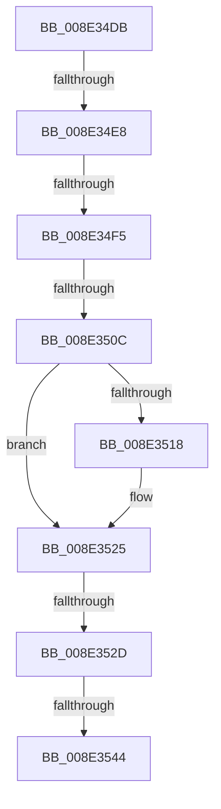

# sub_008E34DB

- RVA: `0x008E34DB`–`0x008E3554` (길이 `121` bytes)
- VA: `0x00000001408E34DB`
- 실행 섹션: `PAGE`
- PDB 이름 있음: `아니요`; PDB Function 태그: `아니요`
- unwind 정보 RVA: `0x0008602C`
- 디코드: `30`개 명령, `121/121` bytes 표시
- 미해석 바이트: `0` (있으면 어셈블리에 `.byte`로 보존)

> 이 문서는 커널 이미지의 기계어와 PDB 기호를 분석해 생성했습니다. 4번과 5번은 함수 원형과 자료형을 바이너리 사용 방식에서 추정한 C 해석이며 원본 소스 복구 결과는 아닙니다.

## 1. Dependencies

- 직접 호출 지점: **3**; 고유 호출 대상: **3**
- 직접 호출자로 확인된 함수: **0**
- RIP 상대 이미지 참조: **0**

### Outgoing calls
- `0x008E34FF` → [memcmp](../../text/6C/memcmp_function_006C6B10.md) (function, `0x006C6B10`)
- `0x008E3520` → [ExFreePoolWithTag](../../poolcode/B8/ExFreePoolWithTag_function_00B82870.md) (function, `0x00B82870`)
- `0x008E354A` → [PiPnpRtlCacheObjectBaseKey](PiPnpRtlCacheObjectBaseKey_function_008E0690.md) (function, `0x008E0690`)

### Direct callers
- 이 함수 시작 RVA로 연결되는 직접 call은 확인되지 않았습니다. 간접 호출은 완전히 역산할 수 없습니다.

### Static image references
- 디코드된 RIP-relative 메모리 참조가 없습니다.

## 2. Other-region calls and transfers

- 다른 실행 섹션으로 향하는 call: **2**
  - `0x008E34FF` → [memcmp](../../text/6C/memcmp_function_006C6B10.md) (`PAGE` → `.text`)
  - `0x008E3520` → [ExFreePoolWithTag](../../poolcode/B8/ExFreePoolWithTag_function_00B82870.md) (`PAGE` → `POOLCODE`)
- call이 아닌 외부 분기/꼬리 이동: **6**
  - `0x008E34E2` → [sub_008E2DBC + 0xEE](Unknown_function_008E2DBC.md) (`tail-transfer`)
  - `0x008E34EF` → [sub_008E2DBC + 0xEE](Unknown_function_008E2DBC.md) (`tail-transfer`)
  - `0x008E3506` → [sub_008E2DBC + 0xD6](Unknown_function_008E2DBC.md) (`tail-transfer`)
  - `0x008E3527` → [sub_008E2A93](Unknown_function_008E2A93.md) (`tail-transfer`)
  - `0x008E353E` → [sub_008E2A93](Unknown_function_008E2A93.md) (`tail-transfer`)
  - `0x008E354F` → [sub_008E2A93](Unknown_function_008E2A93.md) (`tail-transfer`)

## 3. Assembly (complete function range)

```asm
008E34DB  8B 47 28                        mov eax, dword ptr [rdi + 0x28]
008E34DE  39 44 24 60                     cmp dword ptr [rsp + 0x60], eax
008E34E2  0F 85 C2 F9 FF FF               jne 0x1408e2eaa
008E34E8  8B 44 24 64                     mov eax, dword ptr [rsp + 0x64]
008E34EC  3B 47 38                        cmp eax, dword ptr [rdi + 0x38]
008E34EF  0F 85 B5 F9 FF FF               jne 0x1408e2eaa
008E34F5  48 8B 57 30                     mov rdx, qword ptr [rdi + 0x30]
008E34F9  44 8B C0                        mov r8d, eax
008E34FC  48 8B CE                        mov rcx, rsi
008E34FF  E8 0C 36 DE FF                  call 0x1406c6b10
008E3504  85 C0                           test eax, eax
008E3506  0F 85 86 F9 FF FF               jne 0x1408e2e92
008E350C  89 1F                           mov dword ptr [rdi], ebx
008E350E  BB 20 01 00 C0                  mov ebx, 0xc0000120
008E3513  48 85 F6                        test rsi, rsi
008E3516  74 0D                           je 0x1408e3525
008E3518  BA 50 6E 70 47                  mov edx, 0x47706e50
008E351D  48 8B CE                        mov rcx, rsi
008E3520  E8 4B F3 29 00                  call 0x140b82870
008E3525  85 DB                           test ebx, ebx
008E3527  0F 85 66 F5 FF FF               jne 0x1408e2a93
008E352D  44 8B 5C 24 6C                  mov r11d, dword ptr [rsp + 0x6c]
008E3532  48 8B 4D A0                     mov rcx, qword ptr [rbp - 0x60]
008E3536  4C 39 77 10                     cmp qword ptr [rdi + 0x10], r14
008E353A  4C 8D 4F 10                     lea r9, [rdi + 0x10]
008E353E  0F 85 4F F5 FF FF               jne 0x1408e2a93
008E3544  45 8B C3                        mov r8d, r11d
008E3547  49 8B D5                        mov rdx, r13
008E354A  E8 41 D1 FF FF                  call 0x1408e0690
008E354F  E9 3F F5 FF FF                  jmp 0x1408e2a93
```

## 4. C-style interpretation (structured pseudocode)

```c
__int64 __fastcall sub_008E34DB(__int64 a1, __int64 a2, __int64 a3, __int64 a4, __int64 a5, __int64 a6, __int64 a7, __int64 a8, __int64 a9, __int64 a10, __int64 a11, unsigned int a12)
{
    __int64 result;
    unsigned int v_stack_p64;
    unsigned int v_stack_p6C;

    result = memcmp(v_rsi, *(unsigned __int64 *)(v_rdi + 48), (unsigned int)((unsigned int)((unsigned int)(v_stack_p64))), a4);
    *(unsigned int *)(v_rdi) = (unsigned int)(v_rbx);
    if (v_rsi != 0) {
        a2 = 0x47706E50ULL;
        a1 = v_rsi;
        result = ExFreePoolWithTag(a1, a2, (unsigned int)((unsigned int)((unsigned int)(v_stack_p64))), a4);
    }
    result = PiPnpRtlCacheObjectBaseKey(*(unsigned __int64 *)(v_rbp - 96), v_r13, (unsigned int)((unsigned int)((unsigned int)(v_stack_p6C))), v_rdi + 16);
}
```

## 5. (Beta) C Style

```c
int64_t sub_008E34DB(int64_t Arg1, int64_t Arg2, int64_t Arg3, int64_t Arg4, uint64_t Arg5, uint64_t Arg6, uint64_t Arg7, uint64_t Arg8, uint64_t Arg9, uint64_t Arg10, uint64_t Arg11, uint32_t Arg12)
{
    int64_t result;
    uint32_t v_stack_p64;
    uint32_t v_stack_p6C;

    result = memcmp(local_rsi, *(uint64_t *)(local_rdi + 0x30), (uint32_t)((uint32_t)((uint32_t)(v_stack_p64))), Arg4);
    *(uint32_t *)(local_rdi) = (uint32_t)(local_rbx);
    if (local_rsi != 0) {
        Arg2 = 0x47706E50ULL;
        Arg1 = local_rsi;
        result = ExFreePoolWithTag(Arg1, Arg2, (uint32_t)((uint32_t)((uint32_t)(v_stack_p64))), Arg4);
    }
    result = PiPnpRtlCacheObjectBaseKey(*(uint64_t *)(local_rbp - 0x60), local_r13, (uint32_t)((uint32_t)((uint32_t)(v_stack_p6C))), local_rdi + 16);
}
```

## 6. Execution-region graph

[열기: 2D/3D 그래프와 함수 탐색 컨트롤 패널](../../../control-panel.html?section=page&rva=0x008E34DB&view=graph)

- 2D 그래프는 위에서 아래로 흐르고, 3D 그래프는 빈 공간을 드래그해 회전합니다. Shift+드래그는 이동, 휠은 확대·축소, 함수 노드 선택은 대상 보고서 이동입니다.

### Static fallback


