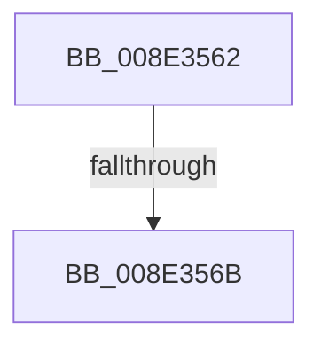

# sub_008E3562

- RVA: `0x008E3562`–`0x008E359C` (길이 `58` bytes)
- VA: `0x00000001408E3562`
- 실행 섹션: `PAGE`
- PDB 이름 있음: `아니요`; PDB Function 태그: `아니요`
- unwind 정보 RVA: `0x00086054`
- 디코드: `14`개 명령, `58/58` bytes 표시
- 미해석 바이트: `0` (있으면 어셈블리에 `.byte`로 보존)

> 이 문서는 커널 이미지의 기계어와 PDB 기호를 분석해 생성했습니다. 4번과 5번은 함수 원형과 자료형을 바이너리 사용 방식에서 추정한 C 해석이며 원본 소스 복구 결과는 아닙니다.

## 1. Dependencies

- 직접 호출 지점: **1**; 고유 호출 대상: **1**
- 직접 호출자로 확인된 함수: **0**
- RIP 상대 이미지 참조: **0**

### Outgoing calls
- `0x008E3592` → [PiDmObjectUpdateCachedObjectProperty](../8F/PiDmObjectUpdateCachedObjectProperty_function_008F9C94.md) (function, `0x008F9C94`)

### Direct callers
- 이 함수 시작 RVA로 연결되는 직접 call은 확인되지 않았습니다. 간접 호출은 완전히 역산할 수 없습니다.

### Static image references
- 디코드된 RIP-relative 메모리 참조가 없습니다.

## 2. Other-region calls and transfers

- 다른 실행 섹션으로 향하는 call: **0**
- call이 아닌 외부 분기/꼬리 이동: **2**
  - `0x008E3565` → [sub_008E2A93](Unknown_function_008E2A93.md) (`tail-transfer`)
  - `0x008E3597` → [sub_008E3115 + 0x2F](Unknown_function_008E3115.md) (`tail-transfer`)

## 3. Assembly (complete function range)

```asm
008E3562  83 3F 00                        cmp dword ptr [rdi], 0
008E3565  0F 8C 28 F5 FF FF               jl 0x1408e2a93
008E356B  8B 47 38                        mov eax, dword ptr [rdi + 0x38]
008E356E  41 8B CB                        mov ecx, r11d
008E3571  4C 8B 4F 18                     mov r9, qword ptr [rdi + 0x18]
008E3575  89 44 24 38                     mov dword ptr [rsp + 0x38], eax
008E3579  48 8B 47 30                     mov rax, qword ptr [rdi + 0x30]
008E357D  48 89 44 24 30                  mov qword ptr [rsp + 0x30], rax
008E3582  8B 47 28                        mov eax, dword ptr [rdi + 0x28]
008E3585  89 44 24 28                     mov dword ptr [rsp + 0x28], eax
008E3589  48 8B 47 20                     mov rax, qword ptr [rdi + 0x20]
008E358D  48 89 44 24 20                  mov qword ptr [rsp + 0x20], rax
008E3592  E8 FD 66 01 00                  call 0x1408f9c94
008E3597  E9 A8 FB FF FF                  jmp 0x1408e3144
```

## 4. C-style interpretation (structured pseudocode)

```c
__int64 __fastcall sub_008E3562(void)
{
    __int64 result;
    unsigned __int64 v_stack_p20;
    unsigned int v_stack_p28;
    unsigned __int64 v_stack_p30;
    unsigned int v_stack_p38;

    v_stack_p38 = (unsigned int)((unsigned int)(*(unsigned int *)(v_rdi + 56)));
    v_stack_p30 = *(unsigned __int64 *)(v_rdi + 48);
    v_stack_p28 = (unsigned int)((unsigned int)(*(unsigned int *)(v_rdi + 40)));
    v_stack_p20 = *(unsigned __int64 *)(v_rdi + 32);
    result = PiDmObjectUpdateCachedObjectProperty((unsigned int)((unsigned int)(v_r11)), a2, a3, *(unsigned __int64 *)(v_rdi + 24));
}
```

## 5. (Beta) C Style

```c
void sub_008E3562(void)
{
    int64_t result;
    uint64_t v_stack_p20;
    uint32_t v_stack_p28;
    uint64_t v_stack_p30;
    uint32_t v_stack_p38;

    v_stack_p38 = (uint32_t)((uint32_t)(*(uint32_t *)(local_rdi + 0x38)));
    v_stack_p30 = *(uint64_t *)(local_rdi + 0x30);
    v_stack_p28 = (uint32_t)((uint32_t)(*(uint32_t *)(local_rdi + 0x28)));
    v_stack_p20 = *(uint64_t *)(local_rdi + 0x20);
    result = PiDmObjectUpdateCachedObjectProperty((uint32_t)((uint32_t)(local_r11)), a2, a3, *(uint64_t *)(local_rdi + 0x18));
}
```

## 6. Execution-region graph

[열기: 2D/3D 그래프와 함수 탐색 컨트롤 패널](../../../control-panel.html?section=page&rva=0x008E3562&view=graph)

- 2D 그래프는 위에서 아래로 흐르고, 3D 그래프는 빈 공간을 드래그해 회전합니다. Shift+드래그는 이동, 휠은 확대·축소, 함수 노드 선택은 대상 보고서 이동입니다.

### Static fallback


