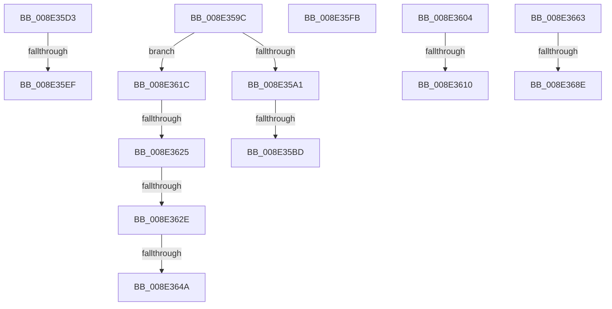

# sub_008E359C

- RVA: `0x008E359C`–`0x008E369D` (길이 `257` bytes)
- VA: `0x00000001408E359C`
- 실행 섹션: `PAGE`
- PDB 이름 있음: `아니요`; PDB Function 태그: `아니요`
- unwind 정보 RVA: `0x00086064`
- 디코드: `61`개 명령, `257/257` bytes 표시
- 미해석 바이트: `0` (있으면 어셈블리에 `.byte`로 보존)

> 이 문서는 커널 이미지의 기계어와 PDB 기호를 분석해 생성했습니다. 4번과 5번은 함수 원형과 자료형을 바이너리 사용 방식에서 추정한 C 해석이며 원본 소스 복구 결과는 아닙니다.

## 1. Dependencies

- 직접 호출 지점: **3**; 고유 호출 대상: **2**
- 직접 호출자로 확인된 함수: **0**
- RIP 상대 이미지 참조: **2**

### Outgoing calls
- `0x008E35C9` → [memcpy](../../text/6C/memcpy_function_006C6840.md) (function, `0x006C6840`)
- `0x008E35DF` → [PiDmGetObject](../8D/PiDmGetObject_function_008DFAE0.md) (function, `0x008DFAE0`)
- `0x008E3659` → [memcpy](../../text/6C/memcpy_function_006C6840.md) (function, `0x006C6840`)

### Direct callers
- 이 함수 시작 RVA로 연결되는 직접 call은 확인되지 않았습니다. 간접 호출은 완전히 역산할 수 없습니다.

### Static image references
- `0x008E3610` → RVA `0x00F8B880` (`.data`; read)
- `0x008E3667` → RVA `0x00000000` (`image boundary/outside`; read)

## 2. Other-region calls and transfers

- 다른 실행 섹션으로 향하는 call: **2**
  - `0x008E35C9` → [memcpy](../../text/6C/memcpy_function_006C6840.md) (`PAGE` → `.text`)
  - `0x008E3659` → [memcpy](../../text/6C/memcpy_function_006C6840.md) (`PAGE` → `.text`)
- call이 아닌 외부 분기/꼬리 이동: **13**
  - `0x008E35B7` → [sub_008E2AB2 + 0x291](Unknown_function_008E2AB2.md) (`tail-transfer`)
  - `0x008E35CE` → [sub_008E2AB2 + 0x296](Unknown_function_008E2AB2.md) (`tail-transfer`)
  - `0x008E35E9` → [sub_008E2AB2 + 0x2F1](Unknown_function_008E2AB2.md) (`tail-transfer`)
  - `0x008E35F6` → [sub_008E2AB2 + 0x20E](Unknown_function_008E2AB2.md) (`tail-transfer`)
  - `0x008E35FF` → [sub_008E2AB2 + 0x173](Unknown_function_008E2AB2.md) (`tail-transfer`)
  - `0x008E360A` → [sub_008E3704](Unknown_function_008E3704.md) (`tail-transfer`)
  - `0x008E3617` → [sub_008E2AB2 + 0x19](Unknown_function_008E2AB2.md) (`tail-transfer`)
  - `0x008E361F` → [sub_008E37F5 + 0x2B](Unknown_function_008E37F5.md) (`tail-transfer`)
  - `0x008E3628` → [sub_008E37F5 + 0x20](Unknown_function_008E37F5.md) (`tail-transfer`)
  - `0x008E3644` → [sub_008E2AB2 + 0x291](Unknown_function_008E2AB2.md) (`tail-transfer`)
  - `0x008E365E` → [sub_008E2AB2 + 0x296](Unknown_function_008E2AB2.md) (`tail-transfer`)
  - `0x008E3688` → [sub_00B1D11D](../B1/Unknown_function_00B1D11D.md) (`tail-transfer`)
  - `0x008E3698` → [sub_008E28A3 + 0x134](Unknown_function_008E28A3.md) (`tail-transfer`)

## 3. Assembly (complete function range)

```asm
008E359C  83 E9 01                        sub ecx, 1
008E359F  75 7B                           jne 0x1408e361c
008E35A1  8B 42 78                        mov eax, dword ptr [rdx + 0x78]
008E35A4  48 8B 4D 90                     mov rcx, qword ptr [rbp - 0x70]
008E35A8  89 01                           mov dword ptr [rcx], eax
008E35AA  8B 42 7C                        mov eax, dword ptr [rdx + 0x7c]
008E35AD  48 8B 4D 98                     mov rcx, qword ptr [rbp - 0x68]
008E35B1  89 01                           mov dword ptr [rcx], eax
008E35B3  39 44 24 60                     cmp dword ptr [rsp + 0x60], eax
008E35B7  0F 82 86 F7 FF FF               jb 0x1408e2d43
008E35BD  48 8B 4C 24 78                  mov rcx, qword ptr [rsp + 0x78]
008E35C2  44 8B C0                        mov r8d, eax
008E35C5  48 83 EA 80                     sub rdx, -0x80
008E35C9  E8 72 32 DE FF                  call 0x1406c6840
008E35CE  E9 75 F7 FF FF                  jmp 0x1408e2d48
008E35D3  48 8B 55 88                     mov rdx, qword ptr [rbp - 0x78]
008E35D7  4C 8D 45 80                     lea r8, [rbp - 0x80]
008E35DB  8B 4C 24 6C                     mov ecx, dword ptr [rsp + 0x6c]
008E35DF  E8 FC C4 FF FF                  call 0x1408dfae0
008E35E4  44 8B E8                        mov r13d, eax
008E35E7  85 C0                           test eax, eax
008E35E9  0F 88 B4 F7 FF FF               js 0x1408e2da3
008E35EF  4C 8B 65 80                     mov r12, qword ptr [rbp - 0x80]
008E35F3  40 B6 01                        mov sil, 1
008E35F6  E9 C5 F6 FF FF                  jmp 0x1408e2cc0
008E35FB  4C 8B 45 80                     mov r8, qword ptr [rbp - 0x80]
008E35FF  E9 21 F6 FF FF                  jmp 0x1408e2c25
008E3604  41 8B CB                        mov ecx, r11d
008E3607  83 E9 01                        sub ecx, 1
008E360A  0F 85 F4 00 00 00               jne 0x1408e3704
008E3610  48 8D 35 69 82 6A 00            lea rsi, [rip + 0x6a8269]
008E3617  E9 AF F4 FF FF                  jmp 0x1408e2acb
008E361C  83 E9 01                        sub ecx, 1
008E361F  0F 84 FB 01 00 00               je 0x1408e3820
008E3625  83 F9 01                        cmp ecx, 1
008E3628  0F 85 E7 01 00 00               jne 0x1408e3815
008E362E  8B 42 78                        mov eax, dword ptr [rdx + 0x78]
008E3631  48 8B 4D 90                     mov rcx, qword ptr [rbp - 0x70]
008E3635  89 01                           mov dword ptr [rcx], eax
008E3637  8B 42 7C                        mov eax, dword ptr [rdx + 0x7c]
008E363A  48 8B 4D 98                     mov rcx, qword ptr [rbp - 0x68]
008E363E  89 01                           mov dword ptr [rcx], eax
008E3640  39 44 24 60                     cmp dword ptr [rsp + 0x60], eax
008E3644  0F 82 F9 F6 FF FF               jb 0x1408e2d43
008E364A  48 8B 92 80 00 00 00            mov rdx, qword ptr [rdx + 0x80]
008E3651  44 8B C0                        mov r8d, eax
008E3654  48 8B 4C 24 78                  mov rcx, qword ptr [rsp + 0x78]
008E3659  E8 E2 31 DE FF                  call 0x1406c6840
008E365E  E9 E5 F6 FF FF                  jmp 0x1408e2d48
008E3663  49 63 47 28                     movsxd rax, dword ptr [r15 + 0x28]
008E3667  4C 8D 05 92 C9 71 FF            lea r8, [rip - 0x8e366e]
008E366E  48 8D 04 80                     lea rax, [rax + rax*4]
008E3672  4D 8B AC C0 A8 18 00 00         mov r13, qword ptr [r8 + rax*8 + 0x18a8]
008E367A  8B 44 24 60                     mov eax, dword ptr [rsp + 0x60]
008E367E  4C 03 EE                        add r13, rsi
008E3681  4D 8B 75 00                     mov r14, qword ptr [r13]
008E3685  4D 3B F5                        cmp r14, r13
008E3688  0F 85 8F 9A 23 00               jne 0x140b1d11d
008E368E  41 89 04 34                     mov dword ptr [r12 + rsi], eax
008E3692  41 BD 16 00 00 C0               mov r13d, 0xc0000016
008E3698  E9 3A F3 FF FF                  jmp 0x1408e29d7
```

## 4. C-style interpretation (structured pseudocode)

```c
__int64 __fastcall sub_008E359C(int a1, __int64 a2, __int64 a3, __int64 a4, __int64 a5, __int64 a6, __int64 a7, __int64 a8, __int64 a9, __int64 a10, __int64 a11, unsigned int a12, __int64 a13, __int64 a14, __int64 a15)
{
    __int64 result;
    unsigned int v_stack_p60;
    unsigned int v_stack_p6C;

    a1 = (unsigned int)((a1) - (1));
    if (condition_is_not_equal) goto loc_008E361C;
    *(unsigned int *)(*(unsigned __int64 *)(v_rbp - 112)) = (unsigned int)((unsigned int)(*(unsigned int *)(a2 + 120)));
    *(unsigned int *)(*(unsigned __int64 *)(v_rbp - 104)) = (unsigned int)((unsigned int)(*(unsigned int *)(a2 + 124)));
    a2 = (a2) - (-128);
    result = memcpy(a15, a2, (unsigned int)((unsigned int)((unsigned int)(*(unsigned int *)(a2 + 124)))), a4);
loc_008E361C:
    a1 = (unsigned int)((a15) - (1));
    *(unsigned int *)(*(unsigned __int64 *)(v_rbp - 112)) = (unsigned int)((unsigned int)(*(unsigned int *)(a2 + 120)));
    *(unsigned int *)(*(unsigned __int64 *)(v_rbp - 104)) = (unsigned int)((unsigned int)(*(unsigned int *)(a2 + 124)));
    result = memcpy(a15, *(unsigned __int64 *)(a2 + 128), (unsigned int)((unsigned int)((unsigned int)(*(unsigned int *)(a2 + 124)))), a4);
}
```

## 5. (Beta) C Style

```c
int64_t sub_008E359C(int32_t Arg1, void *Arg2, int64_t Arg3, int64_t Arg4, uint64_t Arg5, uint64_t Arg6, uint64_t Arg7, uint64_t Arg8, uint64_t Arg9, uint64_t Arg10, uint64_t Arg11, uint32_t Arg12, uint64_t Arg13, uint64_t Arg14, int64_t Arg15)
{
    uint8_t *arg2 = (uint8_t *)Arg2;

    int64_t result;
    uint32_t v_stack_p60;
    uint32_t v_stack_p6C;

    Arg1 = (uint32_t)((Arg1) - (1));
    if (condition_is_not_equal) goto loc_008E361C;
    *(uint32_t *)(*(uint64_t *)(local_rbp - 0x70)) = (uint32_t)((uint32_t)(*(uint32_t *)(arg2 + 0x78)));
    *(uint32_t *)(*(uint64_t *)(local_rbp - 0x68)) = (uint32_t)((uint32_t)(*(uint32_t *)(arg2 + 0x7C)));
    Arg2 = (Arg2) - (-128);
    result = memcpy(Arg15, Arg2, (uint32_t)((uint32_t)((uint32_t)(*(uint32_t *)(arg2 + 0x7C)))), Arg4);
loc_008E361C:
    Arg1 = (uint32_t)((Arg15) - (1));
    *(uint32_t *)(*(uint64_t *)(local_rbp - 0x70)) = (uint32_t)((uint32_t)(*(uint32_t *)(arg2 + 0x78)));
    *(uint32_t *)(*(uint64_t *)(local_rbp - 0x68)) = (uint32_t)((uint32_t)(*(uint32_t *)(arg2 + 0x7C)));
    result = memcpy(Arg15, *(uint64_t *)(arg2 + 0x80), (uint32_t)((uint32_t)((uint32_t)(*(uint32_t *)(arg2 + 0x7C)))), Arg4);
}
```

### 관측된 메모리 오프셋

구조체 형식이 확인되지 않은 접근은 인자 기준의 오프셋으로만 기록했습니다.

| 기준 인자 | 오프셋 표현 | 폭 (bit) | 접근 |
|---|---:|---:|---|
| `Arg2` | `+ 0x78` | `32` | `R` |
| `Arg2` | `+ 0x7C` | `32` | `R` |
| `Arg2` | `+ 0x80` | `64` | `R` |

## 6. Execution-region graph

[열기: 2D/3D 그래프와 함수 탐색 컨트롤 패널](../../../control-panel.html?section=page&rva=0x008E359C&view=graph)

- 2D 그래프는 위에서 아래로 흐르고, 3D 그래프는 빈 공간을 드래그해 회전합니다. Shift+드래그는 이동, 휠은 확대·축소, 함수 노드 선택은 대상 보고서 이동입니다.

### Static fallback


