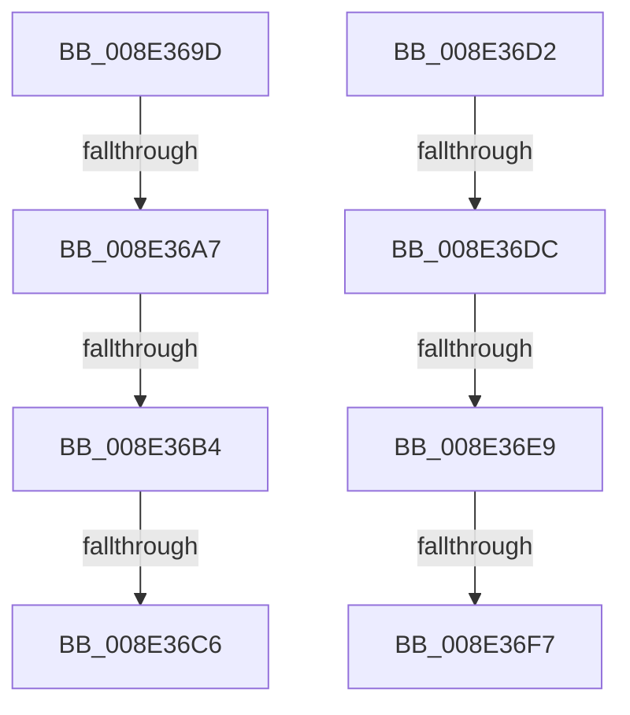

# sub_008E369D

- RVA: `0x008E369D`–`0x008E3704` (길이 `103` bytes)
- VA: `0x00000001408E369D`
- 실행 섹션: `PAGE`
- PDB 이름 있음: `아니요`; PDB Function 태그: `아니요`
- unwind 정보 RVA: `0x0008607C`
- 디코드: `23`개 명령, `103/103` bytes 표시
- 미해석 바이트: `0` (있으면 어셈블리에 `.byte`로 보존)

> 이 문서는 커널 이미지의 기계어와 PDB 기호를 분석해 생성했습니다. 4번과 5번은 함수 원형과 자료형을 바이너리 사용 방식에서 추정한 C 해석이며 원본 소스 복구 결과는 아닙니다.

## 1. Dependencies

- 직접 호출 지점: **2**; 고유 호출 대상: **2**
- 직접 호출자로 확인된 함수: **0**
- RIP 상대 이미지 참조: **0**

### Outgoing calls
- `0x008E36B7` → [PiDrvDbUnmountNode](../70/PiDrvDbUnmountNode_function_00704D48.md) (function, `0x00704D48`)
- `0x008E36EC` → [PiDrvDbMountNode](../AD/PiDrvDbMountNode_function_00AD4ECC.md) (function, `0x00AD4ECC`)

### Direct callers
- 이 함수 시작 RVA로 연결되는 직접 call은 확인되지 않았습니다. 간접 호출은 완전히 역산할 수 없습니다.

### Static image references
- 디코드된 RIP-relative 메모리 참조가 없습니다.

## 2. Other-region calls and transfers

- 다른 실행 섹션으로 향하는 call: **0**
- call이 아닌 외부 분기/꼬리 이동: **8**
  - `0x008E36A1` → [sub_008E2A93](Unknown_function_008E2A93.md) (`tail-transfer`)
  - `0x008E36AE` → [sub_008E37B7](Unknown_function_008E37B7.md) (`tail-transfer`)
  - `0x008E36C0` → [sub_008E2A93](Unknown_function_008E2A93.md) (`tail-transfer`)
  - `0x008E36CD` → [sub_008E2A93](Unknown_function_008E2A93.md) (`tail-transfer`)
  - `0x008E36D6` → [sub_008E2A93](Unknown_function_008E2A93.md) (`tail-transfer`)
  - `0x008E36E3` → [sub_008E37B7 + 0x1C](Unknown_function_008E37B7.md) (`tail-transfer`)
  - `0x008E36F5` → [sub_008E372B + 0x3B](Unknown_function_008E372B.md) (`tail-transfer`)
  - `0x008E36FF` → [sub_008E2A93](Unknown_function_008E2A93.md) (`tail-transfer`)

## 3. Assembly (complete function range)

```asm
008E369D  41 83 FB 07                     cmp r11d, 7
008E36A1  0F 85 EC F3 FF FF               jne 0x1408e2a93
008E36A7  83 BD D0 00 00 00 01            cmp dword ptr [rbp + 0xd0], 1
008E36AE  0F 85 03 01 00 00               jne 0x1408e37b7
008E36B4  49 8B CD                        mov rcx, r13
008E36B7  E8 8C 16 E2 FF                  call 0x140704d48
008E36BC  8B D8                           mov ebx, eax
008E36BE  85 C0                           test eax, eax
008E36C0  0F 89 CD F3 FF FF               jns 0x1408e2a93
008E36C6  89 07                           mov dword ptr [rdi], eax
008E36C8  BB 20 01 00 C0                  mov ebx, 0xc0000120
008E36CD  E9 C1 F3 FF FF                  jmp 0x1408e2a93
008E36D2  41 83 FB 07                     cmp r11d, 7
008E36D6  0F 85 B7 F3 FF FF               jne 0x1408e2a93
008E36DC  83 BD D0 00 00 00 01            cmp dword ptr [rbp + 0xd0], 1
008E36E3  0F 85 EA 00 00 00               jne 0x1408e37d3
008E36E9  49 8B CD                        mov rcx, r13
008E36EC  E8 DB 17 1F 00                  call 0x140ad4ecc
008E36F1  8B D8                           mov ebx, eax
008E36F3  85 C0                           test eax, eax
008E36F5  78 6F                           js 0x1408e3766
008E36F7  48 C7 47 08 01 00 00 00         mov qword ptr [rdi + 8], 1
008E36FF  E9 8F F3 FF FF                  jmp 0x1408e2a93
```

## 4. C-style interpretation (structured pseudocode)

```c
__int64 __fastcall sub_008E369D(void)
{
    __int64 result;

    result = PiDrvDbUnmountNode(v_r13, a2, a3, a4);
    *(unsigned int *)(v_rdi) = (unsigned int)(result);
}
```

## 5. (Beta) C Style

```c
void sub_008E369D(void)
{
    int64_t result;

    result = PiDrvDbUnmountNode(local_r13, a2, a3, a4);
    *(uint32_t *)(local_rdi) = (uint32_t)(result);
}
```

## 6. Execution-region graph

[열기: 2D/3D 그래프와 함수 탐색 컨트롤 패널](../../../control-panel.html?section=page&rva=0x008E369D&view=graph)

- 2D 그래프는 위에서 아래로 흐르고, 3D 그래프는 빈 공간을 드래그해 회전합니다. Shift+드래그는 이동, 휠은 확대·축소, 함수 노드 선택은 대상 보고서 이동입니다.

### Static fallback


