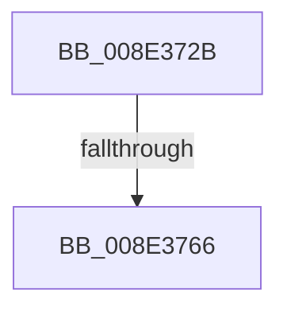

# sub_008E372B

- RVA: `0x008E372B`–`0x008E3772` (길이 `71` bytes)
- VA: `0x00000001408E372B`
- 실행 섹션: `PAGE`
- PDB 이름 있음: `아니요`; PDB Function 태그: `아니요`
- unwind 정보 RVA: `0x000860A4`
- 디코드: `16`개 명령, `71/71` bytes 표시
- 미해석 바이트: `0` (있으면 어셈블리에 `.byte`로 보존)

> 이 문서는 커널 이미지의 기계어와 PDB 기호를 분석해 생성했습니다. 4번과 5번은 함수 원형과 자료형을 바이너리 사용 방식에서 추정한 C 해석이며 원본 소스 복구 결과는 아닙니다.

## 1. Dependencies

- 직접 호출 지점: **1**; 고유 호출 대상: **1**
- 직접 호출자로 확인된 함수: **0**
- RIP 상대 이미지 참조: **1**

### Outgoing calls
- `0x008E3752` → [PiDmGetObjectList](../8F/PiDmGetObjectList_function_008FF0A0.md) (function, `0x008FF0A0`)

### Direct callers
- 이 함수 시작 RVA로 연결되는 직접 call은 확인되지 않았습니다. 간접 호출은 완전히 역산할 수 없습니다.

### Static image references
- `0x008E3747` → RVA `0x00730720` (`PiDmPnpObjectMatchCallback`; read)

## 2. Other-region calls and transfers

- 다른 실행 섹션으로 향하는 call: **0**
- call이 아닌 외부 분기/꼬리 이동: **2**
  - `0x008E3760` → [sub_008E3115 + 0x2F](Unknown_function_008E3115.md) (`tail-transfer`)
  - `0x008E376D` → [sub_008E2A93](Unknown_function_008E2A93.md) (`tail-transfer`)

## 3. Assembly (complete function range)

```asm
008E372B  48 8B 47 10                     mov rax, qword ptr [rdi + 0x10]
008E372F  4C 8D 45 A0                     lea r8, [rbp - 0x60]
008E3733  48 89 4C 24 28                  mov qword ptr [rsp + 0x28], rcx
008E3738  41 8B CB                        mov ecx, r11d
008E373B  48 89 45 A0                     mov qword ptr [rbp - 0x60], rax
008E373F  48 8B 47 18                     mov rax, qword ptr [rdi + 0x18]
008E3743  89 54 24 20                     mov dword ptr [rsp + 0x20], edx
008E3747  48 8D 15 D2 CF E4 FF            lea rdx, [rip - 0x1b302e]
008E374E  48 89 45 A8                     mov qword ptr [rbp - 0x58], rax
008E3752  E8 49 B9 01 00                  call 0x1408ff0a0
008E3757  41 BD 16 00 00 C0               mov r13d, 0xc0000016
008E375D  41 3B C5                        cmp eax, r13d
008E3760  0F 84 DE F9 FF FF               je 0x1408e3144
008E3766  89 07                           mov dword ptr [rdi], eax
008E3768  BB 20 01 00 C0                  mov ebx, 0xc0000120
008E376D  E9 21 F3 FF FF                  jmp 0x1408e2a93
```

## 4. C-style interpretation (structured pseudocode)

```c
__int64 __fastcall sub_008E372B(__int64 a1, int a2)
{
    __int64 result;
    unsigned int v_stack_p20;
    unsigned __int64 v_stack_p28;

    v_stack_p28 = a1;
    *(unsigned __int64 *)(v_rbp - 96) = *(unsigned __int64 *)(v_rdi + 16);
    v_stack_p20 = a2;
    *(unsigned __int64 *)(v_rbp - 88) = *(unsigned __int64 *)(v_rdi + 24);
    result = PiDmGetObjectList((unsigned int)((unsigned int)(v_r11)), v_rip - 1781806, v_rbp - 96, a4);
    *(unsigned int *)(v_rdi) = (unsigned int)(result);
}
```

## 5. (Beta) C Style

```c
int64_t sub_008E372B(int64_t Arg1, int32_t Arg2)
{
    int64_t result;
    uint32_t v_stack_p20;
    uint64_t v_stack_p28;

    v_stack_p28 = Arg1;
    *(uint64_t *)(local_rbp - 0x60) = *(uint64_t *)(local_rdi + 0x10);
    v_stack_p20 = Arg2;
    *(uint64_t *)(local_rbp - 0x58) = *(uint64_t *)(local_rdi + 0x18);
    result = PiDmGetObjectList((uint32_t)((uint32_t)(local_r11)), v_rip - 1781806, local_rbp - 96, a4);
    *(uint32_t *)(local_rdi) = (uint32_t)(result);
}
```

## 6. Execution-region graph

[열기: 2D/3D 그래프와 함수 탐색 컨트롤 패널](../../../control-panel.html?section=page&rva=0x008E372B&view=graph)

- 2D 그래프는 위에서 아래로 흐르고, 3D 그래프는 빈 공간을 드래그해 회전합니다. Shift+드래그는 이동, 휠은 확대·축소, 함수 노드 선택은 대상 보고서 이동입니다.

### Static fallback


