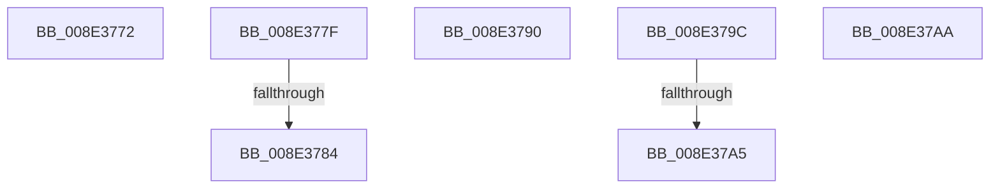

# sub_008E3772

- RVA: `0x008E3772`–`0x008E37B7` (길이 `69` bytes)
- VA: `0x00000001408E3772`
- 실행 섹션: `PAGE`
- PDB 이름 있음: `아니요`; PDB Function 태그: `아니요`
- unwind 정보 RVA: `0x000860B4`
- 디코드: `15`개 명령, `69/69` bytes 표시
- 미해석 바이트: `0` (있으면 어셈블리에 `.byte`로 보존)

> 이 문서는 커널 이미지의 기계어와 PDB 기호를 분석해 생성했습니다. 4번과 5번은 함수 원형과 자료형을 바이너리 사용 방식에서 추정한 C 해석이며 원본 소스 복구 결과는 아닙니다.

## 1. Dependencies

- 직접 호출 지점: **0**; 고유 호출 대상: **0**
- 직접 호출자로 확인된 함수: **0**
- RIP 상대 이미지 참조: **2**

### Outgoing calls
- 직접 디코드된 call 명령이 없습니다.

### Direct callers
- 이 함수 시작 RVA로 연결되는 직접 call은 확인되지 않았습니다. 간접 호출은 완전히 역산할 수 없습니다.

### Static image references
- `0x008E3784` → RVA `0x00F8B5E0` (`.data`; read)
- `0x008E3790` → RVA `0x00F8B500` (`.data`; read)

## 2. Other-region calls and transfers

- 다른 실행 섹션으로 향하는 call: **0**
- call이 아닌 외부 분기/꼬리 이동: **7**
  - `0x008E377A` → [sub_008E2AB2 + 0xB1](Unknown_function_008E2AB2.md) (`tail-transfer`)
  - `0x008E3782` → [sub_008E37F5 + 0xB](Unknown_function_008E37F5.md) (`tail-transfer`)
  - `0x008E378B` → [sub_008E2AB2 + 0x19](Unknown_function_008E2AB2.md) (`tail-transfer`)
  - `0x008E3797` → [sub_008E2AB2 + 0x19](Unknown_function_008E2AB2.md) (`tail-transfer`)
  - `0x008E379F` → [sub_008E314B + 0x241](Unknown_function_008E314B.md) (`tail-transfer`)
  - `0x008E37A5` → [sub_008E314B + 0x276](Unknown_function_008E314B.md) (`tail-transfer`)
  - `0x008E37B2` → [sub_008E314B + 0x83](Unknown_function_008E314B.md) (`tail-transfer`)

## 3. Assembly (complete function range)

```asm
008E3772  4C 8B 5D C0                     mov r11, qword ptr [rbp - 0x40]
008E3776  0F B7 55 B8                     movzx edx, word ptr [rbp - 0x48]
008E377A  E9 E4 F3 FF FF                  jmp 0x1408e2b63
008E377F  83 E9 01                        sub ecx, 1
008E3782  75 7C                           jne 0x1408e3800
008E3784  48 8D 35 55 7E 6A 00            lea rsi, [rip + 0x6a7e55]
008E378B  E9 3B F3 FF FF                  jmp 0x1408e2acb
008E3790  48 8D 35 69 7D 6A 00            lea rsi, [rip + 0x6a7d69]
008E3797  E9 2F F3 FF FF                  jmp 0x1408e2acb
008E379C  48 85 F6                        test rsi, rsi
008E379F  0F 85 E7 FB FF FF               jne 0x1408e338c
008E37A5  E9 17 FC FF FF                  jmp 0x1408e33c1
008E37AA  44 8B 74 24 70                  mov r14d, dword ptr [rsp + 0x70]
008E37AF  40 32 FF                        xor dil, dil
008E37B2  E9 17 FA FF FF                  jmp 0x1408e31ce
```

## 4. C-style interpretation (structured pseudocode)

```c
void __fastcall sub_008E3772(int a1)
{
    unsigned int v_stack_p70;
}
```

## 5. (Beta) C Style

```c
void sub_008E3772(int32_t Arg1)
{
    uint32_t v_stack_p70;
}
```

## 6. Execution-region graph

[열기: 2D/3D 그래프와 함수 탐색 컨트롤 패널](../../../control-panel.html?section=page&rva=0x008E3772&view=graph)

- 2D 그래프는 위에서 아래로 흐르고, 3D 그래프는 빈 공간을 드래그해 회전합니다. Shift+드래그는 이동, 휠은 확대·축소, 함수 노드 선택은 대상 보고서 이동입니다.

### Static fallback


