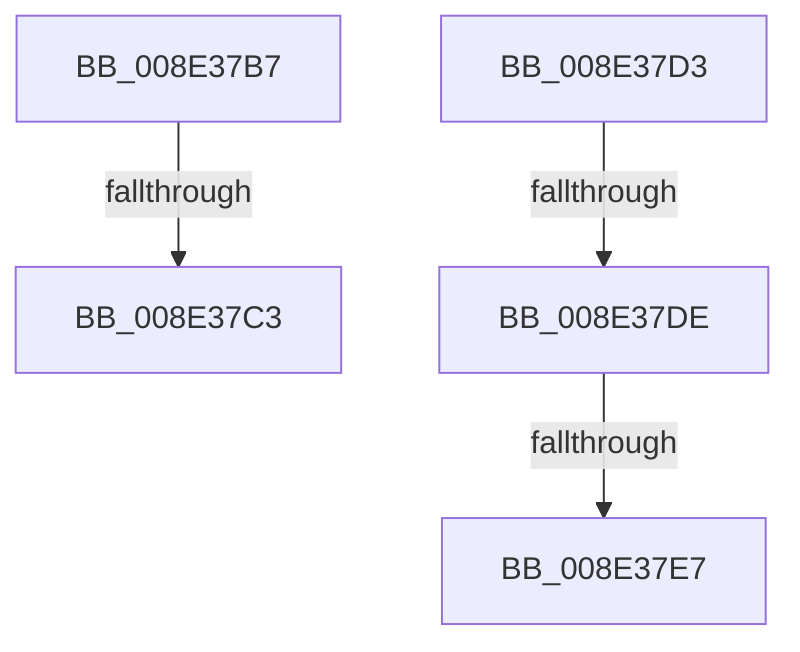

# sub_008E37B7

- RVA: `0x008E37B7`–`0x008E37F5` (길이 `62` bytes)
- VA: `0x00000001408E37B7`
- 실행 섹션: `PAGE`
- PDB 이름 있음: `아니요`; PDB Function 태그: `아니요`
- unwind 정보 RVA: `0x000860CC`
- 디코드: `13`개 명령, `62/62` bytes 표시
- 미해석 바이트: `0` (있으면 어셈블리에 `.byte`로 보존)

> 이 문서는 커널 이미지의 기계어와 PDB 기호를 분석해 생성했습니다. 4번과 5번은 함수 원형과 자료형을 바이너리 사용 방식에서 추정한 C 해석이며 원본 소스 복구 결과는 아닙니다.

## 1. Dependencies

- 직접 호출 지점: **1**; 고유 호출 대상: **1**
- 직접 호출자로 확인된 함수: **0**
- RIP 상대 이미지 참조: **0**

### Outgoing calls
- `0x008E37EA` → [PiDrvDbUnmountNode](../70/PiDrvDbUnmountNode_function_00704D48.md) (function, `0x00704D48`)

### Direct callers
- 이 함수 시작 RVA로 연결되는 직접 call은 확인되지 않았습니다. 간접 호출은 완전히 역산할 수 없습니다.

### Static image references
- 디코드된 RIP-relative 메모리 참조가 없습니다.

## 2. Other-region calls and transfers

- 다른 실행 섹션으로 향하는 call: **0**
- call이 아닌 외부 분기/꼬리 이동: **5**
  - `0x008E37BD` → [sub_008E2A93](Unknown_function_008E2A93.md) (`tail-transfer`)
  - `0x008E37CE` → [sub_008E2A93](Unknown_function_008E2A93.md) (`tail-transfer`)
  - `0x008E37D8` → [sub_008E2A93](Unknown_function_008E2A93.md) (`tail-transfer`)
  - `0x008E37E1` → [sub_00B1D10C](../B1/Unknown_function_00B1D10C.md) (`tail-transfer`)
  - `0x008E37F0` → [sub_00B1D10C + 0x4](../B1/Unknown_function_00B1D10C.md) (`tail-transfer`)

## 3. Assembly (complete function range)

```asm
008E37B7  81 3F 34 00 00 C0               cmp dword ptr [rdi], 0xc0000034
008E37BD  0F 85 D0 F2 FF FF               jne 0x1408e2a93
008E37C3  C7 07 00 00 00 00               mov dword ptr [rdi], 0
008E37C9  BB 20 01 00 C0                  mov ebx, 0xc0000120
008E37CE  E9 C0 F2 FF FF                  jmp 0x1408e2a93
008E37D3  48 83 7F 08 01                  cmp qword ptr [rdi + 8], 1
008E37D8  0F 85 B5 F2 FF FF               jne 0x1408e2a93
008E37DE  83 3F 00                        cmp dword ptr [rdi], 0
008E37E1  0F 8D 25 99 23 00               jge 0x140b1d10c
008E37E7  49 8B CD                        mov rcx, r13
008E37EA  E8 59 15 E2 FF                  call 0x140704d48
008E37EF  90                              nop
008E37F0  E9 1B 99 23 00                  jmp 0x140b1d110
```

## 4. C-style interpretation (structured pseudocode)

```c
__int64 __fastcall sub_008E37B7(void)
{
    *(unsigned int *)(v_rdi) = 0;
}
```

## 5. (Beta) C Style

```c
void sub_008E37B7(void)
{
    *(uint32_t *)(local_rdi) = 0;
}
```

## 6. Execution-region graph

[열기: 2D/3D 그래프와 함수 탐색 컨트롤 패널](../../../control-panel.html?section=page&rva=0x008E37B7&view=graph)

- 2D 그래프는 위에서 아래로 흐르고, 3D 그래프는 빈 공간을 드래그해 회전합니다. Shift+드래그는 이동, 휠은 확대·축소, 함수 노드 선택은 대상 보고서 이동입니다.

### Static fallback


