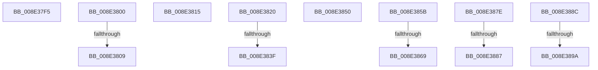

# sub_008E37F5

- RVA: `0x008E37F5`–`0x008E38AF` (길이 `186` bytes)
- VA: `0x00000001408E37F5`
- 실행 섹션: `PAGE`
- PDB 이름 있음: `아니요`; PDB Function 태그: `아니요`
- unwind 정보 RVA: `0x000860DC`
- 디코드: `39`개 명령, `186/186` bytes 표시
- 미해석 바이트: `0` (있으면 어셈블리에 `.byte`로 보존)

> 이 문서는 커널 이미지의 기계어와 PDB 기호를 분석해 생성했습니다. 4번과 5번은 함수 원형과 자료형을 바이너리 사용 방식에서 추정한 C 해석이며 원본 소스 복구 결과는 아닙니다.

## 1. Dependencies

- 직접 호출 지점: **2**; 고유 호출 대상: **1**
- 직접 호출자로 확인된 함수: **0**
- RIP 상대 이미지 참조: **1**

### Outgoing calls
- `0x008E3871` → [ExFreePoolWithTag](../../poolcode/B8/ExFreePoolWithTag_function_00B82870.md) (function, `0x00B82870`)
- `0x008E38A2` → [ExFreePoolWithTag](../../poolcode/B8/ExFreePoolWithTag_function_00B82870.md) (function, `0x00B82870`)

### Direct callers
- 이 함수 시작 RVA로 연결되는 직접 call은 확인되지 않았습니다. 간접 호출은 완전히 역산할 수 없습니다.

### Static image references
- `0x008E3809` → RVA `0x00F8B420` (`.data`; read)

## 2. Other-region calls and transfers

- 다른 실행 섹션으로 향하는 call: **2**
  - `0x008E3871` → [ExFreePoolWithTag](../../poolcode/B8/ExFreePoolWithTag_function_00B82870.md) (`PAGE` → `POOLCODE`)
  - `0x008E38A2` → [ExFreePoolWithTag](../../poolcode/B8/ExFreePoolWithTag_function_00B82870.md) (`PAGE` → `POOLCODE`)
- call이 아닌 외부 분기/꼬리 이동: **13**
  - `0x008E37FB` → [sub_008E28A3 + 0x1D8](Unknown_function_008E28A3.md) (`tail-transfer`)
  - `0x008E3803` → [sub_008E2AB2 + 0x19](Unknown_function_008E2AB2.md) (`tail-transfer`)
  - `0x008E3810` → [sub_008E2AB2 + 0x19](Unknown_function_008E2AB2.md) (`tail-transfer`)
  - `0x008E381B` → [sub_008E2AB2 + 0x296](Unknown_function_008E2AB2.md) (`tail-transfer`)
  - `0x008E3839` → [sub_008E2AB2 + 0x291](Unknown_function_008E2AB2.md) (`tail-transfer`)
  - `0x008E384B` → [sub_008E2AB2 + 0x296](Unknown_function_008E2AB2.md) (`tail-transfer`)
  - `0x008E3856` → [sub_008E2AB2 + 0x296](Unknown_function_008E2AB2.md) (`tail-transfer`)
  - `0x008E3863` → [sub_00B1D11D + 0xAC](../B1/Unknown_function_00B1D11D.md) (`tail-transfer`)
  - `0x008E3879` → [sub_00B1D11D + 0xAC](../B1/Unknown_function_00B1D11D.md) (`tail-transfer`)
  - `0x008E3881` → [sub_008E2EB2 + 0x208](Unknown_function_008E2EB2.md) (`tail-transfer`)
  - `0x008E3887` → [sub_008E314B + 0x124](Unknown_function_008E314B.md) (`tail-transfer`)
  - `0x008E3894` → [sub_00B1D11D + 0xB4](../B1/Unknown_function_00B1D11D.md) (`tail-transfer`)
  - `0x008E38AA` → [sub_00B1D11D + 0xB4](../B1/Unknown_function_00B1D11D.md) (`tail-transfer`)

## 3. Assembly (complete function range)

```asm
008E37F5  41 BC 23 00 00 C0               mov r12d, 0xc0000023
008E37FB  E9 7B F2 FF FF                  jmp 0x1408e2a7b
008E3800  83 F9 01                        cmp ecx, 1
008E3803  0F 85 C2 F2 FF FF               jne 0x1408e2acb
008E3809  48 8D 35 10 7C 6A 00            lea rsi, [rip + 0x6a7c10]
008E3810  E9 B6 F2 FF FF                  jmp 0x1408e2acb
008E3815  41 BD E5 00 00 C0               mov r13d, 0xc00000e5
008E381B  E9 28 F5 FF FF                  jmp 0x1408e2d48
008E3820  83 7C 24 60 10                  cmp dword ptr [rsp + 0x60], 0x10
008E3825  48 8B 4D 90                     mov rcx, qword ptr [rbp - 0x70]
008E3829  C7 01 0D 00 00 00               mov dword ptr [rcx], 0xd
008E382F  48 8B 4D 98                     mov rcx, qword ptr [rbp - 0x68]
008E3833  C7 01 10 00 00 00               mov dword ptr [rcx], 0x10
008E3839  0F 82 04 F5 FF FF               jb 0x1408e2d43
008E383F  48 8B 44 24 78                  mov rax, qword ptr [rsp + 0x78]
008E3844  0F 10 42 78                     movups xmm0, xmmword ptr [rdx + 0x78]
008E3848  0F 11 00                        movups xmmword ptr [rax], xmm0
008E384B  E9 F8 F4 FF FF                  jmp 0x1408e2d48
008E3850  41 BD E5 00 00 C0               mov r13d, 0xc00000e5
008E3856  E9 ED F4 FF FF                  jmp 0x1408e2d48
008E385B  44 89 7C 24 60                  mov dword ptr [rsp + 0x60], r15d
008E3860  48 85 FF                        test rdi, rdi
008E3863  0F 84 60 99 23 00               je 0x140b1d1c9
008E3869  BA 50 6E 70 5A                  mov edx, 0x5a706e50
008E386E  48 8B CF                        mov rcx, rdi
008E3871  E8 FA EF 29 00                  call 0x140b82870
008E3876  49 8B FF                        mov rdi, r15
008E3879  E9 4B 99 23 00                  jmp 0x140b1d1c9
008E387E  4D 85 E4                        test r12, r12
008E3881  0F 85 33 F8 FF FF               jne 0x1408e30ba
008E3887  E9 E3 F9 FF FF                  jmp 0x1408e326f
008E388C  44 89 74 24 60                  mov dword ptr [rsp + 0x60], r14d
008E3891  48 85 F6                        test rsi, rsi
008E3894  0F 84 37 99 23 00               je 0x140b1d1d1
008E389A  BA 50 6E 70 5A                  mov edx, 0x5a706e50
008E389F  48 8B CE                        mov rcx, rsi
008E38A2  E8 C9 EF 29 00                  call 0x140b82870
008E38A7  49 8B F6                        mov rsi, r14
008E38AA  E9 22 99 23 00                  jmp 0x140b1d1d1
```

## 4. C-style interpretation (structured pseudocode)

```c
__int64 __fastcall sub_008E37F5(int a1, __int64 a2)
{
    unsigned int v_stack_p60;
    unsigned __int64 v_stack_p78;
}
```

## 5. (Beta) C Style

```c
int64_t sub_008E37F5(int32_t Arg1, int64_t Arg2)
{
    uint32_t v_stack_p60;
    uint64_t v_stack_p78;
}
```

## 6. Execution-region graph

[열기: 2D/3D 그래프와 함수 탐색 컨트롤 패널](../../../control-panel.html?section=page&rva=0x008E37F5&view=graph)

- 2D 그래프는 위에서 아래로 흐르고, 3D 그래프는 빈 공간을 드래그해 회전합니다. Shift+드래그는 이동, 휠은 확대·축소, 함수 노드 선택은 대상 보고서 이동입니다.

### Static fallback


