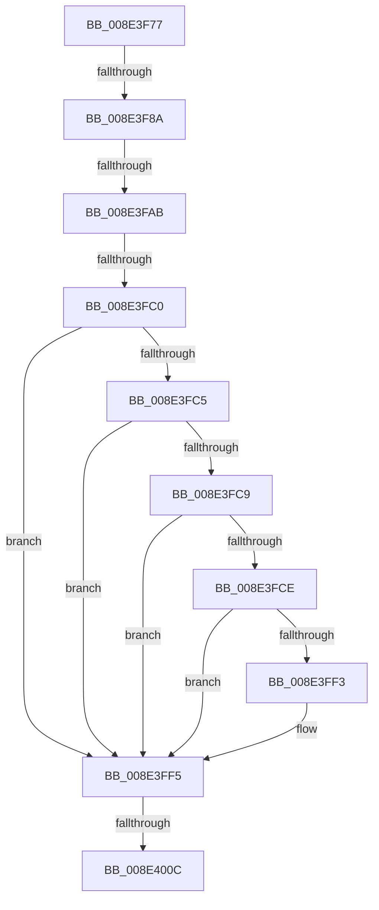

# sub_008E3F77

- RVA: `0x008E3F77`–`0x008E4018` (길이 `161` bytes)
- VA: `0x00000001408E3F77`
- 실행 섹션: `PAGE`
- PDB 이름 있음: `아니요`; PDB Function 태그: `아니요`
- unwind 정보 RVA: `0x000861AC`
- 디코드: `42`개 명령, `161/161` bytes 표시
- 미해석 바이트: `0` (있으면 어셈블리에 `.byte`로 보존)

> 이 문서는 커널 이미지의 기계어와 PDB 기호를 분석해 생성했습니다. 4번과 5번은 함수 원형과 자료형을 바이너리 사용 방식에서 추정한 C 해석이며 원본 소스 복구 결과는 아닙니다.

## 1. Dependencies

- 직접 호출 지점: **2**; 고유 호출 대상: **2**
- 직접 호출자로 확인된 함수: **0**
- RIP 상대 이미지 참조: **1**

### Outgoing calls
- `0x008E3FAD` → [PiControlGetDeviceInterfaceEnabled](PiControlGetDeviceInterfaceEnabled_function_008E4140.md) (function, `0x008E4140`)
- `0x008E3FEA` → [PiControlCopyUserModeCallersBuffer](PiControlCopyUserModeCallersBuffer_function_008E4720.md) (function, `0x008E4720`)

### Direct callers
- 이 함수 시작 RVA로 연결되는 직접 call은 확인되지 않았습니다. 간접 호출은 완전히 역산할 수 없습니다.

### Static image references
- `0x008E3F91` → RVA `0x008E4140` (`PiControlGetDeviceInterfaceEnabled`; read)

## 2. Other-region calls and transfers

- 다른 실행 섹션으로 향하는 call: **0**
- call이 아닌 외부 분기/꼬리 이동: **4**
  - `0x008E3F84` → [sub_008E402C + 0xA](Unknown_function_008E402C.md) (`tail-transfer`)
  - `0x008E3FA5` → [sub_008E402C + 0x87](Unknown_function_008E402C.md) (`tail-transfer`)
  - `0x008E3FBE` → [sub_008E402C](Unknown_function_008E402C.md) (`tail-transfer`)
  - `0x008E4006` → [sub_008E402C + 0x6F](Unknown_function_008E402C.md) (`tail-transfer`)

## 3. Assembly (complete function range)

```asm
008E3F77  4C 89 64 24 50                  mov qword ptr [rsp + 0x50], r12
008E3F7C  4C 89 74 24 58                  mov qword ptr [rsp + 0x58], r14
008E3F81  40 84 FF                        test dil, dil
008E3F84  0F 85 AC 00 00 00               jne 0x1408e4036
008E3F8A  4D 8B F7                        mov r14, r15
008E3F8D  48 8B 43 08                     mov rax, qword ptr [rbx + 8]
008E3F91  48 8D 0D A8 01 00 00            lea rcx, [rip + 0x1a8]
008E3F98  44 0F B6 CF                     movzx r9d, dil
008E3F9C  44 8B C6                        mov r8d, esi
008E3F9F  49 8B D6                        mov rdx, r14
008E3FA2  48 3B C1                        cmp rax, rcx
008E3FA5  0F 85 08 01 00 00               jne 0x1408e40b3
008E3FAB  8B CD                           mov ecx, ebp
008E3FAD  E8 8E 01 00 00                  call 0x1408e4140
008E3FB2  8B D8                           mov ebx, eax
008E3FB4  25 00 00 00 C0                  and eax, 0xc0000000
008E3FB9  3D 00 00 00 C0                  cmp eax, 0xc0000000
008E3FBE  74 6C                           je 0x1408e402c
008E3FC0  40 84 FF                        test dil, dil
008E3FC3  74 30                           je 0x1408e3ff5
008E3FC5  85 F6                           test esi, esi
008E3FC7  74 2C                           je 0x1408e3ff5
008E3FC9  4D 85 FF                        test r15, r15
008E3FCC  74 27                           je 0x1408e3ff5
008E3FCE  C7 44 24 28 00 00 00 00         mov dword ptr [rsp + 0x28], 0
008E3FD6  41 B9 04 00 00 00               mov r9d, 4
008E3FDC  44 8B C6                        mov r8d, esi
008E3FDF  40 88 7C 24 20                  mov byte ptr [rsp + 0x20], dil
008E3FE4  49 8B D6                        mov rdx, r14
008E3FE7  49 8B CF                        mov rcx, r15
008E3FEA  E8 31 07 00 00                  call 0x1408e4720
008E3FEF  85 C0                           test eax, eax
008E3FF1  79 02                           jns 0x1408e3ff5
008E3FF3  8B D8                           mov ebx, eax
008E3FF5  81 FB 56 00 00 C0               cmp ebx, 0xc0000056
008E3FFB  B8 0E 00 00 C0                  mov eax, 0xc000000e
008E4000  0F 44 D8                        cmove ebx, eax
008E4003  40 84 FF                        test dil, dil
008E4006  0F 85 8F 00 00 00               jne 0x1408e409b
008E400C  8B C3                           mov eax, ebx
008E400E  4C 8B 64 24 50                  mov r12, qword ptr [rsp + 0x50]
008E4013  4C 8B 74 24 58                  mov r14, qword ptr [rsp + 0x58]
```

## 4. C-style interpretation (structured pseudocode)

```c
__int64 __fastcall sub_008E3F77(__int64 a1, __int64 a2, __int64 a3, __int64 a4, __int64 a5, __int64 a6, __int64 a7, __int64 a8, __int64 a9, __int64 a10, __int64 a11)
{
    __int64 result;
    __int64 v_rbx;
    unsigned __int8 v_stack_p20;
    unsigned int v_stack_p28;
    unsigned __int64 v_stack_p50;
    unsigned __int64 v_stack_p58;

    v_stack_p50 = v_r12;
    v_stack_p58 = v_r14;
    result = PiControlGetDeviceInterfaceEnabled((unsigned int)((unsigned int)(v_rbp)), v_r15, (unsigned int)((unsigned int)(v_rsi)), (unsigned __int8)(v_rdi));
    result = (unsigned int)((result) & (0xC0000000ULL));
    if ((unsigned __int8)(v_rdi) == 0) goto loc_008E3FF5;
    if ((unsigned int)(v_rsi) == 0) goto loc_008E3FF5;
    if (v_r15 == 0) goto loc_008E3FF5;
    v_stack_p28 = 0;
    v_stack_p20 = (unsigned __int8)(v_rdi);
    result = PiControlCopyUserModeCallersBuffer(v_r15, v_r15, (unsigned int)((unsigned int)(v_rsi)), 4);
    v_rbx = (unsigned int)((unsigned int)(result));
    if (sign_flag) {
        v_rbx = (unsigned int)(result);
    }
    if (((unsigned int)(v_rbx)) == 0xC0000056ULL) { v_rbx = (unsigned int)((unsigned int)(0xC000000EULL)); }
    return (unsigned int)((unsigned int)(v_rbx));
}
```

## 5. (Beta) C Style

```c
int64_t sub_008E3F77(int64_t Arg1, int64_t Arg2, int64_t Arg3, int64_t Arg4, uint64_t Arg5, uint64_t Arg6, uint64_t Arg7, uint64_t Arg8, uint64_t Arg9, int64_t Arg10, int64_t Arg11)
{
    int64_t result;
    int64_t local_rbx;
    uint8_t v_stack_p20;
    uint32_t v_stack_p28;
    uint64_t v_stack_p50;
    uint64_t v_stack_p58;

    v_stack_p50 = local_r12;
    v_stack_p58 = local_r14;
    result = PiControlGetDeviceInterfaceEnabled((uint32_t)((uint32_t)(local_rbp)), local_r15, (uint32_t)((uint32_t)(local_rsi)), (uint8_t)(local_rdi));
    result = (uint32_t)((result) & (0xC0000000ULL));
    if ((uint8_t)(local_rdi) == 0) goto loc_008E3FF5;
    if ((uint32_t)(local_rsi) == 0) goto loc_008E3FF5;
    if (local_r15 == 0) goto loc_008E3FF5;
    v_stack_p28 = 0;
    v_stack_p20 = (uint8_t)(local_rdi);
    result = PiControlCopyUserModeCallersBuffer(local_r15, local_r15, (uint32_t)((uint32_t)(local_rsi)), 4);
    local_rbx = (uint32_t)((uint32_t)(result));
    if (sign_flag) {
        local_rbx = (uint32_t)(result);
    }
    if (((uint32_t)(local_rbx)) == 0xC0000056ULL) { local_rbx = (uint32_t)((uint32_t)(0xC000000EULL)); }
    return (uint32_t)((uint32_t)(local_rbx));
}
```

## 6. Execution-region graph

[열기: 2D/3D 그래프와 함수 탐색 컨트롤 패널](../../../control-panel.html?section=page&rva=0x008E3F77&view=graph)

- 2D 그래프는 위에서 아래로 흐르고, 3D 그래프는 빈 공간을 드래그해 회전합니다. Shift+드래그는 이동, 휠은 확대·축소, 함수 노드 선택은 대상 보고서 이동입니다.

### Static fallback


