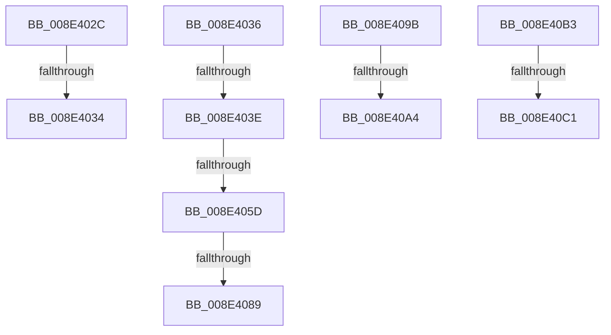

# sub_008E402C

- RVA: `0x008E402C`–`0x008E40CB` (길이 `159` bytes)
- VA: `0x00000001408E402C`
- 실행 섹션: `PAGE`
- PDB 이름 있음: `아니요`; PDB Function 태그: `아니요`
- unwind 정보 RVA: `0x000861D8`
- 디코드: `39`개 명령, `159/159` bytes 표시
- 미해석 바이트: `0` (있으면 어셈블리에 `.byte`로 보존)

> 이 문서는 커널 이미지의 기계어와 PDB 기호를 분석해 생성했습니다. 4번과 5번은 함수 원형과 자료형을 바이너리 사용 방식에서 추정한 C 해석이며 원본 소스 복구 결과는 아닙니다.

## 1. Dependencies

- 직접 호출 지점: **5**; 고유 호출 대상: **4**
- 직접 호출자로 확인된 함수: **0**
- RIP 상대 이미지 참조: **1**

### Outgoing calls
- `0x008E404C` → [ExAllocatePool2](../../poolcode/B8/ExAllocatePool2_function_00B820F0.md) (function, `0x00B820F0`)
- `0x008E4079` → [PiControlCopyUserModeCallersBuffer](PiControlCopyUserModeCallersBuffer_function_008E4720.md) (function, `0x008E4720`)
- `0x008E408E` → [ExFreePoolWithTag](../../poolcode/B8/ExFreePoolWithTag_function_00B82870.md) (function, `0x00B82870`)
- `0x008E40A9` → [ExFreePoolWithTag](../../poolcode/B8/ExFreePoolWithTag_function_00B82870.md) (function, `0x00B82870`)
- `0x008E40C1` → [PiControlGetSetDeviceStatus](PiControlGetSetDeviceStatus_function_008E55F0.md) (function, `0x008E55F0`)

### Direct callers
- 이 함수 시작 RVA로 연결되는 직접 call은 확인되지 않았습니다. 간접 호출은 완전히 역산할 수 없습니다.

### Static image references
- `0x008E40B3` → RVA `0x008E55F0` (`PiControlGetSetDeviceStatus`; read)

## 2. Other-region calls and transfers

- 다른 실행 섹션으로 향하는 call: **3**
  - `0x008E404C` → [ExAllocatePool2](../../poolcode/B8/ExAllocatePool2_function_00B820F0.md) (`PAGE` → `POOLCODE`)
  - `0x008E408E` → [ExFreePoolWithTag](../../poolcode/B8/ExFreePoolWithTag_function_00B82870.md) (`PAGE` → `POOLCODE`)
  - `0x008E40A9` → [ExFreePoolWithTag](../../poolcode/B8/ExFreePoolWithTag_function_00B82870.md) (`PAGE` → `POOLCODE`)
- call이 아닌 외부 분기/꼬리 이동: **10**
  - `0x008E4032` → [sub_008E3F77 + 0x7E](Unknown_function_008E3F77.md) (`tail-transfer`)
  - `0x008E4034` → [sub_008E3F77 + 0x49](Unknown_function_008E3F77.md) (`tail-transfer`)
  - `0x008E4038` → [sub_008E40F7](Unknown_function_008E40F7.md) (`tail-transfer`)
  - `0x008E4057` → [sub_008E411D](Unknown_function_008E411D.md) (`tail-transfer`)
  - `0x008E4083` → [sub_008E3F77 + 0x16](Unknown_function_008E3F77.md) (`tail-transfer`)
  - `0x008E4096` → [sub_008E3F77 + 0x97](Unknown_function_008E3F77.md) (`tail-transfer`)
  - `0x008E409E` → [sub_008E3F77 + 0x95](Unknown_function_008E3F77.md) (`tail-transfer`)
  - `0x008E40AE` → [sub_008E3F77 + 0x95](Unknown_function_008E3F77.md) (`tail-transfer`)
  - `0x008E40BF` → [sub_008E40F7 + 0x8](Unknown_function_008E40F7.md) (`tail-transfer`)
  - `0x008E40C6` → [sub_008E3F77 + 0x3B](Unknown_function_008E3F77.md) (`tail-transfer`)

## 3. Assembly (complete function range)

```asm
008E402C  81 FB 23 00 00 C0               cmp ebx, 0xc0000023
008E4032  75 C1                           jne 0x1408e3ff5
008E4034  EB 8A                           jmp 0x1408e3fc0
008E4036  85 F6                           test esi, esi
008E4038  0F 84 B9 00 00 00               je 0x1408e40f7
008E403E  48 8B D6                        mov rdx, rsi
008E4041  B9 01 01 00 00                  mov ecx, 0x101
008E4046  41 B8 50 70 20 20               mov r8d, 0x20207050
008E404C  E8 9F E0 29 00                  call 0x140b820f0
008E4051  4C 8B F0                        mov r14, rax
008E4054  48 85 C0                        test rax, rax
008E4057  0F 84 C0 00 00 00               je 0x1408e411d
008E405D  C7 44 24 28 01 00 00 00         mov dword ptr [rsp + 0x28], 1
008E4065  41 B9 04 00 00 00               mov r9d, 4
008E406B  44 8B C6                        mov r8d, esi
008E406E  40 88 7C 24 20                  mov byte ptr [rsp + 0x20], dil
008E4073  49 8B D7                        mov rdx, r15
008E4076  48 8B C8                        mov rcx, rax
008E4079  E8 A2 06 00 00                  call 0x1408e4720
008E407E  44 8B E0                        mov r12d, eax
008E4081  85 C0                           test eax, eax
008E4083  0F 89 04 FF FF FF               jns 0x1408e3f8d
008E4089  33 D2                           xor edx, edx
008E408B  49 8B CE                        mov rcx, r14
008E408E  E8 DD E7 29 00                  call 0x140b82870
008E4093  41 8B C4                        mov eax, r12d
008E4096  E9 73 FF FF FF                  jmp 0x1408e400e
008E409B  4D 85 F6                        test r14, r14
008E409E  0F 84 68 FF FF FF               je 0x1408e400c
008E40A4  33 D2                           xor edx, edx
008E40A6  49 8B CE                        mov rcx, r14
008E40A9  E8 C2 E7 29 00                  call 0x140b82870
008E40AE  E9 59 FF FF FF                  jmp 0x1408e400c
008E40B3  48 8D 0D 36 15 00 00            lea rcx, [rip + 0x1536]
008E40BA  48 3B C1                        cmp rax, rcx
008E40BD  8B CD                           mov ecx, ebp
008E40BF  75 3E                           jne 0x1408e40ff
008E40C1  E8 2A 15 00 00                  call 0x1408e55f0
008E40C6  E9 E7 FE FF FF                  jmp 0x1408e3fb2
```

## 4. C-style interpretation (structured pseudocode)

```c
__int64 __fastcall sub_008E402C(void)
{
    unsigned __int8 v_stack_p20;
    unsigned int v_stack_p28;
}
```

## 5. (Beta) C Style

```c
void sub_008E402C(void)
{
    uint8_t v_stack_p20;
    uint32_t v_stack_p28;
}
```

## 6. Execution-region graph

[열기: 2D/3D 그래프와 함수 탐색 컨트롤 패널](../../../control-panel.html?section=page&rva=0x008E402C&view=graph)

- 2D 그래프는 위에서 아래로 흐르고, 3D 그래프는 빈 공간을 드래그해 회전합니다. Shift+드래그는 이동, 휠은 확대·축소, 함수 노드 선택은 대상 보고서 이동입니다.

### Static fallback


