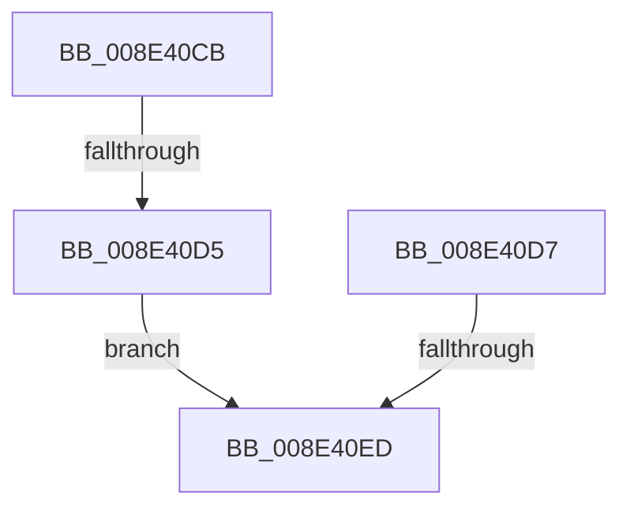

# sub_008E40CB

- RVA: `0x008E40CB`–`0x008E40F7` (길이 `44` bytes)
- VA: `0x00000001408E40CB`
- 실행 섹션: `PAGE`
- PDB 이름 있음: `아니요`; PDB Function 태그: `아니요`
- unwind 정보 RVA: `0x000861F0`
- 디코드: `10`개 명령, `44/44` bytes 표시
- 미해석 바이트: `0` (있으면 어셈블리에 `.byte`로 보존)

> 이 문서는 커널 이미지의 기계어와 PDB 기호를 분석해 생성했습니다. 4번과 5번은 함수 원형과 자료형을 바이너리 사용 방식에서 추정한 C 해석이며 원본 소스 복구 결과는 아닙니다.

## 1. Dependencies

- 직접 호출 지점: **1**; 고유 호출 대상: **1**
- 직접 호출자로 확인된 함수: **0**
- RIP 상대 이미지 참조: **1**

### Outgoing calls
- `0x008E40E0` → [SeSinglePrivilegeCheck](../87/SeSinglePrivilegeCheck_function_00871E20.md) (function, `0x00871E20`)

### Direct callers
- 이 함수 시작 RVA로 연결되는 직접 call은 확인되지 않았습니다. 간접 호출은 완전히 역산할 수 없습니다.

### Static image references
- `0x008E40D7` → RVA `0x00FD9A78` (`PAGEDATA`; read)

## 2. Other-region calls and transfers

- 다른 실행 섹션으로 향하는 call: **0**
- call이 아닌 외부 분기/꼬리 이동: **3**
  - `0x008E40CF` → [sub_008E3F77](Unknown_function_008E3F77.md) (`tail-transfer`)
  - `0x008E40E7` → [NtPlugPlayControl + 0x33](NtPlugPlayControl_function_008E3EF0.md) (`tail-transfer`)
  - `0x008E40F2` → [sub_008E4018](Unknown_function_008E4018.md) (`tail-transfer`)

## 3. Assembly (complete function range)

```asm
008E40CB  80 7B 10 00                     cmp byte ptr [rbx + 0x10], 0
008E40CF  0F 85 A2 FE FF FF               jne 0x1408e3f77
008E40D5  EB 16                           jmp 0x1408e40ed
008E40D7  48 8B 0D 9A 59 6F 00            mov rcx, qword ptr [rip + 0x6f599a]
008E40DE  B2 01                           mov dl, 1
008E40E0  E8 3B DD F8 FF                  call 0x140871e20
008E40E5  84 C0                           test al, al
008E40E7  0F 85 36 FE FF FF               jne 0x1408e3f23
008E40ED  B8 61 00 00 C0                  mov eax, 0xc0000061
008E40F2  E9 21 FF FF FF                  jmp 0x1408e4018
```

## 4. C-style interpretation (structured pseudocode)

```c
__int64 __fastcall sub_008E40CB(void)
{
    goto loc_008E40ED;
loc_008E40ED:
}
```

## 5. (Beta) C Style

```c
void sub_008E40CB(void)
{
    goto loc_008E40ED;
loc_008E40ED:
}
```

## 6. Execution-region graph

[열기: 2D/3D 그래프와 함수 탐색 컨트롤 패널](../../../control-panel.html?section=page&rva=0x008E40CB&view=graph)

- 2D 그래프는 위에서 아래로 흐르고, 3D 그래프는 빈 공간을 드래그해 회전합니다. Shift+드래그는 이동, 휠은 확대·축소, 함수 노드 선택은 대상 보고서 이동입니다.

### Static fallback


