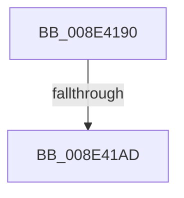

# sub_008E4190

- RVA: `0x008E4190`–`0x008E41B3` (길이 `35` bytes)
- VA: `0x00000001408E4190`
- 실행 섹션: `PAGE`
- PDB 이름 있음: `아니요`; PDB Function 태그: `아니요`
- unwind 정보 RVA: `0x00086268`
- 디코드: `9`개 명령, `35/35` bytes 표시
- 미해석 바이트: `0` (있으면 어셈블리에 `.byte`로 보존)

> 이 문서는 커널 이미지의 기계어와 PDB 기호를 분석해 생성했습니다. 4번과 5번은 함수 원형과 자료형을 바이너리 사용 방식에서 추정한 C 해석이며 원본 소스 복구 결과는 아닙니다.

## 1. Dependencies

- 직접 호출 지점: **0**; 고유 호출 대상: **0**
- 직접 호출자로 확인된 함수: **0**
- RIP 상대 이미지 참조: **0**

### Outgoing calls
- 직접 디코드된 call 명령이 없습니다.

### Direct callers
- 이 함수 시작 RVA로 연결되는 직접 call은 확인되지 않았습니다. 간접 호출은 완전히 역산할 수 없습니다.

### Static image references
- 디코드된 RIP-relative 메모리 참조가 없습니다.

## 2. Other-region calls and transfers

- 다른 실행 섹션으로 향하는 call: **0**
- call이 아닌 외부 분기/꼬리 이동: **1**
  - `0x008E41A7` → [sub_008E44D3](Unknown_function_008E44D3.md) (`tail-transfer`)

## 3. Assembly (complete function range)

```asm
008E4190  49 89 5B 08                     mov qword ptr [r11 + 8], rbx
008E4194  48 8B 5A 08                     mov rbx, qword ptr [rdx + 8]
008E4198  49 89 7B 20                     mov qword ptr [r11 + 0x20], rdi
008E419C  49 89 6B 18                     mov qword ptr [r11 + 0x18], rbp
008E41A0  4D 89 63 E0                     mov qword ptr [r11 - 0x20], r12
008E41A4  45 84 C9                        test r9b, r9b
008E41A7  0F 85 26 03 00 00               jne 0x1408e44d3
008E41AD  48 8B EB                        mov rbp, rbx
008E41B0  45 33 E4                        xor r12d, r12d
```

## 4. C-style interpretation (structured pseudocode)

```c
void __fastcall sub_008E4190(__int64 a1, __int64 a2, __int64 a3, unsigned __int8 a4)
{
    __int64 v_r12;

    *(unsigned __int64 *)(v_r11 + 8) = v_rbx;
    *(unsigned __int64 *)(v_r11 + 32) = v_rdi;
    *(unsigned __int64 *)(v_r11 + 24) = v_rbp;
    *(unsigned __int64 *)(v_r11 - 32) = v_r12;
    v_r12 = 0;
    return;
}
```

## 5. (Beta) C Style

```c
void sub_008E4190(int64_t Arg1, void *Arg2, int64_t Arg3, uint8_t Arg4)
{
    uint8_t *arg2 = (uint8_t *)Arg2;

    int64_t local_r12;

    *(uint64_t *)(local_r11 + 0x8) = local_rbx;
    *(uint64_t *)(local_r11 + 0x20) = local_rdi;
    *(uint64_t *)(local_r11 + 0x18) = local_rbp;
    *(uint64_t *)(local_r11 - 0x20) = local_r12;
    local_r12 = 0;
    return;
}
```

### 관측된 메모리 오프셋

구조체 형식이 확인되지 않은 접근은 인자 기준의 오프셋으로만 기록했습니다.

| 기준 인자 | 오프셋 표현 | 폭 (bit) | 접근 |
|---|---:|---:|---|
| `Arg2` | `+ 0x8` | `64` | `R` |

## 6. Execution-region graph

[열기: 2D/3D 그래프와 함수 탐색 컨트롤 패널](../../../control-panel.html?section=page&rva=0x008E4190&view=graph)

- 2D 그래프는 위에서 아래로 흐르고, 3D 그래프는 빈 공간을 드래그해 회전합니다. Shift+드래그는 이동, 휠은 확대·축소, 함수 노드 선택은 대상 보고서 이동입니다.

### Static fallback


