# sub_008E41B3

- RVA: `0x008E41B3`–`0x008E4454` (길이 `673` bytes)
- VA: `0x00000001408E41B3`
- 실행 섹션: `PAGE`
- PDB 이름 있음: `아니요`; PDB Function 태그: `아니요`
- unwind 정보 RVA: `0x00086288`
- 디코드: `161`개 명령, `673/673` bytes 표시
- 미해석 바이트: `0` (있으면 어셈블리에 `.byte`로 보존)

> 이 문서는 커널 이미지의 기계어와 PDB 기호를 분석해 생성했습니다. 4번과 5번은 함수 원형과 자료형을 바이너리 사용 방식에서 추정한 C 해석이며 원본 소스 복구 결과는 아닙니다.

## 1. Dependencies

- 직접 호출 지점: **14**; 고유 호출 대상: **13**
- 직접 호출자로 확인된 함수: **0**
- RIP 상대 이미지 참조: **3**

### Outgoing calls
- `0x008E4216` → [ExAllocatePool2](../../poolcode/B8/ExAllocatePool2_function_00B820F0.md) (function, `0x00B820F0`)
- `0x008E4230` → [memcpy](../../text/6C/memcpy_function_006C6840.md) (function, `0x006C6840`)
- `0x008E4254` → [ExAcquireResourceSharedLite](../../text/21/ExAcquireResourceSharedLite_function_00211BC0.md) (function, `0x00211BC0`)
- `0x008E4269` → [memset](../../text/6C/memset_function_006C6C40.md) (function, `0x006C6C40`)
- `0x008E42EE` → [PsGetCurrentServerSiloGlobals](../../text/2F/PsGetCurrentServerSiloGlobals_function_002FE1F0.md) (function, `0x002FE1F0`)
- `0x008E4350` → [RtlLookupElementGenericTableAvl](../../text/3F/RtlLookupElementGenericTableAvl_function_003FEFB0.md) (function, `0x003FEFB0`)
- `0x008E4375` → [ExReleaseResourceLite](../../text/25/ExReleaseResourceLite_function_0025FA10.md) (function, `0x0025FA10`)
- `0x008E4383` → [KeLeaveCriticalRegionThread](../../text/25/KeLeaveCriticalRegionThread_function_0025EFF0.md) (function, `0x0025EFF0`)
- `0x008E43A1` → [KeAbPreAcquire](../../text/21/KeAbPreAcquire_function_00210230.md) (function, `0x00210230`)
- `0x008E43C2` → [ExfAcquirePushLockSharedEx](../../text/21/ExfAcquirePushLockSharedEx_function_0021044C.md) (function, `0x0021044C`)
- `0x008E440A` → [KeAbPostRelease](../../text/2E/KeAbPostRelease_function_002E1600.md) (function, `0x002E1600`)
- `0x008E4418` → [KeLeaveCriticalRegionThread](../../text/25/KeLeaveCriticalRegionThread_function_0025EFF0.md) (function, `0x0025EFF0`)
- `0x008E4420` → [PiDmObjectRelease](PiDmObjectRelease_function_008E4F70.md) (function, `0x008E4F70`)
- `0x008E443E` → [ExFreePoolWithTag](../../poolcode/B8/ExFreePoolWithTag_function_00B82870.md) (function, `0x00B82870`)

### Direct callers
- 이 함수 시작 RVA로 연결되는 직접 call은 확인되지 않았습니다. 간접 호출은 완전히 역산할 수 없습니다.

### Static image references
- `0x008E4243` → RVA `0x00F8B7A0` (`.data`; read)
- `0x008E4281` → RVA `0x00F8B870` (`.data`; read)
- `0x008E4349` → RVA `0x00F8B808` (`.data`; read)

## 2. Other-region calls and transfers

- 다른 실행 섹션으로 향하는 call: **13**
  - `0x008E4216` → [ExAllocatePool2](../../poolcode/B8/ExAllocatePool2_function_00B820F0.md) (`PAGE` → `POOLCODE`)
  - `0x008E4230` → [memcpy](../../text/6C/memcpy_function_006C6840.md) (`PAGE` → `.text`)
  - `0x008E4254` → [ExAcquireResourceSharedLite](../../text/21/ExAcquireResourceSharedLite_function_00211BC0.md) (`PAGE` → `.text`)
  - `0x008E4269` → [memset](../../text/6C/memset_function_006C6C40.md) (`PAGE` → `.text`)
  - `0x008E42EE` → [PsGetCurrentServerSiloGlobals](../../text/2F/PsGetCurrentServerSiloGlobals_function_002FE1F0.md) (`PAGE` → `.text`)
  - `0x008E4350` → [RtlLookupElementGenericTableAvl](../../text/3F/RtlLookupElementGenericTableAvl_function_003FEFB0.md) (`PAGE` → `.text`)
  - `0x008E4375` → [ExReleaseResourceLite](../../text/25/ExReleaseResourceLite_function_0025FA10.md) (`PAGE` → `.text`)
  - `0x008E4383` → [KeLeaveCriticalRegionThread](../../text/25/KeLeaveCriticalRegionThread_function_0025EFF0.md) (`PAGE` → `.text`)
  - `0x008E43A1` → [KeAbPreAcquire](../../text/21/KeAbPreAcquire_function_00210230.md) (`PAGE` → `.text`)
  - `0x008E43C2` → [ExfAcquirePushLockSharedEx](../../text/21/ExfAcquirePushLockSharedEx_function_0021044C.md) (`PAGE` → `.text`)
  - `0x008E440A` → [KeAbPostRelease](../../text/2E/KeAbPostRelease_function_002E1600.md) (`PAGE` → `.text`)
  - `0x008E4418` → [KeLeaveCriticalRegionThread](../../text/25/KeLeaveCriticalRegionThread_function_0025EFF0.md) (`PAGE` → `.text`)
  - `0x008E443E` → [ExFreePoolWithTag](../../poolcode/B8/ExFreePoolWithTag_function_00B82870.md) (`PAGE` → `POOLCODE`)
- call이 아닌 외부 분기/꼬리 이동: **17**
  - `0x008E41BE` → [sub_008E45BE + 0x57](Unknown_function_008E45BE.md) (`tail-transfer`)
  - `0x008E41C7` → [sub_008E45BE + 0x57](Unknown_function_008E45BE.md) (`tail-transfer`)
  - `0x008E41D0` → [sub_008E45BE + 0x1F](Unknown_function_008E45BE.md) (`tail-transfer`)
  - `0x008E41DB` → [sub_008E45BE + 0x8](Unknown_function_008E45BE.md) (`tail-transfer`)
  - `0x008E41F4` → [sub_008E45BE](Unknown_function_008E45BE.md) (`tail-transfer`)
  - `0x008E4201` → [sub_008E455D + 0x39](Unknown_function_008E455D.md) (`tail-transfer`)
  - `0x008E4221` → [sub_008E455D](Unknown_function_008E455D.md) (`tail-transfer`)
  - `0x008E427B` → [sub_008E4520](Unknown_function_008E4520.md) (`tail-transfer`)
  - `0x008E42C0` → [sub_008E45BE + 0x10](Unknown_function_008E45BE.md) (`tail-transfer`)
  - `0x008E42DB` → [sub_008E4520](Unknown_function_008E4520.md) (`tail-transfer`)
  - `0x008E42E5` → [sub_008E455D + 0x18](Unknown_function_008E455D.md) (`tail-transfer`)
  - `0x008E4323` → [sub_008E4495](Unknown_function_008E4495.md) (`tail-transfer`)
  - `0x008E4358` → [sub_008E4520](Unknown_function_008E4520.md) (`tail-transfer`)
  - `0x008E4364` → [sub_008E4520](Unknown_function_008E4520.md) (`tail-transfer`)
  - `0x008E43F6` → [sub_008E455D + 0xB](Unknown_function_008E455D.md) (`tail-transfer`)
  - `0x008E4401` → [sub_008E455D + 0xB](Unknown_function_008E455D.md) (`tail-transfer`)
  - `0x008E444E` → [sub_008E4545](Unknown_function_008E4545.md) (`tail-transfer`)

## 3. Assembly (complete function range)

```asm
008E41B3  4C 89 BC 24 D0 00 00 00         mov qword ptr [rsp + 0xd0], r15
008E41BB  83 FE 02                        cmp esi, 2
008E41BE  0F 82 51 04 00 00               jb 0x1408e4615
008E41C4  48 85 ED                        test rbp, rbp
008E41C7  0F 84 48 04 00 00               je 0x1408e4615
008E41CD  66 85 F6                        test si, si
008E41D0  0F 84 07 04 00 00               je 0x1408e45dd
008E41D6  66 44 39 65 00                  cmp word ptr [rbp], r12w
008E41DB  0F 84 E5 03 00 00               je 0x1408e45c6
008E41E1  48 8B C6                        mov rax, rsi
008E41E4  48 8B DE                        mov rbx, rsi
008E41E7  48 D1 E8                        shr rax, 1
008E41EA  48 8D 3C 00                     lea rdi, [rax + rax]
008E41EE  66 44 39 64 2F FE               cmp word ptr [rdi + rbp - 2], r12w
008E41F4  0F 84 C4 03 00 00               je 0x1408e45be
008E41FA  48 8D 46 FE                     lea rax, [rsi - 2]
008E41FE  48 3B D8                        cmp rbx, rax
008E4201  0F 86 8F 03 00 00               jbe 0x1408e4596
008E4207  48 8D 56 02                     lea rdx, [rsi + 2]
008E420B  B9 00 01 00 00                  mov ecx, 0x100
008E4210  41 B8 50 70 73 75               mov r8d, 0x75737050
008E4216  E8 D5 DE 29 00                  call 0x140b820f0
008E421B  4C 8B F8                        mov r15, rax
008E421E  48 85 C0                        test rax, rax
008E4221  0F 84 36 03 00 00               je 0x1408e455d
008E4227  4C 8B C3                        mov r8, rbx
008E422A  48 8B D5                        mov rdx, rbp
008E422D  48 8B C8                        mov rcx, rax
008E4230  E8 0B 26 DE FF                  call 0x1406c6840
008E4235  66 46 89 24 3F                  mov word ptr [rdi + r15], r12w
008E423A  65 48 8B 04 25 88 01 00 00      mov rax, qword ptr gs:[0x188]
008E4243  48 8D 0D 56 75 6A 00            lea rcx, [rip + 0x6a7556]
008E424A  B2 01                           mov dl, 1
008E424C  66 FF 88 E4 01 00 00            dec word ptr [rax + 0x1e4]
008E4253  90                              nop
008E4254  E8 67 D9 92 FF                  call 0x140211bc0
008E4259  33 D2                           xor edx, edx
008E425B  4C 89 64 24 50                  mov qword ptr [rsp + 0x50], r12
008E4260  48 8D 4C 24 58                  lea rcx, [rsp + 0x58]
008E4265  44 8D 42 68                     lea r8d, [rdx + 0x68]
008E4269  E8 D2 29 DE FF                  call 0x1406c6c40
008E426E  48 8D 44 24 50                  lea rax, [rsp + 0x50]
008E4273  48 89 44 24 40                  mov qword ptr [rsp + 0x40], rax
008E4278  4D 85 FF                        test r15, r15
008E427B  0F 84 9F 02 00 00               je 0x1408e4520
008E4281  44 8B 05 E8 75 6A 00            mov r8d, dword ptr [rip + 0x6a75e8]
008E4288  0F 57 C0                        xorps xmm0, xmm0
008E428B  BA FF 7F 00 00                  mov edx, 0x7fff
008E4290  4C 89 7C 24 60                  mov qword ptr [rsp + 0x60], r15
008E4295  0F 11 44 24 30                  movups xmmword ptr [rsp + 0x30], xmm0
008E429A  8B CA                           mov ecx, edx
008E429C  44 89 44 24 6C                  mov dword ptr [rsp + 0x6c], r8d
008E42A1  49 8B C7                        mov rax, r15
008E42A4  66 44 39 20                     cmp word ptr [rax], r12w
008E42A8  74 0A                           je 0x1408e42b4
008E42AA  48 83 C0 02                     add rax, 2
008E42AE  48 83 E9 01                     sub rcx, 1
008E42B2  75 F0                           jne 0x1408e42a4
008E42B4  48 85 C9                        test rcx, rcx
008E42B7  B8 0D 00 00 C0                  mov eax, 0xc000000d
008E42BC  41 0F 45 C4                     cmovne eax, r12d
008E42C0  0F 84 08 03 00 00               je 0x1408e45ce
008E42C6  48 2B D1                        sub rdx, rcx
008E42C9  4C 89 7C 24 38                  mov qword ptr [rsp + 0x38], r15
008E42CE  66 03 D2                        add dx, dx
008E42D1  4D 8B D7                        mov r10, r15
008E42D4  66 89 54 24 30                  mov word ptr [rsp + 0x30], dx
008E42D9  85 C0                           test eax, eax
008E42DB  0F 88 3F 02 00 00               js 0x1408e4520
008E42E1  41 83 F8 03                     cmp r8d, 3
008E42E5  0F 84 8A 02 00 00               je 0x1408e4575
008E42EB  45 8B CC                        mov r9d, r12d
008E42EE  E8 FD 9E A1 FF                  call 0x1402fe1f0
008E42F3  44 0F B7 DA                     movzx r11d, dx
008E42F7  41 D1 EB                        shr r11d, 1
008E42FA  48 8B 98 B0 04 00 00            mov rbx, qword ptr [rax + 0x4b0]
008E4301  44 89 64 24 68                  mov dword ptr [rsp + 0x68], r12d
008E4306  74 37                           je 0x1408e433f
008E4308  BF C0 00 00 00                  mov edi, 0xc0
008E430D  0F 1F 00                        nop dword ptr [rax]
008E4310  41 0F B7 02                     movzx eax, word ptr [r10]
008E4314  4D 8D 52 02                     lea r10, [r10 + 2]
008E4318  41 FF CB                        dec r11d
008E431B  83 F8 61                        cmp eax, 0x61
008E431E  72 0D                           jb 0x1408e432d
008E4320  83 F8 7A                        cmp eax, 0x7a
008E4323  0F 87 6C 01 00 00               ja 0x1408e4495
008E4329  66 83 E8 20                     sub ax, 0x20
008E432D  45 69 C9 3F 00 01 00            imul r9d, r9d, 0x1003f
008E4334  0F B7 C8                        movzx ecx, ax
008E4337  44 03 C9                        add r9d, ecx
008E433A  45 85 DB                        test r11d, r11d
008E433D  75 D1                           jne 0x1408e4310
008E433F  44 89 4C 24 68                  mov dword ptr [rsp + 0x68], r9d
008E4344  48 8D 54 24 40                  lea rdx, [rsp + 0x40]
008E4349  48 8D 0D B8 74 6A 00            lea rcx, [rip + 0x6a74b8]
008E4350  E8 5B AC B1 FF                  call 0x1403fefb0
008E4355  48 85 C0                        test rax, rax
008E4358  0F 84 C2 01 00 00               je 0x1408e4520
008E435E  48 8B 18                        mov rbx, qword ptr [rax]
008E4361  48 85 DB                        test rbx, rbx
008E4364  0F 84 B6 01 00 00               je 0x1408e4520
008E436A  F0 FF 43 08                     lock inc dword ptr [rbx + 8]
008E436E  48 8D 0D 2B 74 6A 00            lea rcx, [rip + 0x6a742b]
008E4375  E8 96 B6 97 FF                  call 0x14025fa10
008E437A  65 48 8B 0C 25 88 01 00 00      mov rcx, qword ptr gs:[0x188]
008E4383  E8 68 AC 97 FF                  call 0x14025eff0
008E4388  65 48 8B 04 25 88 01 00 00      mov rax, qword ptr gs:[0x188]
008E4391  45 33 C0                        xor r8d, r8d
008E4394  33 D2                           xor edx, edx
008E4396  48 8B CB                        mov rcx, rbx
008E4399  66 FF 88 E4 01 00 00            dec word ptr [rax + 0x1e4]
008E43A0  90                              nop
008E43A1  E8 8A BE 92 FF                  call 0x140210230
008E43A6  48 8B F8                        mov rdi, rax
008E43A9  B9 11 00 00 00                  mov ecx, 0x11
008E43AE  33 C0                           xor eax, eax
008E43B0  F0 48 0F B1 0B                  lock cmpxchg qword ptr [rbx], rcx
008E43B5  74 10                           je 0x1408e43c7
008E43B7  4C 8B CB                        mov r9, rbx
008E43BA  4C 8B C7                        mov r8, rdi
008E43BD  33 D2                           xor edx, edx
008E43BF  48 8B CB                        mov rcx, rbx
008E43C2  E8 85 C0 92 FF                  call 0x14021044c
008E43C7  48 85 FF                        test rdi, rdi
008E43CA  74 04                           je 0x1408e43d0
008E43CC  C6 47 0A 01                     mov byte ptr [rdi + 0xa], 1
008E43D0  4C 39 63 28                     cmp qword ptr [rbx + 0x28], r12
008E43D4  0F 95 C0                        setne al
008E43D7  41 88 46 14                     mov byte ptr [r14 + 0x14], al
008E43DB  0F 0D 0B                        prefetchw byte ptr [rbx]
008E43DE  48 8B 03                        mov rax, qword ptr [rbx]
008E43E1  48 8B C8                        mov rcx, rax
008E43E4  48 83 E1 F0                     and rcx, 0xfffffffffffffff0
008E43E8  48 83 F9 10                     cmp rcx, 0x10
008E43EC  48 8D 50 F0                     lea rdx, [rax - 0x10]
008E43F0  49 0F 46 D4                     cmovbe rdx, r12
008E43F4  A8 02                           test al, 2
008E43F6  0F 85 6C 01 00 00               jne 0x1408e4568
008E43FC  F0 48 0F B1 13                  lock cmpxchg qword ptr [rbx], rdx
008E4401  0F 85 61 01 00 00               jne 0x1408e4568
008E4407  48 8B CB                        mov rcx, rbx
008E440A  E8 F1 D1 9F FF                  call 0x1402e1600
008E440F  65 48 8B 0C 25 88 01 00 00      mov rcx, qword ptr gs:[0x188]
008E4418  E8 D3 AB 97 FF                  call 0x14025eff0
008E441D  48 8B CB                        mov rcx, rbx
008E4420  E8 4B 0B 00 00                  call 0x1408e4f70
008E4425  4D 85 FF                        test r15, r15
008E4428  74 19                           je 0x1408e4443
008E442A  66 85 F6                        test si, si
008E442D  74 14                           je 0x1408e4443
008E442F  48 85 ED                        test rbp, rbp
008E4432  74 0F                           je 0x1408e4443
008E4434  49 3B EF                        cmp rbp, r15
008E4437  74 0A                           je 0x1408e4443
008E4439  33 D2                           xor edx, edx
008E443B  49 8B CF                        mov rcx, r15
008E443E  E8 2D E4 29 00                  call 0x140b82870
008E4443  4C 8B BC 24 D0 00 00 00         mov r15, qword ptr [rsp + 0xd0]
008E444B  45 84 ED                        test r13b, r13b
008E444E  0F 85 F1 00 00 00               jne 0x1408e4545
```

## 4. C-style interpretation (structured pseudocode)

```c
__int64 __fastcall sub_008E41B3(__int64 a1, __int64 a2, __int64 a3, __int64 a4, __int64 a5, __int64 a6, __int64 a7, __int64 a8, __int64 a9, __int64 a10, __int64 a11, __int64 a12, __int64 a13, __int64 a14, __int64 a15, __int64 a16, __int64 a17, __int64 a18, __int64 a19, __int64 a20, __int64 a21, __int64 a22, __int64 a23, __int64 a24, __int64 a25, __int64 a26)
{
    __int64 result;
    __int64 v_r11;
    unsigned __int16 v_stack_p30;
    unsigned __int64 v_stack_p38;
    unsigned __int64 v_stack_p40;
    unsigned __int64 v_stack_p50;
    unsigned __int64 v_stack_p60;
    unsigned int v_stack_p68;
    unsigned int v_stack_p6C;
    unsigned __int64 v_stack_pD0;

    v_stack_pD0 = v_r15;
    result = (v_rsi) >> (1);
    result = ExAllocatePool2(256, v_rsi + 2, (unsigned int)(0x75737050ULL), a4);
    result = memcpy(result, v_rbp, v_rsi, a4);
    *(unsigned __int16 *)(result + result * 1 + result * 1) = (unsigned __int16)(v_r12);
    result = ExAcquireResourceSharedLite(v_rip + 6976854, 1, v_rsi, a4);
    a2 = 0;
    v_stack_p50 = v_r12;
    result = memset(a11, a2, a2 + 104, a4);
    v_stack_p40 = a10;
    v_stack_p60 = result;
    a6 = v_xmm0;
    v_stack_p6C = (unsigned int)((unsigned int)(*(unsigned int *)(v_rip + 6977000)));
loc_008E42A4:
    if ((*(unsigned __int16 *)(result)) == ((unsigned __int16)(v_r12))) goto loc_008E42B4;
    result = (result) + (2);
    a1 = ((unsigned int)((unsigned int)((unsigned int)(0x7FFFULL)))) - (1);
    if (condition_is_not_equal) goto loc_008E42A4;
loc_008E42B4:
    result = (unsigned int)(0xC000000DULL);
    if (a1 != 0) { result = (unsigned int)(v_r12); }
    a2 = ((unsigned int)(0x7FFFULL)) - (a1);
    v_stack_p38 = result;
    a2 = (unsigned __int16)((a2) + ((unsigned __int16)(a2)));
    v_stack_p30 = (unsigned __int16)(a2);
    result = PsGetCurrentServerSiloGlobals(a1, a2, (unsigned int)(*(unsigned int *)(v_rip + 6977000)), (unsigned int)((unsigned int)(v_r12)));
    v_r11 = (unsigned int)(((unsigned __int16)(a2)) >> (1));
    v_stack_p68 = (unsigned int)(v_r12);
    if (condition_is_equal) goto loc_008E433F;
loc_008E4310:
    v_r11 = (unsigned int)((v_r11) - 1);
    if (((unsigned int)(*(unsigned __int16 *)(result))) < 97) goto loc_008E432D;
    result = (unsigned __int16)((*(unsigned __int16 *)(result)) - (32));
loc_008E432D:
    a4 = (unsigned int)(((unsigned int)((unsigned int)(v_r12))) * ((unsigned int)((unsigned int)((unsigned int)(v_r12)))));
    a4 = (unsigned int)((a4) + ((unsigned int)((unsigned __int16)(result))));
    if ((unsigned int)(v_r11) != 0) goto loc_008E4310;
loc_008E433F:
    v_stack_p68 = (unsigned int)(a4);
    result = RtlLookupElementGenericTableAvl(v_rip + 6976696, a8, (unsigned int)(*(unsigned int *)(v_rip + 6977000)), a4);
    result = ExReleaseResourceLite(v_rip + 6976555, a8, (unsigned int)(*(unsigned int *)(v_rip + 6977000)), a4);
    result = KeLeaveCriticalRegionThread(*(unsigned __int64 *)(gs_base + (0 + 392)), a8, (unsigned int)(*(unsigned int *)(v_rip + 6977000)), a4);
    a3 = 0;
    a2 = 0;
    result = KeAbPreAcquire(*(unsigned __int64 *)(result), a2, a3, a4);
    result = 0;
    if (!(condition_is_equal)) {
        a4 = *(unsigned __int64 *)(result);
        a3 = 0;
        a2 = 0;
        a1 = *(unsigned __int64 *)(result);
        result = ExfAcquirePushLockSharedEx(a1, a2, a3, a4);
    }
    if (result != 0) {
        *(unsigned __int8 *)(result + 10) = 1;
    }
    result = ((*(unsigned __int64 *)(*(unsigned __int64 *)(result) + 40)) != v_r12) ? 1 : 0;
    *(unsigned __int8 *)(v_r14 + 20) = (unsigned __int8)(result);
    a1 = (*(unsigned __int64 *)(*(unsigned __int64 *)(result))) & (-16);
    a2 = *(unsigned __int64 *)(*(unsigned __int64 *)(result)) - 16;
    if (a1 <= 16) { a2 = v_r12; }
    result = KeAbPostRelease(*(unsigned __int64 *)(result), a2, a3, a4);
    result = KeLeaveCriticalRegionThread(*(unsigned __int64 *)(gs_base + (0 + 392)), a2, a3, a4);
    result = PiDmObjectRelease(*(unsigned __int64 *)(result), a2, a3, a4);
    if (result == 0) goto loc_008E4443;
    if ((unsigned __int16)(v_rsi) == 0) goto loc_008E4443;
    if (v_rbp == 0) goto loc_008E4443;
    if (v_rbp != result) {
        a2 = 0;
        a1 = result;
        result = ExFreePoolWithTag(a1, a2, a3, a4);
    }
}
```

## 5. (Beta) C Style

```c
int64_t sub_008E41B3(int64_t Arg1, int64_t Arg2, int64_t Arg3, int64_t Arg4, uint64_t Arg5, int64_t Arg6, uint64_t Arg7, int64_t Arg8, uint64_t Arg9, int64_t Arg10, int64_t Arg11, uint64_t Arg12, uint64_t Arg13, uint64_t Arg14, uint64_t Arg15, uint64_t Arg16, uint64_t Arg17, uint64_t Arg18, uint64_t Arg19, uint64_t Arg20, uint64_t Arg21, uint64_t Arg22, uint64_t Arg23, uint64_t Arg24, uint64_t Arg25, int64_t Arg26)
{
    int64_t result;
    int64_t local_r11;
    uint16_t v_stack_p30;
    uint64_t v_stack_p38;
    uint64_t v_stack_p40;
    uint64_t v_stack_p50;
    uint64_t v_stack_p60;
    uint32_t v_stack_p68;
    uint32_t v_stack_p6C;
    uint64_t v_stack_pD0;

    v_stack_pD0 = local_r15;
    result = (local_rsi) >> (1);
    result = ExAllocatePool2(256, local_rsi + 2, (uint32_t)(0x75737050ULL), Arg4);
    result = memcpy(result, local_rbp, local_rsi, Arg4);
    *(uint16_t *)(result + result * 1 + result * 1) = (uint16_t)(local_r12);
    result = ExAcquireResourceSharedLite(v_rip + 6976854, 1, local_rsi, Arg4);
    Arg2 = 0;
    v_stack_p50 = local_r12;
    result = memset(Arg11, Arg2, Arg2 + 104, Arg4);
    v_stack_p40 = Arg10;
    v_stack_p60 = result;
    Arg6 = v_xmm0;
    v_stack_p6C = (uint32_t)((uint32_t)(*(uint32_t *)(v_rip + 0x6A75E8)));
loc_008E42A4:
    if ((*(uint16_t *)(result)) == ((uint16_t)(local_r12))) goto loc_008E42B4;
    result = (result) + (2);
    Arg1 = ((uint32_t)((uint32_t)((uint32_t)(0x7FFFULL)))) - (1);
    if (condition_is_not_equal) goto loc_008E42A4;
loc_008E42B4:
    result = (uint32_t)(0xC000000DULL);
    if (Arg1 != 0) { result = (uint32_t)(local_r12); }
    Arg2 = ((uint32_t)(0x7FFFULL)) - (Arg1);
    v_stack_p38 = result;
    Arg2 = (uint16_t)((Arg2) + ((uint16_t)(Arg2)));
    v_stack_p30 = (uint16_t)(Arg2);
    result = PsGetCurrentServerSiloGlobals(Arg1, Arg2, (uint32_t)(*(uint32_t *)(v_rip + 0x6A75E8)), (uint32_t)((uint32_t)(local_r12)));
    local_r11 = (uint32_t)(((uint16_t)(Arg2)) >> (1));
    v_stack_p68 = (uint32_t)(local_r12);
    if (condition_is_equal) goto loc_008E433F;
loc_008E4310:
    local_r11 = (uint32_t)((local_r11) - 1);
    if (((uint32_t)(*(uint16_t *)(result))) < 97) goto loc_008E432D;
    result = (uint16_t)((*(uint16_t *)(result)) - (32));
loc_008E432D:
    Arg4 = (uint32_t)(((uint32_t)((uint32_t)(local_r12))) * ((uint32_t)((uint32_t)((uint32_t)(local_r12)))));
    Arg4 = (uint32_t)((Arg4) + ((uint32_t)((uint16_t)(result))));
    if ((uint32_t)(local_r11) != 0) goto loc_008E4310;
loc_008E433F:
    v_stack_p68 = (uint32_t)(Arg4);
    result = RtlLookupElementGenericTableAvl(v_rip + 6976696, Arg8, (uint32_t)(*(uint32_t *)(v_rip + 0x6A75E8)), Arg4);
    result = ExReleaseResourceLite(v_rip + 6976555, Arg8, (uint32_t)(*(uint32_t *)(v_rip + 0x6A75E8)), Arg4);
    result = KeLeaveCriticalRegionThread(*(uint64_t *)(gs_base + (0 + 0x188)), Arg8, (uint32_t)(*(uint32_t *)(v_rip + 0x6A75E8)), Arg4);
    Arg3 = 0;
    Arg2 = 0;
    result = KeAbPreAcquire(*(uint64_t *)(result), Arg2, Arg3, Arg4);
    result = 0;
    if (!(condition_is_equal)) {
        Arg4 = *(uint64_t *)(result);
        Arg3 = 0;
        Arg2 = 0;
        Arg1 = *(uint64_t *)(result);
        result = ExfAcquirePushLockSharedEx(Arg1, Arg2, Arg3, Arg4);
    }
    if (result != 0) {
        *(uint8_t *)(result + 0xA) = 1;
    }
    result = ((*(uint64_t *)(*(uint64_t *)(result) + 0x28)) != local_r12) ? 1 : 0;
    *(uint8_t *)(local_r14 + 0x14) = (uint8_t)(result);
    Arg1 = (*(uint64_t *)(*(uint64_t *)(result))) & (-16);
    Arg2 = *(uint64_t *)(*(uint64_t *)(result)) - 16;
    if (Arg1 <= 16) { Arg2 = local_r12; }
    result = KeAbPostRelease(*(uint64_t *)(result), Arg2, Arg3, Arg4);
    result = KeLeaveCriticalRegionThread(*(uint64_t *)(gs_base + (0 + 0x188)), Arg2, Arg3, Arg4);
    result = PiDmObjectRelease(*(uint64_t *)(result), Arg2, Arg3, Arg4);
    if (result == 0) goto loc_008E4443;
    if ((uint16_t)(local_rsi) == 0) goto loc_008E4443;
    if (local_rbp == 0) goto loc_008E4443;
    if (local_rbp != result) {
        Arg2 = 0;
        Arg1 = result;
        result = ExFreePoolWithTag(Arg1, Arg2, Arg3, Arg4);
    }
}
```

## 6. Execution-region graph

[열기: 2D/3D 그래프와 함수 탐색 컨트롤 패널](../../../control-panel.html?section=page&rva=0x008E41B3&view=graph)

- 2D 그래프는 위에서 아래로 흐르고, 3D 그래프는 빈 공간을 드래그해 회전합니다. Shift+드래그는 이동, 휠은 확대·축소, 함수 노드 선택은 대상 보고서 이동입니다.

### Static fallback

```mermaid
flowchart TD
  bb_008E41B3[BB_008E41B3]
  bb_008E41C4[BB_008E41C4]
  bb_008E41CD[BB_008E41CD]
  bb_008E41D6[BB_008E41D6]
  bb_008E41E1[BB_008E41E1]
  bb_008E41FA[BB_008E41FA]
  bb_008E4207[BB_008E4207]
  bb_008E4227[BB_008E4227]
  bb_008E4281[BB_008E4281]
  bb_008E42A4[BB_008E42A4]
  bb_008E42AA[BB_008E42AA]
  bb_008E42B4[BB_008E42B4]
  bb_008E42C6[BB_008E42C6]
  bb_008E42E1[BB_008E42E1]
  bb_008E42EB[BB_008E42EB]
  bb_008E4308[BB_008E4308]
  bb_008E4310[BB_008E4310]
  bb_008E4320[BB_008E4320]
  bb_008E4329[BB_008E4329]
  bb_008E432D[BB_008E432D]
  bb_008E433F[BB_008E433F]
  bb_008E435E[BB_008E435E]
  bb_008E436A[BB_008E436A]
  bb_008E43B7[BB_008E43B7]
  bb_008E43C7[BB_008E43C7]
  bb_008E43CC[BB_008E43CC]
  bb_008E43D0[BB_008E43D0]
  bb_008E43FC[BB_008E43FC]
  bb_008E4407[BB_008E4407]
  bb_008E442A[BB_008E442A]
  bb_008E442F[BB_008E442F]
  bb_008E4434[BB_008E4434]
  bb_008E4439[BB_008E4439]
  bb_008E4443[BB_008E4443]
  bb_008E41B3 -->|fallthrough| bb_008E41C4
  bb_008E41C4 -->|fallthrough| bb_008E41CD
  bb_008E41CD -->|fallthrough| bb_008E41D6
  bb_008E41D6 -->|fallthrough| bb_008E41E1
  bb_008E41E1 -->|fallthrough| bb_008E41FA
  bb_008E41FA -->|fallthrough| bb_008E4207
  bb_008E4207 -->|fallthrough| bb_008E4227
  bb_008E4227 -->|fallthrough| bb_008E4281
  bb_008E4281 -->|flow| bb_008E42A4
  bb_008E42A4 -->|branch| bb_008E42B4
  bb_008E42A4 -->|fallthrough| bb_008E42AA
  bb_008E42AA -->|branch| bb_008E42A4
  bb_008E42AA -->|fallthrough| bb_008E42B4
  bb_008E42B4 -->|fallthrough| bb_008E42C6
  bb_008E42C6 -->|fallthrough| bb_008E42E1
  bb_008E42E1 -->|fallthrough| bb_008E42EB
  bb_008E42EB -->|branch| bb_008E433F
  bb_008E42EB -->|fallthrough| bb_008E4308
  bb_008E4308 -->|flow| bb_008E4310
  bb_008E4310 -->|branch| bb_008E432D
  bb_008E4310 -->|fallthrough| bb_008E4320
  bb_008E4320 -->|fallthrough| bb_008E4329
  bb_008E4329 -->|flow| bb_008E432D
  bb_008E432D -->|branch| bb_008E4310
  bb_008E432D -->|fallthrough| bb_008E433F
  bb_008E433F -->|fallthrough| bb_008E435E
  bb_008E435E -->|fallthrough| bb_008E436A
  bb_008E436A -->|branch| bb_008E43C7
  bb_008E436A -->|fallthrough| bb_008E43B7
  bb_008E43B7 -->|flow| bb_008E43C7
  bb_008E43C7 -->|branch| bb_008E43D0
  bb_008E43C7 -->|fallthrough| bb_008E43CC
  bb_008E43CC -->|flow| bb_008E43D0
  bb_008E43D0 -->|fallthrough| bb_008E43FC
  bb_008E43FC -->|fallthrough| bb_008E4407
  bb_008E4407 -->|branch| bb_008E4443
  bb_008E4407 -->|fallthrough| bb_008E442A
  bb_008E442A -->|branch| bb_008E4443
  bb_008E442A -->|fallthrough| bb_008E442F
  bb_008E442F -->|branch| bb_008E4443
  bb_008E442F -->|fallthrough| bb_008E4434
  bb_008E4434 -->|branch| bb_008E4443
  bb_008E4434 -->|fallthrough| bb_008E4439
  bb_008E4439 -->|flow| bb_008E4443
```


