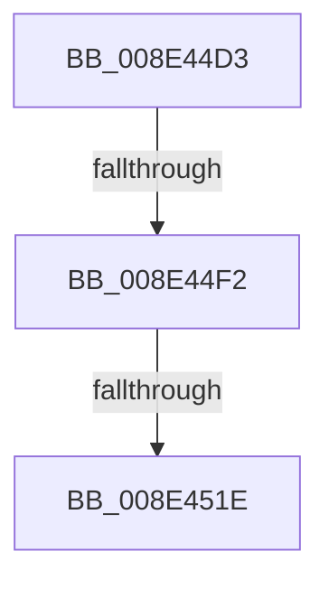

# sub_008E44D3

- RVA: `0x008E44D3`–`0x008E4520` (길이 `77` bytes)
- VA: `0x00000001408E44D3`
- 실행 섹션: `PAGE`
- PDB 이름 있음: `아니요`; PDB Function 태그: `아니요`
- unwind 정보 RVA: `0x000862E4`
- 디코드: `18`개 명령, `77/77` bytes 표시
- 미해석 바이트: `0` (있으면 어셈블리에 `.byte`로 보존)

> 이 문서는 커널 이미지의 기계어와 PDB 기호를 분석해 생성했습니다. 4번과 5번은 함수 원형과 자료형을 바이너리 사용 방식에서 추정한 C 해석이며 원본 소스 복구 결과는 아닙니다.

## 1. Dependencies

- 직접 호출 지점: **2**; 고유 호출 대상: **2**
- 직접 호출자로 확인된 함수: **0**
- RIP 상대 이미지 참조: **0**

### Outgoing calls
- `0x008E44E1` → [ExAllocatePool2](../../poolcode/B8/ExAllocatePool2_function_00B820F0.md) (function, `0x00B820F0`)
- `0x008E450E` → [PiControlCopyUserModeCallersBuffer](PiControlCopyUserModeCallersBuffer_function_008E4720.md) (function, `0x008E4720`)

### Direct callers
- 이 함수 시작 RVA로 연결되는 직접 call은 확인되지 않았습니다. 간접 호출은 완전히 역산할 수 없습니다.

### Static image references
- 디코드된 RIP-relative 메모리 참조가 없습니다.

## 2. Other-region calls and transfers

- 다른 실행 섹션으로 향하는 call: **1**
  - `0x008E44E1` → [ExAllocatePool2](../../poolcode/B8/ExAllocatePool2_function_00B820F0.md) (`PAGE` → `POOLCODE`)
- call이 아닌 외부 분기/꼬리 이동: **3**
  - `0x008E44EC` → [sub_008E45B3](Unknown_function_008E45B3.md) (`tail-transfer`)
  - `0x008E4518` → [sub_008E4190 + 0x20](Unknown_function_008E4190.md) (`tail-transfer`)
  - `0x008E451E` → [sub_008E4545 + 0x9](Unknown_function_008E4545.md) (`tail-transfer`)

## 3. Assembly (complete function range)

```asm
008E44D3  48 8B D6                        mov rdx, rsi
008E44D6  B9 01 01 00 00                  mov ecx, 0x101
008E44DB  41 B8 50 70 20 20               mov r8d, 0x20207050
008E44E1  E8 0A DC 29 00                  call 0x140b820f0
008E44E6  48 8B E8                        mov rbp, rax
008E44E9  48 85 C0                        test rax, rax
008E44EC  0F 84 C1 00 00 00               je 0x1408e45b3
008E44F2  C7 44 24 28 01 00 00 00         mov dword ptr [rsp + 0x28], 1
008E44FA  41 B9 02 00 00 00               mov r9d, 2
008E4500  44 8B C6                        mov r8d, esi
008E4503  44 88 6C 24 20                  mov byte ptr [rsp + 0x20], r13b
008E4508  48 8B D3                        mov rdx, rbx
008E450B  48 8B C8                        mov rcx, rax
008E450E  E8 0D 02 00 00                  call 0x1408e4720
008E4513  44 8B E0                        mov r12d, eax
008E4516  85 C0                           test eax, eax
008E4518  0F 89 92 FC FF FF               jns 0x1408e41b0
008E451E  EB 2E                           jmp 0x1408e454e
```

## 4. C-style interpretation (structured pseudocode)

```c
__int64 __fastcall sub_008E44D3(void)
{
    __int64 result;
    unsigned __int8 v_stack_p20;
    unsigned int v_stack_p28;

    result = ExAllocatePool2(257, v_rsi, (unsigned int)(0x20207050ULL), a4);
    v_stack_p28 = 1;
    v_stack_p20 = (unsigned __int8)(v_r13);
    result = PiControlCopyUserModeCallersBuffer(result, v_rbx, (unsigned int)((unsigned int)(v_rsi)), 2);
}
```

## 5. (Beta) C Style

```c
void sub_008E44D3(void)
{
    int64_t result;
    uint8_t v_stack_p20;
    uint32_t v_stack_p28;

    result = ExAllocatePool2(257, local_rsi, (uint32_t)(0x20207050ULL), a4);
    v_stack_p28 = 1;
    v_stack_p20 = (uint8_t)(local_r13);
    result = PiControlCopyUserModeCallersBuffer(result, local_rbx, (uint32_t)((uint32_t)(local_rsi)), 2);
}
```

## 6. Execution-region graph

[열기: 2D/3D 그래프와 함수 탐색 컨트롤 패널](../../../control-panel.html?section=page&rva=0x008E44D3&view=graph)

- 2D 그래프는 위에서 아래로 흐르고, 3D 그래프는 빈 공간을 드래그해 회전합니다. Shift+드래그는 이동, 휠은 확대·축소, 함수 노드 선택은 대상 보고서 이동입니다.

### Static fallback


