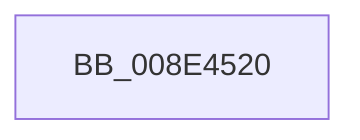

# sub_008E4520

- RVA: `0x008E4520`–`0x008E4545` (길이 `37` bytes)
- VA: `0x00000001408E4520`
- 실행 섹션: `PAGE`
- PDB 이름 있음: `아니요`; PDB Function 태그: `아니요`
- unwind 정보 RVA: `0x00086304`
- 디코드: `6`개 명령, `37/37` bytes 표시
- 미해석 바이트: `0` (있으면 어셈블리에 `.byte`로 보존)

> 이 문서는 커널 이미지의 기계어와 PDB 기호를 분석해 생성했습니다. 4번과 5번은 함수 원형과 자료형을 바이너리 사용 방식에서 추정한 C 해석이며 원본 소스 복구 결과는 아닙니다.

## 1. Dependencies

- 직접 호출 지점: **2**; 고유 호출 대상: **2**
- 직접 호출자로 확인된 함수: **0**
- RIP 상대 이미지 참조: **1**

### Outgoing calls
- `0x008E4527` → [ExReleaseResourceLite](../../text/25/ExReleaseResourceLite_function_0025FA10.md) (function, `0x0025FA10`)
- `0x008E4535` → [KeLeaveCriticalRegionThread](../../text/25/KeLeaveCriticalRegionThread_function_0025EFF0.md) (function, `0x0025EFF0`)

### Direct callers
- 이 함수 시작 RVA로 연결되는 직접 call은 확인되지 않았습니다. 간접 호출은 완전히 역산할 수 없습니다.

### Static image references
- `0x008E4520` → RVA `0x00F8B7A0` (`.data`; read)

## 2. Other-region calls and transfers

- 다른 실행 섹션으로 향하는 call: **2**
  - `0x008E4527` → [ExReleaseResourceLite](../../text/25/ExReleaseResourceLite_function_0025FA10.md) (`PAGE` → `.text`)
  - `0x008E4535` → [KeLeaveCriticalRegionThread](../../text/25/KeLeaveCriticalRegionThread_function_0025EFF0.md) (`PAGE` → `.text`)
- call이 아닌 외부 분기/꼬리 이동: **1**
  - `0x008E4540` → [sub_008E41B3 + 0x272](Unknown_function_008E41B3.md) (`tail-transfer`)

## 3. Assembly (complete function range)

```asm
008E4520  48 8D 0D 79 72 6A 00            lea rcx, [rip + 0x6a7279]
008E4527  E8 E4 B4 97 FF                  call 0x14025fa10
008E452C  65 48 8B 0C 25 88 01 00 00      mov rcx, qword ptr gs:[0x188]
008E4535  E8 B6 AA 97 FF                  call 0x14025eff0
008E453A  41 BC 34 00 00 C0               mov r12d, 0xc0000034
008E4540  E9 E0 FE FF FF                  jmp 0x1408e4425
```

## 4. C-style interpretation (structured pseudocode)

```c
__int64 __fastcall sub_008E4520(void)
{
    __int64 result;

    result = ExReleaseResourceLite(v_rip + 6976121, a2, a3, a4);
    result = KeLeaveCriticalRegionThread(*(unsigned __int64 *)(gs_base + (0 + 392)), a2, a3, a4);
}
```

## 5. (Beta) C Style

```c
void sub_008E4520(void)
{
    int64_t result;

    result = ExReleaseResourceLite(v_rip + 6976121, a2, a3, a4);
    result = KeLeaveCriticalRegionThread(*(uint64_t *)(gs_base + (0 + 0x188)), a2, a3, a4);
}
```

## 6. Execution-region graph

[열기: 2D/3D 그래프와 함수 탐색 컨트롤 패널](../../../control-panel.html?section=page&rva=0x008E4520&view=graph)

- 2D 그래프는 위에서 아래로 흐르고, 3D 그래프는 빈 공간을 드래그해 회전합니다. Shift+드래그는 이동, 휠은 확대·축소, 함수 노드 선택은 대상 보고서 이동입니다.

### Static fallback


