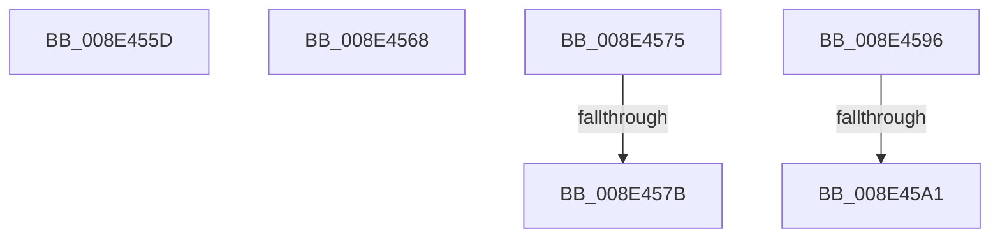

# sub_008E455D

- RVA: `0x008E455D`–`0x008E45A9` (길이 `76` bytes)
- VA: `0x00000001408E455D`
- 실행 섹션: `PAGE`
- PDB 이름 있음: `아니요`; PDB Function 태그: `아니요`
- unwind 정보 RVA: `0x00086348`
- 디코드: `17`개 명령, `76/76` bytes 표시
- 미해석 바이트: `0` (있으면 어셈블리에 `.byte`로 보존)

> 이 문서는 커널 이미지의 기계어와 PDB 기호를 분석해 생성했습니다. 4번과 5번은 함수 원형과 자료형을 바이너리 사용 방식에서 추정한 C 해석이며 원본 소스 복구 결과는 아닙니다.

## 1. Dependencies

- 직접 호출 지점: **1**; 고유 호출 대상: **1**
- 직접 호출자로 확인된 함수: **0**
- RIP 상대 이미지 참조: **0**

### Outgoing calls
- `0x008E456B` → [ExfReleasePushLock](../../text/26/ExfReleasePushLock_function_002638D0.md) (function, `0x002638D0`)

### Direct callers
- 이 함수 시작 RVA로 연결되는 직접 call은 확인되지 않았습니다. 간접 호출은 완전히 역산할 수 없습니다.

### Static image references
- 디코드된 RIP-relative 메모리 참조가 없습니다.

## 2. Other-region calls and transfers

- 다른 실행 섹션으로 향하는 call: **1**
  - `0x008E456B` → [ExfReleasePushLock](../../text/26/ExfReleasePushLock_function_002638D0.md) (`PAGE` → `.text`)
- call이 아닌 외부 분기/꼬리 이동: **6**
  - `0x008E4563` → [sub_008E41B3 + 0x290](Unknown_function_008E41B3.md) (`tail-transfer`)
  - `0x008E4570` → [sub_008E41B3 + 0x254](Unknown_function_008E41B3.md) (`tail-transfer`)
  - `0x008E4579` → [sub_008E4520](Unknown_function_008E4520.md) (`tail-transfer`)
  - `0x008E4591` → [sub_008E41B3 + 0x138](Unknown_function_008E41B3.md) (`tail-transfer`)
  - `0x008E459B` → [sub_008E41B3 + 0x54](Unknown_function_008E41B3.md) (`tail-transfer`)
  - `0x008E45A4` → [sub_008E41B3 + 0x87](Unknown_function_008E41B3.md) (`tail-transfer`)

## 3. Assembly (complete function range)

```asm
008E455D  41 BC 9A 00 00 C0               mov r12d, 0xc000009a
008E4563  E9 DB FE FF FF                  jmp 0x1408e4443
008E4568  48 8B CB                        mov rcx, rbx
008E456B  E8 60 F3 97 FF                  call 0x1402638d0
008E4570  E9 92 FE FF FF                  jmp 0x1408e4407
008E4575  66 83 FA 08                     cmp dx, 8
008E4579  76 A5                           jbe 0x1408e4520
008E457B  B8 F8 FF 00 00                  mov eax, 0xfff8
008E4580  66 03 D0                        add dx, ax
008E4583  49 83 C2 08                     add r10, 8
008E4587  66 89 54 24 30                  mov word ptr [rsp + 0x30], dx
008E458C  4C 89 54 24 38                  mov qword ptr [rsp + 0x38], r10
008E4591  E9 55 FD FF FF                  jmp 0x1408e42eb
008E4596  66 44 39 24 2F                  cmp word ptr [rdi + rbp], r12w
008E459B  0F 85 66 FC FF FF               jne 0x1408e4207
008E45A1  4C 8B FD                        mov r15, rbp
008E45A4  E9 91 FC FF FF                  jmp 0x1408e423a
```

## 4. C-style interpretation (structured pseudocode)

```c
__int64 __fastcall sub_008E455D(__int64 a1, unsigned __int16 a2)
{
    unsigned __int16 v_stack_p30;
    unsigned __int64 v_stack_p38;
}
```

## 5. (Beta) C Style

```c
int64_t sub_008E455D(int64_t Arg1, uint16_t Arg2)
{
    uint16_t v_stack_p30;
    uint64_t v_stack_p38;
}
```

## 6. Execution-region graph

[열기: 2D/3D 그래프와 함수 탐색 컨트롤 패널](../../../control-panel.html?section=page&rva=0x008E455D&view=graph)

- 2D 그래프는 위에서 아래로 흐르고, 3D 그래프는 빈 공간을 드래그해 회전합니다. Shift+드래그는 이동, 휠은 확대·축소, 함수 노드 선택은 대상 보고서 이동입니다.

### Static fallback


