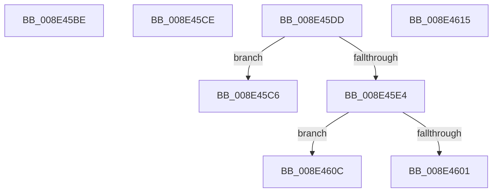

# sub_008E45BE

- RVA: `0x008E45BE`–`0x008E461D` (길이 `95` bytes)
- VA: `0x00000001408E45BE`
- 실행 섹션: `PAGE`
- PDB 이름 있음: `아니요`; PDB Function 태그: `아니요`
- unwind 정보 RVA: `0x0008639C`
- 디코드: `22`개 명령, `95/95` bytes 표시
- 미해석 바이트: `0` (있으면 어셈블리에 `.byte`로 보존)

> 이 문서는 커널 이미지의 기계어와 PDB 기호를 분석해 생성했습니다. 4번과 5번은 함수 원형과 자료형을 바이너리 사용 방식에서 추정한 C 해석이며 원본 소스 복구 결과는 아닙니다.

## 1. Dependencies

- 직접 호출 지점: **1**; 고유 호출 대상: **1**
- 직접 호출자로 확인된 함수: **0**
- RIP 상대 이미지 참조: **0**

### Outgoing calls
- `0x008E45F4` → [ExAllocatePool2](../../poolcode/B8/ExAllocatePool2_function_00B820F0.md) (function, `0x00B820F0`)

### Direct callers
- 이 함수 시작 RVA로 연결되는 직접 call은 확인되지 않았습니다. 간접 호출은 완전히 역산할 수 없습니다.

### Static image references
- 디코드된 RIP-relative 메모리 참조가 없습니다.

## 2. Other-region calls and transfers

- 다른 실행 섹션으로 향하는 call: **1**
  - `0x008E45F4` → [ExAllocatePool2](../../poolcode/B8/ExAllocatePool2_function_00B820F0.md) (`PAGE` → `POOLCODE`)
- call이 아닌 외부 분기/꼬리 이동: **6**
  - `0x008E45C1` → [sub_008E41B3 + 0x87](Unknown_function_008E41B3.md) (`tail-transfer`)
  - `0x008E45C9` → [sub_008E41B3 + 0x87](Unknown_function_008E41B3.md) (`tail-transfer`)
  - `0x008E45D8` → [sub_008E41B3 + 0x126](Unknown_function_008E41B3.md) (`tail-transfer`)
  - `0x008E4607` → [sub_008E41B3 + 0x290](Unknown_function_008E41B3.md) (`tail-transfer`)
  - `0x008E4610` → [sub_008E41B3 + 0x87](Unknown_function_008E41B3.md) (`tail-transfer`)
  - `0x008E4618` → [sub_008E41B3 + 0x87](Unknown_function_008E41B3.md) (`tail-transfer`)

## 3. Assembly (complete function range)

```asm
008E45BE  4C 8B FD                        mov r15, rbp
008E45C1  E9 74 FC FF FF                  jmp 0x1408e423a
008E45C6  4C 8B FD                        mov r15, rbp
008E45C9  E9 6C FC FF FF                  jmp 0x1408e423a
008E45CE  4C 8B 54 24 38                  mov r10, qword ptr [rsp + 0x38]
008E45D3  0F B7 54 24 30                  movzx edx, word ptr [rsp + 0x30]
008E45D8  E9 FC FC FF FF                  jmp 0x1408e42d9
008E45DD  66 44 39 65 00                  cmp word ptr [rbp], r12w
008E45E2  74 E2                           je 0x1408e45c6
008E45E4  BA 02 00 00 00                  mov edx, 2
008E45E9  B9 00 01 00 00                  mov ecx, 0x100
008E45EE  41 B8 50 70 73 75               mov r8d, 0x75737050
008E45F4  E8 F7 DA 29 00                  call 0x140b820f0
008E45F9  4C 8B F8                        mov r15, rax
008E45FC  48 85 C0                        test rax, rax
008E45FF  75 0B                           jne 0x1408e460c
008E4601  41 BC 9A 00 00 C0               mov r12d, 0xc000009a
008E4607  E9 37 FE FF FF                  jmp 0x1408e4443
008E460C  66 44 89 20                     mov word ptr [rax], r12w
008E4610  E9 25 FC FF FF                  jmp 0x1408e423a
008E4615  4D 8B FC                        mov r15, r12
008E4618  E9 1D FC FF FF                  jmp 0x1408e423a
```

## 4. C-style interpretation (structured pseudocode)

```c
__int64 __fastcall sub_008E45BE(void)
{
    unsigned __int16 v_stack_p30;
    unsigned __int64 v_stack_p38;
}
```

## 5. (Beta) C Style

```c
void sub_008E45BE(void)
{
    uint16_t v_stack_p30;
    uint64_t v_stack_p38;
}
```

## 6. Execution-region graph

[열기: 2D/3D 그래프와 함수 탐색 컨트롤 패널](../../../control-panel.html?section=page&rva=0x008E45BE&view=graph)

- 2D 그래프는 위에서 아래로 흐르고, 3D 그래프는 빈 공간을 드래그해 회전합니다. Shift+드래그는 이동, 휠은 확대·축소, 함수 노드 선택은 대상 보고서 이동입니다.

### Static fallback


