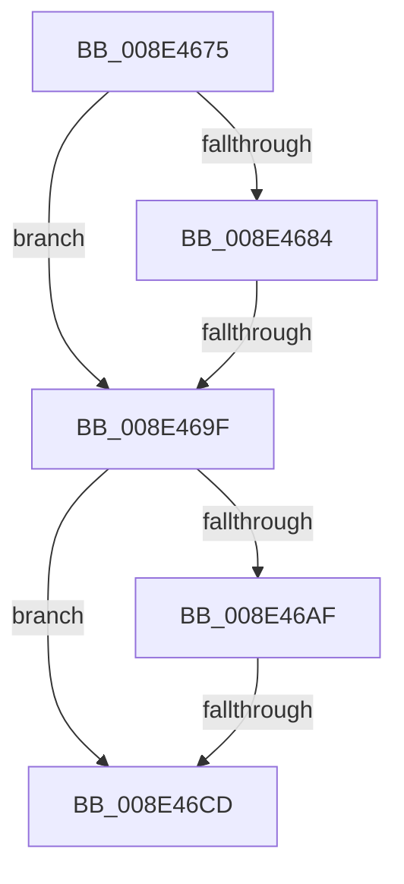

# sub_008E4675

- RVA: `0x008E4675`–`0x008E46DC` (길이 `103` bytes)
- VA: `0x00000001408E4675`
- 실행 섹션: `PAGE`
- PDB 이름 있음: `아니요`; PDB Function 태그: `아니요`
- unwind 정보 RVA: `0x000863D8`
- 디코드: `29`개 명령, `103/103` bytes 표시
- 미해석 바이트: `0` (있으면 어셈블리에 `.byte`로 보존)

> 이 문서는 커널 이미지의 기계어와 PDB 기호를 분석해 생성했습니다. 4번과 5번은 함수 원형과 자료형을 바이너리 사용 방식에서 추정한 C 해석이며 원본 소스 복구 결과는 아닙니다.

## 1. Dependencies

- 직접 호출 지점: **2**; 고유 호출 대상: **2**
- 직접 호출자로 확인된 함수: **0**
- RIP 상대 이미지 참조: **0**

### Outgoing calls
- `0x008E4692` → [ExAllocatePool2](../../poolcode/B8/ExAllocatePool2_function_00B820F0.md) (function, `0x00B820F0`)
- `0x008E46C1` → [PiControlCopyUserModeCallersBuffer](PiControlCopyUserModeCallersBuffer_function_008E4720.md) (function, `0x008E4720`)

### Direct callers
- 이 함수 시작 RVA로 연결되는 직접 call은 확인되지 않았습니다. 간접 호출은 완전히 역산할 수 없습니다.

### Static image references
- 디코드된 RIP-relative 메모리 참조가 없습니다.

## 2. Other-region calls and transfers

- 다른 실행 섹션으로 향하는 call: **1**
  - `0x008E4692` → [ExAllocatePool2](../../poolcode/B8/ExAllocatePool2_function_00B820F0.md) (`PAGE` → `POOLCODE`)
- call이 아닌 외부 분기/꼬리 이동: **3**
  - `0x008E469D` → [sub_008E46EA](Unknown_function_008E46EA.md) (`tail-transfer`)
  - `0x008E46CB` → [sub_008E46F9](Unknown_function_008E46F9.md) (`tail-transfer`)
  - `0x008E46DA` → [PiControlMakeUserModeCallersCopy + 0x2C](PiControlMakeUserModeCallersCopy_function_008E4630.md) (`tail-transfer`)

## 3. Assembly (complete function range)

```asm
008E4675  4C 89 64 24 50                  mov qword ptr [rsp + 0x50], r12
008E467A  44 8B 64 24 78                  mov r12d, dword ptr [rsp + 0x78]
008E467F  45 85 E4                        test r12d, r12d
008E4682  74 1B                           je 0x1408e469f
008E4684  48 8B D6                        mov rdx, rsi
008E4687  B9 01 01 00 00                  mov ecx, 0x101
008E468C  41 B8 50 70 20 20               mov r8d, 0x20207050
008E4692  E8 59 DA 29 00                  call 0x140b820f0
008E4697  48 89 07                        mov qword ptr [rdi], rax
008E469A  48 85 C0                        test rax, rax
008E469D  74 4B                           je 0x1408e46ea
008E469F  48 8B 0F                        mov rcx, qword ptr [rdi]
008E46A2  4C 89 7C 24 58                  mov qword ptr [rsp + 0x58], r15
008E46A7  45 33 FF                        xor r15d, r15d
008E46AA  48 85 C9                        test rcx, rcx
008E46AD  74 1E                           je 0x1408e46cd
008E46AF  44 89 64 24 28                  mov dword ptr [rsp + 0x28], r12d
008E46B4  45 8B CE                        mov r9d, r14d
008E46B7  44 8B C6                        mov r8d, esi
008E46BA  88 5C 24 20                     mov byte ptr [rsp + 0x20], bl
008E46BE  48 8B D5                        mov rdx, rbp
008E46C1  E8 5A 00 00 00                  call 0x1408e4720
008E46C6  44 8B F8                        mov r15d, eax
008E46C9  85 C0                           test eax, eax
008E46CB  78 2C                           js 0x1408e46f9
008E46CD  4C 8B 64 24 50                  mov r12, qword ptr [rsp + 0x50]
008E46D2  41 8B C7                        mov eax, r15d
008E46D5  4C 8B 7C 24 58                  mov r15, qword ptr [rsp + 0x58]
008E46DA  EB 80                           jmp 0x1408e465c
```

## 4. C-style interpretation (structured pseudocode)

```c
__int64 __fastcall sub_008E4675(__int64 a1, __int64 a2, __int64 a3, __int64 a4, __int64 a5, __int64 a6, __int64 a7, __int64 a8, __int64 a9, __int64 a10, __int64 a11, __int64 a12, __int64 a13, __int64 a14, unsigned int a15)
{
    __int64 result;
    __int64 v_r15;
    unsigned __int8 v_stack_p20;
    unsigned int v_stack_p28;
    unsigned __int64 v_stack_p50;
    unsigned __int64 v_stack_p58;

    v_stack_p50 = v_r12;
    if ((unsigned int)((unsigned int)(a15)) == 0) goto loc_008E469F;
    result = ExAllocatePool2(257, v_rsi, (unsigned int)(0x20207050ULL), a4);
    *(unsigned __int64 *)(v_rdi) = result;
loc_008E469F:
    v_stack_p58 = v_r15;
    v_r15 = 0;
    if (*(unsigned __int64 *)(v_rdi) == 0) goto loc_008E46CD;
    v_stack_p28 = (unsigned int)((unsigned int)(a15));
    v_stack_p20 = (unsigned __int8)(v_rbx);
    result = PiControlCopyUserModeCallersBuffer(*(unsigned __int64 *)(v_rdi), v_rbp, (unsigned int)((unsigned int)(v_rsi)), (unsigned int)((unsigned int)(v_r14)));
loc_008E46CD:
}
```

## 5. (Beta) C Style

```c
int64_t sub_008E4675(int64_t Arg1, int64_t Arg2, int64_t Arg3, int64_t Arg4, uint64_t Arg5, uint64_t Arg6, uint64_t Arg7, uint64_t Arg8, uint64_t Arg9, int64_t Arg10, int64_t Arg11, uint64_t Arg12, uint64_t Arg13, uint64_t Arg14, uint32_t Arg15)
{
    int64_t result;
    int64_t local_r15;
    uint8_t v_stack_p20;
    uint32_t v_stack_p28;
    uint64_t v_stack_p50;
    uint64_t v_stack_p58;

    v_stack_p50 = local_r12;
    if ((uint32_t)((uint32_t)(Arg15)) == 0) goto loc_008E469F;
    result = ExAllocatePool2(257, local_rsi, (uint32_t)(0x20207050ULL), Arg4);
    *(uint64_t *)(local_rdi) = result;
loc_008E469F:
    v_stack_p58 = local_r15;
    local_r15 = 0;
    if (*(uint64_t *)(local_rdi) == 0) goto loc_008E46CD;
    v_stack_p28 = (uint32_t)((uint32_t)(Arg15));
    v_stack_p20 = (uint8_t)(local_rbx);
    result = PiControlCopyUserModeCallersBuffer(*(uint64_t *)(local_rdi), local_rbp, (uint32_t)((uint32_t)(local_rsi)), (uint32_t)((uint32_t)(local_r14)));
loc_008E46CD:
}
```

## 6. Execution-region graph

[열기: 2D/3D 그래프와 함수 탐색 컨트롤 패널](../../../control-panel.html?section=page&rva=0x008E4675&view=graph)

- 2D 그래프는 위에서 아래로 흐르고, 3D 그래프는 빈 공간을 드래그해 회전합니다. Shift+드래그는 이동, 휠은 확대·축소, 함수 노드 선택은 대상 보고서 이동입니다.

### Static fallback


