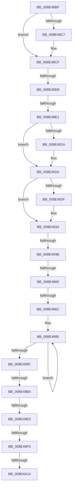

# sub_008E48BF

- RVA: `0x008E48BF`–`0x008E4A2F` (길이 `368` bytes)
- VA: `0x00000001408E48BF`
- 실행 섹션: `PAGE`
- PDB 이름 있음: `아니요`; PDB Function 태그: `아니요`
- unwind 정보 RVA: `0x00086478`
- 디코드: `86`개 명령, `368/368` bytes 표시
- 미해석 바이트: `0` (있으면 어셈블리에 `.byte`로 보존)

> 이 문서는 커널 이미지의 기계어와 PDB 기호를 분석해 생성했습니다. 4번과 5번은 함수 원형과 자료형을 바이너리 사용 방식에서 추정한 C 해석이며 원본 소스 복구 결과는 아닙니다.

## 1. Dependencies

- 직접 호출 지점: **5**; 고유 호출 대상: **5**
- 직접 호출자로 확인된 함수: **0**
- RIP 상대 이미지 참조: **0**

### Outgoing calls
- `0x008E48FF` → [KeAbPreAcquire](../../text/21/KeAbPreAcquire_function_00210230.md) (function, `0x00210230`)
- `0x008E4925` → [ExfAcquirePushLockSharedEx](../../text/21/ExfAcquirePushLockSharedEx_function_0021044C.md) (function, `0x0021044C`)
- `0x008E49F8` → [KeAbPostRelease](../../text/2E/KeAbPostRelease_function_002E1600.md) (function, `0x002E1600`)
- `0x008E4A06` → [KeLeaveCriticalRegionThread](../../text/25/KeLeaveCriticalRegionThread_function_0025EFF0.md) (function, `0x0025EFF0`)
- `0x008E4A17` → [PiDmObjectRelease](PiDmObjectRelease_function_008E4F70.md) (function, `0x008E4F70`)

### Direct callers
- 이 함수 시작 RVA로 연결되는 직접 call은 확인되지 않았습니다. 간접 호출은 완전히 역산할 수 없습니다.

### Static image references
- 디코드된 RIP-relative 메모리 참조가 없습니다.

## 2. Other-region calls and transfers

- 다른 실행 섹션으로 향하는 call: **4**
  - `0x008E48FF` → [KeAbPreAcquire](../../text/21/KeAbPreAcquire_function_00210230.md) (`PAGE` → `.text`)
  - `0x008E4925` → [ExfAcquirePushLockSharedEx](../../text/21/ExfAcquirePushLockSharedEx_function_0021044C.md) (`PAGE` → `.text`)
  - `0x008E49F8` → [KeAbPostRelease](../../text/2E/KeAbPostRelease_function_002E1600.md) (`PAGE` → `.text`)
  - `0x008E4A06` → [KeLeaveCriticalRegionThread](../../text/25/KeLeaveCriticalRegionThread_function_0025EFF0.md) (`PAGE` → `.text`)
- call이 아닌 외부 분기/꼬리 이동: **9**
  - `0x008E48D2` → [sub_008E4A5E + 0x1B7](Unknown_function_008E4A5E.md) (`tail-transfer`)
  - `0x008E48DB` → [sub_008E4C9A + 0x1B3](Unknown_function_008E4C9A.md) (`tail-transfer`)
  - `0x008E4945` → [sub_008E4C9A + 0xDD](Unknown_function_008E4C9A.md) (`tail-transfer`)
  - `0x008E495A` → [sub_008E4C9A + 0xAE](Unknown_function_008E4C9A.md) (`tail-transfer`)
  - `0x008E4966` → [sub_008E4C9A + 0xE8](Unknown_function_008E4C9A.md) (`tail-transfer`)
  - `0x008E49AE` → [sub_008E4C9A + 0xC2](Unknown_function_008E4C9A.md) (`tail-transfer`)
  - `0x008E49DA` → [sub_008E4C9A + 0x136](Unknown_function_008E4C9A.md) (`tail-transfer`)
  - `0x008E49EA` → [sub_008E4C9A + 0x136](Unknown_function_008E4C9A.md) (`tail-transfer`)
  - `0x008E4A0E` → [sub_008E4C9A + 0x16D](Unknown_function_008E4C9A.md) (`tail-transfer`)

## 3. Assembly (complete function range)

```asm
008E48BF  49 8B 09                        mov rcx, qword ptr [r9]
008E48C2  48 2B 0A                        sub rcx, qword ptr [rdx]
008E48C5  75 08                           jne 0x1408e48cf
008E48C7  49 8B 49 08                     mov rcx, qword ptr [r9 + 8]
008E48CB  48 2B 4A 08                     sub rcx, qword ptr [rdx + 8]
008E48CF  48 85 C9                        test rcx, rcx
008E48D2  0F 85 3D 03 00 00               jne 0x1408e4c15
008E48D8  48 85 F6                        test rsi, rsi
008E48DB  0F 84 6C 05 00 00               je 0x1408e4e4d
008E48E1  65 48 8B 04 25 88 01 00 00      mov rax, qword ptr gs:[0x188]
008E48EA  45 33 C0                        xor r8d, r8d
008E48ED  48 8B 5C 24 48                  mov rbx, qword ptr [rsp + 0x48]
008E48F2  33 D2                           xor edx, edx
008E48F4  48 8B CB                        mov rcx, rbx
008E48F7  66 FF 88 E4 01 00 00            dec word ptr [rax + 0x1e4]
008E48FE  90                              nop
008E48FF  E8 2C B9 92 FF                  call 0x140210230
008E4904  4C 8B F0                        mov r14, rax
008E4907  B9 11 00 00 00                  mov ecx, 0x11
008E490C  33 C0                           xor eax, eax
008E490E  F0 48 0F B1 0B                  lock cmpxchg qword ptr [rbx], rcx
008E4913  48 8B 5C 24 48                  mov rbx, qword ptr [rsp + 0x48]
008E4918  74 10                           je 0x1408e492a
008E491A  4C 8B CB                        mov r9, rbx
008E491D  4D 8B C6                        mov r8, r14
008E4920  33 D2                           xor edx, edx
008E4922  48 8B CB                        mov rcx, rbx
008E4925  E8 22 BB 92 FF                  call 0x14021044c
008E492A  4D 85 F6                        test r14, r14
008E492D  74 05                           je 0x1408e4934
008E492F  41 C6 46 0A 01                  mov byte ptr [r14 + 0xa], 1
008E4934  8B C7                           mov eax, edi
008E4936  48 8D 0C 40                     lea rcx, [rax + rax*2]
008E493A  48 8D 14 CB                     lea rdx, [rbx + rcx*8]
008E493E  8B 4C CB 70                     mov ecx, dword ptr [rbx + rcx*8 + 0x70]
008E4942  83 F9 01                        cmp ecx, 1
008E4945  0F 86 2C 04 00 00               jbe 0x1408e4d77
008E494B  33 C0                           xor eax, eax
008E494D  0F 57 C0                        xorps xmm0, xmm0
008E4950  44 8B F0                        mov r14d, eax
008E4953  0F 11 45 88                     movups xmmword ptr [rbp - 0x78], xmm0
008E4957  83 F9 06                        cmp ecx, 6
008E495A  0F 85 E8 03 00 00               jne 0x1408e4d48
008E4960  8B 42 78                        mov eax, dword ptr [rdx + 0x78]
008E4963  83 F8 12                        cmp eax, 0x12
008E4966  0F 85 16 04 00 00               jne 0x1408e4d82
008E496C  48 8B 4C 24 50                  mov rcx, qword ptr [rsp + 0x50]
008E4971  89 01                           mov dword ptr [rcx], eax
008E4973  48 8B 82 80 00 00 00            mov rax, qword ptr [rdx + 0x80]
008E497A  48 8B 48 10                     mov rcx, qword ptr [rax + 0x10]
008E497E  48 C7 C0 FF FF FF FF            mov rax, 0xffffffffffffffff
008E4985  66 66 66 0F 1F 84 00 00 00 00 00  nop word ptr [rax + rax]
008E4990  66 44 39 74 41 02               cmp word ptr [rcx + rax*2 + 2], r14w
008E4996  48 8D 40 01                     lea rax, [rax + 1]
008E499A  75 F4                           jne 0x1408e4990
008E499C  48 8B 4C 24 58                  mov rcx, qword ptr [rsp + 0x58]
008E49A1  8D 04 45 02 00 00 00            lea eax, [rax*2 + 2]
008E49A8  89 01                           mov dword ptr [rcx], eax
008E49AA  39 44 24 40                     cmp dword ptr [rsp + 0x40], eax
008E49AE  0F 83 A8 03 00 00               jae 0x1408e4d5c
008E49B4  41 BE 23 00 00 C0               mov r14d, 0xc0000023
008E49BA  0F 0D 0B                        prefetchw byte ptr [rbx]
008E49BD  48 8B 03                        mov rax, qword ptr [rbx]
008E49C0  48 8B C8                        mov rcx, rax
008E49C3  48 83 E1 F0                     and rcx, 0xfffffffffffffff0
008E49C7  48 83 F9 10                     cmp rcx, 0x10
008E49CB  B9 00 00 00 00                  mov ecx, 0
008E49D0  48 8D 50 F0                     lea rdx, [rax - 0x10]
008E49D4  48 0F 46 D1                     cmovbe rdx, rcx
008E49D8  A8 02                           test al, 2
008E49DA  0F 85 F0 03 00 00               jne 0x1408e4dd0
008E49E0  48 8B 4C 24 48                  mov rcx, qword ptr [rsp + 0x48]
008E49E5  F0 48 0F B1 11                  lock cmpxchg qword ptr [rcx], rdx
008E49EA  0F 85 E0 03 00 00               jne 0x1408e4dd0
008E49F0  48 8B 5C 24 48                  mov rbx, qword ptr [rsp + 0x48]
008E49F5  48 8B CB                        mov rcx, rbx
008E49F8  E8 03 CC 9F FF                  call 0x1402e1600
008E49FD  65 48 8B 0C 25 88 01 00 00      mov rcx, qword ptr gs:[0x188]
008E4A06  E8 E5 A5 97 FF                  call 0x14025eff0
008E4A0B  45 84 FF                        test r15b, r15b
008E4A0E  0F 85 F3 03 00 00               jne 0x1408e4e07
008E4A14  48 8B CE                        mov rcx, rsi
008E4A17  E8 54 05 00 00                  call 0x1408e4f70
008E4A1C  41 8B C6                        mov eax, r14d
008E4A1F  48 8B 9C 24 50 01 00 00         mov rbx, qword ptr [rsp + 0x150]
008E4A27  48 8B BC 24 60 01 00 00         mov rdi, qword ptr [rsp + 0x160]
```

## 4. C-style interpretation (structured pseudocode)

```c
__int64 __fastcall sub_008E48BF(__int64 a1, __int64 a2, int a3, __int64 a4, __int64 a5, __int64 a6, __int64 a7, unsigned int a8, __int64 a9, __int64 a10, __int64 a11, __int64 a12, __int64 a13, __int64 a14, __int64 a15, __int64 a16, __int64 a17, __int64 a18, __int64 a19, __int64 a20, __int64 a21, __int64 a22, __int64 a23, __int64 a24, __int64 a25, __int64 a26, __int64 a27, __int64 a28, __int64 a29, __int64 a30, __int64 a31, __int64 a32, __int64 a33, __int64 a34, __int64 a35, __int64 a36, __int64 a37, __int64 a38, __int64 a39, __int64 a40, __int64 a41, __int64 a42, __int64 a43, __int64 a44)
{
    __int64 result;

    a1 = (*(unsigned __int64 *)(a4)) - (*(unsigned __int64 *)(a2));
    if (!(condition_is_not_equal)) {
        a1 = *(unsigned __int64 *)(a4 + 8);
        a1 = (a1) - (*(unsigned __int64 *)(a2 + 8));
    }
    a3 = 0;
    a2 = 0;
    result = KeAbPreAcquire(a9, a2, a3, a4);
    result = 0;
    if (!(condition_is_equal)) {
        a4 = a9;
        a3 = 0;
        a2 = 0;
        a1 = a9;
        result = ExfAcquirePushLockSharedEx(a1, a2, a3, a4);
    }
    if (result != 0) {
        *(unsigned __int8 *)(result + 10) = 1;
    }
    result = 0;
    *(unsigned __int64 *)(v_rbp - 120) = v_xmm0;
    *(unsigned int *)(a10) = (unsigned int)((unsigned int)(*(unsigned int *)(a9 + (unsigned int)((unsigned int)(v_rdi)) + (unsigned int)((unsigned int)(v_rdi)) * 2 * 8 + 120)));
loc_008E4990:
    if ((*(unsigned __int16 *)(*(unsigned __int64 *)(*(unsigned __int64 *)(a9 + (unsigned int)((unsigned int)(v_rdi)) + (unsigned int)((unsigned int)(v_rdi)) * 2 * 8 + 128) + 16) + -1 * 2 + 2)) != 0) goto loc_008E4990;
    *(unsigned int *)(a11) = (unsigned int)(-1 + 1 * 2 + 2);
    a1 = (*(unsigned __int64 *)(a9)) & (-16);
    a2 = *(unsigned __int64 *)(a9) - 16;
    if (a1 <= 16) { a2 = 0; }
    result = KeAbPostRelease(a9, a2, a3, a4);
    result = KeLeaveCriticalRegionThread(*(unsigned __int64 *)(gs_base + (0 + 392)), a2, a3, a4);
    result = PiDmObjectRelease(v_rsi, a2, a3, a4);
    return (unsigned int)((unsigned int)((unsigned int)(0xC0000023ULL)));
}
```

## 5. (Beta) C Style

```c
int64_t sub_008E48BF(int64_t Arg1, void *Arg2, int32_t Arg3, void *Arg4, uint64_t Arg5, uint64_t Arg6, uint64_t Arg7, uint32_t Arg8, void *Arg9, void *Arg10, void *Arg11, uint64_t Arg12, uint64_t Arg13, uint64_t Arg14, uint64_t Arg15, uint64_t Arg16, uint64_t Arg17, uint64_t Arg18, uint64_t Arg19, uint64_t Arg20, uint64_t Arg21, uint64_t Arg22, uint64_t Arg23, uint64_t Arg24, uint64_t Arg25, uint64_t Arg26, uint64_t Arg27, uint64_t Arg28, uint64_t Arg29, uint64_t Arg30, uint64_t Arg31, uint64_t Arg32, uint64_t Arg33, uint64_t Arg34, uint64_t Arg35, uint64_t Arg36, uint64_t Arg37, uint64_t Arg38, uint64_t Arg39, uint64_t Arg40, uint64_t Arg41, int64_t Arg42, uint64_t Arg43, int64_t Arg44)
{
    uint8_t *arg2 = (uint8_t *)Arg2;
    uint8_t *arg4 = (uint8_t *)Arg4;
    uint8_t *arg9 = (uint8_t *)Arg9;
    uint8_t *arg10 = (uint8_t *)Arg10;
    uint8_t *arg11 = (uint8_t *)Arg11;

    int64_t result;

    Arg1 = (*(uint64_t *)(arg4)) - (*(uint64_t *)(arg2));
    if (!(condition_is_not_equal)) {
        Arg1 = *(uint64_t *)(arg4 + 0x8);
        Arg1 = (Arg1) - (*(uint64_t *)(arg2 + 0x8));
    }
    Arg3 = 0;
    Arg2 = 0;
    result = KeAbPreAcquire(Arg9, Arg2, Arg3, Arg4);
    result = 0;
    if (!(condition_is_equal)) {
        Arg4 = Arg9;
        Arg3 = 0;
        Arg2 = 0;
        Arg1 = Arg9;
        result = ExfAcquirePushLockSharedEx(Arg1, Arg2, Arg3, Arg4);
    }
    if (result != 0) {
        *(uint8_t *)(result + 0xA) = 1;
    }
    result = 0;
    *(uint64_t *)(local_rbp - 0x78) = v_xmm0;
    *(uint32_t *)(arg10) = (uint32_t)((uint32_t)(*(uint32_t *)(arg9 + (uint32_t)((uint32_t)(local_rdi)) + (uint32_t)((uint32_t)(local_rdi)) * 2 * 8 + 0x78)));
loc_008E4990:
    if ((*(uint16_t *)(*(uint64_t *)(*(uint64_t *)(arg9 + (uint32_t)((uint32_t)(local_rdi)) + (uint32_t)((uint32_t)(local_rdi)) * 2 * 8 + 0x80) + 0x10) + - 0x1 * 2 + 0x2)) != 0) goto loc_008E4990;
    *(uint32_t *)(arg11) = (uint32_t)(-1 + 1 * 2 + 2);
    Arg1 = (*(uint64_t *)(arg9)) & (-16);
    Arg2 = *(uint64_t *)(arg9) - 16;
    if (Arg1 <= 16) { Arg2 = 0; }
    result = KeAbPostRelease(Arg9, Arg2, Arg3, Arg4);
    result = KeLeaveCriticalRegionThread(*(uint64_t *)(gs_base + (0 + 0x188)), Arg2, Arg3, Arg4);
    result = PiDmObjectRelease(local_rsi, Arg2, Arg3, Arg4);
    return (uint32_t)((uint32_t)((uint32_t)(0xC0000023ULL)));
}
```

### 관측된 메모리 오프셋

구조체 형식이 확인되지 않은 접근은 인자 기준의 오프셋으로만 기록했습니다.

| 기준 인자 | 오프셋 표현 | 폭 (bit) | 접근 |
|---|---:|---:|---|
| `Arg2` | `+ 0x0` | `64` | `R` |
| `Arg2` | `+ 0x8` | `64` | `R` |
| `Arg4` | `+ 0x0` | `64` | `R` |
| `Arg4` | `+ 0x8` | `64` | `R` |
| `Arg9` | `+ 0x0` | `8` | `R` |
| `Arg9` | `+ 0x0` | `64` | `R` |
| `Arg9` | `+ 0x0 + rcx*8` | `64` | `R` |
| `Arg9` | `+ 0x70 + rcx*8` | `32` | `R` |
| `Arg9` | `+ 0x78` | `32` | `R` |
| `Arg9` | `+ 0x80` | `64` | `R` |
| `Arg10` | `+ 0x0` | `32` | `W` |
| `Arg11` | `+ 0x0` | `32` | `W` |

## 6. Execution-region graph

[열기: 2D/3D 그래프와 함수 탐색 컨트롤 패널](../../../control-panel.html?section=page&rva=0x008E48BF&view=graph)

- 2D 그래프는 위에서 아래로 흐르고, 3D 그래프는 빈 공간을 드래그해 회전합니다. Shift+드래그는 이동, 휠은 확대·축소, 함수 노드 선택은 대상 보고서 이동입니다.

### Static fallback


