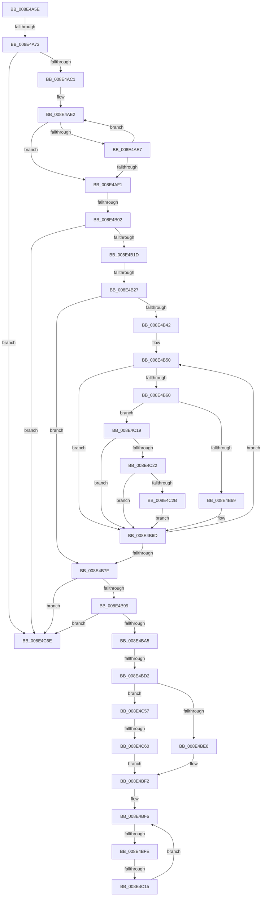

# sub_008E4A5E

- RVA: `0x008E4A5E`–`0x008E4C8E` (길이 `560` bytes)
- VA: `0x00000001408E4A5E`
- 실행 섹션: `PAGE`
- PDB 이름 있음: `아니요`; PDB Function 태그: `아니요`
- unwind 정보 RVA: `0x000864A4`
- 디코드: `134`개 명령, `560/560` bytes 표시
- 미해석 바이트: `0` (있으면 어셈블리에 `.byte`로 보존)

> 이 문서는 커널 이미지의 기계어와 PDB 기호를 분석해 생성했습니다. 4번과 5번은 함수 원형과 자료형을 바이너리 사용 방식에서 추정한 C 해석이며 원본 소스 복구 결과는 아닙니다.

## 1. Dependencies

- 직접 호출 지점: **8**; 고유 호출 대상: **6**
- 직접 호출자로 확인된 함수: **0**
- RIP 상대 이미지 참조: **3**

### Outgoing calls
- `0x008E4A98` → [ExAcquireResourceSharedLite](../../text/21/ExAcquireResourceSharedLite_function_00211BC0.md) (function, `0x00211BC0`)
- `0x008E4AAB` → [memset](../../text/6C/memset_function_006C6C40.md) (function, `0x006C6C40`)
- `0x008E4B2A` → [PsGetCurrentServerSiloGlobals](../../text/2F/PsGetCurrentServerSiloGlobals_function_002FE1F0.md) (function, `0x002FE1F0`)
- `0x008E4B8B` → [RtlLookupElementGenericTableAvl](../../text/3F/RtlLookupElementGenericTableAvl_function_003FEFB0.md) (function, `0x003FEFB0`)
- `0x008E4BAC` → [ExReleaseResourceLite](../../text/25/ExReleaseResourceLite_function_0025FA10.md) (function, `0x0025FA10`)
- `0x008E4BBA` → [KeLeaveCriticalRegionThread](../../text/25/KeLeaveCriticalRegionThread_function_0025EFF0.md) (function, `0x0025EFF0`)
- `0x008E4C71` → [ExReleaseResourceLite](../../text/25/ExReleaseResourceLite_function_0025FA10.md) (function, `0x0025FA10`)
- `0x008E4C7F` → [KeLeaveCriticalRegionThread](../../text/25/KeLeaveCriticalRegionThread_function_0025EFF0.md) (function, `0x0025EFF0`)

### Direct callers
- 이 함수 시작 RVA로 연결되는 직접 call은 확인되지 않았습니다. 간접 호출은 완전히 역산할 수 없습니다.

### Static image references
- `0x008E4A73` → RVA `0x00F8B7A0` (`.data`; read)
- `0x008E4BE6` → RVA `0x00001A70` (`.rdata`; read)
- `0x008E4C60` → RVA `0x00001B60` (`.rdata`; read)

## 2. Other-region calls and transfers

- 다른 실행 섹션으로 향하는 call: **8**
  - `0x008E4A98` → [ExAcquireResourceSharedLite](../../text/21/ExAcquireResourceSharedLite_function_00211BC0.md) (`PAGE` → `.text`)
  - `0x008E4AAB` → [memset](../../text/6C/memset_function_006C6C40.md) (`PAGE` → `.text`)
  - `0x008E4B2A` → [PsGetCurrentServerSiloGlobals](../../text/2F/PsGetCurrentServerSiloGlobals_function_002FE1F0.md) (`PAGE` → `.text`)
  - `0x008E4B8B` → [RtlLookupElementGenericTableAvl](../../text/3F/RtlLookupElementGenericTableAvl_function_003FEFB0.md) (`PAGE` → `.text`)
  - `0x008E4BAC` → [ExReleaseResourceLite](../../text/25/ExReleaseResourceLite_function_0025FA10.md) (`PAGE` → `.text`)
  - `0x008E4BBA` → [KeLeaveCriticalRegionThread](../../text/25/KeLeaveCriticalRegionThread_function_0025EFF0.md) (`PAGE` → `.text`)
  - `0x008E4C71` → [ExReleaseResourceLite](../../text/25/ExReleaseResourceLite_function_0025FA10.md) (`PAGE` → `.text`)
  - `0x008E4C7F` → [KeLeaveCriticalRegionThread](../../text/25/KeLeaveCriticalRegionThread_function_0025EFF0.md) (`PAGE` → `.text`)
- call이 아닌 외부 분기/꼬리 이동: **8**
  - `0x008E4A6D` → [sub_008E4E72](Unknown_function_008E4E72.md) (`tail-transfer`)
  - `0x008E4AFC` → [sub_008E4EE0](Unknown_function_008E4EE0.md) (`tail-transfer`)
  - `0x008E4B21` → [sub_008E4C9A + 0x148](Unknown_function_008E4C9A.md) (`tail-transfer`)
  - `0x008E4BCC` → [sub_008E4C9A](Unknown_function_008E4C9A.md) (`tail-transfer`)
  - `0x008E4BF8` → [sub_008E48BF + 0x155](Unknown_function_008E48BF.md) (`tail-transfer`)
  - `0x008E4C0F` → [sub_008E48BF](Unknown_function_008E48BF.md) (`tail-transfer`)
  - `0x008E4C5A` → [sub_008E4C9A + 0x98](Unknown_function_008E4C9A.md) (`tail-transfer`)
  - `0x008E4C89` → [sub_008E48BF + 0x160](Unknown_function_008E48BF.md) (`tail-transfer`)

## 3. Assembly (complete function range)

```asm
008E4A5E  48 89 BC 24 60 01 00 00         mov qword ptr [rsp + 0x160], rdi
008E4A66  48 8B FE                        mov rdi, rsi
008E4A69  41 83 FD 03                     cmp r13d, 3
008E4A6D  0F 85 FF 03 00 00               jne 0x1408e4e72
008E4A73  48 8D 3D 26 6D 6A 00            lea rdi, [rip + 0x6a6d26]
008E4A7A  65 48 8B 04 25 88 01 00 00      mov rax, qword ptr gs:[0x188]
008E4A83  B2 01                           mov dl, 1
008E4A85  48 8B CF                        mov rcx, rdi
008E4A88  48 89 9C 24 50 01 00 00         mov qword ptr [rsp + 0x150], rbx
008E4A90  66 FF 88 E4 01 00 00            dec word ptr [rax + 0x1e4]
008E4A97  90                              nop
008E4A98  E8 23 D1 92 FF                  call 0x140211bc0
008E4A9D  33 D2                           xor edx, edx
008E4A9F  48 89 75 A0                     mov qword ptr [rbp - 0x60], rsi
008E4AA3  48 8D 4D A8                     lea rcx, [rbp - 0x58]
008E4AA7  44 8D 42 68                     lea r8d, [rdx + 0x68]
008E4AAB  E8 90 21 DE FF                  call 0x1406c6c40
008E4AB0  48 8D 45 A0                     lea rax, [rbp - 0x60]
008E4AB4  48 89 45 80                     mov qword ptr [rbp - 0x80], rax
008E4AB8  4D 85 FF                        test r15, r15
008E4ABB  0F 84 AD 01 00 00               je 0x1408e4c6e
008E4AC1  44 8B 87 D0 00 00 00            mov r8d, dword ptr [rdi + 0xd0]
008E4AC8  0F 57 C0                        xorps xmm0, xmm0
008E4ACB  BA FF 7F 00 00                  mov edx, 0x7fff
008E4AD0  4C 89 7D B0                     mov qword ptr [rbp - 0x50], r15
008E4AD4  0F 11 44 24 60                  movups xmmword ptr [rsp + 0x60], xmm0
008E4AD9  8B CA                           mov ecx, edx
008E4ADB  44 89 45 BC                     mov dword ptr [rbp - 0x44], r8d
008E4ADF  49 8B C7                        mov rax, r15
008E4AE2  66 39 30                        cmp word ptr [rax], si
008E4AE5  74 0A                           je 0x1408e4af1
008E4AE7  48 83 C0 02                     add rax, 2
008E4AEB  48 83 E9 01                     sub rcx, 1
008E4AEF  75 F1                           jne 0x1408e4ae2
008E4AF1  48 85 C9                        test rcx, rcx
008E4AF4  B8 0D 00 00 C0                  mov eax, 0xc000000d
008E4AF9  0F 45 C6                        cmovne eax, esi
008E4AFC  0F 84 DE 03 00 00               je 0x1408e4ee0
008E4B02  48 2B D1                        sub rdx, rcx
008E4B05  4C 89 7C 24 68                  mov qword ptr [rsp + 0x68], r15
008E4B0A  66 03 D2                        add dx, dx
008E4B0D  4D 8B DF                        mov r11, r15
008E4B10  66 89 54 24 60                  mov word ptr [rsp + 0x60], dx
008E4B15  85 C0                           test eax, eax
008E4B17  0F 88 51 01 00 00               js 0x1408e4c6e
008E4B1D  41 83 F8 03                     cmp r8d, 3
008E4B21  0F 84 BB 02 00 00               je 0x1408e4de2
008E4B27  44 8B CE                        mov r9d, esi
008E4B2A  E8 C1 96 A1 FF                  call 0x1402fe1f0
008E4B2F  44 0F B7 D2                     movzx r10d, dx
008E4B33  41 D1 EA                        shr r10d, 1
008E4B36  48 8B 98 B0 04 00 00            mov rbx, qword ptr [rax + 0x4b0]
008E4B3D  89 75 B8                        mov dword ptr [rbp - 0x48], esi
008E4B40  74 3D                           je 0x1408e4b7f
008E4B42  BE C0 00 00 00                  mov esi, 0xc0
008E4B47  66 0F 1F 84 00 00 00 00 00      nop word ptr [rax + rax]
008E4B50  41 0F B7 03                     movzx eax, word ptr [r11]
008E4B54  4D 8D 5B 02                     lea r11, [r11 + 2]
008E4B58  41 FF CA                        dec r10d
008E4B5B  83 F8 61                        cmp eax, 0x61
008E4B5E  72 0D                           jb 0x1408e4b6d
008E4B60  83 F8 7A                        cmp eax, 0x7a
008E4B63  0F 87 B0 00 00 00               ja 0x1408e4c19
008E4B69  66 83 E8 20                     sub ax, 0x20
008E4B6D  45 69 C9 3F 00 01 00            imul r9d, r9d, 0x1003f
008E4B74  0F B7 C8                        movzx ecx, ax
008E4B77  44 03 C9                        add r9d, ecx
008E4B7A  45 85 D2                        test r10d, r10d
008E4B7D  75 D1                           jne 0x1408e4b50
008E4B7F  44 89 4D B8                     mov dword ptr [rbp - 0x48], r9d
008E4B83  48 8D 4F 68                     lea rcx, [rdi + 0x68]
008E4B87  48 8D 55 80                     lea rdx, [rbp - 0x80]
008E4B8B  E8 20 A4 B1 FF                  call 0x1403fefb0
008E4B90  48 85 C0                        test rax, rax
008E4B93  0F 84 D5 00 00 00               je 0x1408e4c6e
008E4B99  48 8B 30                        mov rsi, qword ptr [rax]
008E4B9C  48 85 F6                        test rsi, rsi
008E4B9F  0F 84 C9 00 00 00               je 0x1408e4c6e
008E4BA5  F0 FF 46 08                     lock inc dword ptr [rsi + 8]
008E4BA9  48 8B CF                        mov rcx, rdi
008E4BAC  E8 5F AE 97 FF                  call 0x14025fa10
008E4BB1  65 48 8B 0C 25 88 01 00 00      mov rcx, qword ptr gs:[0x188]
008E4BBA  E8 31 A4 97 FF                  call 0x14025eff0
008E4BBF  4C 8B 4C 24 48                  mov r9, qword ptr [rsp + 0x48]
008E4BC4  BB 03 00 00 00                  mov ebx, 3
008E4BC9  44 3B EB                        cmp r13d, ebx
008E4BCC  0F 84 C8 00 00 00               je 0x1408e4c9a
008E4BD2  45 32 FF                        xor r15b, r15b
008E4BD5  48 89 74 24 48                  mov qword ptr [rsp + 0x48], rsi
008E4BDA  41 BE 16 00 00 C0               mov r14d, 0xc0000016
008E4BE0  41 83 FD 01                     cmp r13d, 1
008E4BE4  75 71                           jne 0x1408e4c57
008E4BE6  4C 8D 05 83 CE 71 FF            lea r8, [rip - 0x8e317d]
008E4BED  BB 0A 00 00 00                  mov ebx, 0xa
008E4BF2  33 C0                           xor eax, eax
008E4BF4  8B F8                           mov edi, eax
008E4BF6  3B FB                           cmp edi, ebx
008E4BF8  0F 83 16 FE FF FF               jae 0x1408e4a14
008E4BFE  8B C7                           mov eax, edi
008E4C00  48 8D 0C 40                     lea rcx, [rax + rax*2]
008E4C04  49 8B 14 C8                     mov rdx, qword ptr [r8 + rcx*8]
008E4C08  8B 42 10                        mov eax, dword ptr [rdx + 0x10]
008E4C0B  41 39 41 10                     cmp dword ptr [r9 + 0x10], eax
008E4C0F  0F 84 AA FC FF FF               je 0x1408e48bf
008E4C15  FF C7                           inc edi
008E4C17  EB DD                           jmp 0x1408e4bf6
008E4C19  48 85 DB                        test rbx, rbx
008E4C1C  0F 84 4B FF FF FF               je 0x1408e4b6d
008E4C22  66 3B C6                        cmp ax, si
008E4C25  0F 82 42 FF FF FF               jb 0x1408e4b6d
008E4C2B  48 8B C8                        mov rcx, rax
008E4C2E  44 8B C0                        mov r8d, eax
008E4C31  48 C1 E9 08                     shr rcx, 8
008E4C35  41 83 E0 0F                     and r8d, 0xf
008E4C39  0F B7 14 4B                     movzx edx, word ptr [rbx + rcx*2]
008E4C3D  8B C8                           mov ecx, eax
008E4C3F  C1 E9 04                        shr ecx, 4
008E4C42  83 E1 0F                        and ecx, 0xf
008E4C45  03 D1                           add edx, ecx
008E4C47  0F B7 14 53                     movzx edx, word ptr [rbx + rdx*2]
008E4C4B  41 03 D0                        add edx, r8d
008E4C4E  66 03 04 53                     add ax, word ptr [rbx + rdx*2]
008E4C52  E9 16 FF FF FF                  jmp 0x1408e4b6d
008E4C57  44 3B EB                        cmp r13d, ebx
008E4C5A  0F 85 D2 00 00 00               jne 0x1408e4d32
008E4C60  4C 8D 05 F9 CE 71 FF            lea r8, [rip - 0x8e3107]
008E4C67  BB 01 00 00 00                  mov ebx, 1
008E4C6C  EB 84                           jmp 0x1408e4bf2
008E4C6E  48 8B CF                        mov rcx, rdi
008E4C71  E8 9A AD 97 FF                  call 0x14025fa10
008E4C76  65 48 8B 0C 25 88 01 00 00      mov rcx, qword ptr gs:[0x188]
008E4C7F  E8 6C A3 97 FF                  call 0x14025eff0
008E4C84  B8 34 00 00 C0                  mov eax, 0xc0000034
008E4C89  E9 91 FD FF FF                  jmp 0x1408e4a1f
```

## 4. C-style interpretation (structured pseudocode)

```c
__int64 __fastcall sub_008E4A5E(__int64 a1, __int64 a2, __int64 a3, __int64 a4, __int64 a5, __int64 a6, __int64 a7, __int64 a8, __int64 a9, __int64 a10, __int64 a11, __int64 a12)
{
    __int64 result;
    __int64 v_r10;
    __int64 v_r15;
    __int64 v_rdi;
    unsigned __int64 v_stack_p150;
    unsigned __int64 v_stack_p160;
    unsigned __int64 v_stack_p48;
    unsigned __int16 v_stack_p60;
    unsigned __int64 v_stack_p68;

    v_stack_p160 = v_rdi;
    v_stack_p150 = v_rbx;
    result = ExAcquireResourceSharedLite(v_rip + 6974758, 1, a3, a4);
    a2 = 0;
    *(unsigned __int64 *)(v_rbp - 96) = v_rsi;
    result = memset(v_rbp - 88, a2, a2 + 104, a4);
    *(unsigned __int64 *)(v_rbp - 128) = v_rbp - 96;
    if (v_r15 == 0) goto loc_008E4C6E;
    *(unsigned __int64 *)(v_rbp - 80) = v_r15;
    a12 = v_xmm0;
    *(unsigned int *)(v_rbp - 68) = (unsigned int)((unsigned int)(*(unsigned int *)(v_rip + 6974758 + 208)));
loc_008E4AE2:
    if ((*(unsigned __int16 *)(v_r15)) == ((unsigned __int16)(v_rsi))) goto loc_008E4AF1;
    result = (v_r15) + (2);
    a1 = ((unsigned int)((unsigned int)((unsigned int)(0x7FFFULL)))) - (1);
    if (condition_is_not_equal) goto loc_008E4AE2;
loc_008E4AF1:
    result = (unsigned int)(0xC000000DULL);
    if (a1 != 0) { result = (unsigned int)(v_rsi); }
    a2 = ((unsigned int)(0x7FFFULL)) - (a1);
    v_stack_p68 = v_r15;
    a2 = (unsigned __int16)((a2) + ((unsigned __int16)(a2)));
    v_stack_p60 = (unsigned __int16)(a2);
    if (sign_flag) goto loc_008E4C6E;
    result = PsGetCurrentServerSiloGlobals(a1, a2, (unsigned int)(*(unsigned int *)(v_rip + 6974758 + 208)), (unsigned int)((unsigned int)(v_rsi)));
    v_r10 = (unsigned int)(((unsigned __int16)(a2)) >> (1));
    *(unsigned int *)(v_rbp - 72) = (unsigned int)(v_rsi);
    if (condition_is_equal) goto loc_008E4B7F;
loc_008E4B50:
    v_r10 = (unsigned int)((v_r10) - 1);
    if (((unsigned int)(*(unsigned __int16 *)(v_r15))) < 97) goto loc_008E4B6D;
    if (((unsigned int)(*(unsigned __int16 *)(v_r15))) > 122) goto loc_008E4C19;
    result = (unsigned __int16)((*(unsigned __int16 *)(v_r15)) - (32));
loc_008E4B6D:
    a4 = (unsigned int)(((unsigned int)((unsigned int)(v_rsi))) * ((unsigned int)((unsigned int)((unsigned int)(v_rsi)))));
    a4 = (unsigned int)((a4) + ((unsigned int)((unsigned __int16)(result))));
    if ((unsigned int)(v_r10) != 0) goto loc_008E4B50;
loc_008E4B7F:
    *(unsigned int *)(v_rbp - 72) = (unsigned int)(a4);
    result = RtlLookupElementGenericTableAvl(v_rip + 6974758 + 104, v_rbp - 128, (unsigned int)(*(unsigned int *)(v_rip + 6974758 + 208)), a4);
    if (result == 0) goto loc_008E4C6E;
    if (*(unsigned __int64 *)(result) == 0) goto loc_008E4C6E;
    result = ExReleaseResourceLite(v_rip + 6974758, v_rbp - 128, (unsigned int)(*(unsigned int *)(v_rip + 6974758 + 208)), a4);
    result = KeLeaveCriticalRegionThread(*(unsigned __int64 *)(gs_base + (0 + 392)), v_rbp - 128, (unsigned int)(*(unsigned int *)(v_rip + 6974758 + 208)), a4);
    v_r15 = 0;
    v_stack_p48 = *(unsigned __int64 *)(result);
    if (((unsigned int)(v_r13)) != 1) goto loc_008E4C57;
loc_008E4BF2:
    result = 0;
loc_008E4BF6:
    v_rdi = (unsigned int)((0) + 1);
    goto loc_008E4BF6;
loc_008E4C19:
    if (10 == 0) goto loc_008E4B6D;
    if (((unsigned __int16)((unsigned int)(*(unsigned int *)(*(unsigned __int64 *)(v_rip - 9318781 + 0 + 0 * 2 * 8) + 16)))) < ((unsigned __int16)(*(unsigned __int64 *)(result)))) goto loc_008E4B6D;
    a1 = ((unsigned int)(*(unsigned int *)(*(unsigned __int64 *)(v_rip - 9318781 + 0 + 0 * 2 * 8) + 16))) >> (8);
    a3 = (unsigned int)(((unsigned int)((unsigned int)((unsigned int)(*(unsigned int *)(*(unsigned __int64 *)(v_rip - 9318781 + 0 + 0 * 2 * 8) + 16))))) & (15));
    a1 = (unsigned int)(((unsigned int)((unsigned int)((unsigned int)(*(unsigned int *)(*(unsigned __int64 *)(v_rip - 9318781 + 0 + 0 * 2 * 8) + 16))))) >> (4));
    a1 = (unsigned int)((a1) & (15));
    a2 = (unsigned int)((*(unsigned __int16 *)(10 + a1 * 2)) + ((unsigned int)(a1)));
    a2 = (unsigned int)((*(unsigned __int16 *)(10 + a2 * 2)) + ((unsigned int)(a3)));
    result = (unsigned __int16)(((unsigned int)(*(unsigned int *)(*(unsigned __int64 *)(v_rip - 9318781 + 0 + 0 * 2 * 8) + 16))) + (*(unsigned __int16 *)(10 + a2 * 2)));
    goto loc_008E4B6D;
loc_008E4C57:
    goto loc_008E4BF2;
loc_008E4C6E:
    result = ExReleaseResourceLite(v_rdi, a2, v_rip - 9318663, a9);
    result = KeLeaveCriticalRegionThread(*(unsigned __int64 *)(gs_base + (0 + 392)), a2, v_rip - 9318663, a9);
}
```

## 5. (Beta) C Style

```c
int64_t sub_008E4A5E(int64_t Arg1, int64_t Arg2, int64_t Arg3, int64_t Arg4, uint64_t Arg5, uint64_t Arg6, uint64_t Arg7, uint64_t Arg8, void *Arg9, uint64_t Arg10, uint64_t Arg11, int64_t Arg12)
{
    uint8_t *arg9 = (uint8_t *)Arg9;

    int64_t result;
    int64_t local_r10;
    int64_t local_r15;
    int64_t local_rdi;
    uint64_t v_stack_p150;
    uint64_t v_stack_p160;
    uint64_t v_stack_p48;
    uint16_t v_stack_p60;
    uint64_t v_stack_p68;

    v_stack_p160 = local_rdi;
    v_stack_p150 = local_rbx;
    result = ExAcquireResourceSharedLite(v_rip + 6974758, 1, Arg3, Arg4);
    Arg2 = 0;
    *(uint64_t *)(local_rbp - 0x60) = local_rsi;
    result = memset(local_rbp - 88, Arg2, Arg2 + 104, Arg4);
    *(uint64_t *)(local_rbp - 0x80) = local_rbp - 96;
    if (local_r15 == 0) goto loc_008E4C6E;
    *(uint64_t *)(local_rbp - 0x50) = local_r15;
    Arg12 = v_xmm0;
    *(uint32_t *)(local_rbp - 0x44) = (uint32_t)((uint32_t)(*(uint32_t *)(v_rip + 0x6A6D26 + 0xD0)));
loc_008E4AE2:
    if ((*(uint16_t *)(local_r15)) == ((uint16_t)(local_rsi))) goto loc_008E4AF1;
    result = (local_r15) + (2);
    Arg1 = ((uint32_t)((uint32_t)((uint32_t)(0x7FFFULL)))) - (1);
    if (condition_is_not_equal) goto loc_008E4AE2;
loc_008E4AF1:
    result = (uint32_t)(0xC000000DULL);
    if (Arg1 != 0) { result = (uint32_t)(local_rsi); }
    Arg2 = ((uint32_t)(0x7FFFULL)) - (Arg1);
    v_stack_p68 = local_r15;
    Arg2 = (uint16_t)((Arg2) + ((uint16_t)(Arg2)));
    v_stack_p60 = (uint16_t)(Arg2);
    if (sign_flag) goto loc_008E4C6E;
    result = PsGetCurrentServerSiloGlobals(Arg1, Arg2, (uint32_t)(*(uint32_t *)(v_rip + 0x6A6D26 + 0xD0)), (uint32_t)((uint32_t)(local_rsi)));
    local_r10 = (uint32_t)(((uint16_t)(Arg2)) >> (1));
    *(uint32_t *)(local_rbp - 0x48) = (uint32_t)(local_rsi);
    if (condition_is_equal) goto loc_008E4B7F;
loc_008E4B50:
    local_r10 = (uint32_t)((local_r10) - 1);
    if (((uint32_t)(*(uint16_t *)(local_r15))) < 97) goto loc_008E4B6D;
    if (((uint32_t)(*(uint16_t *)(local_r15))) > 122) goto loc_008E4C19;
    result = (uint16_t)((*(uint16_t *)(local_r15)) - (32));
loc_008E4B6D:
    Arg4 = (uint32_t)(((uint32_t)((uint32_t)(local_rsi))) * ((uint32_t)((uint32_t)((uint32_t)(local_rsi)))));
    Arg4 = (uint32_t)((Arg4) + ((uint32_t)((uint16_t)(result))));
    if ((uint32_t)(local_r10) != 0) goto loc_008E4B50;
loc_008E4B7F:
    *(uint32_t *)(local_rbp - 0x48) = (uint32_t)(Arg4);
    result = RtlLookupElementGenericTableAvl(v_rip + 6974758 + 104, local_rbp - 128, (uint32_t)(*(uint32_t *)(v_rip + 0x6A6D26 + 0xD0)), Arg4);
    if (result == 0) goto loc_008E4C6E;
    if (*(uint64_t *)(result) == 0) goto loc_008E4C6E;
    result = ExReleaseResourceLite(v_rip + 6974758, local_rbp - 128, (uint32_t)(*(uint32_t *)(v_rip + 0x6A6D26 + 0xD0)), Arg4);
    result = KeLeaveCriticalRegionThread(*(uint64_t *)(gs_base + (0 + 0x188)), local_rbp - 128, (uint32_t)(*(uint32_t *)(v_rip + 0x6A6D26 + 0xD0)), Arg4);
    local_r15 = 0;
    v_stack_p48 = *(uint64_t *)(result);
    if (((uint32_t)(local_r13)) != 1) goto loc_008E4C57;
loc_008E4BF2:
    result = 0;
loc_008E4BF6:
    local_rdi = (uint32_t)((0) + 1);
    goto loc_008E4BF6;
loc_008E4C19:
    if (10 == 0) goto loc_008E4B6D;
    if (((uint16_t)((uint32_t)(*(uint32_t *)(*(uint64_t *)(v_rip - 0x8E317D + 0x0 + 0x0 * 2 * 8) + 0x10)))) < ((uint16_t)(*(uint64_t *)(result)))) goto loc_008E4B6D;
    Arg1 = ((uint32_t)(*(uint32_t *)(*(uint64_t *)(v_rip - 0x8E317D + 0x0 + 0x0 * 2 * 8) + 0x10))) >> (8);
    Arg3 = (uint32_t)(((uint32_t)((uint32_t)((uint32_t)(*(uint32_t *)(*(uint64_t *)(v_rip - 0x8E317D + 0x0 + 0x0 * 2 * 8) + 0x10))))) & (15));
    Arg1 = (uint32_t)(((uint32_t)((uint32_t)((uint32_t)(*(uint32_t *)(*(uint64_t *)(v_rip - 0x8E317D + 0x0 + 0x0 * 2 * 8) + 0x10))))) >> (4));
    Arg1 = (uint32_t)((Arg1) & (15));
    Arg2 = (uint32_t)((*(uint16_t *)(10 + Arg1 * 2)) + ((uint32_t)(Arg1)));
    Arg2 = (uint32_t)((*(uint16_t *)(10 + Arg2 * 2)) + ((uint32_t)(Arg3)));
    result = (uint16_t)(((uint32_t)(*(uint32_t *)(*(uint64_t *)(v_rip - 0x8E317D + 0x0 + 0x0 * 2 * 8) + 0x10))) + (*(uint16_t *)(10 + Arg2 * 2)));
    goto loc_008E4B6D;
loc_008E4C57:
    goto loc_008E4BF2;
loc_008E4C6E:
    result = ExReleaseResourceLite(local_rdi, Arg2, v_rip - 9318663, Arg9);
    result = KeLeaveCriticalRegionThread(*(uint64_t *)(gs_base + (0 + 0x188)), Arg2, v_rip - 9318663, Arg9);
}
```

### 관측된 메모리 오프셋

구조체 형식이 확인되지 않은 접근은 인자 기준의 오프셋으로만 기록했습니다.

| 기준 인자 | 오프셋 표현 | 폭 (bit) | 접근 |
|---|---:|---:|---|
| `Arg9` | `+ 0x10` | `32` | `R` |

## 6. Execution-region graph

[열기: 2D/3D 그래프와 함수 탐색 컨트롤 패널](../../../control-panel.html?section=page&rva=0x008E4A5E&view=graph)

- 2D 그래프는 위에서 아래로 흐르고, 3D 그래프는 빈 공간을 드래그해 회전합니다. Shift+드래그는 이동, 휠은 확대·축소, 함수 노드 선택은 대상 보고서 이동입니다.

### Static fallback


