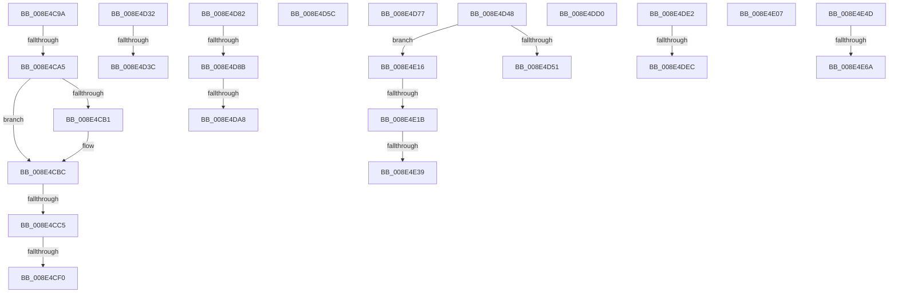

# sub_008E4C9A

- RVA: `0x008E4C9A`–`0x008E4E72` (길이 `472` bytes)
- VA: `0x00000001408E4C9A`
- 실행 섹션: `PAGE`
- PDB 이름 있음: `아니요`; PDB Function 태그: `아니요`
- unwind 정보 RVA: `0x000864CC`
- 디코드: `106`개 명령, `472/472` bytes 표시
- 미해석 바이트: `0` (있으면 어셈블리에 `.byte`로 보존)

> 이 문서는 커널 이미지의 기계어와 PDB 기호를 분석해 생성했습니다. 4번과 5번은 함수 원형과 자료형을 바이너리 사용 방식에서 추정한 C 해석이며 원본 소스 복구 결과는 아닙니다.

## 1. Dependencies

- 직접 호출 지점: **10**; 고유 호출 대상: **8**
- 직접 호출자로 확인된 함수: **0**
- RIP 상대 이미지 참조: **4**

### Outgoing calls
- `0x008E4CDE` → [PiDmObjectGetCachedObjectReference](../8F/PiDmObjectGetCachedObjectReference_function_008F7FB0.md) (function, `0x008F7FB0`)
- `0x008E4D1D` → [PiDmObjectGetCachedObjectPropertyData](../8F/PiDmObjectGetCachedObjectPropertyData_function_008F3430.md) (function, `0x008F3430`)
- `0x008E4D28` → [PiDmObjectRelease](PiDmObjectRelease_function_008E4F70.md) (function, `0x008E4F70`)
- `0x008E4D6D` → [memcpy](../../text/6C/memcpy_function_006C6840.md) (function, `0x006C6840`)
- `0x008E4DB7` → [RtlInitUnicodeString](../../text/42/RtlInitUnicodeString_function_0042A780.md) (function, `0x0042A780`)
- `0x008E4DC3` → [RtlGUIDFromString](../8F/RtlGUIDFromString_function_008F1EF0.md) (function, `0x008F1EF0`)
- `0x008E4DD8` → [ExfReleasePushLock](../../text/26/ExfReleasePushLock_function_002638D0.md) (function, `0x002638D0`)
- `0x008E4E0C` → [PiDmObjectRelease](PiDmObjectRelease_function_008E4F70.md) (function, `0x008E4F70`)
- `0x008E4E43` → [memcpy](../../text/6C/memcpy_function_006C6840.md) (function, `0x006C6840`)
- `0x008E4E5A` → [PiDmGetObject](../8D/PiDmGetObject_function_008DFAE0.md) (function, `0x008DFAE0`)

### Direct callers
- 이 함수 시작 RVA로 연결되는 직접 call은 확인되지 않았습니다. 간접 호출은 완전히 역산할 수 없습니다.

### Static image references
- `0x008E4CA8` → RVA `0x00011568` (`.rdata`; read)
- `0x008E4CB5` → RVA `0x00011570` (`.rdata`; read)
- `0x008E4CCD` → RVA `0x00011490` (`.rdata`; read)
- `0x008E4D3C` → RVA `0x00001B90` (`.rdata`; read)

## 2. Other-region calls and transfers

- 다른 실행 섹션으로 향하는 call: **4**
  - `0x008E4D6D` → [memcpy](../../text/6C/memcpy_function_006C6840.md) (`PAGE` → `.text`)
  - `0x008E4DB7` → [RtlInitUnicodeString](../../text/42/RtlInitUnicodeString_function_0042A780.md) (`PAGE` → `.text`)
  - `0x008E4DD8` → [ExfReleasePushLock](../../text/26/ExfReleasePushLock_function_002638D0.md) (`PAGE` → `.text`)
  - `0x008E4E43` → [memcpy](../../text/6C/memcpy_function_006C6840.md) (`PAGE` → `.text`)
- call이 아닌 외부 분기/꼬리 이동: **21**
  - `0x008E4C9F` → [sub_008E4A5E + 0x174](Unknown_function_008E4A5E.md) (`tail-transfer`)
  - `0x008E4CBF` → [sub_008E4A5E + 0x174](Unknown_function_008E4A5E.md) (`tail-transfer`)
  - `0x008E4CEA` → [sub_008E4A5E + 0x174](Unknown_function_008E4A5E.md) (`tail-transfer`)
  - `0x008E4D2D` → [sub_008E48BF + 0x155](Unknown_function_008E48BF.md) (`tail-transfer`)
  - `0x008E4D36` → [sub_008E48BF + 0x155](Unknown_function_008E48BF.md) (`tail-transfer`)
  - `0x008E4D43` → [sub_008E4A5E + 0x194](Unknown_function_008E4A5E.md) (`tail-transfer`)
  - `0x008E4D57` → [sub_008E48BF + 0xFB](Unknown_function_008E48BF.md) (`tail-transfer`)
  - `0x008E4D72` → [sub_008E48BF + 0xFB](Unknown_function_008E48BF.md) (`tail-transfer`)
  - `0x008E4D7D` → [sub_008E48BF + 0xFB](Unknown_function_008E48BF.md) (`tail-transfer`)
  - `0x008E4D85` → [sub_008E4F21 + 0x3A](Unknown_function_008E4F21.md) (`tail-transfer`)
  - `0x008E4DA2` → [sub_008E48BF + 0xF5](Unknown_function_008E48BF.md) (`tail-transfer`)
  - `0x008E4DCB` → [sub_008E48BF + 0xFB](Unknown_function_008E48BF.md) (`tail-transfer`)
  - `0x008E4DDD` → [sub_008E48BF + 0x136](Unknown_function_008E48BF.md) (`tail-transfer`)
  - `0x008E4DE6` → [sub_008E4A5E + 0x210](Unknown_function_008E4A5E.md) (`tail-transfer`)
  - `0x008E4E02` → [sub_008E4A5E + 0xC9](Unknown_function_008E4A5E.md) (`tail-transfer`)
  - `0x008E4E11` → [sub_008E48BF + 0x155](Unknown_function_008E48BF.md) (`tail-transfer`)
  - `0x008E4E19` → [sub_008E4E83](Unknown_function_008E4E83.md) (`tail-transfer`)
  - `0x008E4E33` → [sub_008E48BF + 0xF5](Unknown_function_008E48BF.md) (`tail-transfer`)
  - `0x008E4E48` → [sub_008E48BF + 0xFB](Unknown_function_008E48BF.md) (`tail-transfer`)
  - `0x008E4E64` → [sub_008E48BF + 0x155](Unknown_function_008E48BF.md) (`tail-transfer`)
  - `0x008E4E6D` → [sub_008E48BF + 0x22](Unknown_function_008E48BF.md) (`tail-transfer`)

## 3. Assembly (complete function range)

```asm
008E4C9A  41 83 79 10 02                  cmp dword ptr [r9 + 0x10], 2
008E4C9F  0F 85 2D FF FF FF               jne 0x1408e4bd2
008E4CA5  49 8B 01                        mov rax, qword ptr [r9]
008E4CA8  48 2B 05 B9 C8 72 FF            sub rax, qword ptr [rip - 0x8d3747]
008E4CAF  75 0B                           jne 0x1408e4cbc
008E4CB1  49 8B 41 08                     mov rax, qword ptr [r9 + 8]
008E4CB5  48 2B 05 B4 C8 72 FF            sub rax, qword ptr [rip - 0x8d374c]
008E4CBC  48 85 C0                        test rax, rax
008E4CBF  0F 85 0D FF FF FF               jne 0x1408e4bd2
008E4CC5  48 8D 44 24 70                  lea rax, [rsp + 0x70]
008E4CCA  4C 8B C6                        mov r8, rsi
008E4CCD  4C 8D 0D BC C7 72 FF            lea r9, [rip - 0x8d3844]
008E4CD4  48 89 44 24 20                  mov qword ptr [rsp + 0x20], rax
008E4CD9  49 8B D7                        mov rdx, r15
008E4CDC  8B CB                           mov ecx, ebx
008E4CDE  E8 CD 32 01 00                  call 0x1408f7fb0
008E4CE3  4C 8B 4C 24 48                  mov r9, qword ptr [rsp + 0x48]
008E4CE8  85 C0                           test eax, eax
008E4CEA  0F 88 E2 FE FF FF               js 0x1408e4bd2
008E4CF0  48 8B 5C 24 70                  mov rbx, qword ptr [rsp + 0x70]
008E4CF5  48 8B 4C 24 58                  mov rcx, qword ptr [rsp + 0x58]
008E4CFA  4C 8B C3                        mov r8, rbx
008E4CFD  48 89 4C 24 38                  mov qword ptr [rsp + 0x38], rcx
008E4D02  48 8B 4C 24 50                  mov rcx, qword ptr [rsp + 0x50]
008E4D07  48 8B 53 10                     mov rdx, qword ptr [rbx + 0x10]
008E4D0B  44 89 74 24 30                  mov dword ptr [rsp + 0x30], r14d
008E4D10  4C 89 64 24 28                  mov qword ptr [rsp + 0x28], r12
008E4D15  48 89 4C 24 20                  mov qword ptr [rsp + 0x20], rcx
008E4D1A  8B 4B 1C                        mov ecx, dword ptr [rbx + 0x1c]
008E4D1D  E8 0E E7 00 00                  call 0x1408f3430
008E4D22  48 8B CB                        mov rcx, rbx
008E4D25  44 8B F0                        mov r14d, eax
008E4D28  E8 43 02 00 00                  call 0x1408e4f70
008E4D2D  E9 E2 FC FF FF                  jmp 0x1408e4a14
008E4D32  41 83 FD 05                     cmp r13d, 5
008E4D36  0F 85 D8 FC FF FF               jne 0x1408e4a14
008E4D3C  4C 8D 05 4D CE 71 FF            lea r8, [rip - 0x8e31b3]
008E4D43  E9 AA FE FF FF                  jmp 0x1408e4bf2
008E4D48  83 E9 02                        sub ecx, 2
008E4D4B  0F 85 C5 00 00 00               jne 0x1408e4e16
008E4D51  41 BE 25 02 00 C0               mov r14d, 0xc0000225
008E4D57  E9 5E FC FF FF                  jmp 0x1408e49ba
008E4D5C  48 8B 92 80 00 00 00            mov rdx, qword ptr [rdx + 0x80]
008E4D63  49 8B CC                        mov rcx, r12
008E4D66  44 8B C0                        mov r8d, eax
008E4D69  48 8B 52 10                     mov rdx, qword ptr [rdx + 0x10]
008E4D6D  E8 CE 1A DE FF                  call 0x1406c6840
008E4D72  E9 43 FC FF FF                  jmp 0x1408e49ba
008E4D77  41 BE 16 00 00 C0               mov r14d, 0xc0000016
008E4D7D  E9 38 FC FF FF                  jmp 0x1408e49ba
008E4D82  83 F8 0D                        cmp eax, 0xd
008E4D85  0F 85 D0 01 00 00               jne 0x1408e4f5b
008E4D8B  83 7C 24 40 10                  cmp dword ptr [rsp + 0x40], 0x10
008E4D90  48 8B 4C 24 50                  mov rcx, qword ptr [rsp + 0x50]
008E4D95  89 01                           mov dword ptr [rcx], eax
008E4D97  48 8B 4C 24 58                  mov rcx, qword ptr [rsp + 0x58]
008E4D9C  C7 01 10 00 00 00               mov dword ptr [rcx], 0x10
008E4DA2  0F 82 0C FC FF FF               jb 0x1408e49b4
008E4DA8  48 8B 92 80 00 00 00            mov rdx, qword ptr [rdx + 0x80]
008E4DAF  48 8D 4D 88                     lea rcx, [rbp - 0x78]
008E4DB3  48 8B 52 10                     mov rdx, qword ptr [rdx + 0x10]
008E4DB7  E8 C4 59 B4 FF                  call 0x14042a780
008E4DBC  49 8B D4                        mov rdx, r12
008E4DBF  48 8D 4D 88                     lea rcx, [rbp - 0x78]
008E4DC3  E8 28 D1 00 00                  call 0x1408f1ef0
008E4DC8  44 8B F0                        mov r14d, eax
008E4DCB  E9 EA FB FF FF                  jmp 0x1408e49ba
008E4DD0  48 8B 5C 24 48                  mov rbx, qword ptr [rsp + 0x48]
008E4DD5  48 8B CB                        mov rcx, rbx
008E4DD8  E8 F3 EA 97 FF                  call 0x1402638d0
008E4DDD  E9 13 FC FF FF                  jmp 0x1408e49f5
008E4DE2  66 83 FA 08                     cmp dx, 8
008E4DE6  0F 86 82 FE FF FF               jbe 0x1408e4c6e
008E4DEC  B8 F8 FF 00 00                  mov eax, 0xfff8
008E4DF1  66 03 D0                        add dx, ax
008E4DF4  49 83 C3 08                     add r11, 8
008E4DF8  66 89 54 24 60                  mov word ptr [rsp + 0x60], dx
008E4DFD  4C 89 5C 24 68                  mov qword ptr [rsp + 0x68], r11
008E4E02  E9 20 FD FF FF                  jmp 0x1408e4b27
008E4E07  48 8B 4C 24 48                  mov rcx, qword ptr [rsp + 0x48]
008E4E0C  E8 5F 01 00 00                  call 0x1408e4f70
008E4E11  E9 FE FB FF FF                  jmp 0x1408e4a14
008E4E16  83 E9 01                        sub ecx, 1
008E4E19  75 68                           jne 0x1408e4e83
008E4E1B  8B 42 78                        mov eax, dword ptr [rdx + 0x78]
008E4E1E  48 8B 4C 24 50                  mov rcx, qword ptr [rsp + 0x50]
008E4E23  89 01                           mov dword ptr [rcx], eax
008E4E25  8B 42 7C                        mov eax, dword ptr [rdx + 0x7c]
008E4E28  48 8B 4C 24 58                  mov rcx, qword ptr [rsp + 0x58]
008E4E2D  89 01                           mov dword ptr [rcx], eax
008E4E2F  39 44 24 40                     cmp dword ptr [rsp + 0x40], eax
008E4E33  0F 82 7B FB FF FF               jb 0x1408e49b4
008E4E39  44 8B C0                        mov r8d, eax
008E4E3C  48 83 EA 80                     sub rdx, -0x80
008E4E40  49 8B CC                        mov rcx, r12
008E4E43  E8 F8 19 DE FF                  call 0x1406c6840
008E4E48  E9 6D FB FF FF                  jmp 0x1408e49ba
008E4E4D  48 8B 54 24 78                  mov rdx, qword ptr [rsp + 0x78]
008E4E52  4C 8D 44 24 48                  lea r8, [rsp + 0x48]
008E4E57  41 8B CD                        mov ecx, r13d
008E4E5A  E8 81 AC FF FF                  call 0x1408dfae0
008E4E5F  44 8B F0                        mov r14d, eax
008E4E62  85 C0                           test eax, eax
008E4E64  0F 88 AA FB FF FF               js 0x1408e4a14
008E4E6A  41 B7 01                        mov r15b, 1
008E4E6D  E9 6F FA FF FF                  jmp 0x1408e48e1
```

## 4. C-style interpretation (structured pseudocode)

```c
__int64 __fastcall sub_008E4C9A(__int64 a1, __int64 a2, __int64 a3, __int64 a4, __int64 a5, __int64 a6, __int64 a7, __int64 a8, __int64 a9, __int64 a10, __int64 a11, __int64 a12, __int64 a13, __int64 a14)
{
    __int64 result;
    unsigned __int64 v_stack_p20;
    unsigned __int64 v_stack_p28;
    unsigned int v_stack_p30;
    unsigned __int64 v_stack_p38;
    unsigned int v_stack_p40;
    unsigned __int64 v_stack_p48;
    unsigned __int64 v_stack_p50;
    unsigned __int64 v_stack_p58;
    unsigned __int16 v_stack_p60;
    unsigned __int64 v_stack_p68;
    unsigned __int64 v_stack_p78;

    result = (*(unsigned __int64 *)(a4)) - (*(unsigned __int64 *)(v_rip - 9254727));
    if (!(condition_is_not_equal)) {
        result = *(unsigned __int64 *)(a4 + 8);
        result = (result) - (*(unsigned __int64 *)(v_rip - 9254732));
    }
    v_stack_p20 = a14;
    result = PiDmObjectGetCachedObjectReference((unsigned int)((unsigned int)(v_rbx)), v_r15, v_rsi, v_rip - 9254980);
    v_stack_p38 = a11;
    v_stack_p30 = (unsigned int)(v_r14);
    v_stack_p28 = v_r12;
    v_stack_p20 = a10;
    result = PiDmObjectGetCachedObjectPropertyData((unsigned int)(*(unsigned int *)(a14 + 28)), *(unsigned __int64 *)(a14 + 16), a14, a9);
    result = PiDmObjectRelease(a14, *(unsigned __int64 *)(a14 + 16), a14, a9);
}
```

## 5. (Beta) C Style

```c
int64_t sub_008E4C9A(int64_t Arg1, int64_t Arg2, int64_t Arg3, void *Arg4, uint64_t Arg5, uint64_t Arg6, uint64_t Arg7, uint64_t Arg8, int64_t Arg9, int64_t Arg10, int64_t Arg11, uint64_t Arg12, uint64_t Arg13, void *Arg14)
{
    uint8_t *arg4 = (uint8_t *)Arg4;
    uint8_t *arg14 = (uint8_t *)Arg14;

    int64_t result;
    uint64_t v_stack_p20;
    uint64_t v_stack_p28;
    uint32_t v_stack_p30;
    uint64_t v_stack_p38;
    uint32_t v_stack_p40;
    uint64_t v_stack_p48;
    uint64_t v_stack_p50;
    uint64_t v_stack_p58;
    uint16_t v_stack_p60;
    uint64_t v_stack_p68;
    uint64_t v_stack_p78;

    result = (*(uint64_t *)(arg4)) - (*(uint64_t *)(v_rip - 0x8D3747));
    if (!(condition_is_not_equal)) {
        result = *(uint64_t *)(arg4 + 0x8);
        result = (result) - (*(uint64_t *)(v_rip - 0x8D374C));
    }
    v_stack_p20 = Arg14;
    result = PiDmObjectGetCachedObjectReference((uint32_t)((uint32_t)(local_rbx)), local_r15, local_rsi, v_rip - 9254980);
    v_stack_p38 = Arg11;
    v_stack_p30 = (uint32_t)(local_r14);
    v_stack_p28 = local_r12;
    v_stack_p20 = Arg10;
    result = PiDmObjectGetCachedObjectPropertyData((uint32_t)(*(uint32_t *)(arg14 + 0x1C)), *(uint64_t *)(arg14 + 0x10), Arg14, Arg9);
    result = PiDmObjectRelease(Arg14, *(uint64_t *)(arg14 + 0x10), Arg14, Arg9);
}
```

### 관측된 메모리 오프셋

구조체 형식이 확인되지 않은 접근은 인자 기준의 오프셋으로만 기록했습니다.

| 기준 인자 | 오프셋 표현 | 폭 (bit) | 접근 |
|---|---:|---:|---|
| `Arg4` | `+ 0x0` | `64` | `R` |
| `Arg4` | `+ 0x8` | `64` | `R` |
| `Arg4` | `+ 0x10` | `32` | `R` |
| `Arg14` | `+ 0x10` | `64` | `R` |
| `Arg14` | `+ 0x1C` | `32` | `R` |

## 6. Execution-region graph

[열기: 2D/3D 그래프와 함수 탐색 컨트롤 패널](../../../control-panel.html?section=page&rva=0x008E4C9A&view=graph)

- 2D 그래프는 위에서 아래로 흐르고, 3D 그래프는 빈 공간을 드래그해 회전합니다. Shift+드래그는 이동, 휠은 확대·축소, 함수 노드 선택은 대상 보고서 이동입니다.

### Static fallback


