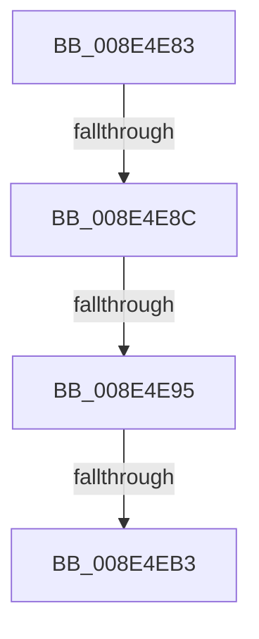

# sub_008E4E83

- RVA: `0x008E4E83`–`0x008E4ECA` (길이 `71` bytes)
- VA: `0x00000001408E4E83`
- 실행 섹션: `PAGE`
- PDB 이름 있음: `아니요`; PDB Function 태그: `아니요`
- unwind 정보 RVA: `0x000864F8`
- 디코드: `17`개 명령, `71/71` bytes 표시
- 미해석 바이트: `0` (있으면 어셈블리에 `.byte`로 보존)

> 이 문서는 커널 이미지의 기계어와 PDB 기호를 분석해 생성했습니다. 4번과 5번은 함수 원형과 자료형을 바이너리 사용 방식에서 추정한 C 해석이며 원본 소스 복구 결과는 아닙니다.

## 1. Dependencies

- 직접 호출 지점: **1**; 고유 호출 대상: **1**
- 직접 호출자로 확인된 함수: **0**
- RIP 상대 이미지 참조: **0**

### Outgoing calls
- `0x008E4EC0` → [memcpy](../../text/6C/memcpy_function_006C6840.md) (function, `0x006C6840`)

### Direct callers
- 이 함수 시작 RVA로 연결되는 직접 call은 확인되지 않았습니다. 간접 호출은 완전히 역산할 수 없습니다.

### Static image references
- 디코드된 RIP-relative 메모리 참조가 없습니다.

## 2. Other-region calls and transfers

- 다른 실행 섹션으로 향하는 call: **1**
  - `0x008E4EC0` → [memcpy](../../text/6C/memcpy_function_006C6840.md) (`PAGE` → `.text`)
- call이 아닌 외부 분기/꼬리 이동: **4**
  - `0x008E4E86` → [sub_008E4F21 + 0xB](Unknown_function_008E4F21.md) (`tail-transfer`)
  - `0x008E4E8F` → [sub_008E4F21](Unknown_function_008E4F21.md) (`tail-transfer`)
  - `0x008E4EAD` → [sub_008E48BF + 0xF5](Unknown_function_008E48BF.md) (`tail-transfer`)
  - `0x008E4EC5` → [sub_008E48BF + 0xFB](Unknown_function_008E48BF.md) (`tail-transfer`)

## 3. Assembly (complete function range)

```asm
008E4E83  83 E9 01                        sub ecx, 1
008E4E86  0F 84 A0 00 00 00               je 0x1408e4f2c
008E4E8C  83 F9 01                        cmp ecx, 1
008E4E8F  0F 85 8C 00 00 00               jne 0x1408e4f21
008E4E95  8B 42 78                        mov eax, dword ptr [rdx + 0x78]
008E4E98  48 8B 4C 24 50                  mov rcx, qword ptr [rsp + 0x50]
008E4E9D  89 01                           mov dword ptr [rcx], eax
008E4E9F  8B 42 7C                        mov eax, dword ptr [rdx + 0x7c]
008E4EA2  48 8B 4C 24 58                  mov rcx, qword ptr [rsp + 0x58]
008E4EA7  89 01                           mov dword ptr [rcx], eax
008E4EA9  39 44 24 40                     cmp dword ptr [rsp + 0x40], eax
008E4EAD  0F 82 01 FB FF FF               jb 0x1408e49b4
008E4EB3  48 8B 92 80 00 00 00            mov rdx, qword ptr [rdx + 0x80]
008E4EBA  44 8B C0                        mov r8d, eax
008E4EBD  49 8B CC                        mov rcx, r12
008E4EC0  E8 7B 19 DE FF                  call 0x1406c6840
008E4EC5  E9 F0 FA FF FF                  jmp 0x1408e49ba
```

## 4. C-style interpretation (structured pseudocode)

```c
__int64 __fastcall sub_008E4E83(int a1, __int64 a2, __int64 a3, __int64 a4, __int64 a5, __int64 a6, __int64 a7, unsigned int a8, __int64 a9, __int64 a10, __int64 a11)
{
    __int64 result;

    a1 = (unsigned int)((a1) - (1));
    *(unsigned int *)(a10) = (unsigned int)((unsigned int)(*(unsigned int *)(a2 + 120)));
    *(unsigned int *)(a11) = (unsigned int)((unsigned int)(*(unsigned int *)(a2 + 124)));
    result = memcpy(v_r12, *(unsigned __int64 *)(a2 + 128), (unsigned int)((unsigned int)((unsigned int)(*(unsigned int *)(a2 + 124)))), a4);
}
```

## 5. (Beta) C Style

```c
int64_t sub_008E4E83(int32_t Arg1, void *Arg2, int64_t Arg3, int64_t Arg4, uint64_t Arg5, uint64_t Arg6, uint64_t Arg7, uint32_t Arg8, uint64_t Arg9, void *Arg10, void *Arg11)
{
    uint8_t *arg2 = (uint8_t *)Arg2;
    uint8_t *arg10 = (uint8_t *)Arg10;
    uint8_t *arg11 = (uint8_t *)Arg11;

    int64_t result;

    Arg1 = (uint32_t)((Arg1) - (1));
    *(uint32_t *)(arg10) = (uint32_t)((uint32_t)(*(uint32_t *)(arg2 + 0x78)));
    *(uint32_t *)(arg11) = (uint32_t)((uint32_t)(*(uint32_t *)(arg2 + 0x7C)));
    result = memcpy(local_r12, *(uint64_t *)(arg2 + 0x80), (uint32_t)((uint32_t)((uint32_t)(*(uint32_t *)(arg2 + 0x7C)))), Arg4);
}
```

### 관측된 메모리 오프셋

구조체 형식이 확인되지 않은 접근은 인자 기준의 오프셋으로만 기록했습니다.

| 기준 인자 | 오프셋 표현 | 폭 (bit) | 접근 |
|---|---:|---:|---|
| `Arg2` | `+ 0x78` | `32` | `R` |
| `Arg2` | `+ 0x7C` | `32` | `R` |
| `Arg2` | `+ 0x80` | `64` | `R` |
| `Arg10` | `+ 0x0` | `32` | `W` |
| `Arg11` | `+ 0x0` | `32` | `W` |

## 6. Execution-region graph

[열기: 2D/3D 그래프와 함수 탐색 컨트롤 패널](../../../control-panel.html?section=page&rva=0x008E4E83&view=graph)

- 2D 그래프는 위에서 아래로 흐르고, 3D 그래프는 빈 공간을 드래그해 회전합니다. Shift+드래그는 이동, 휠은 확대·축소, 함수 노드 선택은 대상 보고서 이동입니다.

### Static fallback


