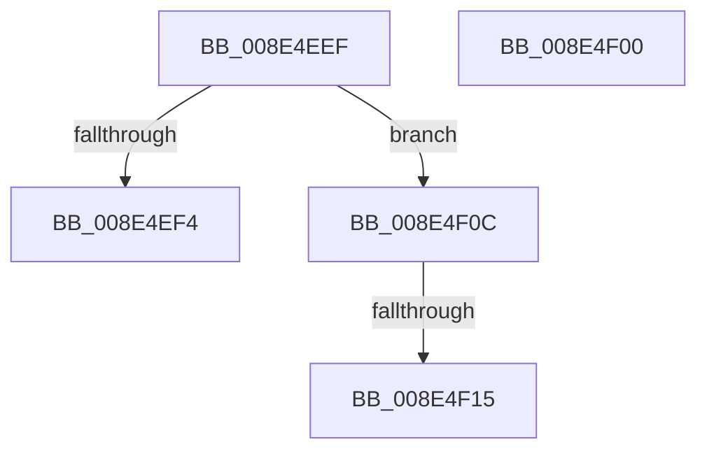

# sub_008E4EEF

- RVA: `0x008E4EEF`–`0x008E4F21` (길이 `50` bytes)
- VA: `0x00000001408E4EEF`
- 실행 섹션: `PAGE`
- PDB 이름 있음: `아니요`; PDB Function 태그: `아니요`
- unwind 정보 RVA: `0x0008653C`
- 디코드: `10`개 명령, `50/50` bytes 표시
- 미해석 바이트: `0` (있으면 어셈블리에 `.byte`로 보존)

> 이 문서는 커널 이미지의 기계어와 PDB 기호를 분석해 생성했습니다. 4번과 5번은 함수 원형과 자료형을 바이너리 사용 방식에서 추정한 C 해석이며 원본 소스 복구 결과는 아닙니다.

## 1. Dependencies

- 직접 호출 지점: **0**; 고유 호출 대상: **0**
- 직접 호출자로 확인된 함수: **0**
- RIP 상대 이미지 참조: **3**

### Outgoing calls
- 직접 디코드된 call 명령이 없습니다.

### Direct callers
- 이 함수 시작 RVA로 연결되는 직접 call은 확인되지 않았습니다. 간접 호출은 완전히 역산할 수 없습니다.

### Static image references
- `0x008E4EF4` → RVA `0x00F8B5E0` (`.data`; read)
- `0x008E4F00` → RVA `0x00F8B500` (`.data`; read)
- `0x008E4F15` → RVA `0x00F8B420` (`.data`; read)

## 2. Other-region calls and transfers

- 다른 실행 섹션으로 향하는 call: **0**
- call이 아닌 외부 분기/꼬리 이동: **4**
  - `0x008E4EFB` → [sub_008E4A5E + 0x1C](Unknown_function_008E4A5E.md) (`tail-transfer`)
  - `0x008E4F07` → [sub_008E4A5E + 0x1C](Unknown_function_008E4A5E.md) (`tail-transfer`)
  - `0x008E4F0F` → [sub_008E4A5E + 0x1C](Unknown_function_008E4A5E.md) (`tail-transfer`)
  - `0x008E4F1C` → [sub_008E4A5E + 0x1C](Unknown_function_008E4A5E.md) (`tail-transfer`)

## 3. Assembly (complete function range)

```asm
008E4EEF  83 E9 01                        sub ecx, 1
008E4EF2  75 18                           jne 0x1408e4f0c
008E4EF4  48 8D 3D E5 66 6A 00            lea rdi, [rip + 0x6a66e5]
008E4EFB  E9 7A FB FF FF                  jmp 0x1408e4a7a
008E4F00  48 8D 3D F9 65 6A 00            lea rdi, [rip + 0x6a65f9]
008E4F07  E9 6E FB FF FF                  jmp 0x1408e4a7a
008E4F0C  83 F9 01                        cmp ecx, 1
008E4F0F  0F 85 65 FB FF FF               jne 0x1408e4a7a
008E4F15  48 8D 3D 04 65 6A 00            lea rdi, [rip + 0x6a6504]
008E4F1C  E9 59 FB FF FF                  jmp 0x1408e4a7a
```

## 4. C-style interpretation (structured pseudocode)

```c
void __fastcall sub_008E4EEF(int a1)
{
    a1 = (unsigned int)((a1) - (1));
    if (condition_is_not_equal) goto loc_008E4F0C;
loc_008E4F0C:
}
```

## 5. (Beta) C Style

```c
void sub_008E4EEF(int32_t Arg1)
{
    Arg1 = (uint32_t)((Arg1) - (1));
    if (condition_is_not_equal) goto loc_008E4F0C;
loc_008E4F0C:
}
```

## 6. Execution-region graph

[열기: 2D/3D 그래프와 함수 탐색 컨트롤 패널](../../../control-panel.html?section=page&rva=0x008E4EEF&view=graph)

- 2D 그래프는 위에서 아래로 흐르고, 3D 그래프는 빈 공간을 드래그해 회전합니다. Shift+드래그는 이동, 휠은 확대·축소, 함수 노드 선택은 대상 보고서 이동입니다.

### Static fallback


