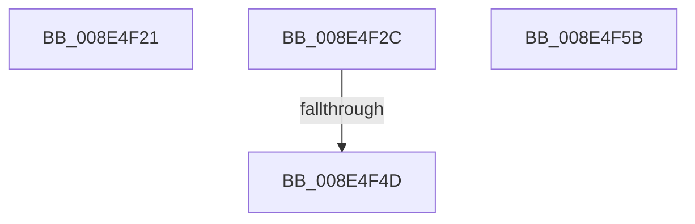

# sub_008E4F21

- RVA: `0x008E4F21`–`0x008E4F66` (길이 `69` bytes)
- VA: `0x00000001408E4F21`
- 실행 섹션: `PAGE`
- PDB 이름 있음: `아니요`; PDB Function 태그: `아니요`
- unwind 정보 RVA: `0x00086550`
- 디코드: `13`개 명령, `69/69` bytes 표시
- 미해석 바이트: `0` (있으면 어셈블리에 `.byte`로 보존)

> 이 문서는 커널 이미지의 기계어와 PDB 기호를 분석해 생성했습니다. 4번과 5번은 함수 원형과 자료형을 바이너리 사용 방식에서 추정한 C 해석이며 원본 소스 복구 결과는 아닙니다.

## 1. Dependencies

- 직접 호출 지점: **0**; 고유 호출 대상: **0**
- 직접 호출자로 확인된 함수: **0**
- RIP 상대 이미지 참조: **0**

### Outgoing calls
- 직접 디코드된 call 명령이 없습니다.

### Direct callers
- 이 함수 시작 RVA로 연결되는 직접 call은 확인되지 않았습니다. 간접 호출은 완전히 역산할 수 없습니다.

### Static image references
- 디코드된 RIP-relative 메모리 참조가 없습니다.

## 2. Other-region calls and transfers

- 다른 실행 섹션으로 향하는 call: **0**
- call이 아닌 외부 분기/꼬리 이동: **4**
  - `0x008E4F27` → [sub_008E48BF + 0xFB](Unknown_function_008E48BF.md) (`tail-transfer`)
  - `0x008E4F47` → [sub_008E48BF + 0xF5](Unknown_function_008E48BF.md) (`tail-transfer`)
  - `0x008E4F56` → [sub_008E48BF + 0xFB](Unknown_function_008E48BF.md) (`tail-transfer`)
  - `0x008E4F61` → [sub_008E48BF + 0xFB](Unknown_function_008E48BF.md) (`tail-transfer`)

## 3. Assembly (complete function range)

```asm
008E4F21  41 BE E5 00 00 C0               mov r14d, 0xc00000e5
008E4F27  E9 8E FA FF FF                  jmp 0x1408e49ba
008E4F2C  83 7C 24 40 10                  cmp dword ptr [rsp + 0x40], 0x10
008E4F31  48 8B 4C 24 50                  mov rcx, qword ptr [rsp + 0x50]
008E4F36  C7 01 0D 00 00 00               mov dword ptr [rcx], 0xd
008E4F3C  48 8B 4C 24 58                  mov rcx, qword ptr [rsp + 0x58]
008E4F41  C7 01 10 00 00 00               mov dword ptr [rcx], 0x10
008E4F47  0F 82 67 FA FF FF               jb 0x1408e49b4
008E4F4D  0F 10 42 78                     movups xmm0, xmmword ptr [rdx + 0x78]
008E4F51  41 0F 11 04 24                  movups xmmword ptr [r12], xmm0
008E4F56  E9 5F FA FF FF                  jmp 0x1408e49ba
008E4F5B  41 BE E5 00 00 C0               mov r14d, 0xc00000e5
008E4F61  E9 54 FA FF FF                  jmp 0x1408e49ba
```

## 4. C-style interpretation (structured pseudocode)

```c
void __fastcall sub_008E4F21(__int64 a1, __int64 a2)
{
    unsigned int v_stack_p40;
    unsigned __int64 v_stack_p50;
    unsigned __int64 v_stack_p58;
}
```

## 5. (Beta) C Style

```c
void sub_008E4F21(int64_t Arg1, int64_t Arg2)
{
    uint32_t v_stack_p40;
    uint64_t v_stack_p50;
    uint64_t v_stack_p58;
}
```

## 6. Execution-region graph

[열기: 2D/3D 그래프와 함수 탐색 컨트롤 패널](../../../control-panel.html?section=page&rva=0x008E4F21&view=graph)

- 2D 그래프는 위에서 아래로 흐르고, 3D 그래프는 빈 공간을 드래그해 회전합니다. Shift+드래그는 이동, 휠은 확대·축소, 함수 노드 선택은 대상 보고서 이동입니다.

### Static fallback


