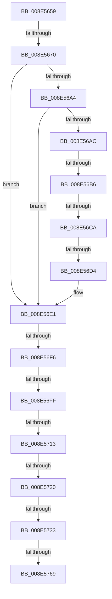

# sub_008E5659

- RVA: `0x008E5659`–`0x008E577B` (길이 `290` bytes)
- VA: `0x00000001408E5659`
- 실행 섹션: `PAGE`
- PDB 이름 있음: `아니요`; PDB Function 태그: `아니요`
- unwind 정보 RVA: `0x00086634`
- 디코드: `65`개 명령, `290/290` bytes 표시
- 미해석 바이트: `0` (있으면 어셈블리에 `.byte`로 보존)

> 이 문서는 커널 이미지의 기계어와 PDB 기호를 분석해 생성했습니다. 4번과 5번은 함수 원형과 자료형을 바이너리 사용 방식에서 추정한 C 해석이며 원본 소스 복구 결과는 아닙니다.

## 1. Dependencies

- 직접 호출 지점: **6**; 고유 호출 대상: **6**
- 직접 호출자로 확인된 함수: **0**
- RIP 상대 이미지 참조: **3**

### Outgoing calls
- `0x008E568A` → [ExAcquireFastMutex](../../text/20/ExAcquireFastMutex_function_0020E5A0.md) (function, `0x0020E5A0`)
- `0x008E569A` → [RtlLookupElementGenericTableAvl](../../text/3F/RtlLookupElementGenericTableAvl_function_003FEFB0.md) (function, `0x003FEFB0`)
- `0x008E56DC` → [ObfReferenceObjectWithTag](../../text/21/ObfReferenceObjectWithTag_function_00210710.md) (function, `0x00210710`)
- `0x008E56E8` → [ExReleaseFastMutex](../../text/25/ExReleaseFastMutex_function_002519C0.md) (function, `0x002519C0`)
- `0x008E573A` → [PiControlGetUserFlagsFromDeviceNode](PiControlGetUserFlagsFromDeviceNode_function_008E5888.md) (function, `0x008E5888`)
- `0x008E575C` → [ObfDereferenceObjectWithTag](../../text/2F/ObfDereferenceObjectWithTag_function_002F78E0.md) (function, `0x002F78E0`)

### Direct callers
- 이 함수 시작 RVA로 연결되는 직접 call은 확인되지 않았습니다. 간접 호출은 완전히 역산할 수 없습니다.

### Static image references
- `0x008E567C` → RVA `0x00F8CB40` (`.data`; read)
- `0x008E5693` → RVA `0x00F8CB80` (`.data`; read)
- `0x008E5713` → RVA `0x00F8C438` (`.data`; read)

## 2. Other-region calls and transfers

- 다른 실행 섹션으로 향하는 call: **5**
  - `0x008E568A` → [ExAcquireFastMutex](../../text/20/ExAcquireFastMutex_function_0020E5A0.md) (`PAGE` → `.text`)
  - `0x008E569A` → [RtlLookupElementGenericTableAvl](../../text/3F/RtlLookupElementGenericTableAvl_function_003FEFB0.md) (`PAGE` → `.text`)
  - `0x008E56DC` → [ObfReferenceObjectWithTag](../../text/21/ObfReferenceObjectWithTag_function_00210710.md) (`PAGE` → `.text`)
  - `0x008E56E8` → [ExReleaseFastMutex](../../text/25/ExReleaseFastMutex_function_002519C0.md) (`PAGE` → `.text`)
  - `0x008E575C` → [ObfDereferenceObjectWithTag](../../text/2F/ObfDereferenceObjectWithTag_function_002F78E0.md) (`PAGE` → `.text`)
- call이 아닌 외부 분기/꼬리 이동: **10**
  - `0x008E566A` → [sub_008E5795](Unknown_function_008E5795.md) (`tail-transfer`)
  - `0x008E56B0` → [sub_008E5795 + 0x74](Unknown_function_008E5795.md) (`tail-transfer`)
  - `0x008E56C4` → [sub_008E5795 + 0x74](Unknown_function_008E5795.md) (`tail-transfer`)
  - `0x008E56CE` → [sub_008E5795 + 0x74](Unknown_function_008E5795.md) (`tail-transfer`)
  - `0x008E56F0` → [sub_008E5795 + 0x5B](Unknown_function_008E5795.md) (`tail-transfer`)
  - `0x008E56F9` → [sub_008E5839](Unknown_function_008E5839.md) (`tail-transfer`)
  - `0x008E570D` → [sub_008E5795 + 0x90](Unknown_function_008E5795.md) (`tail-transfer`)
  - `0x008E571A` → [sub_008E5795 + 0x7C](Unknown_function_008E5795.md) (`tail-transfer`)
  - `0x008E572D` → [sub_008E5839 + 0x14](Unknown_function_008E5839.md) (`tail-transfer`)
  - `0x008E5763` → [sub_008E5839 + 0x30](Unknown_function_008E5839.md) (`tail-transfer`)

## 3. Assembly (complete function range)

```asm
008E5659  49 89 5B 08                     mov qword ptr [r11 + 8], rbx
008E565D  48 8B 5E 08                     mov rbx, qword ptr [rsi + 8]
008E5661  49 89 7B 18                     mov qword ptr [r11 + 0x18], rdi
008E5665  8B F9                           mov edi, ecx
008E5667  45 84 C9                        test r9b, r9b
008E566A  0F 85 25 01 00 00               jne 0x1408e5795
008E5670  48 89 5D F7                     mov qword ptr [rbp - 9], rbx
008E5674  48 8D 45 EF                     lea rax, [rbp - 0x11]
008E5678  4C 89 6D 0F                     mov qword ptr [rbp + 0xf], r13
008E567C  48 8D 0D BD 74 6A 00            lea rcx, [rip + 0x6a74bd]
008E5683  48 89 45 17                     mov qword ptr [rbp + 0x17], rax
008E5687  49 8B DD                        mov rbx, r13
008E568A  E8 11 8F 92 FF                  call 0x14020e5a0
008E568F  48 8D 55 0F                     lea rdx, [rbp + 0xf]
008E5693  48 8D 0D E6 74 6A 00            lea rcx, [rip + 0x6a74e6]
008E569A  E8 11 99 B1 FF                  call 0x1403fefb0
008E569F  48 85 C0                        test rax, rax
008E56A2  74 3D                           je 0x1408e56e1
008E56A4  48 8B 18                        mov rbx, qword ptr [rax]
008E56A7  48 85 DB                        test rbx, rbx
008E56AA  74 35                           je 0x1408e56e1
008E56AC  66 83 3B 03                     cmp word ptr [rbx], 3
008E56B0  0F 85 53 01 00 00               jne 0x1408e5809
008E56B6  48 8B 83 38 01 00 00            mov rax, qword ptr [rbx + 0x138]
008E56BD  48 8B 48 28                     mov rcx, qword ptr [rax + 0x28]
008E56C1  48 85 C9                        test rcx, rcx
008E56C4  0F 84 3F 01 00 00               je 0x1408e5809
008E56CA  48 39 59 20                     cmp qword ptr [rcx + 0x20], rbx
008E56CE  0F 85 35 01 00 00               jne 0x1408e5809
008E56D4  BA 50 6E 70 53                  mov edx, 0x53706e50
008E56D9  48 8B CB                        mov rcx, rbx
008E56DC  E8 2F B0 92 FF                  call 0x140210710
008E56E1  48 8D 0D 58 74 6A 00            lea rcx, [rip + 0x6a7458]
008E56E8  E8 D3 C2 96 FF                  call 0x1402519c0
008E56ED  45 84 F6                        test r14b, r14b
008E56F0  0F 85 FA 00 00 00               jne 0x1408e57f0
008E56F6  48 85 DB                        test rbx, rbx
008E56F9  0F 84 3A 01 00 00               je 0x1408e5839
008E56FF  48 8B 83 38 01 00 00            mov rax, qword ptr [rbx + 0x138]
008E5706  48 8B 78 28                     mov rdi, qword ptr [rax + 0x28]
008E570A  48 85 FF                        test rdi, rdi
008E570D  0F 84 12 01 00 00               je 0x1408e5825
008E5713  48 3B 3D 1E 6D 6A 00            cmp rdi, qword ptr [rip + 0x6a6d1e]
008E571A  0F 84 F1 00 00 00               je 0x1408e5811
008E5720  44 8B 76 1C                     mov r14d, dword ptr [rsi + 0x1c]
008E5724  8B 46 10                        mov eax, dword ptr [rsi + 0x10]
008E5727  41 83 E6 01                     and r14d, 1
008E572B  85 C0                           test eax, eax
008E572D  0F 85 1A 01 00 00               jne 0x1408e584d
008E5733  48 8D 56 14                     lea rdx, [rsi + 0x14]
008E5737  48 8B CF                        mov rcx, rdi
008E573A  E8 49 01 00 00                  call 0x1408e5888
008E573F  8B 87 94 01 00 00               mov eax, dword ptr [rdi + 0x194]
008E5745  89 46 18                        mov dword ptr [rsi + 0x18], eax
008E5748  8B 87 98 01 00 00               mov eax, dword ptr [rdi + 0x198]
008E574E  41 8B FD                        mov edi, r13d
008E5751  89 46 20                        mov dword ptr [rsi + 0x20], eax
008E5754  BA 50 6E 70 53                  mov edx, 0x53706e50
008E5759  48 8B CB                        mov rcx, rbx
008E575C  E8 7F 21 A1 FF                  call 0x1402f78e0
008E5761  85 FF                           test edi, edi
008E5763  0F 88 00 01 00 00               js 0x1408e5869
008E5769  48 8B 9C 24 C0 00 00 00         mov rbx, qword ptr [rsp + 0xc0]
008E5771  8B C7                           mov eax, edi
008E5773  48 8B BC 24 D0 00 00 00         mov rdi, qword ptr [rsp + 0xd0]
```

## 4. C-style interpretation (structured pseudocode)

```c
__int64 __fastcall sub_008E5659(int a1, __int64 a2, __int64 a3, unsigned __int8 a4, __int64 a5, __int64 a6, __int64 a7, __int64 a8, __int64 a9, __int64 a10, __int64 a11, __int64 a12, __int64 a13, __int64 a14, __int64 a15, __int64 a16, __int64 a17, __int64 a18, __int64 a19, __int64 a20, __int64 a21, __int64 a22, __int64 a23, __int64 a24, __int64 a25, __int64 a26)
{
    __int64 result;
    __int64 v_r14;

    *(unsigned __int64 *)(v_r11 + 8) = v_rbx;
    *(unsigned __int64 *)(v_r11 + 24) = v_rdi;
    *(unsigned __int64 *)(v_rbp - 9) = *(unsigned __int64 *)(v_rsi + 8);
    *(unsigned __int64 *)(v_rbp + 15) = v_r13;
    *(unsigned __int64 *)(v_rbp + 23) = v_rbp - 17;
    result = ExAcquireFastMutex(v_rip + 6976701, a2, a3, a4);
    result = RtlLookupElementGenericTableAvl(v_rip + 6976742, v_rbp + 15, a3, a4);
    if (result == 0) goto loc_008E56E1;
    if (*(unsigned __int64 *)(result) == 0) goto loc_008E56E1;
    result = ObfReferenceObjectWithTag(*(unsigned __int64 *)(result), (unsigned int)(0x53706E50ULL), a3, a4);
loc_008E56E1:
    result = ExReleaseFastMutex(v_rip + 6976600, (unsigned int)(0x53706E50ULL), a3, a4);
    v_r14 = (unsigned int)(((unsigned int)(*(unsigned int *)(v_rsi + 28))) & (1));
    result = PiControlGetUserFlagsFromDeviceNode(*(unsigned __int64 *)(*(unsigned __int64 *)(*(unsigned __int64 *)(result) + 312) + 40), v_rsi + 20, a3, a4);
    *(unsigned int *)(v_rsi + 24) = (unsigned int)((unsigned int)(*(unsigned int *)(*(unsigned __int64 *)(*(unsigned __int64 *)(*(unsigned __int64 *)(result) + 312) + 40) + 404)));
    *(unsigned int *)(v_rsi + 32) = (unsigned int)((unsigned int)(*(unsigned int *)(*(unsigned __int64 *)(*(unsigned __int64 *)(*(unsigned __int64 *)(result) + 312) + 40) + 408)));
    result = ObfDereferenceObjectWithTag(*(unsigned __int64 *)(result), (unsigned int)(0x53706E50ULL), a3, a4);
    return (unsigned int)((unsigned int)((unsigned int)((unsigned int)(v_r13))));
}
```

## 5. (Beta) C Style

```c
int64_t sub_008E5659(int32_t Arg1, int64_t Arg2, int64_t Arg3, uint8_t Arg4, uint64_t Arg5, uint64_t Arg6, uint64_t Arg7, uint64_t Arg8, uint64_t Arg9, uint64_t Arg10, uint64_t Arg11, uint64_t Arg12, uint64_t Arg13, uint64_t Arg14, uint64_t Arg15, uint64_t Arg16, uint64_t Arg17, uint64_t Arg18, uint64_t Arg19, uint64_t Arg20, uint64_t Arg21, uint64_t Arg22, uint64_t Arg23, int64_t Arg24, uint64_t Arg25, int64_t Arg26)
{
    int64_t result;
    int64_t local_r14;

    *(uint64_t *)(local_r11 + 0x8) = local_rbx;
    *(uint64_t *)(local_r11 + 0x18) = local_rdi;
    *(uint64_t *)(local_rbp - 0x9) = *(uint64_t *)(local_rsi + 0x8);
    *(uint64_t *)(local_rbp + 0xF) = local_r13;
    *(uint64_t *)(local_rbp + 0x17) = local_rbp - 17;
    result = ExAcquireFastMutex(v_rip + 6976701, Arg2, Arg3, Arg4);
    result = RtlLookupElementGenericTableAvl(v_rip + 6976742, local_rbp + 15, Arg3, Arg4);
    if (result == 0) goto loc_008E56E1;
    if (*(uint64_t *)(result) == 0) goto loc_008E56E1;
    result = ObfReferenceObjectWithTag(*(uint64_t *)(result), (uint32_t)(0x53706E50ULL), Arg3, Arg4);
loc_008E56E1:
    result = ExReleaseFastMutex(v_rip + 6976600, (uint32_t)(0x53706E50ULL), Arg3, Arg4);
    local_r14 = (uint32_t)(((uint32_t)(*(uint32_t *)(local_rsi + 0x1C))) & (1));
    result = PiControlGetUserFlagsFromDeviceNode(*(uint64_t *)(*(uint64_t *)(*(uint64_t *)(result) + 0x138) + 0x28), local_rsi + 20, Arg3, Arg4);
    *(uint32_t *)(local_rsi + 0x18) = (uint32_t)((uint32_t)(*(uint32_t *)(*(uint64_t *)(*(uint64_t *)(*(uint64_t *)(result) + 0x138) + 0x28) + 0x194)));
    *(uint32_t *)(local_rsi + 0x20) = (uint32_t)((uint32_t)(*(uint32_t *)(*(uint64_t *)(*(uint64_t *)(*(uint64_t *)(result) + 0x138) + 0x28) + 0x198)));
    result = ObfDereferenceObjectWithTag(*(uint64_t *)(result), (uint32_t)(0x53706E50ULL), Arg3, Arg4);
    return (uint32_t)((uint32_t)((uint32_t)((uint32_t)(local_r13))));
}
```

## 6. Execution-region graph

[열기: 2D/3D 그래프와 함수 탐색 컨트롤 패널](../../../control-panel.html?section=page&rva=0x008E5659&view=graph)

- 2D 그래프는 위에서 아래로 흐르고, 3D 그래프는 빈 공간을 드래그해 회전합니다. Shift+드래그는 이동, 휠은 확대·축소, 함수 노드 선택은 대상 보고서 이동입니다.

### Static fallback


