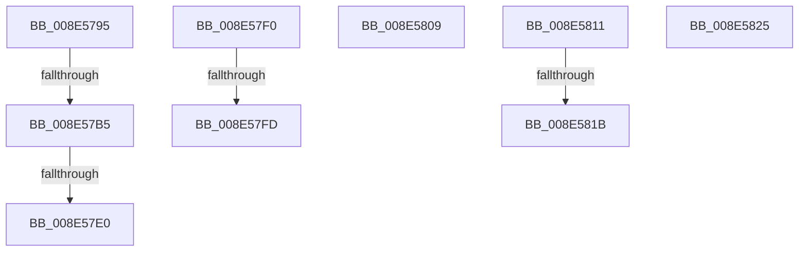

# sub_008E5795

- RVA: `0x008E5795`–`0x008E582F` (길이 `154` bytes)
- VA: `0x00000001408E5795`
- 실행 섹션: `PAGE`
- PDB 이름 있음: `아니요`; PDB Function 태그: `아니요`
- unwind 정보 RVA: `0x00086660`
- 디코드: `35`개 명령, `154/154` bytes 표시
- 미해석 바이트: `0` (있으면 어셈블리에 `.byte`로 보존)

> 이 문서는 커널 이미지의 기계어와 PDB 기호를 분석해 생성했습니다. 4번과 5번은 함수 원형과 자료형을 바이너리 사용 방식에서 추정한 C 해석이며 원본 소스 복구 결과는 아닙니다.

## 1. Dependencies

- 직접 호출 지점: **4**; 고유 호출 대상: **3**
- 직접 호출자로 확인된 함수: **0**
- RIP 상대 이미지 참조: **0**

### Outgoing calls
- `0x008E57A3` → [ExAllocatePool2](../../poolcode/B8/ExAllocatePool2_function_00B820F0.md) (function, `0x00B820F0`)
- `0x008E57D1` → [PiControlCopyUserModeCallersBuffer](PiControlCopyUserModeCallersBuffer_function_008E4720.md) (function, `0x008E4720`)
- `0x008E57E6` → [ExFreePoolWithTag](../../poolcode/B8/ExFreePoolWithTag_function_00B82870.md) (function, `0x00B82870`)
- `0x008E57FF` → [ExFreePoolWithTag](../../poolcode/B8/ExFreePoolWithTag_function_00B82870.md) (function, `0x00B82870`)

### Direct callers
- 이 함수 시작 RVA로 연결되는 직접 call은 확인되지 않았습니다. 간접 호출은 완전히 역산할 수 없습니다.

### Static image references
- 디코드된 RIP-relative 메모리 참조가 없습니다.

## 2. Other-region calls and transfers

- 다른 실행 섹션으로 향하는 call: **3**
  - `0x008E57A3` → [ExAllocatePool2](../../poolcode/B8/ExAllocatePool2_function_00B820F0.md) (`PAGE` → `POOLCODE`)
  - `0x008E57E6` → [ExFreePoolWithTag](../../poolcode/B8/ExFreePoolWithTag_function_00B82870.md) (`PAGE` → `POOLCODE`)
  - `0x008E57FF` → [ExFreePoolWithTag](../../poolcode/B8/ExFreePoolWithTag_function_00B82870.md) (`PAGE` → `POOLCODE`)
- call이 아닌 외부 분기/꼬리 이동: **9**
  - `0x008E57AF` → [sub_008E5839 + 0xA](Unknown_function_008E5839.md) (`tail-transfer`)
  - `0x008E57DA` → [sub_008E5659 + 0x1B](Unknown_function_008E5659.md) (`tail-transfer`)
  - `0x008E57EB` → [sub_008E5659 + 0x110](Unknown_function_008E5659.md) (`tail-transfer`)
  - `0x008E57F7` → [sub_008E5659 + 0x9D](Unknown_function_008E5659.md) (`tail-transfer`)
  - `0x008E5804` → [sub_008E5659 + 0x9D](Unknown_function_008E5659.md) (`tail-transfer`)
  - `0x008E580C` → [sub_008E5659 + 0x88](Unknown_function_008E5659.md) (`tail-transfer`)
  - `0x008E5815` → [sub_008E5659 + 0xC7](Unknown_function_008E5659.md) (`tail-transfer`)
  - `0x008E5820` → [sub_008E5659 + 0xFB](Unknown_function_008E5659.md) (`tail-transfer`)
  - `0x008E582A` → [sub_008E5659 + 0xFB](Unknown_function_008E5659.md) (`tail-transfer`)

## 3. Assembly (complete function range)

```asm
008E5795  48 8B D7                        mov rdx, rdi
008E5798  B9 01 01 00 00                  mov ecx, 0x101
008E579D  41 B8 50 70 20 20               mov r8d, 0x20207050
008E57A3  E8 48 C9 29 00                  call 0x140b820f0
008E57A8  48 89 45 F7                     mov qword ptr [rbp - 9], rax
008E57AC  48 85 C0                        test rax, rax
008E57AF  0F 84 8E 00 00 00               je 0x1408e5843
008E57B5  C7 44 24 28 01 00 00 00         mov dword ptr [rsp + 0x28], 1
008E57BD  41 B9 02 00 00 00               mov r9d, 2
008E57C3  44 8B C7                        mov r8d, edi
008E57C6  44 88 74 24 20                  mov byte ptr [rsp + 0x20], r14b
008E57CB  48 8B D3                        mov rdx, rbx
008E57CE  48 8B C8                        mov rcx, rax
008E57D1  E8 4A EF FF FF                  call 0x1408e4720
008E57D6  8B F8                           mov edi, eax
008E57D8  85 C0                           test eax, eax
008E57DA  0F 89 94 FE FF FF               jns 0x1408e5674
008E57E0  48 8B 4D F7                     mov rcx, qword ptr [rbp - 9]
008E57E4  33 D2                           xor edx, edx
008E57E6  E8 85 D0 29 00                  call 0x140b82870
008E57EB  E9 79 FF FF FF                  jmp 0x1408e5769
008E57F0  48 8B 4D F7                     mov rcx, qword ptr [rbp - 9]
008E57F4  48 85 C9                        test rcx, rcx
008E57F7  0F 84 F9 FE FF FF               je 0x1408e56f6
008E57FD  33 D2                           xor edx, edx
008E57FF  E8 6C D0 29 00                  call 0x140b82870
008E5804  E9 ED FE FF FF                  jmp 0x1408e56f6
008E5809  49 8B DD                        mov rbx, r13
008E580C  E9 D0 FE FF FF                  jmp 0x1408e56e1
008E5811  44 39 6E 10                     cmp dword ptr [rsi + 0x10], r13d
008E5815  0F 84 05 FF FF FF               je 0x1408e5720
008E581B  BF 22 00 00 C0                  mov edi, 0xc0000022
008E5820  E9 2F FF FF FF                  jmp 0x1408e5754
008E5825  BF 0E 00 00 C0                  mov edi, 0xc000000e
008E582A  E9 25 FF FF FF                  jmp 0x1408e5754
```

## 4. C-style interpretation (structured pseudocode)

```c
__int64 __fastcall sub_008E5795(void)
{
    __int64 result;
    unsigned __int8 v_stack_p20;
    unsigned int v_stack_p28;

    result = ExAllocatePool2(257, v_rdi, (unsigned int)(0x20207050ULL), a4);
    *(unsigned __int64 *)(v_rbp - 9) = result;
    v_stack_p28 = 1;
    v_stack_p20 = (unsigned __int8)(v_r14);
    result = PiControlCopyUserModeCallersBuffer(result, v_rbx, (unsigned int)((unsigned int)(v_rdi)), 2);
    a2 = 0;
    result = ExFreePoolWithTag(*(unsigned __int64 *)(v_rbp - 9), a2, (unsigned int)((unsigned int)(v_rdi)), 2);
}
```

## 5. (Beta) C Style

```c
void sub_008E5795(void)
{
    int64_t result;
    uint8_t v_stack_p20;
    uint32_t v_stack_p28;

    result = ExAllocatePool2(257, local_rdi, (uint32_t)(0x20207050ULL), a4);
    *(uint64_t *)(local_rbp - 0x9) = result;
    v_stack_p28 = 1;
    v_stack_p20 = (uint8_t)(local_r14);
    result = PiControlCopyUserModeCallersBuffer(result, local_rbx, (uint32_t)((uint32_t)(local_rdi)), 2);
    a2 = 0;
    result = ExFreePoolWithTag(*(uint64_t *)(local_rbp - 0x9), a2, (uint32_t)((uint32_t)(local_rdi)), 2);
}
```

## 6. Execution-region graph

[열기: 2D/3D 그래프와 함수 탐색 컨트롤 패널](../../../control-panel.html?section=page&rva=0x008E5795&view=graph)

- 2D 그래프는 위에서 아래로 흐르고, 3D 그래프는 빈 공간을 드래그해 회전합니다. Shift+드래그는 이동, 휠은 확대·축소, 함수 노드 선택은 대상 보고서 이동입니다.

### Static fallback


