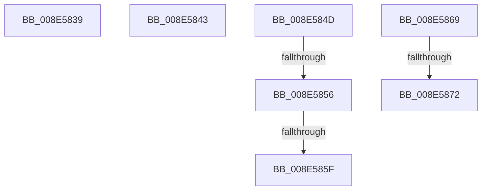

# sub_008E5839

- RVA: `0x008E5839`–`0x008E587F` (길이 `70` bytes)
- VA: `0x00000001408E5839`
- 실행 섹션: `PAGE`
- PDB 이름 있음: `아니요`; PDB Function 태그: `아니요`
- unwind 정보 RVA: `0x00086688`
- 디코드: `15`개 명령, `70/70` bytes 표시
- 미해석 바이트: `0` (있으면 어셈블리에 `.byte`로 보존)

> 이 문서는 커널 이미지의 기계어와 PDB 기호를 분석해 생성했습니다. 4번과 5번은 함수 원형과 자료형을 바이너리 사용 방식에서 추정한 C 해석이며 원본 소스 복구 결과는 아닙니다.

## 1. Dependencies

- 직접 호출 지점: **0**; 고유 호출 대상: **0**
- 직접 호출자로 확인된 함수: **0**
- RIP 상대 이미지 참조: **0**

### Outgoing calls
- 직접 디코드된 call 명령이 없습니다.

### Direct callers
- 이 함수 시작 RVA로 연결되는 직접 call은 확인되지 않았습니다. 간접 호출은 완전히 역산할 수 없습니다.

### Static image references
- 디코드된 RIP-relative 메모리 참조가 없습니다.

## 2. Other-region calls and transfers

- 다른 실행 섹션으로 향하는 call: **0**
- call이 아닌 외부 분기/꼬리 이동: **7**
  - `0x008E583E` → [sub_008E5659 + 0x110](Unknown_function_008E5659.md) (`tail-transfer`)
  - `0x008E5848` → [sub_008E5659 + 0x110](Unknown_function_008E5659.md) (`tail-transfer`)
  - `0x008E5850` → [sub_00B1D2FE + 0xAE](../B1/Unknown_function_00B1D2FE.md) (`tail-transfer`)
  - `0x008E5859` → [sub_00B1D2FE](../B1/Unknown_function_00B1D2FE.md) (`tail-transfer`)
  - `0x008E5864` → [sub_008E5659 + 0xFB](Unknown_function_008E5659.md) (`tail-transfer`)
  - `0x008E586C` → [sub_008E5659 + 0x110](Unknown_function_008E5659.md) (`tail-transfer`)
  - `0x008E587A` → [sub_008E5795 + 0x51](Unknown_function_008E5795.md) (`tail-transfer`)

## 3. Assembly (complete function range)

```asm
008E5839  BF 0E 00 00 C0                  mov edi, 0xc000000e
008E583E  E9 26 FF FF FF                  jmp 0x1408e5769
008E5843  BF 9A 00 00 C0                  mov edi, 0xc000009a
008E5848  E9 1C FF FF FF                  jmp 0x1408e5769
008E584D  83 E8 01                        sub eax, 1
008E5850  0F 84 56 7B 23 00               je 0x140b1d3ac
008E5856  83 F8 01                        cmp eax, 1
008E5859  0F 84 9F 7A 23 00               je 0x140b1d2fe
008E585F  BF 10 00 00 C0                  mov edi, 0xc0000010
008E5864  E9 EB FE FF FF                  jmp 0x1408e5754
008E5869  4D 85 E4                        test r12, r12
008E586C  0F 84 F7 FE FF FF               je 0x1408e5769
008E5872  BA 50 6E 70 55                  mov edx, 0x55706e50
008E5877  49 8B CC                        mov rcx, r12
008E587A  E9 67 FF FF FF                  jmp 0x1408e57e6
```

## 4. C-style interpretation (structured pseudocode)

```c
__int64 __fastcall sub_008E5839(void)
{
}
```

## 5. (Beta) C Style

```c
void sub_008E5839(void)
{
}
```

## 6. Execution-region graph

[열기: 2D/3D 그래프와 함수 탐색 컨트롤 패널](../../../control-panel.html?section=page&rva=0x008E5839&view=graph)

- 2D 그래프는 위에서 아래로 흐르고, 3D 그래프는 빈 공간을 드래그해 회전합니다. Shift+드래그는 이동, 휠은 확대·축소, 함수 노드 선택은 대상 보고서 이동입니다.

### Static fallback


